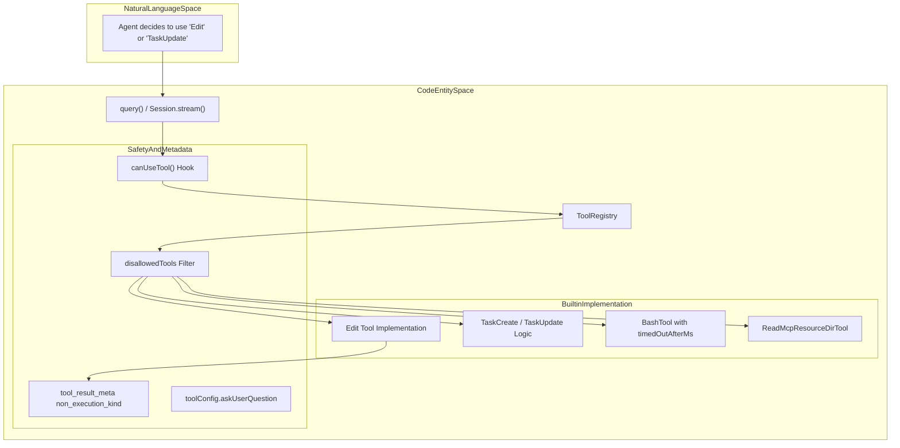
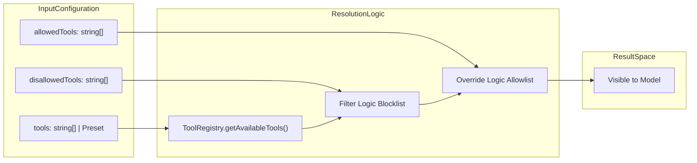

<!-- source: DeepWiki mcp.deepwiki.com · repo anthropics/claude-agent-sdk-typescript · extra page Built-in Tools · fetched 2026-10-26 -->

# Built-in Tools

<details>
<summary>Relevant source files</summary>

The following files were used as context for generating this wiki page:

- [CHANGELOG.md](CHANGELOG.md)

</details>


This document describes the built-in tools provided by the Claude Agent SDK, their implementation details, and the configuration options that govern their availability and behavior. Built-in tools are native capabilities implemented within the SDK that enable agents to interact with the local environment, manage files, and coordinate tasks.

---

## Overview of Built-in Tools

Built-in tools are core capabilities that ship directly with the SDK. Unlike MCP tools, which require an external server, built-in tools are executed by the SDK's internal tool engine.

| Tool Name | Purpose | Key Feature |
|-----------|---------|-------------|
| `Bash` | Execute shell commands | Real-time command execution; supports auto-backgrounding with `timedOutAfterMs` [CHANGELOG.md:66-67](). |
| `Read` | Read file contents | Populates context with file data and tracks modification state. |
| `Edit` | Modify file contents | Supports precise manipulations with `seed_read_state` safety. |
| `NotebookEdit` | Modify notebook cells | Includes `old_source` field for inline diff generation [CHANGELOG.md:154-155](). |
| `AskUserQuestion` | Request user input | Enables interactive loops with configurable `previewFormat`. |
| `TaskCreate` | Create a new task | Modern task tracking tool replacing legacy `TodoWrite` [CHANGELOG.md:131-133](). |
| `TaskGet` | Retrieve task details | Provides structured access to task status and metadata. |
| `TaskUpdate` | Update task state | Allows agents to mark tasks as complete or modify descriptions. |
| `TaskList` | List all tasks | Enables oversight of the current task queue. |
| `ReadMcpResourceDir` | List MCP resources | Specialized tool for listing directory contents of MCP resources [CHANGELOG.md:164-165](). |

Sources: [CHANGELOG.md:66-67](), [CHANGELOG.md:131-133](), [CHANGELOG.md:154-155](), [CHANGELOG.md:164-165]()

---

## Detailed Tool Implementation

### Bash Tool
The `Bash` tool provides a bridge to the host operating system's shell. 
- **Embedded Search:** Native builds utilize fast embedded `find` and `grep` implementations within the `Bash` tool itself rather than registering separate `Grep` or `Glob` tools [CHANGELOG.md:213-214]().
- **Timeout & Backgrounding:** `BashToolOutput` includes a `timedOutAfterMs` field set when a command exceeds its execution threshold, automatically moving it to the background [CHANGELOG.md:66-67]().
- **Data Flow:** The agent sends a command string; the SDK executes it via a sub-process and returns `stdout`, `stderr`, and the exit code.

### Read and Edit State
The `Read` tool allows the agent to ingest file content, while `Edit` is used for rewriting or patching.
- **The Eviction Problem:** In long conversations, the original `Read` result might be evicted from the context window to save tokens.
- **The Solution:** The SDK uses a `seed_read_state` mechanism to persist `{path, mtime}` metadata even if the originating `Read` tool result is no longer in the active context, ensuring `Edit` remains functional by verifying the file hasn't changed since it was last "seen".
- **Notebooks:** The `NotebookEdit` tool includes an `old_source` field to facilitate the generation of inline diffs by comparing the new state against previous content [CHANGELOG.md:154-155]().

### AskUserQuestion Tool
This tool enables human-in-the-loop interactions.
- **Preview Formatting:** Using `toolConfig.askUserQuestion.previewFormat`, developers can set the format to `'markdown'` or `'html'`. This affects the `preview` field and `annotations` output exposed in the public SDK types.

### Task Management Tools
The SDK utilizes Task tools (`TaskCreate`, `TaskGet`, `TaskUpdate`, `TaskList`) for structured progress tracking. 
- **Model-Dependent Defaults:** Task-tracking tools are enabled by default only on Claude 3.x, Opus 4.0–4.7, Sonnet 4.0–4.6, and Haiku 4.5 models; for other models, they must be explicitly listed in `tools` or `allowedTools` [CHANGELOG.md:87-87]().
- **Types:** Input and Output types for these tools are exported from `@anthropic-ai/claude-agent-sdk/sdk-tools` [CHANGELOG.md:139-141]().
- **Agent Integration:** When a subagent completes a task, the result is communicated via the `AgentToolCompletedOutput` type [CHANGELOG.md:84-86]().

Sources: [CHANGELOG.md:66-67](), [CHANGELOG.md:84-86](), [CHANGELOG.md:87-87](), [CHANGELOG.md:131-133](), [CHANGELOG.md:139-141](), [CHANGELOG.md:154-155](), [CHANGELOG.md:213-214]()

---

## Tool System Architecture

The following diagram illustrates the flow from a tool request in Natural Language Space to the execution of code entities within the SDK.



**Diagram: Tool Execution Data Flow**
This diagram maps the transition from an agent's intent to the SDK's internal validation and execution logic, including the `tool_result_meta` sidecar for classifying denied or cancelled tool calls.

Sources: [CHANGELOG.md:30-32](), [CHANGELOG.md:66-67](), [CHANGELOG.md:131-133](), [CHANGELOG.md:164-165]()

---

## Configuration and Filtering

The availability of built-in tools is governed by the `tools`, `allowedTools`, and `disallowedTools` options.

### The `tools` Option
This option supports three modes:
1.  **Allowlist (Array):** `['Bash', 'Read', 'TaskCreate']` — Only these tools are available.
2.  **Preset:** `{ type: 'preset', preset: 'claude_code' }` — Enables the standard suite of tools.
3.  **Empty:** `[]` — Disables all built-in tools.

### The `allowedTools` and Search Tools
Dedicated `Grep` and `Glob` search tools are omitted by default on native builds to favor embedded search in `Bash`. To keep dedicated search tools, they must be explicitly referenced in `allowedTools` [CHANGELOG.md:213-214]().

### The `disallowedTools` Option
Acts as a blocklist targeting specific tools or entire MCP servers (e.g., `mcp__server_name` or `mcp__server_name__*`) [CHANGELOG.md:185-187]().



**Diagram: Tool Resolution Logic**
Visualizing how the SDK determines the final toolset sent to the model by intersecting `tools`, `allowedTools`, and `disallowedTools`.

Sources: [CHANGELOG.md:185-187](), [CHANGELOG.md:213-214]()

---

## Advanced Tool Configuration

### `toolConfig.askUserQuestion.previewFormat`
Allows customization of how questions are rendered for the user.
```typescript
const result = await query("...", {
  toolConfig: {
    askUserQuestion: {
      previewFormat: 'markdown' // 'markdown' | 'html'
    }
  }
});
```

### Exported Types
The SDK exports specific types for handling tool outputs and inputs:
- **`AgentToolCompletedOutput`**: The structured result emitted when an agent tool finishes its task [CHANGELOG.md:84-86]().
- **Task Tool Types**: `TaskCreateInput`, `TaskGetInput`, `TaskUpdateInput`, `TaskListInput` and their corresponding outputs [CHANGELOG.md:139-141]().

Sources: [CHANGELOG.md:84-86](), [CHANGELOG.md:139-141]()

---

