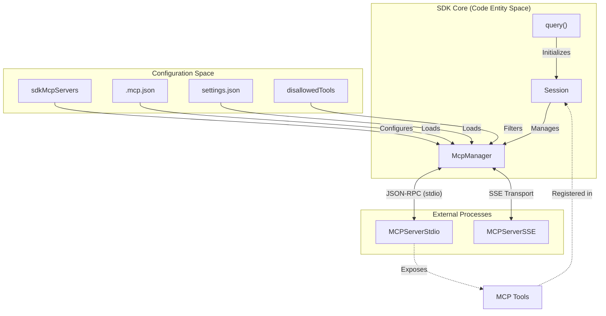
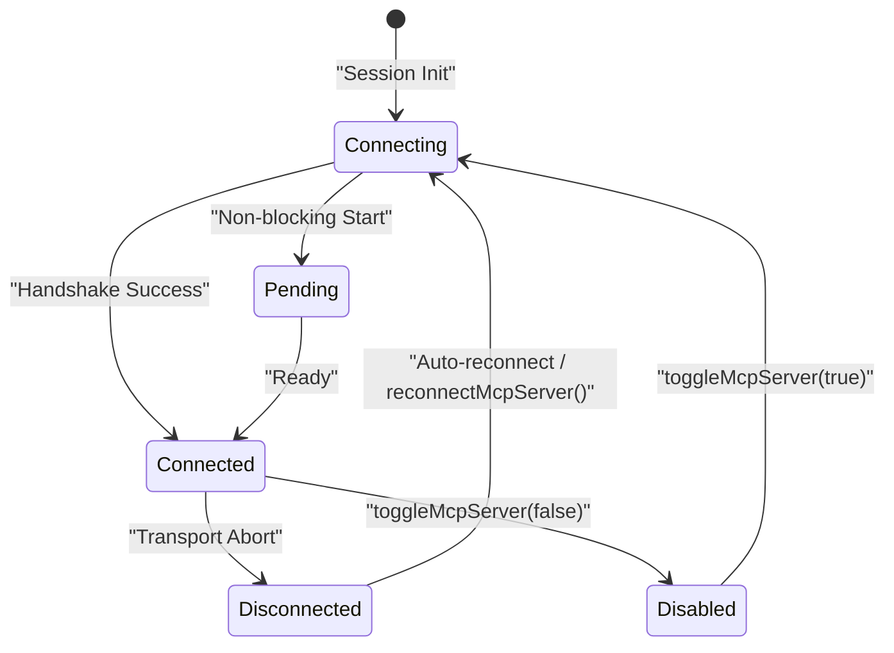
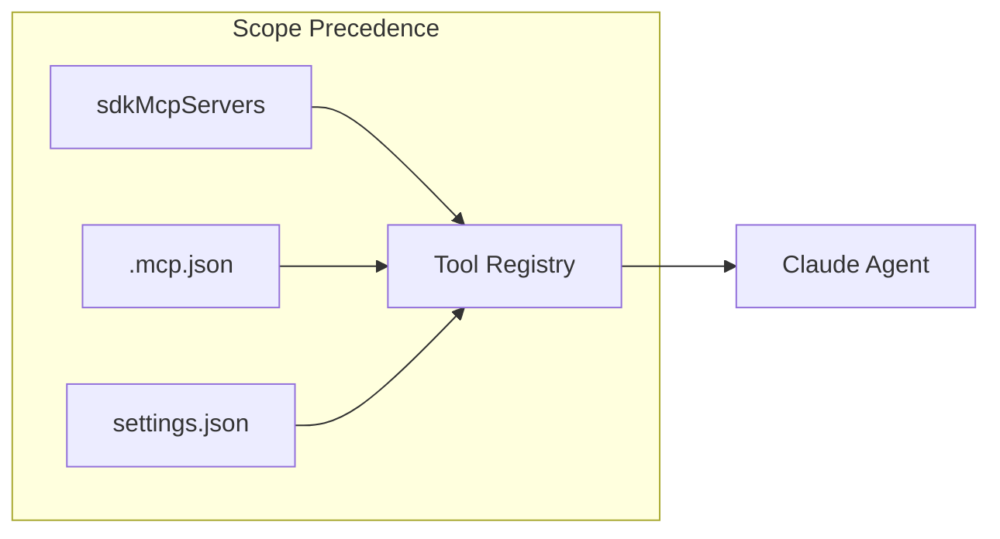

<!-- source: DeepWiki mcp.deepwiki.com · repo anthropics/claude-agent-sdk-typescript · extra page MCP Server Integration · fetched 2026-10-26 -->

# MCP Server Integration

Relevant source files

The following files were used as context for generating this wiki page:

- [CHANGELOG.md](CHANGELOG.md)

This document details how the Claude Agent SDK integrates with Model Context Protocol (MCP) servers to expose external tools, resources, and prompts to agents. MCP servers run as standalone processes communicating via stdio, HTTP/SSE, or proxied transports.

For information on built-in tools (Bash, Read, Edit, AskUserQuestion), see [Built-in Tools](3.5.1). For broader tool system architecture including tool selection and registries, see [Tool System](3.5).

---

## MCP Server Overview and Architecture

MCP servers extend agent capabilities by providing dynamic tools. The SDK's internal MCP Manager handles process lifecycles, health monitoring, reconnection, and configuration scoping.

The following diagram bridges the configuration space to the SDK's internal code entities and runtime execution:

**Sources**: [CHANGELOG.md:125-126](), [CHANGELOG.md:140-141](), [CHANGELOG.md:33-38]()

---

## Server Management APIs and Startup Behavior

### Non-Blocking Connection Default and Startup Timing

By default, MCP servers connect asynchronously in the background to avoid blocking the initial agent query [CHANGELOG.md:90-91](). 
* **Non-Blocking Default**: Sessions start immediately. Slow or connecting servers report `status: "pending"` during the initial handshake [CHANGELOG.md:90-91]().
* **Deferred Tool Search**: Servers loaded from settings files or plugins defer tool search, avoiding startup delays, while servers defined in `options.mcpServers` are prioritized [CHANGELOG.md:38-38]().
* **Startup Bounds**: You can pass `CLAUDE_CODE_MCP_STARTUP_WAIT_MS` via `env` to bound or completely disable (`0`) the first-turn wait for connecting MCP servers [CHANGELOG.md:34-34](). Setting `MCP_CONNECTION_NONBLOCKING=0` restores the legacy synchronous connection behavior [CHANGELOG.md:91-91]().

### `mcpServerStatus()`

The SDK provides status inspection for all configured servers, returning records indicating their connection state, source, and available tools:

| Return Field | Type | Description |
|--------------|------|-------------|
| `name` | `string` | Server identifier |
| `status` | `string` | `'connected'`, `'pending'`, `'disconnected'`, `'disabled'`, `'error'` |
| `config` | `object` | Server process configuration (command, args, env) |
| `scope` | `string` | Configuration source (`'sdk'`, `'project'`, `'user'`) |
| `source` | `string` | Source identifier (e.g., `'sdk'`) enabling hosts to key trust [CHANGELOG.md:33-34]() |
| `tools` | `string[]` | Tool names exposed by the server |

**Sources**: [CHANGELOG.md:33-34](), [CHANGELOG.md:38-38](), [CHANGELOG.md:90-91]()

### Lifecycle State Machine

**Sources**: [CHANGELOG.md:38-39](), [CHANGELOG.md:90-91](), [CHANGELOG.md:100-101]()

---

## Permissions and Tool Integration

### `canUseTool` and Security Policies

When an MCP tool is invoked, permission checks route through the `canUseTool` callback. The options object supplies an `mcpServer: {name, source}` property, and tool hook inputs receive `mcp_server`, allowing host applications to key trust policies based on whether a server originates from the SDK (`source === "sdk"`) or user configuration [CHANGELOG.md:33-34]().

### Tool Disallowance (`disallowedTools`)

The `disallowedTools` configuration supports server-level wildcard specs using the `mcp__server` or `mcp__server__*` format. This completely excludes tools originating from specified MCP servers from being registered or exposed to the agent [CHANGELOG.md:128-129]().

### Request Timeouts

* **Per-Server Timeouts**: The `mcp_set_servers` control request accepts a `request_timeout_ms` parameter to configure individual timeout thresholds per server [CHANGELOG.md:108-109]().
* **Global Timeout**: The `MCP_TOOL_TIMEOUT` environment variable enforces a ceiling on all MCP tool executions [CHANGELOG.md:79-79]().

**Sources**: [CHANGELOG.md:33-34](), [CHANGELOG.md:79-79](), [CHANGELOG.md:128-129]()

---

## MCP Elicitation and Annotations

### Elicitation Hooks

MCP servers can request supplemental user input or host configuration at runtime using elicitation. When triggered, the SDK handles `McpElicitation` events and emits an `SDKElicitationCompleteMessage` back into the control stream once input is collected.

### Tool Metadata Annotations

MCP tool definitions can declare semantic hints that modify execution and safety handling:
* `readOnlyHint`: Marks read-only actions (skipping destructive prompts).
* `destructiveHint`: Marks irreversible data mutations.
* `openWorldHint`: Designates interactions with external web APIs.

**Sources**: [CHANGELOG.md:141-142]()

---

## Configuration Scoping

MCP servers resolve across three precedence tiers:
1. **SDK Scope**: Programmatically supplied via `options.sdkMcpServers`.
2. **Project Scope**: Defined in project-level `.mcp.json` or `.claude/settings.json`.
3. **User Scope**: Global user settings directories.

**Sources**: [CHANGELOG.md:125-126](), [CHANGELOG.md:141-142]()

---

