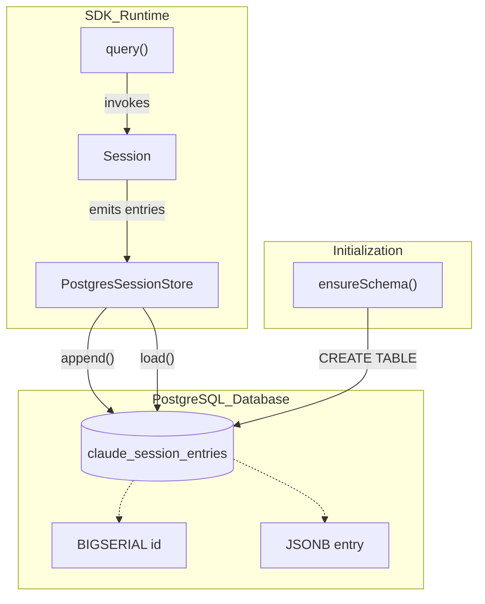
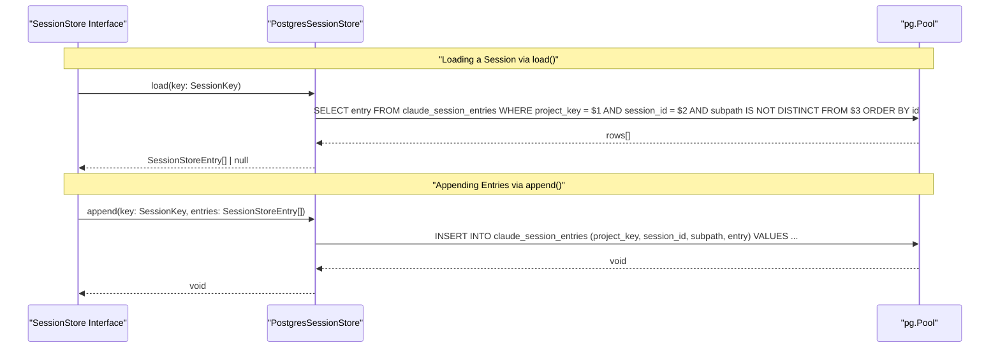

<!-- source: DeepWiki mcp.deepwiki.com · repo anthropics/claude-agent-sdk-typescript · extra page PostgreSQL Session Store · fetched 2026-10-26 -->

# PostgreSQL Session Store

<details>
<summary>Relevant source files</summary>

The following files were used as context for generating this wiki page:

- [examples/session-stores/postgres/demo.ts](examples/session-stores/postgres/demo.ts)
- [examples/session-stores/postgres/package.json](examples/session-stores/postgres/package.json)
- [examples/session-stores/postgres/src/PostgresSessionStore.ts](examples/session-stores/postgres/src/PostgresSessionStore.ts)
- [examples/session-stores/postgres/src/index.ts](examples/session-stores/postgres/src/index.ts)
- [examples/session-stores/postgres/test/PostgresSessionStore.test.ts](examples/session-stores/postgres/test/PostgresSessionStore.test.ts)
- [examples/session-stores/postgres/tsconfig.json](examples/session-stores/postgres/tsconfig.json)

</details>


The `PostgresSessionStore` is a reference implementation of the `SessionStore` interface, designed to mirror session transcripts to a PostgreSQL database using the `pg` client [examples/session-stores/postgres/src/PostgresSessionStore.ts:19-19](). It provides a persistent, queryable SQL backend for session history, suitable for environments where relational data integrity and standard SQL tooling are preferred.

Sources: [examples/session-stores/postgres/src/PostgresSessionStore.ts:19-19]()

## Architecture and Data Flow

The store maps the hierarchical session structure (`Project` > `Session` > `Subagent`) into a flat relational table where each `SessionStoreEntry` is stored as a single row [examples/session-stores/postgres/src/PostgresSessionStore.ts:16-16]().

### Data Entity Mapping

| SDK Concept | Postgres Implementation | SQL Column |
| :--- | :--- | :--- |
| **Ordering** | `BIGSERIAL` primary key | `id` |
| **Project** | `projectKey` string | `project_key` |
| **Session** | `sessionId` string | `session_id` |
| **Subagent** | `subpath` (optional string) | `subpath` |
| **Content** | `SessionStoreEntry` object | `entry` (JSONB) |
| **Timestamp** | Wall clock time | `created_at` |

Sources: [examples/session-stores/postgres/src/PostgresSessionStore.ts:34-43]()

### System Component Diagram

This diagram illustrates how `PostgresSessionStore` bridges the SDK's session management with the physical PostgreSQL database using concrete class and method identifiers.

**PostgreSQL Persistence Flow**

Sources: [examples/session-stores/postgres/src/PostgresSessionStore.ts:19-50](), [examples/session-stores/postgres/demo.ts:25-32]()

## Implementation Details

### Schema Management
The store includes an idempotent `ensureSchema()` method that creates the necessary table and a composite covering index [examples/session-stores/postgres/src/PostgresSessionStore.ts:33-48]().

*   **Table**: Defaults to `claude_session_entries` and validates table names using regex to prevent SQL injection [examples/session-stores/postgres/src/PostgresSessionStore.ts:25-29]().
*   **Indexing**: A composite index `${this.table}_key_idx` is created on `(project_key, session_id, subpath, id)` to optimize for the `load()` operation, which requires strict ordering by the auto-incrementing `id` [examples/session-stores/postgres/src/PostgresSessionStore.ts:44-47]().

### The JSONB Column
The `entry` column uses the `JSONB` data type [examples/session-stores/postgres/src/PostgresSessionStore.ts:40-40](). 
*   **Key Ordering**: PostgreSQL's `JSONB` does not preserve the original key ordering of input objects, but this is fully compatible with the Claude Agent SDK since entries are processed via structural lookup rather than byte-level comparisons [examples/session-stores/postgres/src/PostgresSessionStore.ts:40-40]().

### Query Logic
The implementation uses the `IS NOT DISTINCT FROM` operator when querying the `subpath` column [examples/session-stores/postgres/src/PostgresSessionStore.ts:73-73](). This is critical because the main session transcript has a `NULL` subpath, and standard SQL equality (`= NULL`) evaluates to unknown, whereas `IS NOT DISTINCT FROM` correctly matches `NULL`-to-`NULL` [examples/session-stores/postgres/src/PostgresSessionStore.ts:70-73]().

**SQL to Code Mapping**

Sources: [examples/session-stores/postgres/src/PostgresSessionStore.ts:50-78]()

## Configuration

The store is initialized with a `pg.Pool` instance via `PostgresSessionStoreOptions`, allowing the consumer to manage connection pooling, TLS settings, and authentication externally [examples/session-stores/postgres/src/PostgresSessionStore.ts:8-13]().

```typescript
import { Pool } from 'pg'
import { PostgresSessionStore } from './PostgresSessionStore.ts'

const pool = new Pool({ connectionString: process.env.DATABASE_URL })
const store = new PostgresSessionStore({ 
  pool,
  tableName: 'my_custom_session_table' // Optional
})

// Ensure table exists before use
await store.ensureSchema()
```
Sources: [examples/session-stores/postgres/src/PostgresSessionStore.ts:23-30](), [examples/session-stores/postgres/demo.ts:23-25]()

## Production Checklist

Before deploying the PostgreSQL adapter in a production environment, consider the following technical constraints:

1.  **Connection Sizing**: Size the `pg.Pool` appropriately for expected concurrent active sessions. Avoid sharing long-lived query pools across unrelated services [examples/session-stores/postgres/src/PostgresSessionStore.ts:8-13]().
2.  **Table Growth & Retention**: The `claude_session_entries` table grows unbounded with session length. Implement a periodic background retention query (e.g., deleting records older than a retention threshold based on `created_at`) [examples/session-stores/postgres/src/PostgresSessionStore.ts:41-41]().
3.  **Identifier Validation**: The constructor validates `tableName` against the regex `/^[A-Za-z_][A-Za-z0-9_]*$/` to prevent SQL injection vulnerabilities when interpolating table names [examples/session-stores/postgres/src/PostgresSessionStore.ts:26-29]().
4.  **Error Handling**: Failures during `append()` operations are propagated back through the SDK session runtime or handled via internal mirror error logging [examples/session-stores/postgres/src/PostgresSessionStore.ts:50-67]().

Sources: [examples/session-stores/postgres/src/PostgresSessionStore.ts:8-41]()

---

