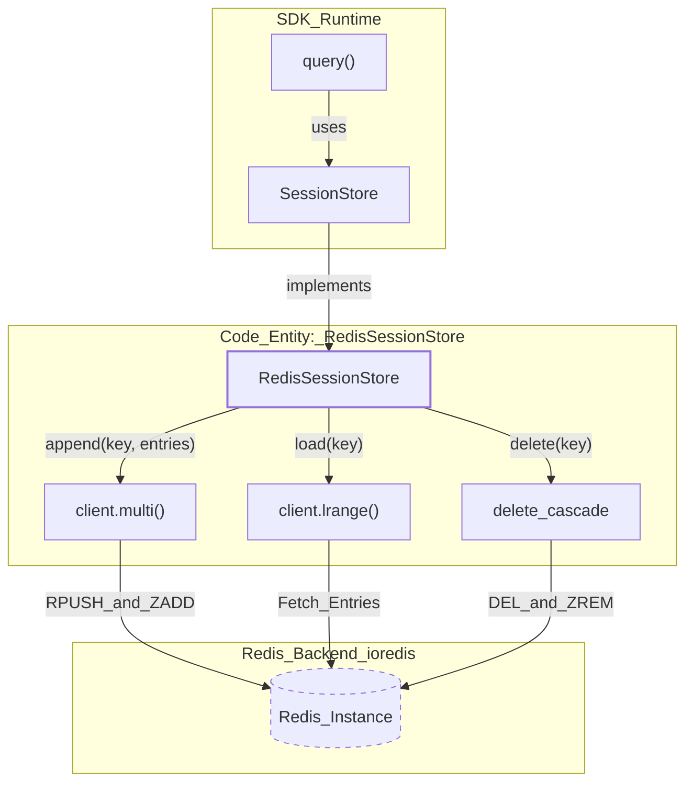
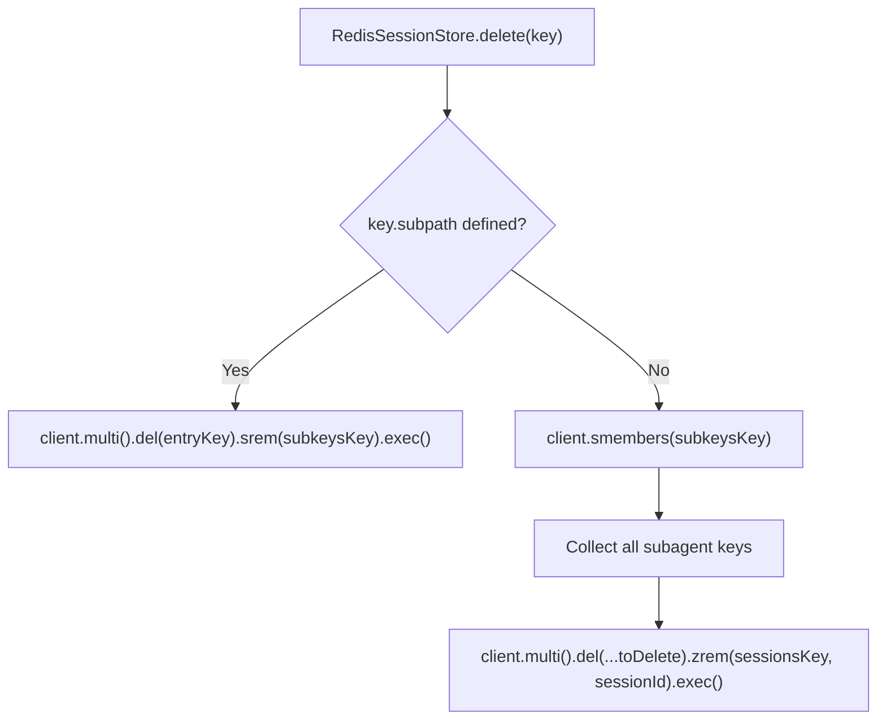

<!-- source: DeepWiki mcp.deepwiki.com · repo anthropics/claude-agent-sdk-typescript · extra page Redis Session Store · fetched 2026-10-26 -->

# Redis Session Store

<details>
<summary>Relevant source files</summary>

The following files were used as context for generating this wiki page:

- [examples/session-stores/redis/demo.ts](examples/session-stores/redis/demo.ts)
- [examples/session-stores/redis/package.json](examples/session-stores/redis/package.json)
- [examples/session-stores/redis/src/RedisSessionStore.ts](examples/session-stores/redis/src/RedisSessionStore.ts)
- [examples/session-stores/redis/src/index.ts](examples/session-stores/redis/src/index.ts)
- [examples/session-stores/redis/test/RedisSessionStore.test.ts](examples/session-stores/redis/test/RedisSessionStore.test.ts)
- [examples/session-stores/redis/tsconfig.json](examples/session-stores/redis/tsconfig.json)

</details>


The `RedisSessionStore` is a reference implementation of the `SessionStore` interface [examples/session-stores/redis/src/RedisSessionStore.ts:36-36](), designed to mirror session transcripts to a Redis backend using the `ioredis` client [examples/session-stores/redis/src/RedisSessionStore.ts:1-1](). It provides a scalable, low-latency alternative to the default `InMemorySessionStore` for applications requiring persistence across process restarts or shared access across multiple application instances.

## Implementation Overview

The store manages session data using a combination of Redis Lists, Sets, and Sorted Sets. It ensures atomicity for updates using Redis `MULTI` transaction blocks [examples/session-stores/redis/src/RedisSessionStore.ts:65-75]().

### Data Flow and Key Entities

The following diagram illustrates how the `RedisSessionStore` class interacts with the `ioredis` client to persist session data during execution.

**Redis Session Store Architecture**

Sources: [examples/session-stores/redis/src/RedisSessionStore.ts:36-139](), [examples/session-stores/redis/demo.ts:22-25]()

### Key Scheme

The store uses a structured key scheme to isolate data by `projectKey` and `sessionId`, utilizing a `:` separator [examples/session-stores/redis/src/RedisSessionStore.ts:23-24]().

| Key Pattern | Redis Type | Purpose |
| :--- | :--- | :--- |
| `{prefix}:{projectKey}:{sessionId}` | **List** | Main transcript entries stored as JSON strings [examples/session-stores/redis/src/RedisSessionStore.ts:25-25](). |
| `{prefix}:{projectKey}:{sessionId}:{subpath}` | **List** | Transcript entries for subagents [examples/session-stores/redis/src/RedisSessionStore.ts:26-26](). |
| `{prefix}:{projectKey}:{sessionId}:__subkeys` | **Set** | Index of all subpaths (subagents) associated with a session [examples/session-stores/redis/src/RedisSessionStore.ts:27-27](). |
| `{prefix}:{projectKey}:__sessions` | **Sorted Set** | Project-level index mapping `sessionId` to its last modification time (`mtime`) [examples/session-stores/redis/src/RedisSessionStore.ts:28-28](). |

Sources: [examples/session-stores/redis/src/RedisSessionStore.ts:15-35]()

## Configuration

To use the store, you must provide a pre-configured `ioredis` client instance and optional prefix configuration.

### RedisSessionStoreOptions
The constructor accepts a `RedisSessionStoreOptions` object [examples/session-stores/redis/src/RedisSessionStore.ts:8-13]():
*   `client`: An instance of `Redis` from `ioredis` [examples/session-stores/redis/src/RedisSessionStore.ts:10-10]().
*   `prefix`: (Optional) A string prepended to all keys. Trailing colons are automatically normalized [examples/session-stores/redis/src/RedisSessionStore.ts:43-43]().

### Example Setup
```typescript
import Redis from 'ioredis'
import { query } from '@anthropic-ai/claude-agent-sdk'
import { RedisSessionStore } from './src/RedisSessionStore.ts'

const client = new Redis('redis://localhost:6379/0')
const store = new RedisSessionStore({ client, prefix: 'transcripts' })

for await (const m of query({
  prompt: 'Hello!',
  options: { sessionStore: store },
})) {
  // Process stream
}
```
Sources: [examples/session-stores/redis/demo.ts:12-25](), [examples/session-stores/redis/src/RedisSessionStore.ts:8-44]()

## Core Functions

### append()
Appends one or more `SessionStoreEntry` objects to the transcript list [examples/session-stores/redis/src/RedisSessionStore.ts:63-76]().
*   Uses `RPUSH` via `client.multi()` to add entries to the end of the list [examples/session-stores/redis/src/RedisSessionStore.ts:65-66]().
*   If it is a main transcript (no `subpath`), it updates the session index using `ZADD` with `Date.now()` as the score [examples/session-stores/redis/src/RedisSessionStore.ts:73-73]().
*   If it is a subagent transcript, it adds the `subpath` to the session's `__subkeys` set using `SADD` [examples/session-stores/redis/src/RedisSessionStore.ts:67-68]().

### load()
Retrieves the full transcript for a given `SessionKey` [examples/session-stores/redis/src/RedisSessionStore.ts:78-90]().
*   Uses `LRANGE 0 -1` to fetch all entries [examples/session-stores/redis/src/RedisSessionStore.ts:79-79]().
*   Parses the JSON strings back into objects, safely skipping any malformed entries for robustness [examples/session-stores/redis/src/RedisSessionStore.ts:82-88]().

### listSessions()
Queries the project-level sorted set (`__sessions`) to return an array of session identifiers and their modification timestamps [examples/session-stores/redis/src/RedisSessionStore.ts:92-106]().

### delete()
Performs a cascading or targeted deletion of session data [examples/session-stores/redis/src/RedisSessionStore.ts:108-131]().
*   If a `subpath` is provided, it deletes only that specific subagent list and removes the subpath from the subkeys set [examples/session-stores/redis/src/RedisSessionStore.ts:109-116]().
*   If no `subpath` is provided, it cascades to delete the main transcript, the `__subkeys` set, all associated subagent lists, and the session entry from the project index [examples/session-stores/redis/src/RedisSessionStore.ts:118-131]().

**Delete Logic Flow**

Sources: [examples/session-stores/redis/src/RedisSessionStore.ts:108-131]()

### listSubkeys()
Retrieves all subagent subpaths registered under a session via `SMEMBERS` on the `__subkeys` set [examples/session-stores/redis/src/RedisSessionStore.ts:133-138]().

Sources: [examples/session-stores/redis/src/RedisSessionStore.ts:63-139]()

## Testing and Conformance

The adapter includes a dedicated unit test suite (`RedisSessionStore.test.ts`) that runs against both an in-process mock ioredis client and the shared session store conformance suite (`runSessionStoreConformance`) [examples/session-stores/redis/test/RedisSessionStore.test.ts:1-125]().

```typescript
describe('RedisSessionStore (mock conformance)', () => {
  let n = 0
  runSessionStoreConformance(
    () => new RedisSessionStore({ client: makeMockRedis(), prefix: `t${n++}` }),
  )
})
```
Sources: [examples/session-stores/redis/test/RedisSessionStore.test.ts:120-125]()

## Production Considerations

### MULTI Atomicity and Clusters
*   **Atomicity:** All compound operations (`append` and `delete`) execute inside a `client.multi()` transaction block to guarantee that transcript lists and index structures remain consistent [examples/session-stores/redis/src/RedisSessionStore.ts:65-75]().
*   **Redis Cluster Hash Tags:** When deploying in a Redis Cluster environment, ensure that keys for the same session hash to the same slot by using hash tags (e.g., wrapping the project and session ID portion in `{...}`).

### Retention and Memory
*   **No Auto-Expiry:** The adapter does not automatically set `EXPIRE` on keys [examples/session-stores/redis/src/RedisSessionStore.ts:33-34](); lists grow unbounded unless managed by Redis server-side eviction policies or explicit calls to `delete()`.
*   **Resilience:** Failures in session mirroring are designed not to crash the agent loop, bubbling up as storage errors or handled via SDK mirror monitoring mechanisms.

Sources: [examples/session-stores/redis/src/RedisSessionStore.ts:33-75]()

---

