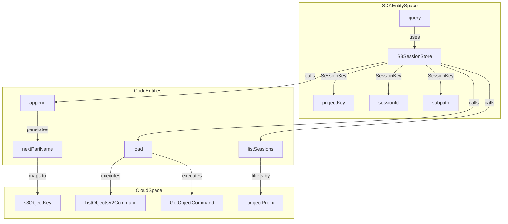
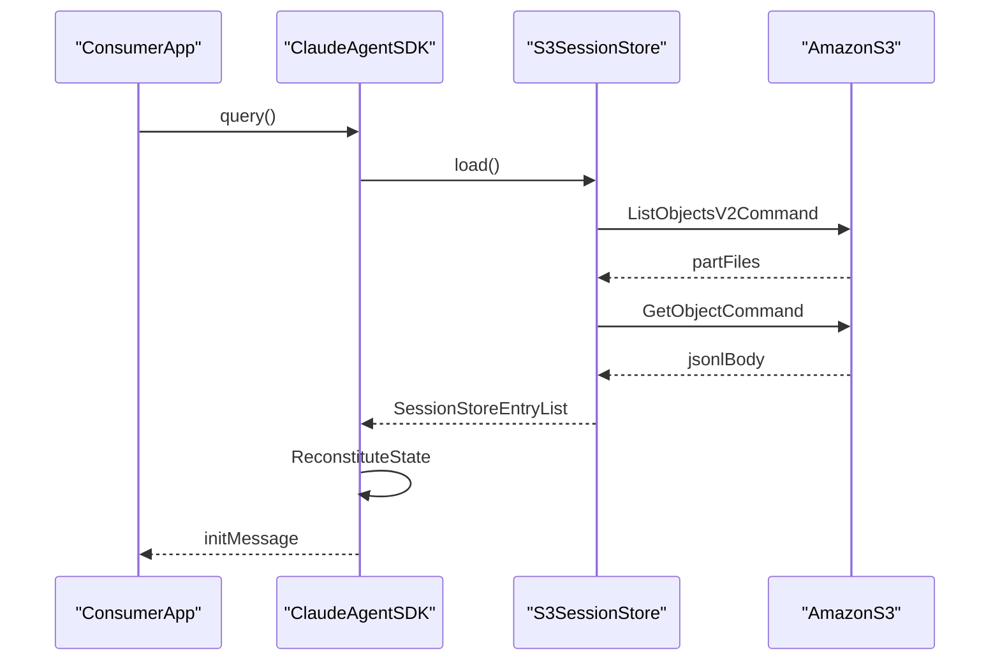

<!-- source: DeepWiki mcp.deepwiki.com · repo anthropics/claude-agent-sdk-typescript · extra page S3 Session Store · fetched 2026-10-26 -->

# S3 Session Store

Relevant source files

The following files were used as context for generating this wiki page:

- [examples/session-stores/s3/demo.ts](examples/session-stores/s3/demo.ts)
- [examples/session-stores/s3/package.json](examples/session-stores/s3/package.json)
- [examples/session-stores/s3/src/S3SessionStore.ts](examples/session-stores/s3/src/S3SessionStore.ts)
- [examples/session-stores/s3/src/index.ts](examples/session-stores/s3/src/index.ts)
- [examples/session-stores/s3/test/S3SessionStore.test.ts](examples/session-stores/s3/test/S3SessionStore.test.ts)
- [examples/session-stores/s3/tsconfig.json](examples/session-stores/s3/tsconfig.json)

The `S3SessionStore` is a reference implementation of the `SessionStore` interface that persists session transcripts as JSONL "part files" in Amazon S3 or S3-compatible APIs like MinIO [examples/session-stores/s3/src/S3SessionStore.ts:33-33](). It is designed to handle high-concurrency session mirroring by writing each `append()` call to a unique, timestamped object key, avoiding write-contention issues common in blob storage.

## Implementation Overview

The store organizes data hierarchically using S3 prefixes to represent `projectKey`, `sessionId`, and optional subagent `subpath` [examples/session-stores/s3/src/S3SessionStore.ts:47-53]().

### Data Flow: Appending Entries
When `append()` is called, the store generates a new object key using a fixed-width 13-digit epoch millisecond timestamp and a 6-character random suffix [examples/session-stores/s3/src/S3SessionStore.ts:64-70](). This ensures that objects sort lexicographically in chronological order. Each `append()` writes a new part; `load()` lists, sorts, and concatenates them.
Sources: [examples/session-stores/s3/src/S3SessionStore.ts:64-87]()

### Data Flow: Loading Sessions
When `load()` is called, the store performs a paginated `ListObjectsV2Command` operation to find all part files for the specific session [examples/session-stores/s3/src/S3SessionStore.ts:98-117](). It then performs bounded-parallel `GetObjectCommand` calls (controlled by `LOAD_CONCURRENCY`, defaulting to 16 concurrent requests) to retrieve and concatenate the JSONL entries [examples/session-stores/s3/src/S3SessionStore.ts:18-18](), [examples/session-stores/s3/src/S3SessionStore.ts:129-158]().
Sources: [examples/session-stores/s3/src/S3SessionStore.ts:89-161]()

### System Entity Mapping
The following diagram illustrates how the `S3SessionStore` class maps SDK session concepts to S3 API entities.

**S3 Session Store Architecture**

Sources: [examples/session-stores/s3/src/S3SessionStore.ts:33-197](), [examples/session-stores/s3/demo.ts:33-40]()

## Configuration

The store is initialized with an `S3SessionStoreOptions` object [examples/session-stores/s3/src/S3SessionStore.ts:20-27]().

| Option | Type | Description |
| :--- | :--- | :--- |
| `bucket` | `string` | The target S3 bucket name [examples/session-stores/s3/src/S3SessionStore.ts:22-22](). |
| `prefix` | `string` | (Optional) A base prefix for all keys. Trailing slashes are normalized [examples/session-stores/s3/src/S3SessionStore.ts:24-24](). |
| `client` | `S3Client` | A pre-configured `@aws-sdk/client-s3` instance [examples/session-stores/s3/src/S3SessionStore.ts:26-26](). |

### Storage Path Format
Objects are stored using the following key pattern:
`s3://{bucket}/{prefix}{projectKey}/{sessionId}/part-{epochMs13}-{rand6}.jsonl`
Sources: [examples/session-stores/s3/src/S3SessionStore.ts:185-185]()

## Key Functions

### `append(key, entries)`
Writes a batch of `SessionStoreEntry` objects to a new S3 object. It uses `application/x-ndjson` as the Content-Type [examples/session-stores/s3/src/S3SessionStore.ts:84-84](). If the `entries` array is empty, the function returns early without making an S3 call [examples/session-stores/s3/test/S3SessionStore.test.ts:94-99]().
Sources: [examples/session-stores/s3/src/S3SessionStore.ts:72-87]()

### `load(key)`
Retrieves the full transcript. It uses a `Delimiter: '/'` in the `ListObjectsV2Command` to ensure it only retrieves part files for the specific session/subagent requested, preventing main-transcript loads from accidentally including subagent entries [examples/session-stores/s3/src/S3SessionStore.ts:93-105]().
Sources: [examples/session-stores/s3/src/S3SessionStore.ts:89-161]()

### `listSessions(projectKey)`
Lists all unique session IDs within a project. It derives the `mtime` (modification time) from the 13-digit timestamp embedded in the filenames rather than the S3 `LastModified` metadata, which ensures consistency even if objects are moved or touched [examples/session-stores/s3/src/S3SessionStore.ts:163-197]().
Sources: [examples/session-stores/s3/src/S3SessionStore.ts:163-197]()

## Production Considerations

### IAM Requirements
The following IAM actions are required on the target bucket and prefix:
* `s3:PutObject`
* `s3:GetObject`
* `s3:ListBucket`
* `s3:DeleteObject` (only if session deletion is used)
Sources: [examples/session-stores/s3/test/S3SessionStore.test.ts:42-48]()

### Clock Skew and Ordering
Because part-file ordering relies on the client-side wall clock, multiple writer instances with significant clock skew (>1s) may result in out-of-order transcripts during `load()`. It is recommended to use NTP or ensure only a single writer instance handles a specific session at any given time.
Sources: [examples/session-stores/s3/src/S3SessionStore.ts:64-70]()

### Performance at Scale
* **Latency**: For sessions exceeding 1,000 part files, `load()` latency grows linearly as it paginates through object listings. Periodic compaction (merging small part files into larger ones) is recommended for long-lived sessions.
* **Retention**: S3 does not automatically delete data. Implement S3 Lifecycle Policies to expire old transcripts according to compliance requirements.
Sources: [examples/session-stores/s3/src/S3SessionStore.ts:98-117]()

### Conformance Testing
The `S3SessionStore` is validated against a behavioral suite to ensure correctness in isolation, ordering, and retrieval [examples/session-stores/s3/test/S3SessionStore.test.ts:57-63](). Developers can run tests using the provided configuration [examples/session-stores/s3/package.json:9-10]().
Sources: [examples/session-stores/s3/test/S3SessionStore.test.ts:57-63]()

**Sequence: Session Resumption with S3**

Sources: [examples/session-stores/s3/src/S3SessionStore.ts:89-161](), [examples/session-stores/s3/demo.ts:35-47]()

---

