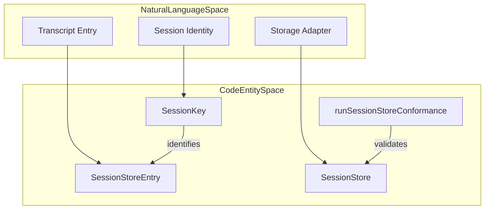
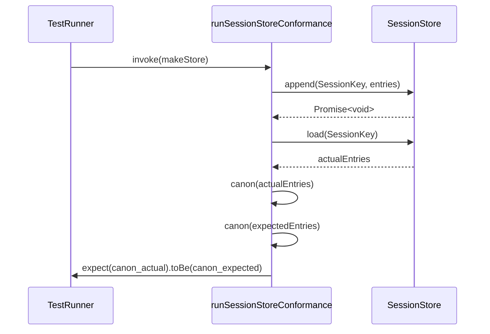

<!-- source: DeepWiki mcp.deepwiki.com · repo anthropics/claude-agent-sdk-typescript · extra page SessionStore Conformance Suite · fetched 2026-10-26 -->

# SessionStore Conformance Suite

<details>
<summary>Relevant source files</summary>

The following files were used as context for generating this wiki page:

- [examples/.gitignore](examples/.gitignore)
- [examples/session-stores/postgres/test/conformance.live.test.ts](examples/session-stores/postgres/test/conformance.live.test.ts)
- [examples/session-stores/redis/test/conformance.live.test.ts](examples/session-stores/redis/test/conformance.live.test.ts)
- [examples/session-stores/s3/test/conformance.live.test.ts](examples/session-stores/s3/test/conformance.live.test.ts)
- [examples/session-stores/shared/conformance.ts](examples/session-stores/shared/conformance.ts)

</details>


The **SessionStore Conformance Suite** is a standardized behavioral test suite consisting of 13 contract checks designed to validate any `SessionStore` implementation. Because the Claude Agent SDK relies on these adapters for critical tasks like transcript mirroring and session resumption, this suite ensures that custom or third-party adapters (e.g., S3, Redis, Postgres) adhere to the required semantics for data isolation, ordering, and retrieval [examples/session-stores/shared/conformance.ts:1-7]().

Sources: [examples/session-stores/shared/conformance.ts:1-7]()

## Overview

The suite is vendored within the SDK examples to allow adapters to be tested standalone without requiring a full SDK installation [examples/session-stores/shared/conformance.ts:5-7](). It uses structural typing for `SessionKey` and `SessionStoreEntry` to maintain zero install-time dependencies while remaining fully compatible with the SDK types [examples/session-stores/shared/conformance.ts:20-25]().

### Key Verification Areas
*   **Ordering**: Ensures `append()` calls preserve the sequence of entries [examples/session-stores/shared/conformance.ts:82-88]().
*   **Isolation**: Validates that data is partitioned correctly by `projectKey` and `sessionId` [examples/session-stores/shared/conformance.ts:109-117]().
*   **Subagent Handling**: Checks that subpath keys (used for subagents) are stored independently of the main transcript [examples/session-stores/shared/conformance.ts:99-107]().
*   **Lifecycle**: Validates cascading deletions where deleting a main session also removes associated subagent subkeys [examples/session-stores/shared/conformance.ts:152-175]().

Sources: [examples/session-stores/shared/conformance.ts:1-175]()

## Usage and Implementation Pattern

To validate a custom adapter, use the `runSessionStoreConformance` function [examples/session-stores/shared/conformance.ts:68-68]() within a test runner like `bun:test` [examples/session-stores/shared/conformance.ts:9-18]().

The test suite requires a `ConformanceFactory`, which must return a fresh, isolated instance of the store for every test case to prevent state leakage between runs [examples/session-stores/shared/conformance.ts:39-40]().

```typescript
import { describe } from 'bun:test';
import { runSessionStoreConformance } from './shared/conformance.ts';
import { MyCustomStore } from './MyCustomStore.ts';

describe('MyCustomStore Conformance', () => {
  runSessionStoreConformance(async () => {
    return new MyCustomStore({
      namespace: `test-${Math.random().toString(36).slice(2)}`
    });
  });
});
```

Sources: [examples/session-stores/shared/conformance.ts:9-40](), [examples/session-stores/shared/conformance.ts:68-68]()

## The 13 Behavioral Contracts

The suite validates the following specific behaviors via `runSessionStoreConformance()` [examples/session-stores/shared/conformance.ts:68-213]():

| Contract | Description | Code Reference |
| :--- | :--- | :--- |
| **Append/Load Accuracy** | `append` then `load` returns the same entries in the same order. | [examples/session-stores/shared/conformance.ts:69-74]() |
| **Unknown Key Handling** | `load` on a key that has never been written returns `null`. | [examples/session-stores/shared/conformance.ts:76-80]() |
| **Call Order Persistence** | Multiple sequential `append` calls result in a concatenated list. | [examples/session-stores/shared/conformance.ts:82-88]() |
| **Empty Append** | Calling `append` with an empty array `[]` is a no-op. | [examples/session-stores/shared/conformance.ts:90-97]() |
| **Subpath Independence** | Entries with a `subpath` do not leak into the main transcript. | [examples/session-stores/shared/conformance.ts:99-107]() |
| **Project Isolation** | Data with the same `sessionId` but different `projectKey` remain isolated. | [examples/session-stores/shared/conformance.ts:109-117]() |
| **Session Listing** | `listSessions` returns correct IDs and `mtime` for a specific project. | [examples/session-stores/shared/conformance.ts:119-130]() |
| **Listing Filter** | `listSessions` excludes subagent subpaths from the results. | [examples/session-stores/shared/conformance.ts:132-141]() |
| **Deletion Accuracy** | Deleting a key makes subsequent `load` calls return `null`. | [examples/session-stores/shared/conformance.ts:143-150]() |
| **Cascading Delete** | Deleting a main session key removes all associated subagent subkeys. | [examples/session-stores/shared/conformance.ts:152-175]() |
| **Targeted Delete** | Deleting a specific subpath removes only that subkey. | [examples/session-stores/shared/conformance.ts:177-187]() |
| **Subkey Discovery** | `listSubkeys` correctly identifies all subpaths under a session. | [examples/session-stores/shared/conformance.ts:189-200]() |
| **Metadata Accuracy** | Updating a subagent entry updates the `mtime` of the parent session. | [examples/session-stores/shared/conformance.ts:202-213]() |

Sources: [examples/session-stores/shared/conformance.ts:68-213]()

## Data Flow and Validation Logic

The conformance suite acts as a bridge between the abstract `SessionStore` interface and concrete backend adapters [examples/session-stores/shared/conformance.ts:26-37]().

### SessionStore Entity Mapping

**Diagram: Conformance Suite Entity Mapping**

Sources: [examples/session-stores/shared/conformance.ts:24-37](), [examples/session-stores/shared/conformance.ts:68-68]()

### Validation Logic: Canonicalization

To ensure compatibility with databases that might reorder JSON object keys (such as PostgreSQL `jsonb`), the suite uses the `canon()` helper function to stringify objects with recursively sorted keys before performing deep equality checks [examples/session-stores/shared/conformance.ts:47-61]().

**Diagram: Entry Validation Flow**

Sources: [examples/session-stores/shared/conformance.ts:47-61](), [examples/session-stores/shared/conformance.ts:69-74]()

## Live Backend Testing

The conformance suite is designed not only for mock-based testing but also for integration testing against real backend servers via environment-gated live test runners [examples/session-stores/postgres/test/conformance.live.test.ts:1-29](), [examples/session-stores/redis/test/conformance.live.test.ts:1-22](), [examples/session-stores/s3/test/conformance.live.test.ts:1-38]().

*   **Postgres**: Enabled via `SESSION_STORE_POSTGRES_URL` [examples/session-stores/postgres/test/conformance.live.test.ts:14-16]()
*   **Redis**: Enabled via `SESSION_STORE_REDIS_URL` [examples/session-stores/redis/test/conformance.live.test.ts:13-15]()
*   **S3 / MinIO**: Enabled via `SESSION_STORE_S3_ENDPOINT` and `SESSION_STORE_S3_BUCKET` [examples/session-stores/s3/test/conformance.live.test.ts:11-18]()

Sources: [examples/session-stores/postgres/test/conformance.live.test.ts:1-29](), [examples/session-stores/redis/test/conformance.live.test.ts:1-22](), [examples/session-stores/s3/test/conformance.live.test.ts:1-38]()

---

