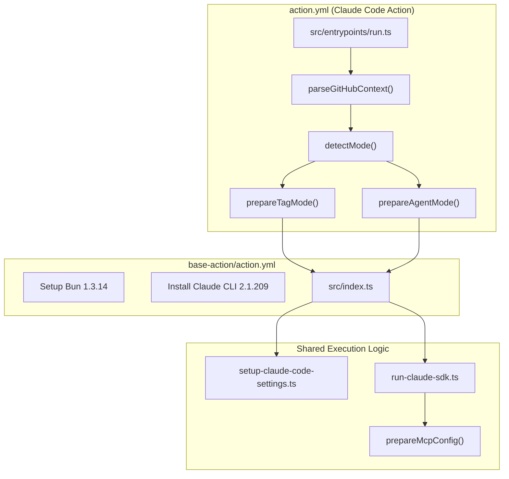
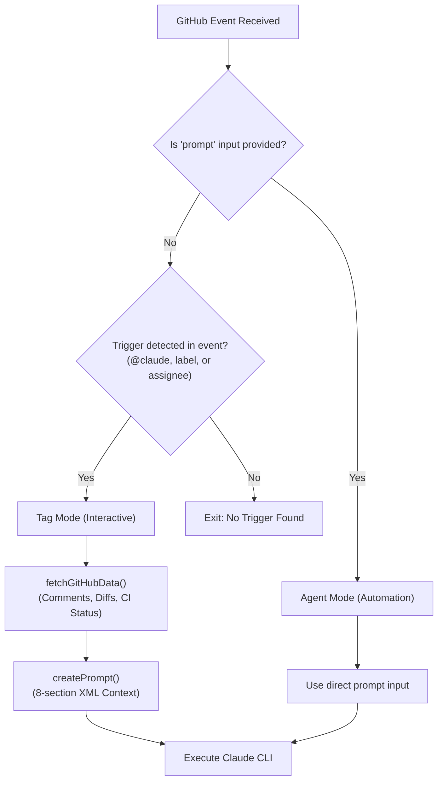

<!-- source: DeepWiki mcp.deepwiki.com · repo anthropics/claude-code-action · page 1 Overview · fetched 2026-10-26 -->

# Overview

Relevant source files

The following files were used as context for generating this wiki page:

- [README.md](README.md)
- [action.yml](action.yml)
- [base-action/action.yml](base-action/action.yml)
- [bun.lock](bun.lock)
- [examples/claude.yml](examples/claude.yml)
- [package.json](package.json)

The `claude-code-action` repository provides a GitHub Action that integrates Claude AI into GitHub workflows for code assistance, automated reviews, and repository automation. The action automatically detects execution mode based on workflow configuration: **Tag Mode** for interactive `@claude` mentions in issues/PRs, or **Agent Mode** for automation tasks with explicit `prompt` inputs. The action executes entirely on your GitHub Actions infrastructure and supports multiple Claude API providers (Anthropic API, AWS Bedrock, Google Vertex AI, Microsoft Foundry).

**Sources:** [README.md:3-5](), [action.yml:1-2]()

## Repository Structure

The repository contains two GitHub Actions organized in a parent-child relationship:

| Action | Location | Purpose |
|--------|----------|---------|
| **Claude Code Action** | [action.yml:1-170]() | Main action with GitHub integration, mode detection, authentication, and prompt generation. |
| **Claude Code Base Action** | [base-action/action.yml:1-216]() | Reusable action focused solely on executing Claude Code CLI with minimal GitHub dependencies. |

The main action delegates Claude execution to the base action's source code, sharing a unified Bun-based runtime environment.

**Sources:** [action.yml:1-170](), [base-action/action.yml:1-216](), [package.json:1-32]()

## Primary Use Cases

The action provides two automation patterns that share execution infrastructure but differ in interaction model:

### Tag Mode (Interactive)
Responds to user triggers (`@claude` mentions, issue assignments, label additions) with:
- Tracking comments showing real-time progress.
- Automatic branch creation and management.
- Full GitHub context injection (PR diffs, comment threads, review comments, CI status).
- PR creation links when work completes on a new branch.

### Agent Mode (Automation)
Executes predefined tasks from the `prompt` input for:
- Scheduled maintenance workflows.
- Event-driven automation (PR opened, issue labeled).
- Headless CI/CD pipelines.
- Structured output generation with JSON schema validation.

**Sources:** [README.md:7-18](), [action.yml:8-18](), [action.yml:57-60](), [action.yml:136-139]()

## Core Capabilities

| Capability | Implementation Logic | Configuration Input |
|------------|----------------------|---------------------|
| **Interactive Assistant** | Tag Mode Detection | `trigger_phrase` [action.yml:8-11]() |
| **Automated Tasks** | Agent Mode Detection | `prompt` [action.yml:57-60]() |
| **PR Review Feedback** | Inline Classification | `classify_inline_comments` [action.yml:116-119]() |
| **Commit Signing** | SSH or GitHub Web Flow | `use_commit_signing`, `ssh_signing_key` [action.yml:120-127]() |
| **Multi-Provider Auth** | OIDC Token Exchange | `use_bedrock`, `use_vertex`, `use_foundry` [action.yml:91-102]() |
| **Progress Tracking** | Dynamic Status Updates | `track_progress` [action.yml:136-139]() |
| **Structured Outputs** | JSON Schema Validation | `claude_args` [action.yml:104-107]() |

**Sources:** [action.yml:7-170](), [README.md:7-18]()

## Dual-Action Architecture

The repository implements a two-layer architecture where the main action handles GitHub integration and delegates Claude execution to the base action components.

**Diagram: Action Composition and Function Flow**

### Main Action Responsibilities
The main action ([action.yml:1-170]()) orchestrates GitHub-specific logic:
- **Context Parsing**: Normalizes various GitHub events (issue comments, PR reviews, labels).
- **Trigger Validation**: Checks for `@claude` or specific labels/assignees. [action.yml:8-18]()
- **Branch Management**: Handles `branch_prefix` and `branch_name_template`. [action.yml:22-29]()
- **Permission Checking**: Validates `allowed_bots` and `allowed_non_write_users`. [action.yml:30-46]()

### Base Action Responsibilities
The base action ([base-action/action.yml:1-216]()) provides the execution engine:
- **Environment Setup**: Installs Bun v1.3.14 and the Claude Code CLI v2.1.209. [base-action/action.yml:123-148]()
- **Plugin Management**: Installs plugins from marketplaces. [base-action/action.yml:86-93]()
- **CLI Invocation**: Runs Claude with `claude_args` and `prompt`. [base-action/action.yml:171-182]()
- **Output Capture**: Produces `structured_output` and `execution_file`. [base-action/action.yml:95-107]()

**Sources:** [action.yml:1-170](), [base-action/action.yml:1-216](), [package.json:12-23]()

## Mode Detection and Execution

The system automatically switches behavior based on inputs and event types.

**Diagram: Mode Selection Logic**

### Mode Comparison

| Aspect | Tag Mode | Agent Mode |
|--------|----------|------------|
| **Activation** | Trigger phrase, Label, or Assignee | Presence of `prompt` input |
| **Context** | Automatic (PR diffs, comments, etc.) | Manual (provided in prompt) |
| **Feedback** | Dynamic tracking comments | GitHub Step Summary only |
| **Branching** | Auto-creates branches for changes | Operates on current branch |
| **Primary Use** | Interactive PR/Issue assistance | Scheduled tasks, CI auto-fixes |

**Sources:** [action.yml:8-18](), [action.yml:57-60](), [action.yml:136-139](), [README.md:9-16]()

## Execution Pipeline

The action follows a structured four-phase execution flow:

1.  **Parse & Validate**: Extracts GitHub context and validates that the actor has appropriate permissions or is in the `allowed_bots` list. [action.yml:30-33]()
2.  **Prepare Mode**: 
    *   **Tag Mode**: Fetches historical comments and code diffs to build a rich context.
    *   **Agent Mode**: Sets up the environment for a single-turn automation task.
3.  **Execute Claude**: Installs the specific version of Claude Code (v2.1.209) and runs it using the configured authentication (API Key, Bedrock, Vertex, or Foundry). [base-action/action.yml:142-154]()
4.  **Cleanup & Report**: Revokes temporary tokens, signs commits if configured, and writes the final execution report to the GitHub Step Summary. [action.yml:120-127](), [base-action/action.yml:184-194]()

**Sources:** [action.yml:1-170](), [base-action/action.yml:109-216]()

## Authentication Architecture

Claude Code Action supports four primary authentication providers via OIDC (OpenID Connect) to avoid long-lived secrets:

*   **Anthropic API**: Direct usage via `anthropic_api_key` or Workload Identity Federation. [action.yml:67-87]()
*   **AWS Bedrock**: Enabled via `use_bedrock`, utilizing OIDC for AWS credentials. [action.yml:91-94]()
*   **Google Vertex AI**: Enabled via `use_vertex`, utilizing OIDC for GCP credentials. [action.yml:95-98]()
*   **Microsoft Foundry**: Enabled via `use_foundry`, utilizing OIDC for Azure credentials. [action.yml:99-102]()

Additionally, it uses a `github_token` or GitHub App installation token to interact with the repository's API for comments, reviews, and file changes. [action.yml:88-90]()

**Sources:** [action.yml:67-102](), [README.md:5]()

---

