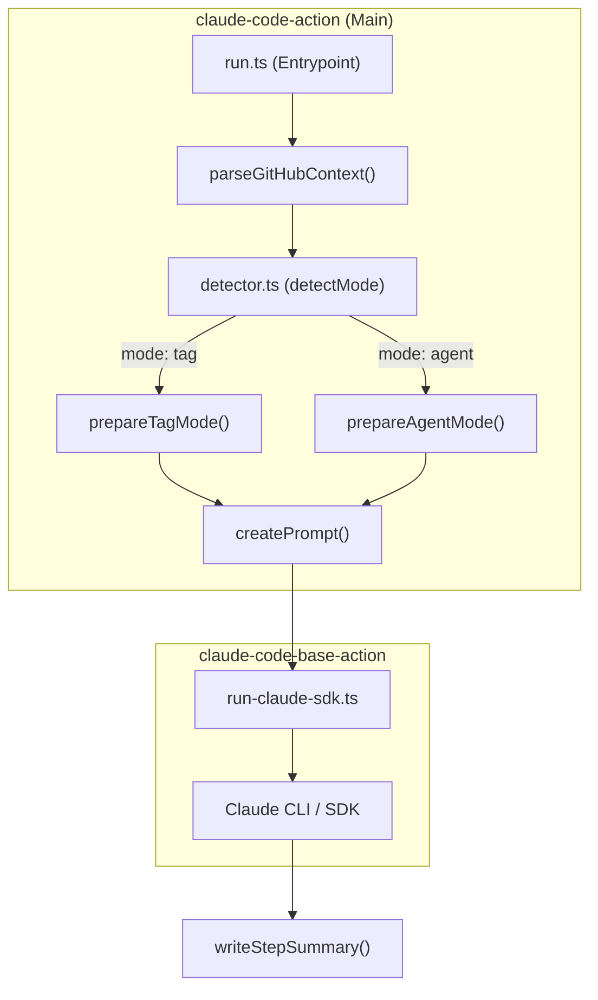
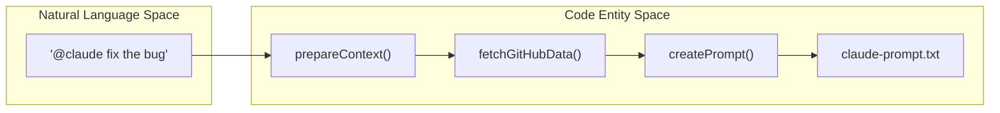

<!-- source: DeepWiki mcp.deepwiki.com · repo anthropics/claude-code-action · page 10 Glossary · fetched 2026-10-26 -->

# Glossary

Relevant source files

The following files were used as context for generating this wiki page:

- [README.md](README.md)
- [agent-approval-check/README.md](agent-approval-check/README.md)
- [agent-approval-check/action.yml](agent-approval-check/action.yml)
- [agent-approval-check/agent-identities.example.yaml](agent-approval-check/agent-identities.example.yaml)
- [agent-approval-check/agent_approval_check.py](agent-approval-check/agent_approval_check.py)
- [docs/configuration.md](docs/configuration.md)
- [examples/agent-approval-check.yml](examples/agent-approval-check.yml)
- [examples/claude.yml](examples/claude.yml)
- [src/create-prompt/index.ts](src/create-prompt/index.ts)
- [src/create-prompt/types.ts](src/create-prompt/types.ts)
- [src/github/token.ts](src/github/token.ts)
- [src/mcp/install-mcp-server.ts](src/mcp/install-mcp-server.ts)
- [src/modes/agent/index.ts](src/modes/agent/index.ts)
- [src/modes/tag/index.ts](src/modes/tag/index.ts)
- [src/utils/retry.ts](src/utils/retry.ts)
- [test/create-prompt.test.ts](test/create-prompt.test.ts)
- [test/install-mcp-server.test.ts](test/install-mcp-server.test.ts)
- [test/modes/agent.test.ts](test/modes/agent.test.ts)
- [test/parse-permissions.test.ts](test/parse-permissions.test.ts)
- [test/prepare-context.test.ts](test/prepare-context.test.ts)
- [test/token.test.ts](test/token.test.ts)

This glossary defines codebase-specific terms, jargon, and domain concepts used within the `claude-code-action` repository.

## Core Concepts & Modes

### Tag Mode
An interactive execution mode where Claude acts as a persistent assistant. It is triggered by specific GitHub events like `@claude` mentions, issue assignments, or label additions. In this mode, the action creates a tracking comment in the GitHub UI to report progress and allows Claude to perform multi-turn operations including file edits and branch management.
*   **Implementation**: `prepareTagMode` handles the initialization, including fetching repository data and setting up the tracking comment [src/modes/tag/index.ts:27-35]().
*   **Trigger Detection**: The action detects triggers like `@claude` using regular expressions and word boundary matching [src/create-prompt/index.ts:113]().

### Agent Mode
An automation-focused mode where Claude is given a specific prompt to execute a single task (e.g., "Review this PR"). Unlike Tag Mode, it does not necessarily create tracking comments unless explicitly configured. It is often used for CI/CD style automations.
*   **Implementation**: `prepareAgentMode` [src/modes/agent/index.ts:19-27]().
*   **Detection**: Triggered when a `prompt` input is provided in the workflow configuration [src/modes/agent/index.ts:75-77]().

### Entity Context
Refers to a GitHub event that is associated with a specific "entity" such as an Issue or a Pull Request. This context contains specific metadata like the issue number or PR diff.
*   **Code Pointer**: Represented by the `isEntityContext` type guard [src/github/context.ts:4]().
*   **Usage**: Required for Tag Mode to function properly [src/modes/tag/index.ts:37-39]().

### Automation Context
Refers to events that are not tied to a specific PR or Issue conversation, such as scheduled runs or manual workflow dispatches (`workflow_dispatch`).
*   **Code Pointer**: Used to differentiate background tasks from interactive ones [src/github/context.ts:122-129]().

---

## Technical Components

### Dual-Action Architecture
The repository consists of two logical actions:
1.  **Claude Code Action (Main)**: The high-level orchestrator that handles GitHub event parsing, permission validation, and environment preparation.
2.  **Claude Code Base Action**: A lower-level wrapper that focuses on installing the Claude CLI and executing the SDK with specific arguments.

**Data Flow: From GitHub Event to Claude Execution**

*Sources: [src/modes/tag/index.ts:104-110](), [src/modes/agent/index.ts:19-27](), [src/create-prompt/index.ts:1-30]()*

### MCP (Model Context Protocol)
A protocol used to grant Claude access to external tools. This repository implements several custom MCP servers to allow Claude to interact with GitHub APIs directly.
*   **github_comment**: For updating the tracking comment [src/mcp/install-mcp-server.ts:97-113]().
*   **github_file_ops**: For performing commits and file deletions via the GitHub API [src/mcp/install-mcp-server.ts:116-135]().
*   **github_inline_comment**: For posting PR review comments [src/mcp/install-mcp-server.ts:138-160]().
*   **github_ci**: For checking workflow statuses and downloading logs using the `actions:read` permission [src/mcp/install-mcp-server.ts:166-204]().

### Tracking Comment
A "sticky" comment created in Tag Mode that Claude updates as it works. It provides transparency into Claude's thought process and the tools it is currently using.
*   **Implementation**: Created via `createInitialComment` [src/modes/tag/index.ts:45-46]() and updated via the `mcp__github_comment__update_claude_comment` tool [src/create-prompt/index.ts:45]().

---

## Security & Permissions

### Permission Mode: `acceptEdits`
A security setting passed to the Claude CLI. It allows Claude to edit files within the current working directory (`$GITHUB_WORKSPACE`) but denies writes to sensitive system areas.
*   **Code Pointer**: Set in `claudeArgs` during preparation [src/modes/tag/index.ts:175]().

### OIDC Token Exchange
The process of exchanging a GitHub-issued OpenID Connect (OIDC) token for a short-lived GitHub App installation token.
*   **Implementation**: `setupGitHubToken` calls `exchangeForAppToken` [src/github/token.ts:158-185]().
*   **Permissions**: Can be extended using the `ADDITIONAL_PERMISSIONS` environment variable [src/github/token.ts:75-101]().

### WorkflowValidationSkipError
A specific error thrown when a workflow cannot be validated (e.g., when adding the action to a new repository). It allows the action to exit gracefully rather than failing the build.
*   **Code Pointer**: [src/github/token.ts:6-11]().

---

## Prompt Generation Pipeline

The system transforms raw GitHub data into a structured prompt for Claude.

**Natural Language to Code Entity Mapping**

| Concept | Code Entity / Variable | Purpose |
| :--- | :--- | :--- |
| **User Request** | `USER_REQUEST_FILENAME` | The specific command from the user (e.g., "fix the bug") stored in `claude-user-request.txt` [src/create-prompt/index.ts:29](). |
| **Context Block** | `PreparedContext` | Metadata about the repository, PR number, and event type [src/create-prompt/types.ts:111-114](). |
| **Event Data** | `EventData` | Union type containing event-specific payloads (e.g., `IssueCommentEvent`) [src/create-prompt/types.ts:99-108](). |
| **Allowed Tools** | `buildAllowedToolsString()` | Filters which MCP tools Claude is permitted to use based on configuration [src/create-prompt/index.ts:36-77](). |

*Sources: [src/create-prompt/index.ts:104-141](), [src/modes/tag/index.ts:52-63](), [src/create-prompt/types.ts:99-114]()*

---

## Jargon & Abbreviations

| Term | Definition |
| :--- | :--- |
| **Bun** | The JavaScript runtime and package manager used to execute the action scripts [src/create-prompt/index.ts:1](). |
| **Octokit** | The official GitHub SDK for Node.js used for API interactions [src/mcp/install-mcp-server.ts:5](). |
| **Trigger Phrase** | The string (default `@claude`) that the action searches for in comments to initiate Tag Mode [src/create-prompt/index.ts:113](). |
| **Sticky Comment** | An option to consolidate all of Claude's feedback into a single comment thread to reduce notification noise [test/install-mcp-server.test.ts:34](). |
| **Sanitizer** | A utility that scrubs secrets and sensitive data from the prompt before sending it to the model [src/create-prompt/index.ts:13](). |

*Sources: [src/create-prompt/index.ts:1-141](), [src/mcp/install-mcp-server.ts:1-224](), [src/github/token.ts:1-185](), [src/modes/tag/index.ts:1-188]()*