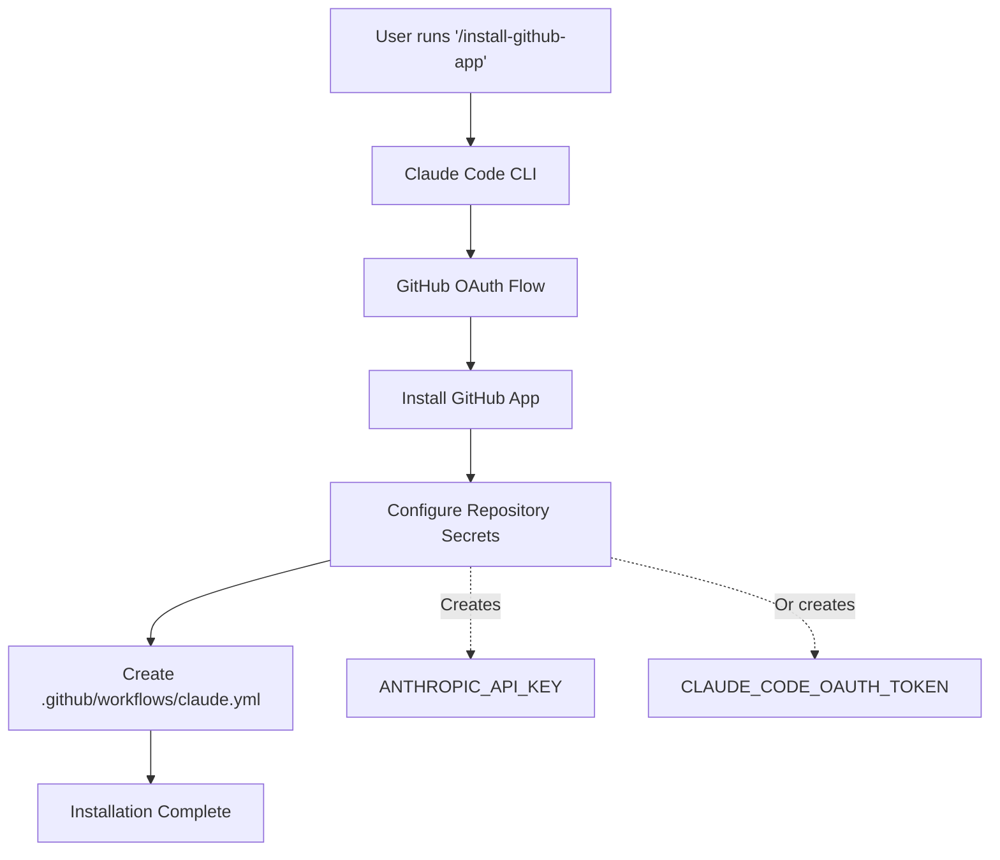
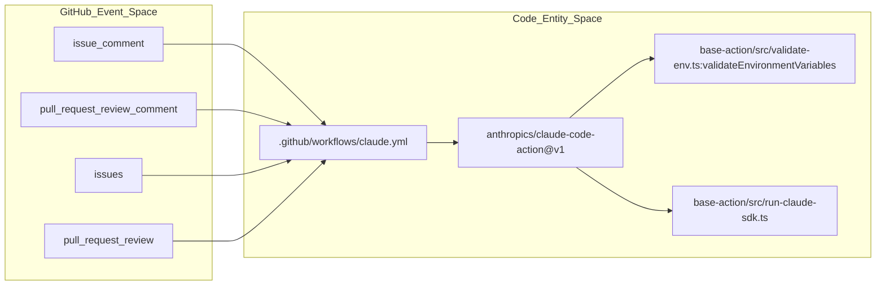
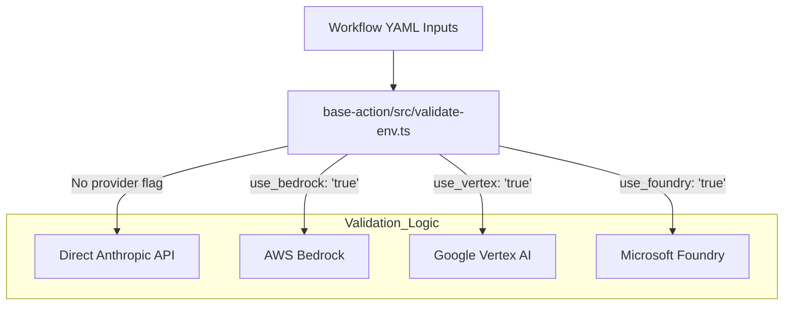

<!-- source: DeepWiki mcp.deepwiki.com · repo anthropics/claude-code-action · page 2 Getting Started · fetched 2026-10-26 -->

# Getting Started

<details>
<summary>Relevant source files</summary>

The following files were used as context for generating this wiki page:

- [README.md](README.md)
- [base-action/src/validate-env.ts](base-action/src/validate-env.ts)
- [base-action/test/validate-env.test.ts](base-action/test/validate-env.test.ts)
- [docs/capabilities-and-limitations.md](docs/capabilities-and-limitations.md)
- [docs/cloud-providers.md](docs/cloud-providers.md)
- [docs/create-app.html](docs/create-app.html)
- [docs/experimental.md](docs/experimental.md)
- [docs/faq.md](docs/faq.md)
- [docs/setup.md](docs/setup.md)
- [examples/claude-wif.yml](examples/claude-wif.yml)
- [examples/claude.yml](examples/claude.yml)
- [github-app-manifest.json](github-app-manifest.json)

</details>


This page provides step-by-step instructions for installing and configuring the Claude Code Action in your GitHub repository. It covers authentication setup, basic workflow configuration, and verification steps to ensure the action is working correctly.

For detailed information about configuration options, see **Action Inputs Reference** (Section 5.1). For usage patterns and examples, see **Usage Examples** (Section 6). For understanding the underlying execution modes, see **Execution Modes** (Section 3.1).

---

## Prerequisites

Before installing the Claude Code Action, ensure you have:

| Requirement | Description |
|------------|-------------|
| **GitHub Repository Access** | Repository admin permissions to install GitHub apps and configure secrets [README.md:30-32]() |
| **Authentication Method** | One of: Anthropic API key, Claude Code OAuth token, AWS Bedrock, Google Vertex AI, or Microsoft Foundry [README.md:5]() |
| **GitHub Actions Enabled** | GitHub Actions must be enabled in your repository settings |
| **Runner Availability** | Access to `ubuntu-latest` runners (default environment) [examples/claude.yml:20]() |

**Sources:** [README.md:5](), [README.md:30-32](), [examples/claude.yml:20]()

---

## Quickstart Installation (Recommended)

The easiest way to set up the action is through the Claude Code CLI using the `/install-github-app` command.

### Installation Steps

1. **Open Claude Code in your terminal:**
   ```bash
   claude
   ```

2. **Run the installation command:**
   ```
   /install-github-app
   ```

3. **Follow the interactive setup:**
   - Select your target repository.
   - Authorize the GitHub app installation.
   - Configure required secrets automatically.

**Diagram: Quickstart Installation Flow**



**Limitations:**
- Only available for direct Anthropic API users [README.md:33]().
- Requires repository admin permissions [README.md:32]().
- For cloud providers (AWS Bedrock, Google Vertex AI, Microsoft Foundry), use manual setup [README.md:33]().

**Sources:** [README.md:24-33]()

---

## Manual Setup

For cloud providers or custom configurations, manually configure the action in your repository.

### Step 1: Create Workflow File

Create `.github/workflows/claude.yml` in your repository. A standard configuration listens for comments, issues, and PR reviews:

```yaml
name: Claude Code
on:
  issue_comment:
    types: [created]
  pull_request_review_comment:
    types: [created]
  issues:
    types: [opened, assigned]
  pull_request_review:
    types: [submitted]

jobs:
  claude:
    if: |
      (github.event_name == 'issue_comment' && contains(github.event.comment.body, '@claude')) ||
      (github.event_name == 'pull_request_review_comment' && contains(github.event.comment.body, '@claude')) ||
      (github.event_name == 'pull_request_review' && contains(github.event.review.body, '@claude')) ||
      (github.event_name == 'issues' && (contains(github.event.issue.body, '@claude') || contains(github.event.issue.title, '@claude')))
    runs-on: ubuntu-latest
    permissions:
      contents: write
      pull-requests: write
      issues: write
      id-token: write
      actions: read
    steps:
      - name: Checkout repository
        uses: actions/checkout@v6
        with:
          fetch-depth: 1

      - name: Run Claude Code
        id: claude
        uses: anthropics/claude-code-action@v1
        with:
          anthropic_api_key: ${{ secrets.ANTHROPIC_API_KEY }}
```

**Diagram: GitHub Event to Logic Orchestration**

This diagram bridges the Natural Language trigger (event) to the specific internal logic that handles the environment validation and execution.



**Sources:** [examples/claude.yml:1-37](), [base-action/src/validate-env.ts:5-89](), [github-app-manifest.json:20-26]()

### Step 2: Configure Repository Secrets

Navigate to **Settings → Secrets and variables → Actions** and add the necessary credentials [docs/setup.md:8-10]():

| Secret Name | Description | Provider |
|------------|-------------|----------|
| `ANTHROPIC_API_KEY` | Direct Anthropic API key (starts with `sk-ant-`) | Anthropic |
| `CLAUDE_CODE_OAUTH_TOKEN` | OAuth token generated via `claude setup-token` | Anthropic |

For AWS Bedrock, Google Vertex AI, or Microsoft Foundry, you typically use OIDC and do not need a static API key, but you must set `use_bedrock: "true"`, `use_vertex: "true"`, or `use_foundry: "true"` in the action inputs [docs/cloud-providers.md:29-52]().

**Sources:** [docs/setup.md:8-10](), [docs/cloud-providers.md:29-52](), [base-action/src/validate-env.ts:30-41]()

### Step 3: Set Permissions

The action requires specific permissions to interact with your repository [examples/claude.yml:21-26]():

- `contents: write`: To read files and create branches [docs/capabilities-and-limitations.md:11-13]().
- `pull-requests: write`: To read PR data and post comments [docs/faq.md:88-89]().
- `issues: write`: To read issue data and update comments [docs/faq.md:89-90]().
- `id-token: write`: Required for OIDC authentication with the GitHub App or Cloud Providers [docs/faq.md:21-27]().
- `actions: read`: Required if you want Claude to analyze CI/CD results [docs/faq.md:79-91]().

**Sources:** [examples/claude.yml:21-26](), [docs/faq.md:21-27](), [docs/faq.md:79-91]()

---

## Basic Configuration Options

### Essential Inputs

The action uses environment validation to ensure all necessary parameters are present based on the selected provider.

| Input | Purpose | Default |
|-------|---------|---------|
| `anthropic_api_key` | Authentication for direct API [examples/claude.yml:37]() | - |
| `prompt` | Instructions for automation (Agent Mode) [docs/experimental.md:24-31]() | - |
| `trigger_phrase` | Phrase to look for in comments [examples/claude.yml:40]() | `@claude` |
| `claude_args` | Arguments passed to Claude CLI (e.g., `--model`, `--system-prompt`) [examples/claude.yml:46-51]() | `""` |
| `use_bedrock` | Enable Amazon Bedrock provider [docs/cloud-providers.md:32]() | `false` |

**Diagram: Input to Provider Validation**



**Sources:** [base-action/src/validate-env.ts:5-83](), [docs/experimental.md:5-49](), [docs/cloud-providers.md:22-52]()

---

## First Interaction

### Testing Interactive Mode (Tag Mode)

1. **Create a Pull Request** or Issue.
2. **Post a comment** containing the trigger:
   ```text
   @claude How does the authentication flow work in this repo?
   ```
3. **Observation**: Claude will post a "tracking comment" with progress indicators and eventually respond with the analysis [README.md:15](), [docs/capabilities-and-limitations.md:5]().

### Testing Automation Mode (Agent Mode)

1. **Modify your workflow** to include a `prompt`:
   ```yaml
   - uses: anthropics/claude-code-action@v1
     with:
       anthropic_api_key: ${{ secrets.ANTHROPIC_API_KEY }}
       prompt: "Summarize the changes in this PR."
   ```
2. **Trigger the event** (e.g., by pushing a commit or opening the PR).
3. **Observation**: The action runs automatically without needing a manual `@claude` mention [docs/experimental.md:24-31]().

**Sources:** [docs/experimental.md:9-49](), [docs/capabilities-and-limitations.md:5-14]()

---

## Verification and Troubleshooting

### Common Verification Checks

- **Check Workflow Runs**: Go to the **Actions** tab. If the run didn't start, verify the `if:` condition in your workflow YAML [examples/claude.yml:15-19]().
- **Check Permissions**: If Claude fails to post a comment, verify the `id-token: write` permission is present [docs/faq.md:21-27]().
- **Check Secrets**: If you see "Authentication failed", ensure `ANTHROPIC_API_KEY` is correctly set in Repository Secrets [docs/setup.md:8-10]().

### Troubleshooting Table

| Symptom | Likely Cause | Reference |
|---------|--------------|-----------|
| No response to `@claude` | Trigger phrase mismatch or event not in `on:` | [examples/claude.yml:3-19]() |
| "Resource not accessible" | Missing `write` permissions or GitHub App token issue | [docs/faq.md:31-56]() |
| Workflow loop | Automated tagging from another GitHub Action | [docs/faq.md:7-9]() |
| OIDC Error | Missing `id-token: write` permission | [docs/faq.md:19-29]() |

**Sources:** [docs/faq.md:1-150](), [examples/claude.yml:1-58]()

---

