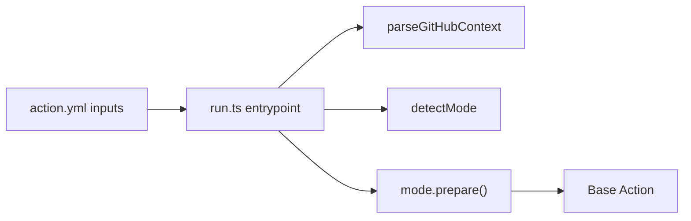
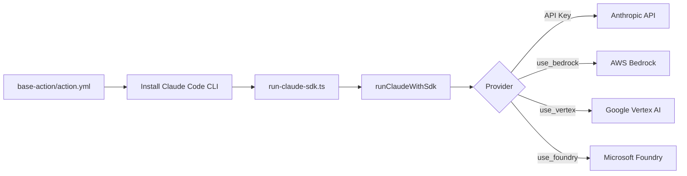
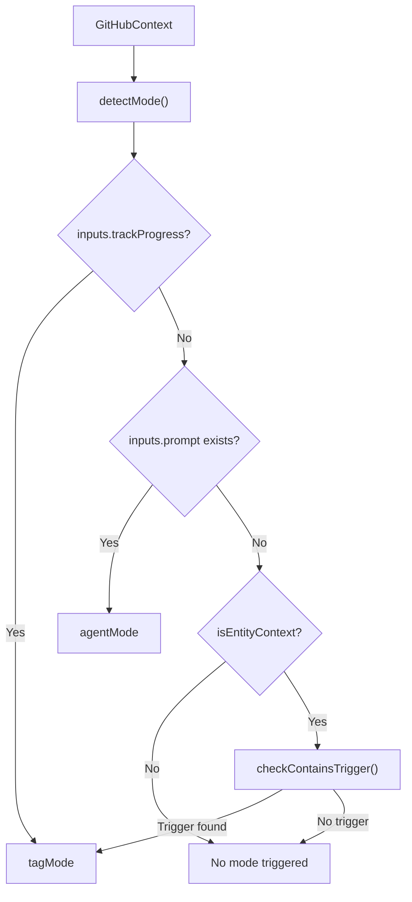
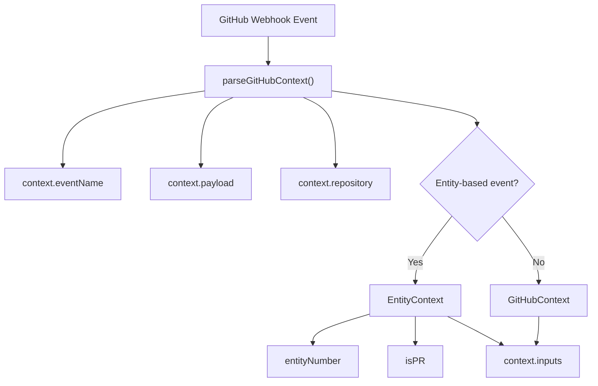
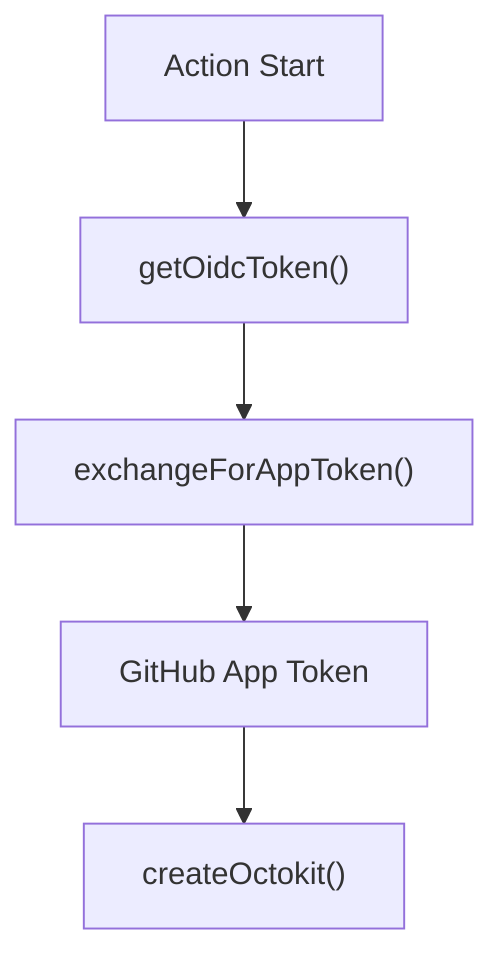
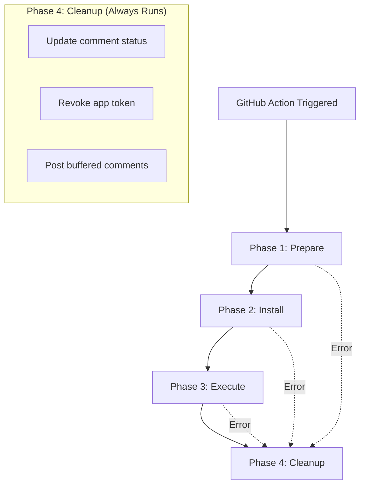

<!-- source: DeepWiki mcp.deepwiki.com · repo anthropics/claude-code-action · page 3 Core Concepts · fetched 2026-10-26 -->

# Core Concepts

<details>
<summary>Relevant source files</summary>

The following files were used as context for generating this wiki page:

- [docs/configuration.md](docs/configuration.md)
- [src/entrypoints/collect-inputs.ts](src/entrypoints/collect-inputs.ts)
- [src/entrypoints/post-buffered-inline-comments.ts](src/entrypoints/post-buffered-inline-comments.ts)
- [src/github/token.ts](src/github/token.ts)
- [src/modes/detector.ts](src/modes/detector.ts)
- [src/utils/retry.ts](src/utils/retry.ts)
- [test/modes/detector.test.ts](test/modes/detector.test.ts)
- [test/parse-permissions.test.ts](test/parse-permissions.test.ts)
- [test/token.test.ts](test/token.test.ts)

</details>


This document explains the fundamental concepts that govern how the Claude Code Action operates. It covers the dual-action architecture, mode detection system, GitHub context parsing, MCP tool integration, and security model. These concepts form the foundation for understanding the system's behavior and capabilities.

For detailed information about specific execution modes, see [Execution Modes](#3.1). For trigger validation mechanisms, see [Trigger System](#3.2). For authentication configuration, see [Authentication Providers](#3.3).

## Dual-Action Architecture

The system consists of two GitHub Actions that work together to provide a complete automation platform. This separation allows the main action to handle complex GitHub logic while the base action focuses on the Claude Code environment.

| Component | File | Purpose |
|-----------|------|---------|
| Main Action | [action.yml:1-290]() | GitHub orchestration, mode detection, context preparation |
| Base Action | [base-action/action.yml:1-216]() | Claude Code execution, provider integration |

**Main Action Flow**



The main action ([action.yml:1-290]()) collects inputs via `collectActionInputsPresence` ([src/entrypoints/collect-inputs.ts:1-60]()), parses GitHub event payloads, detects the appropriate execution mode, and prepares the environment. It then delegates Claude execution to the base action.

**Base Action Flow**



The base action ([base-action/action.yml:1-216]()) installs Claude Code, configures authentication, and executes Claude with the prepared prompt and tools. It supports multiple AI providers through environment variable configuration.

**Sources:** [action.yml:1-290](), [base-action/action.yml:1-216](), [src/entrypoints/collect-inputs.ts:1-60]()

## Mode System

The mode system is the primary mechanism for determining execution behavior. The `AutoDetectedMode` type ([src/modes/detector.ts:12]()) defines the two primary paths: `tag` and `agent`.

**Mode Detection Architecture**



The detector ([src/modes/detector.ts:14-81]()) evaluates the parsed GitHub context. If `trackProgress` is enabled for supported events like `pull_request` or `issues`, it forces **Tag Mode** ([src/modes/detector.ts:16-31]()).

1. If `inputs.prompt` is provided, use **Agent Mode** ([src/modes/detector.ts:41-43]()).
2. If the event is entity-based (PR/issue) and contains a trigger phrase (like `@claude`), use **Tag Mode** ([src/modes/detector.ts:45-47]()).
3. Otherwise, it defaults to `agent` mode, which remains idle without an explicit prompt ([src/modes/detector.ts:80]()).

**Mode Comparison**

| Aspect | Agent Mode | Tag Mode |
|--------|------------|----------|
| Trigger | Explicit `prompt` input | `@claude` mention, assignment, label |
| Tracking Comments | No | Yes (enabled via `track_progress`) |
| Use Case | Automation (CI/CD) | Interactive assistance |

**Sources:** [src/modes/detector.ts:1-115](), [test/modes/detector.test.ts:1-225]()

## GitHub Context Parsing

The system transforms GitHub webhook events into structured contexts that modes can consume.

**Context Parsing Flow**



The system handles specific events like `issue_comment`, `pull_request_review_comment`, and `issues`. It also processes specialized logic for PR review comments, including classification of "real" vs "test/probe" comments using Claude Haiku ([src/entrypoints/post-buffered-inline-comments.ts:45-109]()).

**Sources:** [src/modes/detector.ts:1-11](), [src/entrypoints/post-buffered-inline-comments.ts:28-43]()

## MCP Tool Integration

The Model Context Protocol (MCP) system provides Claude with specialized tools. Users can extend Claude's capabilities by adding custom MCP servers via `claude_args` ([docs/configuration.md:3-17]()).

**Custom MCP Configuration**
Users can pass JSON configuration for MCP servers, including environment variables and secrets ([docs/configuration.md:19-47]()):

```yaml
claude_args: |
  --mcp-config '{"mcpServers": {"thinking": {"command": "npx", "args": ["@modelcontextprotocol/server-sequential-thinking"]}}}'
  --allowedTools mcp__thinking__sequentialthinking
```

The system also supports Python-based MCP servers using `uv` ([docs/configuration.md:49-88]()) and can integrate with GitHub CI tools like `mcp__github_ci__download_job_log` if `actions: read` permissions are granted ([docs/configuration.md:141-146]()).

**Sources:** [docs/configuration.md:1-108](), [docs/configuration.md:141-146]()

## Security and Permission Model

The system implements multiple security layers, including OIDC-based token exchange and granular permission management.

**Authentication Flow**



**Permission Validation**
The action requests a scoped GitHub App token via OIDC ([src/github/token.ts:56-67]()). Default permissions include `contents: write`, `pull_requests: write`, and `issues: write` ([src/github/token.ts:69-73]()). Users can request `additional_permissions` (e.g., `actions: read`) which are merged with defaults ([src/github/token.ts:75-101]()).

If a workflow change is detected on a PR that hasn't been merged to the default branch, the exchange may fail with a `WorkflowValidationSkipError` ([src/github/token.ts:6-11]()), causing the action to skip gracefully ([src/github/token.ts:129-136]()).

**Sources:** [src/github/token.ts:1-185](), [test/parse-permissions.test.ts:1-97]()

## Execution Phases

The system executes in four distinct phases, ensuring proper resource management even when errors occur.

**Phase Execution Flow**



**Phase Responsibilities**

| Phase | Entry Point | Purpose |
|-------|-------------|---------|
| **Prepare** | `src/entrypoints/prepare.ts` | Context parsing, mode detection, and token setup ([src/github/token.ts:158]()). |
| **Install** | `base-action/action.yml` | Environment setup and Claude Code CLI installation. |
| **Execute** | `base-action/src/run-claude-sdk.ts` | Claude invocation and task execution. |
| **Cleanup** | `src/entrypoints/post-buffered-inline-comments.ts` | Finalizing PR comments and classification ([src/entrypoints/post-buffered-inline-comments.ts:146-228]()). |

**Sources:** [src/github/token.ts:158-185](), [src/entrypoints/post-buffered-inline-comments.ts:146-228]()

---

