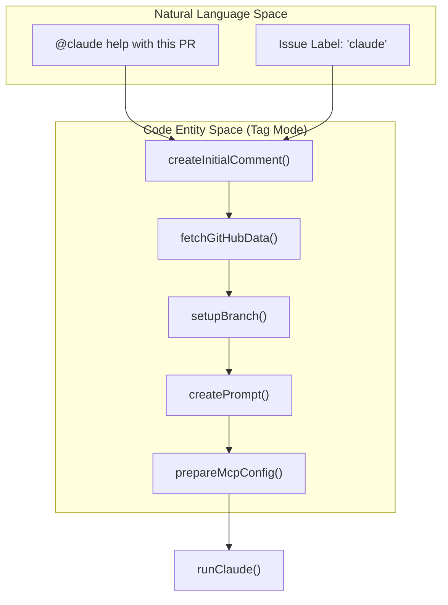
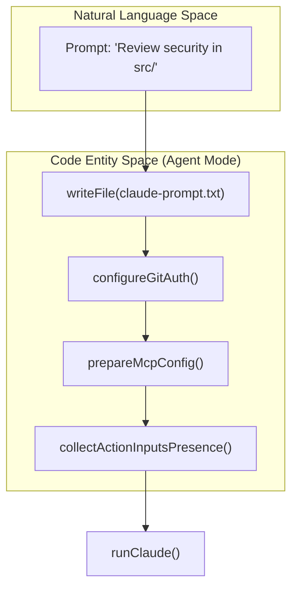

<!-- source: DeepWiki mcp.deepwiki.com · repo anthropics/claude-code-action · page 3.1 Execution Modes · fetched 2026-10-26 -->

# Execution Modes

Relevant source files

The following files were used as context for generating this wiki page:

- [src/entrypoints/collect-inputs.ts](src/entrypoints/collect-inputs.ts)
- [src/entrypoints/post-buffered-inline-comments.ts](src/entrypoints/post-buffered-inline-comments.ts)
- [src/modes/agent/index.ts](src/modes/agent/index.ts)
- [src/modes/detector.ts](src/modes/detector.ts)
- [src/modes/tag/index.ts](src/modes/tag/index.ts)
- [test/modes/agent.test.ts](test/modes/agent.test.ts)
- [test/modes/detector.test.ts](test/modes/detector.test.ts)

The `claude-code-action` supports two primary execution paradigms: **Tag Mode** (interactive, context-rich) and **Agent Mode** (automation-focused, prompt-driven). The system uses an intelligent routing mechanism to detect the appropriate mode based on GitHub event context and user inputs.

## Mode Detection Logic

Mode detection is handled by the `detectMode` function in [src/modes/detector.ts:14-81](). The logic prioritizes explicit user intent (via the `prompt` or `track_progress` inputs) and falls back to event-based heuristics.

### Mode Selection Criteria

| Input / Context | Detected Mode | Behavior |
| :--- | :--- | :--- |
| `track_progress: true` | **Tag Mode** | Forces interactive behavior with tracking comments for supported events [src/modes/detector.ts:16-31](). |
| `prompt` provided | **Agent Mode** | Executes the specific prompt immediately without creating progress comments [src/modes/detector.ts:41-43](). |
| `@claude` mention (no prompt) | **Tag Mode** | Responds to mentions in issues or PR comments [src/modes/detector.ts:45-47](). |
| Issue Assignment/Labeling | **Tag Mode** | Triggers based on `assignee_trigger` or `label_trigger` [src/modes/detector.ts:58-60](). |
| Default (No prompt/trigger) | **Agent Mode** | Default fallback; typically results in a no-op if no trigger is found later [src/modes/detector.ts:80](). |

### The `track_progress` Parameter
The `track_progress` input is a bridge between modes. It allows automation workflows (which normally use Agent Mode) to leverage Tag Mode features like:
1.  **Tracking Comments**: Real-time status updates in the GitHub UI [src/modes/tag/index.ts:45-46]().
2.  **Full Context**: Automatic inclusion of PR/issue history, attachments, and metadata [src/modes/tag/index.ts:52-63]().

**Supported Events for `track_progress`**:
- `pull_request` (actions: `opened`, `synchronize`, `ready_for_review`, `reopened`) [src/modes/detector.ts:100-113]().
- `issues`, `issue_comment`, `pull_request_review`, `pull_request_review_comment`, `pull_request_review` [src/modes/detector.ts:85-91]().

Sources: [src/modes/detector.ts:14-114](), [src/modes/tag/index.ts:45-63]()

## Tag Mode (Interactive)

Tag Mode is designed for human-in-the-loop interactions. It treats Claude as a collaborator that responds to specific triggers within a GitHub Issue or Pull Request.

### Technical Implementation: `prepareTagMode`
When Tag Mode is active, the execution pipeline calls `prepareTagMode` [src/modes/tag/index.ts:27-188](). This pathway performs heavy data fetching to provide Claude with maximum context.

**Tag Mode Data Flow**

**Key Characteristics**:
-   **Tracking**: Immediately creates a "Claude is thinking..." comment via `createInitialComment` [src/modes/tag/index.ts:45-46]().
-   **Context**: Calls `fetchGitHubData` to pull the entire conversation history, diffs, and CI status [src/modes/tag/index.ts:52-63]().
-   **Branching**: Automatically manages git branches via `setupBranch` to ensure Claude operates on the correct code state [src/modes/tag/index.ts:66]().
-   **Tooling**: Configures a specific set of `tagModeTools` including GitHub-specific MCP tools for CI logs and comment updates [src/modes/tag/index.ts:123-150]().

Sources: [src/modes/tag/index.ts:27-188](), [src/github/data/fetcher.ts:1-63]()

## Agent Mode (Automation)

Agent Mode is optimized for "fire-and-forget" automations where a specific task is defined in the workflow YAML. It is the default mode when the `prompt` input is used.

### Technical Implementation: `prepareAgentMode`
The `prepareAgentMode` function [src/modes/agent/index.ts:19-134]() is a lightweight preparation pathway that avoids the overhead of fetching full GitHub conversation histories unless explicitly requested.

**Agent Mode Execution Pipeline**

**Key Characteristics**:
-   **Direct Input**: The `prompt` input is written directly to a temporary file on the runner (`RUNNER_TEMP/claude-prompts/claude-prompt.txt`) [src/modes/agent/index.ts:70-79]().
-   **No Tracking**: By default, it does not post progress comments to GitHub (`commentId` is `undefined`) [src/modes/agent/index.ts:104]().
-   **Branch Detection**: Detects the current branch from environment variables like `GITHUB_HEAD_REF` or `GITHUB_REF_NAME` [src/modes/agent/index.ts:90-95]().
-   **Tooling**: Parses allowed tools directly from the user's `claude_args` [src/modes/agent/index.ts:81-83]().

Sources: [src/modes/agent/index.ts:19-134](), [src/entrypoints/collect-inputs.ts:1-60]()

## Workflow Comparison Summary

| Feature | Tag Mode (Interactive) | Agent Mode (Automation) |
| :--- | :--- | :--- |
| **Trigger** | `@claude`, Labels, Assignees | `prompt` input in YAML |
| **Progress Visibility** | Sticky/Tracking comments | Action logs only (unless `track_progress: true`) |
| **Branch Management** | Auto-creates `claude/` branches | Operates on current checked-out HEAD |
| **GitHub Context** | Deep (Comments, Reviews, CI logs) | Shallow (Environment variables) |
| **Primary Use Case** | Ad-hoc coding help, PR discussions | Scheduled reviews, Auto-docs, CI fixes |

### Implementation Convergence
Regardless of the mode, both pathways converge at the final execution phase. Both modes return a common interface containing:
-   `commentId`: (Optional) The ID of the tracking comment [src/modes/tag/index.ts:183]().
-   `branchInfo`: Details about the base, current, and Claude-specific branches [src/modes/tag/index.ts:184](), [src/modes/agent/index.ts:125-129]().
-   `mcpConfig`: Configuration for the Model Context Protocol servers [src/modes/tag/index.ts:185](), [src/modes/agent/index.ts:130]().
-   `claudeArgs`: Final CLI arguments passed to the Claude binary [src/modes/tag/index.ts:186](), [src/modes/agent/index.ts:131]().

Sources: [src/modes/tag/index.ts:182-188](), [src/modes/agent/index.ts:123-133]()

---

