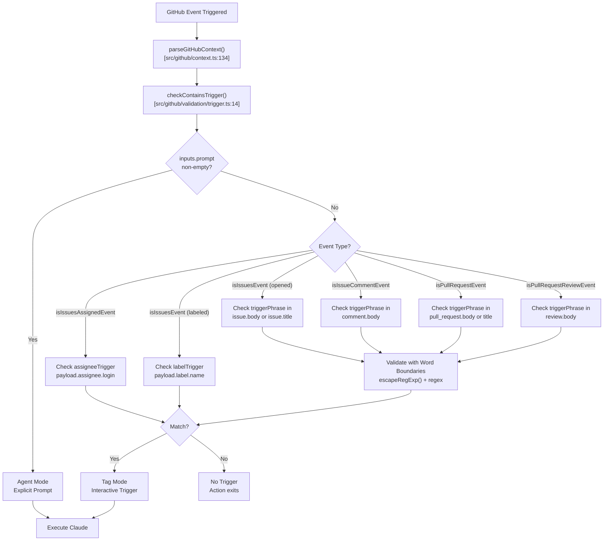
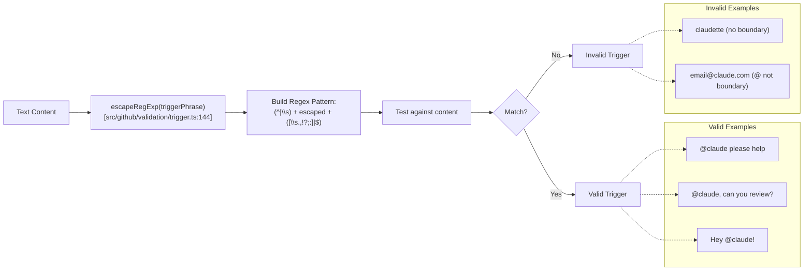
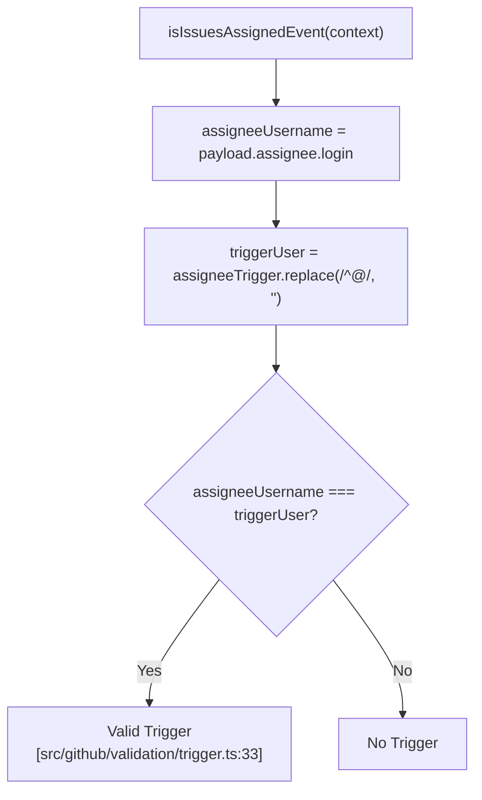

<!-- source: DeepWiki mcp.deepwiki.com · repo anthropics/claude-code-action · page 3.2 Trigger System · fetched 2026-10-26 -->

# Trigger System

<details>
<summary>Relevant source files</summary>

The following files were used as context for generating this wiki page:

- [src/github/constants.ts](src/github/constants.ts)
- [src/github/context.ts](src/github/context.ts)
- [src/github/validation/trigger.ts](src/github/validation/trigger.ts)
- [test/mockContext.ts](test/mockContext.ts)
- [test/trigger-validation.test.ts](test/trigger-validation.test.ts)

</details>


This document explains the trigger mechanisms that determine when the Claude Code Action executes. It covers the various trigger types (`prompt`, `trigger_phrase`, `assignee_trigger`, `label_trigger`), how trigger detection works across different GitHub event types, and the validation logic that ensures triggers are properly detected while avoiding false positives.

For information about how triggers affect execution behavior (Agent Mode vs Tag Mode), see [Execution Modes](3.1). For detailed validation implementation, see [Trigger Validation and Event Processing](9.3).

## Trigger Types Overview

The Claude Code Action supports four distinct trigger mechanisms that can activate Claude execution:

| Trigger Type | Configuration Input | Execution Mode | Use Case |
|-------------|-------------------|----------------|----------|
| **Explicit Prompt** | `prompt` | Agent Mode | Automated workflows with predefined prompts (`workflow_dispatch`, `schedule`, `repository_dispatch`) |
| **Phrase Trigger** | `trigger_phrase` | Tag Mode | Interactive assistance via mentions in comments, issues, or PRs (default: `@claude`) |
| **Assignee Trigger** | `assignee_trigger` | Tag Mode | Automatic activation when specific user is assigned to an issue |
| **Label Trigger** | `label_trigger` | Tag Mode | Automatic activation when specific label is applied to an issue |

**Sources:** [src/github/context.ts:85-106](), [test/mockContext.ts:15-33](), [src/github/validation/trigger.ts:15-17]()

## Trigger Detection Architecture

The detection logic is encapsulated in the `checkContainsTrigger` function, which processes the `ParsedGitHubContext` to determine if the execution criteria are met.

### Logic Flow Diagram



**Sources:** [src/github/context.ts:134-243](), [src/github/validation/trigger.ts:14-138](), [test/trigger-validation.test.ts:24-150]()

## Explicit Prompt Trigger

The `prompt` input provides an explicit instruction for Claude, bypassing all other trigger checks. When `prompt` is non-empty, the action enters Agent Mode and executes immediately.

### Configuration

```yaml
- uses: anthropics/claude-code-action@v1
  with:
    anthropic_api_key: ${{ secrets.ANTHROPIC_API_KEY }}
    prompt: "Review all TypeScript files and suggest improvements"
```

### Behavior

- **Mode**: Agent Mode (see [Execution Modes](3.1)).
- **Event Types**: Typically used with automation events (`workflow_dispatch`, `repository_dispatch`, `schedule`, `workflow_run`) [src/github/context.ts:63-68]().
- **Validation**: If `prompt` is non-empty, `checkContainsTrigger()` returns `true` immediately [src/github/validation/trigger.ts:20-23]().
- **Priority**: Takes precedence over all other trigger types.

**Sources:** [src/github/validation/trigger.ts:20-23](), [test/trigger-validation.test.ts:25-43]()

## Phrase Trigger

The `trigger_phrase` enables interactive Claude assistance by detecting mentions in text content. The default value is `@claude` [src/github/context.ts:149]().

### Word Boundary Detection

The phrase trigger uses word boundary validation to avoid false positives (e.g., matching "claudette" when looking for "@claude"). The system constructs a regular expression using `escapeRegExp` to handle special characters in custom phrases [src/github/validation/trigger.ts:144-146]().



**Sources:** [src/github/validation/trigger.ts:52-54](), [src/github/validation/trigger.ts:79-82](), [test/trigger-validation.test.ts:171-206]()

### Event Content Coverage

| Event Type | Content Checked | Source Implementation |
|-----------|----------------|-------|
| `issues` (opened) | `issue.body`, `issue.title` | [src/github/validation/trigger.ts:48-71]() |
| `issue_comment` | `comment.body` | [src/github/validation/trigger.ts:122-133]() |
| `pull_request` | `pull_request.body`, `pull_request.title` | [src/github/validation/trigger.ts:74-97]() |
| `pull_request_review` | `review.body` | [src/github/validation/trigger.ts:102-118]() |
| `pull_request_review_comment` | `comment.body` | [src/github/validation/trigger.ts:122-133]() |

**Sources:** [src/github/validation/trigger.ts:48-133](), [test/trigger-validation.test.ts:150-451]()

## Assignee Trigger

The `assignee_trigger` activates Claude when a specific user is assigned to an issue.

### Configuration

```yaml
- uses: anthropics/claude-code-action@v1
  with:
    assignee_trigger: "claude-bot"
```

The system automatically removes a leading `@` from the input for comparison [src/github/validation/trigger.ts:28]().

### Detection Logic



**Sources:** [src/github/validation/trigger.ts:26-35](), [test/trigger-validation.test.ts:75-115]()

## Label Trigger

The `label_trigger` activates Claude when a specific label is applied to an issue.

### Configuration

```yaml
- uses: anthropics/claude-code-action@v1
  with:
    label_trigger: "claude-task"
```

### Detection Logic

The trigger is checked during `issues` events where the action is `labeled`. The system compares `payload.label.name` against the `label_trigger` input [src/github/validation/trigger.ts:38-45]().

**Sources:** [src/github/validation/trigger.ts:38-45](), [test/trigger-validation.test.ts:117-148]()

## Trigger Priority and Hierarchy

When multiple inputs are provided, the system evaluates them in a specific order within `checkContainsTrigger`:

1.  **Prompt Check**: If `prompt` is provided, the function returns `true` immediately [src/github/validation/trigger.ts:20-23]().
2.  **Assignee Check**: If the event is an assignment, it checks the `assigneeTrigger` [src/github/validation/trigger.ts:26-35]().
3.  **Label Check**: If the event is a labeling, it checks the `labelTrigger` [src/github/validation/trigger.ts:38-45]().
4.  **Content Check**: Finally, it scans titles, bodies, and comments for the `triggerPhrase` using regex [src/github/validation/trigger.ts:47-133]().

**Sources:** [src/github/validation/trigger.ts:14-138](), [test/trigger-validation.test.ts:24-451]()

---

