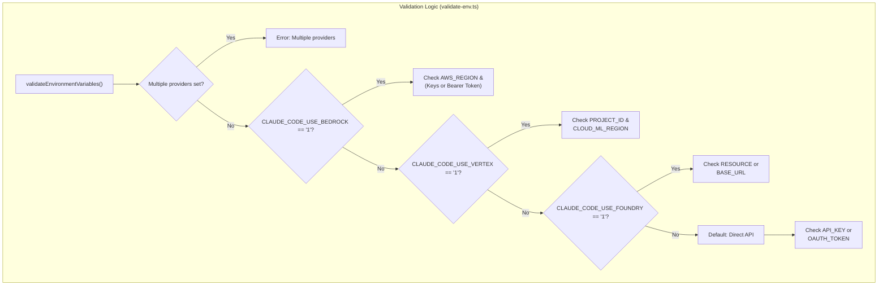
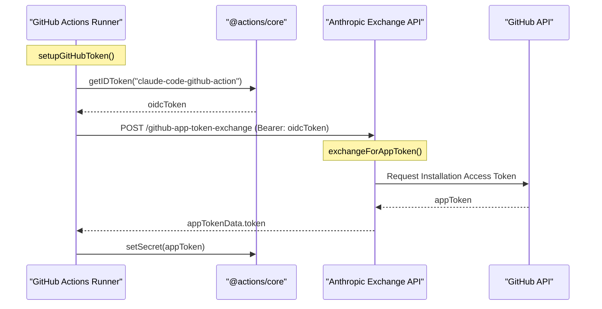

<!-- source: DeepWiki mcp.deepwiki.com · repo anthropics/claude-code-action · page 3.3 Authentication Providers · fetched 2026-10-26 -->

# Authentication Providers

<details>
<summary>Relevant source files</summary>

The following files were used as context for generating this wiki page:

- [action.yml](action.yml)
- [base-action/action.yml](base-action/action.yml)
- [docs/capabilities-and-limitations.md](docs/capabilities-and-limitations.md)
- [docs/cloud-providers.md](docs/cloud-providers.md)
- [docs/configuration.md](docs/configuration.md)
- [docs/experimental.md](docs/experimental.md)
- [docs/faq.md](docs/faq.md)
- [src/github/token.ts](src/github/token.ts)
- [src/utils/retry.ts](src/utils/retry.ts)
- [test/parse-permissions.test.ts](test/parse-permissions.test.ts)
- [test/token.test.ts](test/token.test.ts)

</details>


This document describes the authentication mechanisms supported by Claude Code Action for connecting to Claude AI services. The action supports four distinct authentication providers: direct Anthropic API, Amazon Bedrock, Google Vertex AI, and Microsoft Foundry.

## Overview

Claude Code Action supports multiple authentication providers to access Claude AI services. The provider is selected based on input flags (`use_bedrock`, `use_vertex`, `use_foundry`). When no provider flag is set, the action defaults to the direct Anthropic API.

| Provider | Authentication Method | Primary Use Case |
|----------|---------------------|------------------|
| **Direct Anthropic API** | API Key or OAuth Token | Standard deployments with direct Anthropic access |
| **Amazon Bedrock** | AWS OIDC + IAM Roles | AWS-native deployments, enterprise AWS environments |
| **Google Vertex AI** | GCP OIDC + Service Accounts | GCP-native deployments, Google Cloud Platform integration |
| **Microsoft Foundry** | Azure OIDC + Managed Identity | Azure-native deployments, Microsoft ecosystem integration |

**Sources:** [action.yml:66-102](), [base-action/action.yml:28-68](), [docs/cloud-providers.md:3-8]()

## Provider Selection and Validation

The action uses `validateEnvironmentVariables` in the base action to ensure that required credentials for the selected provider are present and that providers are not mixed.

### Code Entity Mapping: Environment Validation



**Sources:** [base-action/src/validate-env.ts:5-75](), [base-action/test/validate-env.test.ts:36-180]()

## Direct Anthropic API Authentication

The default provider. It requires either an `anthropic_api_key` or a `claude_code_oauth_token`.

### Configuration
```yaml
- uses: anthropics/claude-code-action@v1
  with:
    anthropic_api_key: ${{ secrets.ANTHROPIC_API_KEY }}
```

### Validation Requirements
- `ANTHROPIC_API_KEY` or `CLAUDE_CODE_OAUTH_TOKEN` must be present.
- If both are missing, the action throws an error during the validation phase.
- Support for Workload Identity Federation is available via `anthropic_federation_rule_id` and `anthropic_organization_id`, which allows the action to exchange a GitHub OIDC token for an Anthropic API token.

**Sources:** [base-action/src/validate-env.ts:23-27](), [base-action/action.yml:37-56](), [action.yml:73-86]()

## Amazon Bedrock Authentication

Uses Amazon Bedrock with OIDC authentication. This allows the action to assume an IAM role without storing long-lived AWS secrets.

### Configuration
```yaml
- uses: anthropics/claude-code-action@v1
  with:
    use_bedrock: "true"
    claude_args: "--model anthropic.claude-3-5-sonnet-20241022-v2:0"
```

### Validation Requirements
- `AWS_REGION` is mandatory.
- Must provide either `AWS_BEARER_TOKEN_BEDROCK` OR both `AWS_ACCESS_KEY_ID` and `AWS_SECRET_ACCESS_KEY`.
- The action automatically constructs `ANTHROPIC_BEDROCK_BASE_URL` from the region if not explicitly provided.

**Sources:** [base-action/src/validate-env.ts:28-47](), [docs/cloud-providers.md:29-35](), [base-action/action.yml:57-60]()

## Google Vertex AI Authentication

Integrates with Google Cloud's Vertex AI platform using OIDC and Workload Identity Federation.

### Configuration
```yaml
- uses: anthropics/claude-code-action@v1
  with:
    use_vertex: "true"
    claude_args: "--model claude-3-5-sonnet@20241022"
```

### Validation Requirements
- `ANTHROPIC_VERTEX_PROJECT_ID` is mandatory.
- `CLOUD_ML_REGION` is mandatory.

**Sources:** [base-action/src/validate-env.ts:48-58](), [docs/cloud-providers.md:38-43](), [base-action/action.yml:61-64]()

## Microsoft Foundry Authentication

Supports Microsoft Azure AI Foundry integration via OIDC.

### Configuration
```yaml
- uses: anthropics/claude-code-action@v1
  with:
    use_foundry: "true"
    env:
      ANTHROPIC_FOUNDRY_BASE_URL: https://my-resource.services.ai.azure.com
```

### Validation Requirements
- At least one of `ANTHROPIC_FOUNDRY_RESOURCE` or `ANTHROPIC_FOUNDRY_BASE_URL` must be provided.

**Sources:** [base-action/src/validate-env.ts:59-69](), [docs/cloud-providers.md:46-52](), [base-action/action.yml:65-68]()

## OIDC Token Exchange and GitHub App Tokens

The action features a sophisticated token exchange mechanism to securely obtain GitHub App tokens via OIDC. This is used for performing GitHub operations (like posting comments or creating branches) without requiring a manual `GITHUB_TOKEN` input.

### Code Entity Mapping: Token Exchange Flow



### Implementation Details
- **`getOidcToken()`**: Fetches the OIDC token from the GitHub environment using `core.getIDToken`. Requires `id-token: write` permission in the workflow. [src/github/token.ts:56-67]()
- **`exchangeForAppToken()`**: Sends the OIDC token to `https://api.anthropic.com/api/github/github-app-token-exchange` to receive a short-lived GitHub App token. It optionally includes requested `permissions`. [src/github/token.ts:103-156]()
- **`setupGitHubToken()`**: Orchestrates the flow, including `retryWithBackoff` and handling `WorkflowValidationSkipError`. [src/github/token.ts:158-185]()

### Workflow Validation Handling
If the token exchange fails with `workflow_not_found_on_default_branch` or "workflow validation failed", the system throws a `WorkflowValidationSkipError`. This typically happens when the action is first added to a repository on a non-default branch. The action will log a warning and skip execution rather than failing the build. [src/github/token.ts:24-54](), [src/github/token.ts:129-136]()

**Sources:** [src/github/token.ts:1-185](), [docs/faq.md:19-29]()

## Permissions and Scoping

When requesting an App token, the action passes requested permissions to the exchange API.

### Default Permissions
The action requests the following by default via `DEFAULT_PERMISSIONS`:
- `contents: write`
- `pull_requests: write`
- `issues: write`

**Sources:** [src/github/token.ts:69-73]()

### Additional Permissions
Users can request extra permissions (e.g., `actions: read` for CI log analysis) via the `additional_permissions` input. The `parseAdditionalPermissions` function merges these with the defaults. [src/github/token.ts:75-101]()

```yaml
with:
  additional_permissions: |
    actions: read
    checks: read
```

**Sources:** [docs/configuration.md:110-146](), [test/parse-permissions.test.ts:34-54]()

---

