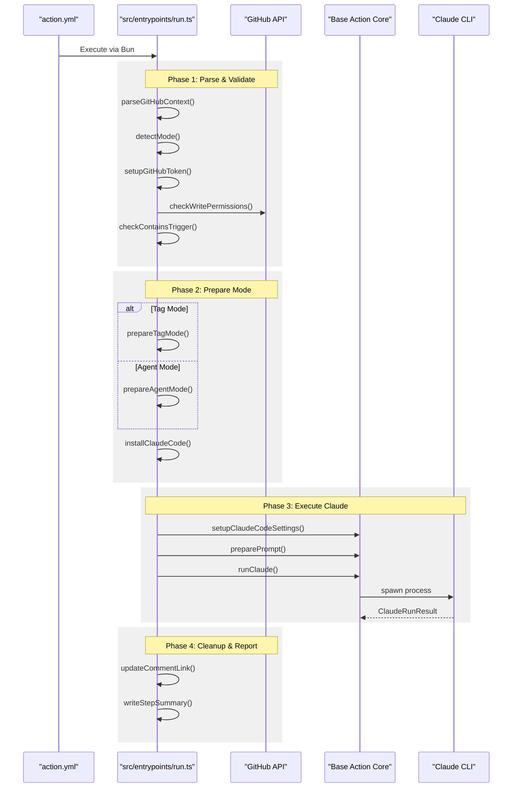

<!-- source: DeepWiki mcp.deepwiki.com · repo anthropics/claude-code-action · page 4 Architecture · fetched 2026-10-26 -->

# Architecture

Relevant source files

The following files were used as context for generating this wiki page:

- [action.yml](action.yml)
- [base-action/action.yml](base-action/action.yml)
- [base-action/bun.lock](base-action/bun.lock)
- [base-action/package.json](base-action/package.json)
- [bun.lock](bun.lock)
- [package.json](package.json)

## Purpose and Scope

This document provides a technical overview of the `claude-code-action` system architecture, including its dual-layer component design, execution phases, and major subsystems. This page covers the high-level architectural decisions and component relationships for developers and maintainers.

For detailed information on specific subsystems, see:
- [Dual-Action Architecture](#4.1) — Relationship between main and base actions.
- [Mode System Architecture](#4.2) — Tag vs agent mode detection and preparation.
- [MCP Integration Architecture](#4.3) — Model Context Protocol server configuration and tool permissions.
- [Prompt Generation Pipeline](#4.4) — Context-to-prompt transformation.
- [Execution Pipeline](#4.5) — Detailed phase-by-phase execution flow and cleanup guarantees.

## System Overview

The `claude-code-action` is a GitHub Actions integration that enables Claude AI to interact with GitHub repositories through two execution paradigms: **tag mode** (interactive, triggered by `@claude` mentions) and **agent mode** (automated, triggered by explicit prompts). The system uses a dual-layer architecture where the main action ([action.yml:1-156]()) handles GitHub-specific orchestration and delegates core Claude execution to a standalone base action ([base-action/action.yml:1-108]()).

The architecture consists of five major subsystems:

1.  **Event Processing & Validation**: Parses GitHub events, validates permissions, and detects triggers.
2.  **Mode Detection & Preparation**: Determines execution mode and prepares context/prompts.
3.  **Authentication Management**: Handles OIDC token exchange and multi-provider auth (Anthropic, Bedrock, Vertex, Foundry).
4.  **Claude Execution**: Runs Claude CLI with MCP tool integration.
5.  **Cleanup & Reporting**: Updates tracking comments and generates step summaries.

Sources: [action.yml:1-156](), [base-action/action.yml:1-108](), [src/entrypoints/run.ts:139-316]()

## Component Hierarchy

The system is structured as a hierarchical component architecture where the main action orchestrates GitHub integration while the base action focuses solely on Claude CLI execution.

### Architecture: Bridge from Natural Language to Code Entities

```mermaid
graph TB
    subgraph "Main Action Layer (claude-code-action)"
        ActionYML["action.yml<br/>(Main Entrypoint)"]
        RunTS["src/entrypoints/run.ts<br/>(Unified Orchestrator)"]
        
        subgraph "GitHub Integration"
            Token["src/github/token.ts<br/>(setupGitHubToken)"]
            Perms["src/github/validation/permissions.ts<br/>(checkWritePermissions)"]
            Context["src/github/context.ts<br/>(parseGitHubContext)"]
            Trigger["src/github/validation/trigger.ts<br/>(checkContainsTrigger)"]
        end
        
        subgraph "Mode Subsystem"
            Detector["src/modes/detector.ts<br/>(detectMode)"]
            TagMode["src/modes/tag/index.ts<br/>(prepareTagMode)"]
            AgentMode["src/modes/agent/index.ts<br/>(prepareAgentMode)"]
        end
        
        subgraph "Support Utilities"
            UpdateComment["src/entrypoints/update-comment-link.ts<br/>(updateCommentLink)"]
            FormatTurns["src/entrypoints/format-turns.ts<br/>(formatTurnsFromData)"]
        end
    end
    
    subgraph "Base Action Layer (claude-code-base-action)"
        BaseActionYML["base-action/action.yml<br/>(Standalone Entrypoint)"]
        
        subgraph "Claude Execution Core"
            ValidateEnv["base-action/src/validate-env.ts<br/>(validateEnvironmentVariables)"]
            SetupSettings["base-action/src/setup-claude-code-settings.ts<br/>(setupClaudeCodeSettings)"]
            InstallPlugins["base-action/src/install-plugins.ts<br/>(installPlugins)"]
            PreparePrompt["base-action/src/prepare-prompt.ts<br/>(preparePrompt)"]
            RunClaude["base-action/src/run-claude.ts<br/>(runClaude)"]
        end
    end
    
    ActionYML --> RunTS
    RunTS --> Token
    RunTS --> Perms
    RunTS --> Context
    RunTS --> Trigger
    RunTS --> Detector
    Detector --> TagMode
    Detector --> AgentMode
    RunTS --> UpdateComment
    RunTS --> FormatTurns
    
    RunTS -.->|"direct function imports"| ValidateEnv
    RunTS -.->|"direct function imports"| SetupSettings
    RunTS -.->|"direct function imports"| InstallPlugins
    RunTS -.->|"direct function imports"| PreparePrompt
    RunTS -.->|"direct function imports"| RunClaude
    
    BaseActionYML -.->|"invokes"| IndexTS["base-action/src/index.ts"]
    IndexTS --> ValidateEnv
    IndexTS --> SetupSettings
    IndexTS --> InstallPlugins
    IndexTS --> PreparePrompt
    IndexTS --> RunClaude
```

**Key Architectural Pattern**: The main action imports base action functions directly ([src/entrypoints/run.ts:37-41]()) rather than spawning a subprocess. This enables shared state, unified error handling, and a single process lifecycle for cleanup operations.

Sources: [src/entrypoints/run.ts:14-42](), [action.yml:152-161](), [base-action/action.yml:109-161]()

## Execution Phases

The system executes in four distinct phases with specific error handling boundaries, orchestrated by the `run()` function in `src/entrypoints/run.ts`.

### Execution Flow: Phase-by-Phase

**Error Attribution Mechanism**: The orchestrator uses a `prepareCompleted` flag ([src/entrypoints/run.ts:151]()) to distinguish between preparation failures (Phases 1-2) and execution failures (Phase 3). This allows the system to provide more accurate feedback in tracking comments and summaries.

Sources: [src/entrypoints/run.ts:139-316](), [src/entrypoints/run.ts:47-107]() (installClaudeCode), [src/entrypoints/run.ts:112-137]() (writeStepSummary)

## Component Responsibilities

| Component | Primary Responsibilities | Key Functions/Files |
|-----------|-------------------------|---------------------|
| **action.yml** | Entry point, input definitions, environment mapping, and composite run steps. | [action.yml:1-295]() |
| **run.ts** | Main orchestrator, phase coordination, error handling, and output management. | [src/entrypoints/run.ts:139-316]() |
| **GitHub Integration** | Token exchange, permission validation, event parsing, and trigger detection. | [src/github/token.ts](), [src/github/validation/permissions.ts](), [src/github/context.ts](), [src/github/validation/trigger.ts]() |
| **Mode System** | Auto-detection of Tag vs Agent mode and preparation of mode-specific prompts. | [src/modes/detector.ts](), [src/modes/tag/index.ts](), [src/modes/agent/index.ts]() |
| **Base Action** | Claude settings configuration, plugin installation, and CLI invocation. | [base-action/src/index.ts](), [base-action/src/run-claude.ts]() |
| **Reporting** | Formatting Claude's execution turns into GitHub Step Summaries. | [src/entrypoints/format-turns.ts](), [src/entrypoints/run.ts:112-137]() |

Sources: [src/entrypoints/run.ts:14-42](), [action.yml:7-139](), [base-action/action.yml:7-94]()

## Key Architectural Decisions

### 1. Dual-Layer Design
The repository maintains two actions: the feature-rich `claude-code-action` and the minimal `claude-code-base-action`. The main action handles GitHub context and interactive features, while the base action provides a clean interface for running Claude in any workflow. For details, see [Dual-Action Architecture](#4.1).

### 2. Mode Auto-Detection
The system uses `detectMode` ([src/modes/detector.ts]()) to automatically switch between **Tag Mode** (interactive) and **Agent Mode** (automated) based on whether a `prompt` input is provided or a GitHub event trigger (like an `@claude` mention) is detected. For details, see [Mode System Architecture](#4.2).

### 3. MCP-Based Tool Access
Claude interacts with the GitHub environment via the Model Context Protocol (MCP). The action dynamically configures MCP servers for tasks like file operations, commenting, and CI status checks. For details, see [MCP Integration Architecture](#4.3).

### 4. File-Based Prompt Communication
To avoid command-line length limits and handle large GitHub contexts (especially in Tag Mode), the action writes prompts to temporary files before execution using `preparePrompt` ([base-action/src/prepare-prompt.ts]()). For details, see [Prompt Generation Pipeline](#4.4).

### 5. Robust Installation & Cleanup
The `installClaudeCode` function ([src/entrypoints/run.ts:47-107]()) includes retry logic and timeout handling for the Claude CLI installation. A `finally` block in the orchestrator ensures that tracking comments are updated and summaries are written regardless of execution success. For details, see [Execution Pipeline](#4.5).

Sources: [src/entrypoints/run.ts:153-159](), [src/entrypoints/run.ts:228-234](), [src/entrypoints/run.ts:47-107](), [src/entrypoints/run.ts:260-311]()

---

