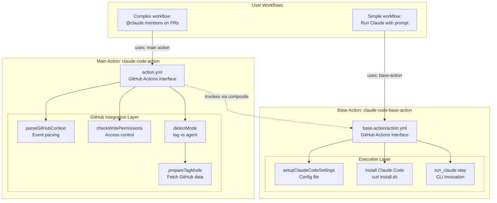
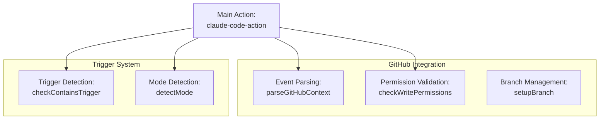
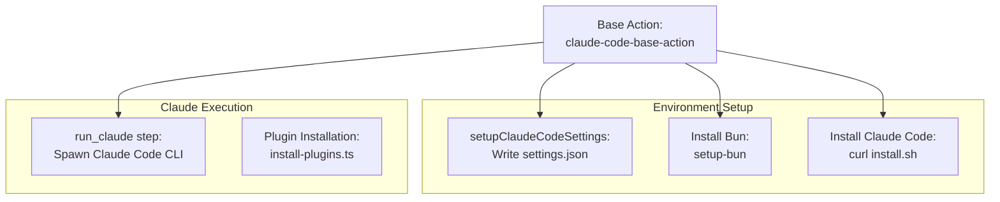

<!-- source: DeepWiki mcp.deepwiki.com · repo anthropics/claude-code-action · page 4.1 Dual-Action Architecture · fetched 2026-10-26 -->

# Dual-Action Architecture

Relevant source files

The following files were used as context for generating this wiki page:

- [.github/workflows/sync-base-action.yml](.github/workflows/sync-base-action.yml)
- [action.yml](action.yml)
- [base-action/MIRROR_DISCLAIMER.md](base-action/MIRROR_DISCLAIMER.md)
- [base-action/README.md](base-action/README.md)
- [base-action/action.yml](base-action/action.yml)
- [base-action/bun.lock](base-action/bun.lock)
- [base-action/package.json](base-action/package.json)
- [base-action/src/setup-claude-code-settings.ts](base-action/src/setup-claude-code-settings.ts)
- [base-action/test/setup-claude-code-settings.test.ts](base-action/test/setup-claude-code-settings.test.ts)

This document explains the two-layer architecture that separates GitHub automation concerns (main action) from Claude Code execution concerns (base action). For execution flow details, see [Execution Pipeline](). For mode-specific preparation logic, see [Mode System Architecture]().

## Overview

The repository contains two GitHub Actions that work together but can also operate independently:

1.  **Main action** (`claude-code-action`) - A GitHub-aware orchestrator that handles events, permissions, mode detection, and GitHub API integration. It is defined in the root [action.yml:1-205]().
2.  **Base action** (`claude-code-base-action`) - A standalone Claude Code executor with minimal dependencies, located in the `base-action/` directory. It is defined in [base-action/action.yml:1-216]().

The separation serves three architectural goals:
*   **Reusability**: Users can call `base-action` directly for simple Claude Code execution without GitHub integration overhead.
*   **Maintainability**: Clear responsibility boundaries between GitHub logic (main) and execution logic (base).
*   **Distribution**: The base action is synchronized to a separate mirror repository via an automated workflow [/.github/workflows/sync-base-action.yml:1-99]().

### Architectural Relationship Diagram

**Sources:** [action.yml:1-205](), [base-action/action.yml:1-216](), [/.github/workflows/sync-base-action.yml:1-99]()

## Design Rationale

### Why Two Actions?

The dual-action architecture emerged from competing requirements:

1.  **Simple use case**: Users who want to run Claude Code with a prompt in GitHub Actions should not need to understand GitHub event parsing or permission validation.
2.  **Complex use case**: Users who want `@claude` mentions on PRs need sophisticated GitHub integration (comment tracking, branch management, diff fetching).
3.  **Mirroring**: The `base-action` directory is mirrored to `anthropics/claude-code-base-action` to allow users to pin to a specialized, lightweight version of the tool [/.github/workflows/sync-base-action.yml:43-43]().

### Runtime and Dependencies

The `base-action` uses `Bun` as its primary runtime and package manager [base-action/package.json:8-10](). It relies on the `@anthropic-ai/claude-agent-sdk` for the core interaction with Claude [base-action/package.json:14-14](). By default, it uses Node.js `18.x` [base-action/action.yml:115-115]() and Bun `1.3.14` [base-action/action.yml:123-123]().

**Sources:** [base-action/package.json:1-24](), [base-action/action.yml:109-135]()

## Responsibility Boundaries

### Main Action Responsibilities
The main action (`claude-code-action`) acts as the "brain" for GitHub interactions, handling trigger detection and context gathering.

### Base Action Responsibilities
The base action (`claude-code-base-action`) is the "executor" responsible for environment setup and CLI invocation.

**Key Boundary Rules:**

| Concern | Owner | Implementation |
| :--- | :--- | :--- |
| **GitHub Context** | Main Action | Parsed from `github.event` [action.yml:1-55]() |
| **Claude Installation** | Base Action | Installs specific version (e.g., `2.1.209`) [base-action/action.yml:148-148]() |
| **Settings Management** | Base Action | Merges JSON and enforces `enableAllProjectMcpServers` [base-action/src/setup-claude-code-settings.ts:5-68]() |
| **CLI Arguments** | Shared | Main generates them; Base passes them to CLI [base-action/action.yml:23-26]() |

**Sources:** [action.yml:1-205](), [base-action/action.yml:1-216](), [base-action/src/setup-claude-code-settings.ts:5-68]()

## Communication Interface

The two actions communicate through environment variables and a shared file system (typically `RUNNER_TEMP`).

### Input Mapping
The `base-action` exposes a subset of inputs specifically for Claude execution:
*   `prompt` and `prompt_file` [base-action/action.yml:9-16]()
*   `claude_args` [base-action/action.yml:23-26]()
*   `anthropic_api_key`, `claude_code_oauth_token` [base-action/action.yml:29-36]()
*   Cloud provider flags (`use_bedrock`, `use_vertex`, `use_foundry`) [base-action/action.yml:57-68]()
*   Workload Identity Federation parameters [base-action/action.yml:37-56]()

### Sync Mechanism
The `base-action` directory is synchronized to the `claude-code-base-action` repository whenever changes are pushed to `main` in the `base-action/**` path [/.github/workflows/sync-base-action.yml:3-8](). 

The sync process:
1.  Clones the target repository [/.github/workflows/sync-base-action.yml:43-43]().
2.  Removes existing files (except `.git`) [/.github/workflows/sync-base-action.yml:54-54]().
3.  Copies contents from the `base-action/` directory [/.github/workflows/sync-base-action.yml:57-57]().
4.  Prepends a mirror disclaimer to the `README.md` [/.github/workflows/sync-base-action.yml:59-63]().

**Sources:** [/.github/workflows/sync-base-action.yml:1-99](), [base-action/MIRROR_DISCLAIMER.md:1-12]()

## Settings Configuration
The function `setupClaudeCodeSettings` in the base action ensures that the environment is correctly configured before Claude runs. It creates the `.claude/` directory [base-action/src/setup-claude-code-settings.ts:15-15](), merges provided JSON settings [base-action/src/setup-claude-code-settings.ts:58-58](), and forces `enableAllProjectMcpServers` to `true` to ensure MCP tools are available in CI [base-action/src/setup-claude-code-settings.ts:63-63]().

**Sources:** [base-action/src/setup-claude-code-settings.ts:5-68](), [base-action/test/setup-claude-code-settings.test.ts:30-37]()

---

