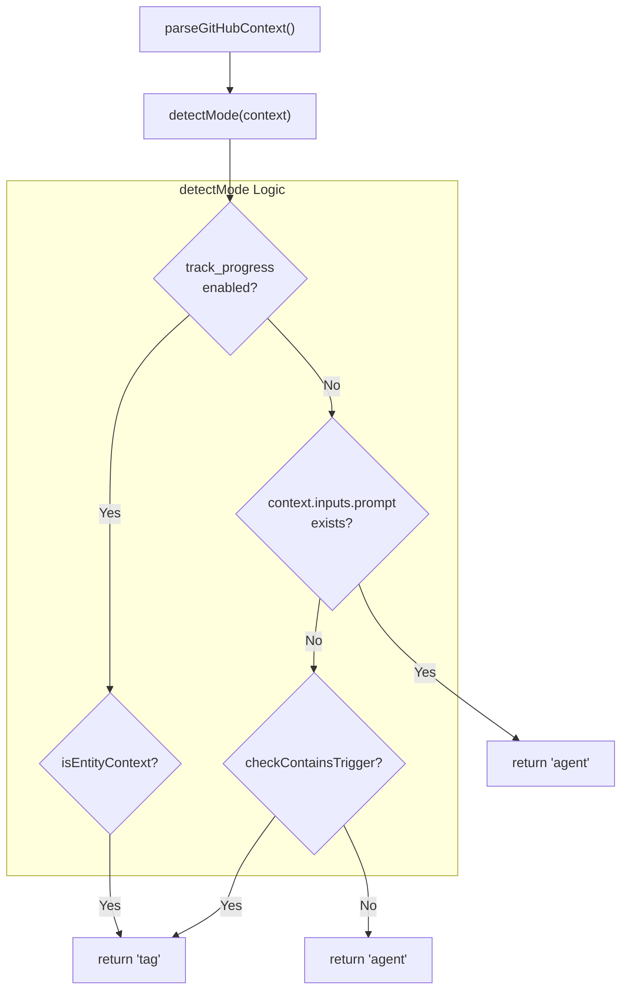
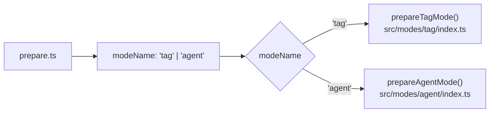
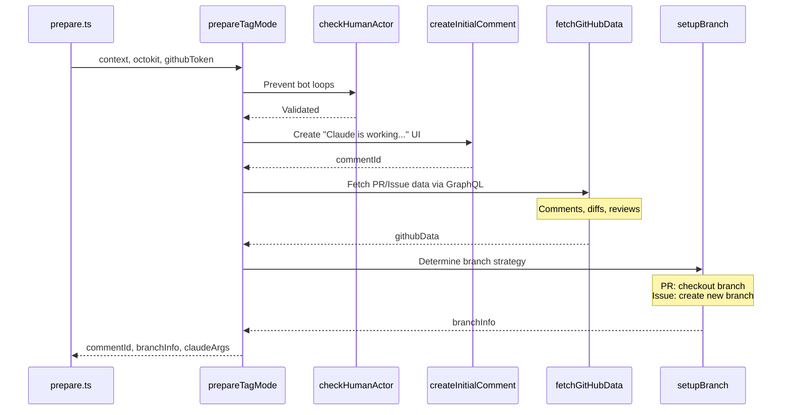
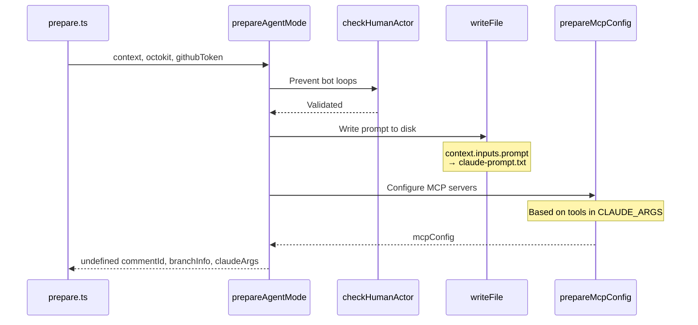
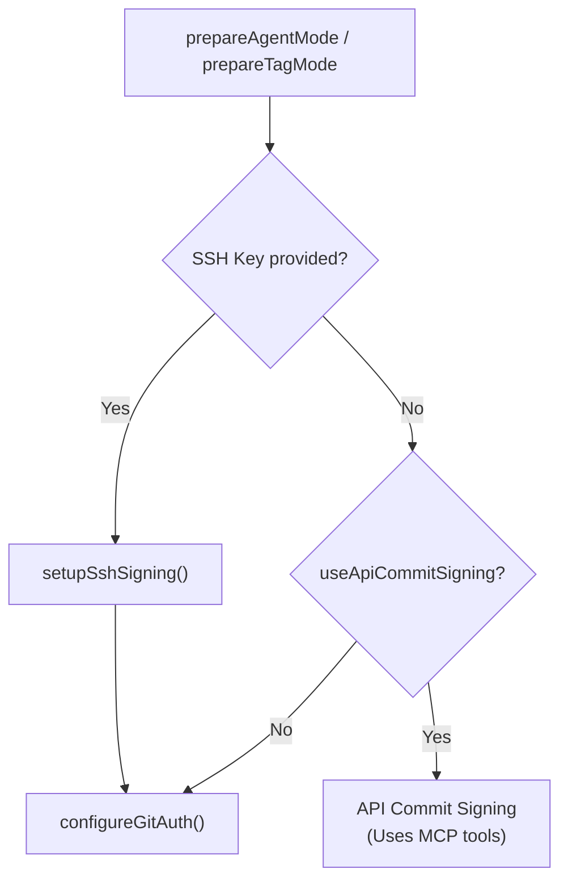

<!-- source: DeepWiki mcp.deepwiki.com · repo anthropics/claude-code-action · page 4.2 Mode System Architecture · fetched 2026-10-26 -->

# Mode System Architecture

<details>
<summary>Relevant source files</summary>

The following files were used as context for generating this wiki page:

- [src/modes/agent/index.ts](src/modes/agent/index.ts)
- [src/modes/agent/parse-tools.ts](src/modes/agent/parse-tools.ts)
- [src/modes/detector.ts](src/modes/detector.ts)
- [src/modes/tag/index.ts](src/modes/tag/index.ts)
- [test/modes/agent.test.ts](test/modes/agent.test.ts)
- [test/modes/parse-tools.test.ts](test/modes/parse-tools.test.ts)

</details>


## Purpose and Scope

This document details the mode system architecture, which determines how the action executes based on workflow configuration and event context. The system automatically detects between two execution modes—**tag mode** and **agent mode**—and prepares distinct execution pathways for each.

The architecture is centered around the `prepare.ts` entrypoint, which orchestrates detection and preparation before passing control to the main execution phase.

## Mode Detection System

Mode detection occurs early in the execution pipeline via the `detectMode()` function in [src/modes/detector.ts:14-81](). The detection logic is deterministic and based on the event context and input parameters like `prompt` and `track_progress`.

### Detection Logic Flow



**Detection Rules**

| Condition | Mode | Use Case |
|-----------|------|----------|
| `track_progress: true` on PR/Issue events | `tag` | Forced interactive mode for progress tracking [src/modes/detector.ts:21-31]() |
| `prompt` input provided | `agent` | Automation workflows with explicit instructions [src/modes/detector.ts:41-43](), [src/modes/detector.ts:54-56](), [src/modes/detector.ts:73-75]() |
| `@claude` mention, label, or assignee found | `tag` | Standard interactive UI-driven workflow [src/modes/detector.ts:45-47](), [src/modes/detector.ts:58-60]() |
| No prompt and no trigger | `agent` | Default state (will skip execution) [src/modes/detector.ts:80]() |

**Sources:** [src/modes/detector.ts:14-81]()

## Mode Dispatching

Once detected, the `prepare.ts` entrypoint dispatches to the specific preparation logic for that mode.



**Sources:** [src/modes/tag/index.ts:27-35](), [src/modes/agent/index.ts:19-27]()

## Tag Mode Architecture

Tag mode is designed for **human-AI interaction** within GitHub's UI. It responds to `@claude` mentions, issue assignments, or label additions. The preparation pathway is complex and GitHub-centric, focusing on building a rich context from the existing thread.

### Tag Mode Preparation Flow



### Tag Mode Tool Selection
Tag mode automatically configures a prescriptive set of tools for the Claude CLI, including:
- **File System**: `Glob`, `Grep`, `LS`, `Read` [src/modes/tag/index.ts:124-127]().
- **GitHub MCP**: `update_claude_comment`, `get_ci_status`, `get_workflow_run_details`, `download_job_log` [src/modes/tag/index.ts:128-131]().
- **Git Operations**: Bash wrappers for `git add`, `commit`, `push`, and `rm` if not using API signing [src/modes/tag/index.ts:137-143]().

**Sources:** [src/modes/tag/index.ts:27-188]()

## Agent Mode Architecture

Agent mode is designed for **headless automation workflows**. It bypasses GitHub UI integration (no tracking comments) and runs directly from workflow configuration prompts.

### Agent Mode Preparation Flow



### Tool Parsing Logic
Agent mode relies on `parseAllowedTools` to extract tool requirements from the `CLAUDE_ARGS` environment variable. This ensures the action only installs the MCP servers actually requested by the user [src/modes/agent/parse-tools.ts:52-81](). It supports:
- Multiple flags (`--allowedTools`, `--allowed-tools`) [src/modes/agent/parse-tools.ts:5-6]().
- Comment stripping to match CLI behavior [src/modes/agent/parse-tools.ts:12-17]().
- Consecutive non-flag values [src/modes/agent/parse-tools.ts:68-77]().

**Sources:** [src/modes/agent/index.ts:19-133](), [src/modes/agent/parse-tools.ts:52-81]()

## Convergence Points

Despite different preparation pathways, both modes converge on several critical infrastructure setups.

### Shared Git Authentication

Both modes use `configureGitAuth` and `setupSshSigning` to configure credentials.



**Sources:** [src/modes/agent/index.ts:33-65](), [src/modes/tag/index.ts:69-101]()

### Unified MCP Configuration

Both modes utilize `prepareMcpConfig` to generate the JSON configuration for the Claude CLI [src/mcp/install-mcp-server:8]().

```typescript
// Shared call pattern in both modes
const ourMcpConfig = await prepareMcpConfig({
  githubToken,
  owner: context.repository.owner,
  repo: context.repository.repo,
  branch: currentBranch,
  baseBranch: baseBranch,
  claudeCommentId: commentId, // undefined for agent mode
  allowedTools,
  mode: "agent", // or "tag"
  context,
});
```

**Sources:** [src/modes/agent/index.ts:98-108](), [src/modes/tag/index.ts:153-163]()

## Mode Output Comparison

The preparation phase ends by returning an object that defines the execution environment.

| Output Field | Tag Mode Value | Agent Mode Value |
|--------------|----------------|------------------|
| `commentId` | ID of tracking comment [src/modes/tag/index.ts:46]() | `undefined` [src/modes/agent/index.ts:124]() |
| `claudeArgs` | Prescriptive tools + `--permission-mode acceptEdits` [src/modes/tag/index.ts:175]() | User-provided `CLAUDE_ARGS` [src/modes/agent/index.ts:121]() |
| `branchInfo` | Determined by `setupBranch()` [src/modes/tag/index.ts:66]() | Detected from environment/inputs [src/modes/agent/index.ts:125-129]() |
| `mcpConfig` | Generated JSON string [src/modes/tag/index.ts:185]() | Generated JSON string [src/modes/agent/index.ts:130]() |

**Sources:** [src/modes/agent/index.ts:123-132](), [src/modes/tag/index.ts:182-187]()

---

