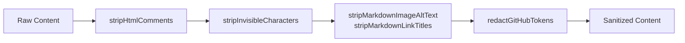
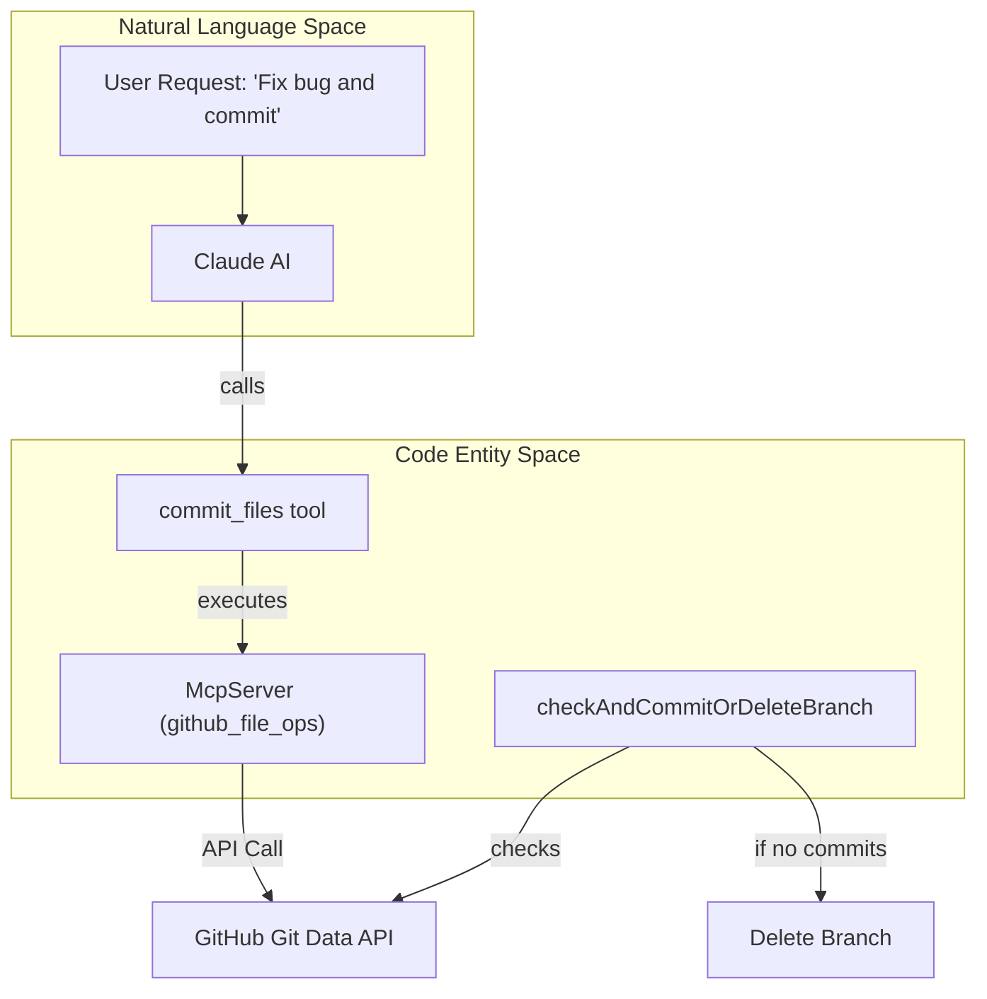

<!-- source: DeepWiki mcp.deepwiki.com · repo anthropics/claude-code-action · page 4.3 MCP Integration Architecture · fetched 2026-10-26 -->

# MCP Integration Architecture

<details>
<summary>Relevant source files</summary>

The following files were used as context for generating this wiki page:

- [src/github/operations/branch-cleanup.ts](src/github/operations/branch-cleanup.ts)
- [src/mcp/github-actions-server.ts](src/mcp/github-actions-server.ts)
- [src/mcp/github-file-ops-server.ts](src/mcp/github-file-ops-server.ts)
- [src/mcp/github-inline-comment-server.ts](src/mcp/github-inline-comment-server.ts)
- [src/mcp/inline-comment-buffer.ts](src/mcp/inline-comment-buffer.ts)
- [src/mcp/install-mcp-server.ts](src/mcp/install-mcp-server.ts)
- [test/branch-cleanup.test.ts](test/branch-cleanup.test.ts)
- [test/comment-logic.test.ts](test/comment-logic.test.ts)
- [test/inline-comment-buffer.test.ts](test/inline-comment-buffer.test.ts)
- [test/install-mcp-server.test.ts](test/install-mcp-server.test.ts)

</details>


## Purpose and Scope

This document details the Model Context Protocol (MCP) server system used by `claude-code-action` to provide Claude with structured, secure access to GitHub APIs. It covers:

- The five built-in MCP servers and their purposes.
- Dynamic server configuration based on mode and permissions.
- Tool access control and allowlisting mechanisms.
- Execution strategies (local Bun vs. Docker).
- Permission checking and buffering logic for inline comments.

For information about how execution modes (tag vs agent) affect MCP configuration, see [Mode System Architecture (4.2)](). For details on how tool configurations are passed to Claude, see [Prompt Generation Pipeline (4.4)]().

## Overview

The action uses MCP (Model Context Protocol) servers as an abstraction layer between Claude and GitHub's APIs. Rather than giving Claude direct API credentials for every request, each MCP server provides a specific set of tools with scoped permissions.

The configuration is generated dynamically by the `prepareMcpConfig` function [src/mcp/install-mcp-server.ts:52-54]() based on the execution mode, GitHub event type, and requested permissions.

**Sources**: [src/mcp/install-mcp-server.ts:52-230]()

## MCP Server Inventory

The action manages five MCP servers, each serving a distinct purpose:

| Server Name | Command | Purpose | Primary Tools | Inclusion Conditions |
|-------------|---------|---------|---------------|---------------------|
| `github_comment` | `bun` | Update tracking comments in issues/PRs | `update_claude_comment` | Tag mode always; agent mode only with explicit tools [src/mcp/install-mcp-server.ts:95-97]() |
| `github_file_ops` | `bun` | Commit files via GitHub API | `commit_files` | Only when `useCommitSigning=true` [src/mcp/install-mcp-server.ts:116-117]() |
| `github_inline_comment` | `bun` | Create PR review comments | `create_inline_comment` | Only for PRs when GitHub tools allowed [src/mcp/install-mcp-server.ts:138-142]() |
| `github_ci` | `bun` | Fetch CI/workflow status | `get_ci_status`, `get_workflow_run_details` | PRs with workflow token and `actions:read` [src/mcp/install-mcp-server.ts:166-170]() |
| `github` | `docker` | Comprehensive GitHub API access | Full GitHub API via Docker | When `mcp__github__*` tools allowed [src/mcp/install-mcp-server.ts:206-207]() |

**Sources**: [src/mcp/install-mcp-server.ts:88-224]()

## Configuration Generation Process

### prepareMcpConfig Function Flow

```mermaid
flowchart TD
    Start["prepareMcpConfig(params)"]
    Start --> ParseParams["Extract parameters:<br/>- githubToken<br/>- owner/repo<br/>- branch/baseBranch<br/>- allowedTools<br/>- mode<br/>- context"]
    
    ParseParams --> InitConfig["Initialize baseMcpConfig:<br/>{mcpServers: {}}"]
    
    InitConfig --> DetectMode{"mode === 'agent'?"}
    
    DetectMode -->|Yes| AgentMode["isAgentMode = true"]
    DetectMode -->|No| TagMode["isAgentMode = false"]
    
    AgentMode --> CheckComment
    TagMode --> CheckComment
    
    CheckComment["Check allowedTools for:<br/>- mcp__github_comment__*<br/>- mcp__github__*<br/>- mcp__github_inline_comment__*<br/>- mcp__github_ci__*"]
    
    CheckComment --> CommentServer{"shouldIncludeCommentServer?<br/>(!isAgentMode || hasGitHubCommentTools)"}
    
    CommentServer -->|Yes| AddComment["Add github_comment server:<br/>command: bun<br/>args: [github-comment-server.ts]<br/>env: {GITHUB_TOKEN, REPO_OWNER, etc}"]
    CommentServer -->|No| FileOpsCheck
    
    AddComment --> FileOpsCheck{"context.inputs.useCommitSigning?"}
    
    FileOpsCheck -->|Yes| AddFileOps["Add github_file_ops server:<br/>command: bun<br/>args: [github-file-ops-server.ts]<br/>env: {GITHUB_TOKEN, BRANCH_NAME, etc}"]
    FileOpsCheck -->|No| InlineCheck
    
    AddFileOps --> InlineCheck{"isEntityContext(context)<br/>&& context.isPR<br/>&& (hasGitHubMcpTools || hasInlineCommentTools)?"}
    
    InlineCheck -->|Yes| AddInline["Add github_inline_comment server:<br/>command: bun<br/>args: [github-inline-comment-server.ts]<br/>env: {GITHUB_TOKEN, PR_NUMBER, etc}"]
    InlineCheck -->|No| CICheck
    
    AddInline --> CICheck{"(!isAgentMode || hasGitHubCITools)<br/>&& isEntityContext(context)<br/>&& context.isPR<br/>&& hasWorkflowToken?"}
    
    CICheck -->|Yes| PermCheck["checkActionsReadPermission(token, owner, repo)"]
    CICheck -->|No| GitHubCheck
    
    PermCheck --> HasPerm{"Has actions:read?"}
    
    HasPerm -->|Yes| AddCI["Add github_ci server:<br/>command: bun<br/>args: [github-actions-server.ts]<br/>env: {GITHUB_TOKEN (workflow), etc}"]
    HasPerm -->|No| WarnCI["core.warning('CI server requires actions:read')"]
    
    AddCI --> GitHubCheck
    WarnCI --> GitHubCheck
    
    GitHubCheck{"hasGitHubMcpTools?"}
    
    GitHubCheck -->|Yes| AddGitHub["Add github server:<br/>command: docker<br/>image: ghcr.io/github/github-mcp-server<br/>env: {GITHUB_PERSONAL_ACCESS_TOKEN, etc}"]
    GitHubCheck -->|No| Return
    
    AddGitHub --> Return["Return JSON.stringify(baseMcpConfig)"]
```



**Sources**: [src/mcp/install-mcp-server.ts:52-230]()

## Server Implementation Details

### github_comment Server
**Implementation**: `src/mcp/github-comment-server.ts`
This server provides the `update_claude_comment` tool. It uses `updateClaudeComment` and applies `sanitizeContent` to the body before posting. It is used to provide progress updates in the GitHub issue or PR comment that triggered the action.

**Sources**: [src/mcp/github-comment-server.ts:98-112]()

### github_file_ops Server
**Implementation**: `src/mcp/github-file-ops-server.ts` [src/mcp/github-file-ops-server.ts:1-55]()
Provides the `commit_files` tool [src/mcp/github-file-ops-server.ts:196-197](). This server allows Claude to perform atomic commits via the GitHub Git Data API, which is essential when commit signing is enabled and local `git` CLI commits are restricted.
1. **Branch Management**: Uses `getOrCreateBranchRef` [src/mcp/github-file-ops-server.ts:58-63]() to ensure the target branch exists.
2. **Atomic Commits**: Resolves file modes via `getFileMode` [src/mcp/github-file-ops-server.ts:168]() and validates paths using `validatePathWithinRepo` [src/mcp/github-file-ops-server.ts:221]().

**Sources**: [src/mcp/github-file-ops-server.ts:1-225]()

### github_inline_comment Server
**Implementation**: `src/mcp/github-inline-comment-server.ts` [src/mcp/github-inline-comment-server.ts:1-35]()
Provides `create_inline_comment` [src/mcp/github-inline-comment-server.ts:37-38](). 
**Buffering Logic**: To prevent subagents from posting "test" comments, calls are buffered to `/tmp/inline-comments-buffer.jsonl` [src/mcp/github-inline-comment-server.ts:19]() unless `confirmed: true` is passed [src/mcp/github-inline-comment-server.ts:111-112](). 
**Deduplication**: When a comment is posted with `confirmed: true`, the server calls `removeBufferedComment` [src/mcp/github-inline-comment-server.ts:188-191]() to clean up any matching entries in the buffer, preventing duplicate posts during the post-execution cleanup phase.

**Sources**: [src/mcp/github-inline-comment-server.ts:1-192](), [src/mcp/inline-comment-buffer.ts:23-54]()

### github_ci Server
**Implementation**: `src/mcp/github-actions-server.ts` [src/mcp/github-actions-server.ts:1-26]()
Provides tools to query PR health and CI logs:
- `get_ci_status`: Summarizes workflow runs for the head SHA [src/mcp/github-actions-server.ts:30-32]().
- `get_workflow_run_details`: Lists jobs and identifies failed steps [src/mcp/github-actions-server.ts:137-139]().
- `download_job_log`: Downloads raw logs to `RUNNER_TEMP` [src/mcp/github-actions-server.ts:205-207]().

**Sources**: [src/mcp/github-actions-server.ts:1-211]()

## Security and Content Sanitization

All MCP servers that post content back to GitHub (comments, commits) utilize the `sanitizeContent` utility.

### Sanitization Pipeline


The `redactGitHubTokens` function specifically targets various GitHub token formats (PATs, OAuth, Installation tokens) to prevent accidental credential leakage in Claude's output.

**Sources**: [src/mcp/github-inline-comment-server.ts:102](), [src/mcp/github-file-ops-server.ts:231]()

## Branch and File Operations Integration

The MCP system interacts closely with the repository's branch state. The `checkAndCommitOrDeleteBranch` function [src/github/operations/branch-cleanup.ts:5]() is used during the cleanup phase to determine if a branch created for Claude's changes should be kept or deleted based on whether commits were actually made.



**Sources**: [src/github/operations/branch-cleanup.ts:5-132](), [src/mcp/github-file-ops-server.ts:196-210]()

## Permission Verification

The `github_ci` server requires `actions:read` permission. The system verifies this using `checkActionsReadPermission` [src/mcp/install-mcp-server.ts:20]().

```typescript
// src/mcp/install-mcp-server.ts:20-50
async function checkActionsReadPermission(token: string, owner: string, repo: string): Promise<boolean> {
  try {
    const client = new Octokit({ auth: token, baseUrl: GITHUB_API_URL });
    await client.actions.listWorkflowRunsForRepo({ owner, repo, per_page: 1 });
    return true;
  } catch (error: any) {
    if (error.status === 403 && error.message?.includes("Resource not accessible")) {
      return false;
    }
    return false;
  }
}
```

If the check fails, the server is omitted from the configuration and a warning is logged [src/mcp/install-mcp-server.ts:180-186]().

**Sources**: [src/mcp/install-mcp-server.ts:20-50](), [src/mcp/install-mcp-server.ts:173-187]()

---

