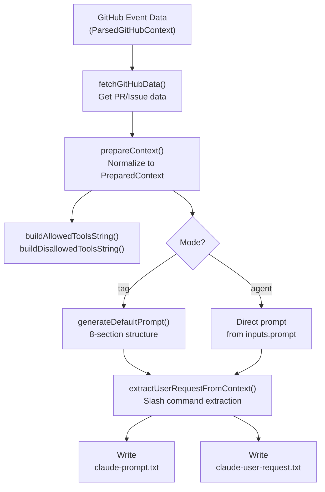
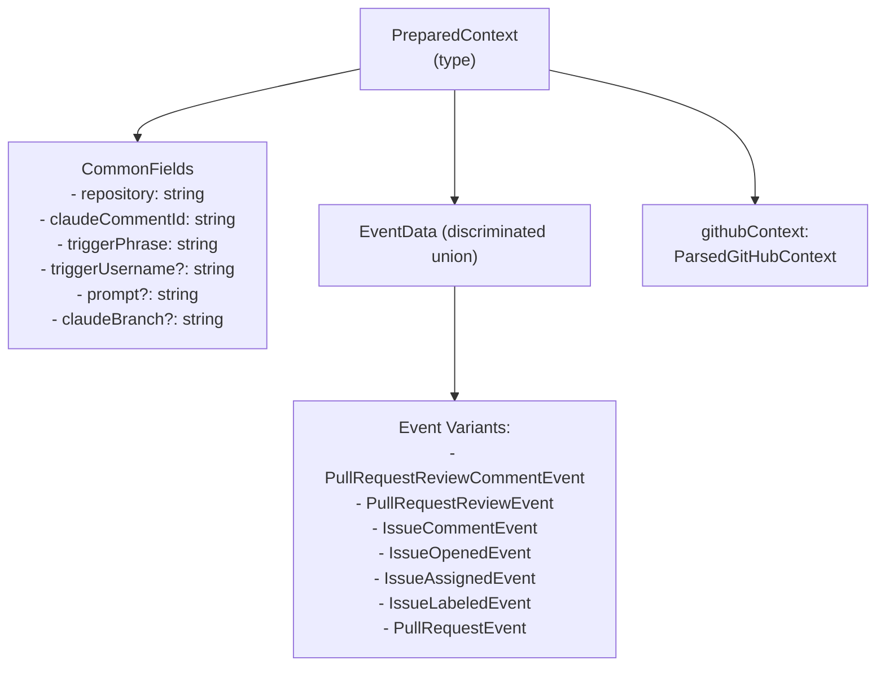
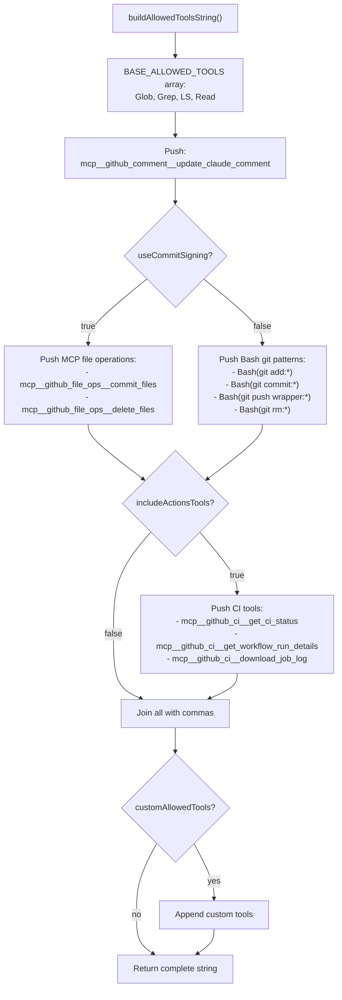

<!-- source: DeepWiki mcp.deepwiki.com · repo anthropics/claude-code-action · page 4.4 Prompt Generation Pipeline · fetched 2026-10-26 -->

# Prompt Generation Pipeline

Relevant source files

The following files were used as context for generating this wiki page:

- [src/create-prompt/index.ts](src/create-prompt/index.ts)
- [src/create-prompt/types.ts](src/create-prompt/types.ts)
- [src/github/api/queries/github.ts](src/github/api/queries/github.ts)
- [src/github/data/fetcher.ts](src/github/data/fetcher.ts)
- [src/github/data/formatter.ts](src/github/data/formatter.ts)
- [src/github/types.ts](src/github/types.ts)
- [test/create-prompt.test.ts](test/create-prompt.test.ts)
- [test/data-fetcher.test.ts](test/data-fetcher.test.ts)
- [test/data-formatter.test.ts](test/data-formatter.test.ts)
- [test/prepare-context.test.ts](test/prepare-context.test.ts)

## Overview

The prompt generation pipeline transforms GitHub event data and repository context into comprehensive prompts that instruct Claude on how to respond. This system handles two distinct workflows: **tag mode** (interactive, GitHub-driven) generates rich 8-section prompts with full context assembly, while **agent mode** (automation, prompt-driven) passes through user-provided prompts directly.

**Key Implementation Files:**
- [src/create-prompt/index.ts:1-981]() — Main prompt generation logic.
- [src/modes/tag/index.ts:104-111]() — Tag mode prompt creation call site.
- [src/create-prompt/types.ts:1-114]() — Type definitions for `PreparedContext` and `EventData`.

**Related Pages:** See page 4.2 for mode system architecture, page 4.3 for MCP tool configuration, and page 4.5 for the overall execution pipeline.

## Pipeline Architecture

The pipeline begins by fetching raw data from GitHub, normalizing it into a standard context object, and then branching based on the execution mode.

**Pipeline Flow Diagram**

**Sources:** [src/create-prompt/index.ts:899-981](), [src/modes/tag/index.ts:104-111](), [src/modes/tag/index.ts:27-35]()

## Context Normalization (`prepareContext`)

The `prepareContext` function normalizes disparate GitHub event payloads into a unified `PreparedContext` structure. This normalization layer decouples prompt generation from GitHub's event-specific payload schemas.

### PreparedContext Type Structure

**Type Hierarchy Diagram**

**Sources:** [src/create-prompt/types.ts:1-114](), [src/create-prompt/index.ts:112-116]()

### Event-Specific Field Extraction

The function extracts different required and optional fields based on event type:

**Event Field Requirements Table**

| eventName | eventAction | Required Fields | Optional/Conditional Fields |
|-----------|-------------|----------------|----------------------------|
| `pull_request_review_comment` | - | `prNumber`, `commentBody` | `commentId`, `claudeBranch`, `baseBranch` |
| `pull_request_review` | - | `prNumber` | `commentBody`, `claudeBranch`, `baseBranch` |
| `issue_comment` (PR/Issue) | - | `commentId`, `commentBody` | `prNumber`, `issueNumber`, `claudeBranch`, `baseBranch` |
| `issues` | `opened` | `issueNumber`, `baseBranch`, `claudeBranch` | - |
| `issues` | `assigned` | `issueNumber`, `baseBranch`, `claudeBranch` | `assigneeTrigger` |
| `issues` | `labeled` | `issueNumber`, `baseBranch`, `claudeBranch` | `labelTrigger` |
| `pull_request` | any | `prNumber` | `eventAction`, `claudeBranch`, `baseBranch` |

**Sources:** [src/create-prompt/index.ts:156-331]()

## Data Fetching and Security

Before formatting the prompt, the system fetches detailed data using GraphQL queries (`PR_QUERY`, `ISSUE_QUERY`). To prevent race conditions and prompt injection, the `fetcher` implements several security checks.

### Time-Based Context Filtering
The `fetcher.ts` utility filters comments and reviews based on the trigger timestamp. This ensures Claude only sees content that existed when the authorized user issued the command.

- `filterCommentsToTriggerTime`: Excludes comments created or edited after the trigger event [src/github/data/fetcher.ts:109-135]().
- `isBodySafeToUse`: Validates that the PR/Issue body hasn't been modified after the trigger [src/github/data/fetcher.ts:177-200]().

**Sources:** [src/github/data/fetcher.ts:1-200](), [src/github/api/queries/github.ts:3-147]()

## Tool Configuration System

Tool configuration determines Claude's capabilities through allowlist and blocklist strings. The system dynamically constructs these based on mode, commit signing configuration, and user-provided tools.

### `buildAllowedToolsString` Implementation

This function assembles a comma-separated allowlist of tools. In tag mode, it intentionally omits `Edit`, `MultiEdit`, and `Write` because the action uses the `acceptEdits` permission mode, which auto-allows file edits inside `$GITHUB_WORKSPACE` while preventing writes to sensitive runner paths.

**Tool Assembly Logic**

**Sources:** [src/create-prompt/index.ts:34-77](), [src/modes/tag/index.ts:119-150]()

## Tag Mode Prompt Generation (8-Section Structure)

Tag mode generates comprehensive prompts following a structured template in `generateDefaultPrompt`.

### The 8 Sections in Detail

1.  **Header Context**: Role definition ("You are Claude, an AI assistant...") [src/create-prompt/index.ts:651-656]().
2.  **Entity Body**: Original issue/PR description wrapped in `<pr_or_issue_body>` [src/create-prompt/index.ts:657-660]().
3.  **Comments**: Chronological comment thread wrapped in `<comments>` [src/create-prompt/index.ts:662-664]().
4.  **Review Comments**: Inline code review comments wrapped in `<review_comments>` [src/create-prompt/index.ts:666-671]().
5.  **Changed Files**: File diffs with SHA verification wrapped in `<changed_files>` [src/create-prompt/index.ts:673-678]().
6.  **Event Metadata**: Structured tags like `<event_type>`, `<repository>`, and `<pr_number>` [src/create-prompt/index.ts:681-691]().
7.  **Trigger Comment**: The specific comment that invoked Claude, sanitized and wrapped in `<trigger_comment>` [src/create-prompt/index.ts:692-700]().
8.  **Task Instructions**: Comprehensive workflow guidance including the 5-step execution plan and commit instructions via `getCommitInstructions()` [src/create-prompt/index.ts:701-870]().

**Sources:** [src/create-prompt/index.ts:608-873]()

### Context Formatting and Sanitization

The `formatter.ts` module handles the transformation of raw GitHub data into the strings used in the 8 sections. It also handles image URL replacement to point to local paths downloaded by the action [src/github/data/formatter.ts:42-55]().

To prevent prompt injection and ensure safety, all GitHub content (titles, bodies, comments) is processed through `sanitizeContent` before inclusion in the prompt.

**Sources:** [src/github/data/formatter.ts:1-154](), [src/github/utils/sanitizer.ts:1-20]()

## User Request Extraction (`USER_REQUEST_FILENAME`)

The pipeline extracts the user's specific request to enable slash command processing in the Claude Code CLI.

**Extraction Logic:**
1.  `extractUserRequestFromContext` identifies the triggering text (e.g., from an issue comment or PR review) [src/create-prompt/index.ts:891-942]().
2.  `extractUserRequest` strips the trigger phrase (e.g., `@claude`) to isolate the command [src/utils/extract-user-request.ts:1-24]().
3.  If a request is found, it is written to a separate file defined by `USER_REQUEST_FILENAME` (`claude-user-request.txt`) [src/create-prompt/index.ts:29]().

This split allows the Claude CLI to distinguish between the background context (provided in the main prompt) and the immediate user command.

**Sources:** [src/create-prompt/index.ts:29](), [src/create-prompt/index.ts:891-942](), [src/utils/extract-user-request.ts:1-24]()

## File Output and Environment Variables

The `createPrompt` function coordinates the final output:

- **Directory**: Creates `${RUNNER_TEMP}/claude-prompts` [src/create-prompt/index.ts:948]().
- **Main Prompt**: Writes `claude-prompt.txt` [src/create-prompt/index.ts:953]().
- **User Request**: Writes `claude-user-request.txt` if a request was extracted [src/create-prompt/index.ts:957]().
- **Environment Variables**: Exports `ALLOWED_TOOLS`, `DISALLOWED_TOOLS`, and `INPUT_PROMPT_FILE` for the base action to use when invoking the Claude CLI [src/create-prompt/index.ts:965-979]().

**Sources:** [src/create-prompt/index.ts:944-979]()

---

