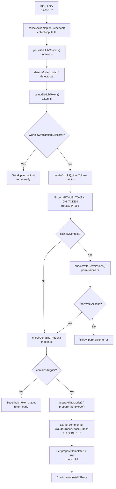
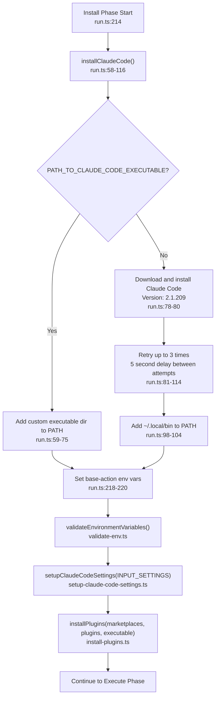
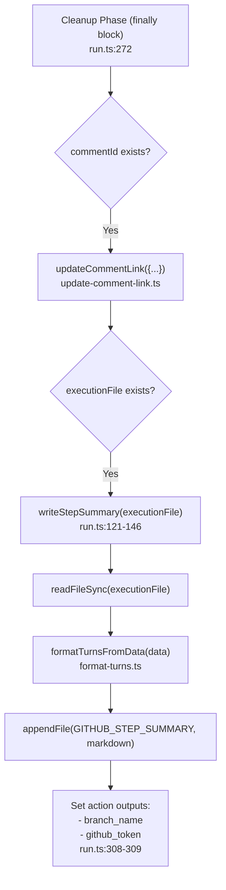

<!-- source: DeepWiki mcp.deepwiki.com · repo anthropics/claude-code-action · page 4.5 Execution Pipeline · fetched 2026-10-26 -->

# Execution Pipeline

Relevant source files

The following files were used as context for generating this wiki page:

- [base-action/src/execution-file.ts](base-action/src/execution-file.ts)
- [base-action/src/index.ts](base-action/src/index.ts)
- [base-action/src/run-claude-sdk.ts](base-action/src/run-claude-sdk.ts)
- [base-action/src/run-claude.ts](base-action/src/run-claude.ts)
- [base-action/test/execution-file.test.ts](base-action/test/execution-file.test.ts)
- [base-action/test/run-claude-sdk.test.ts](base-action/test/run-claude-sdk.test.ts)
- [src/entrypoints/prepare.ts](src/entrypoints/prepare.ts)
- [src/entrypoints/run.ts](src/entrypoints/run.ts)
- [src/entrypoints/update-comment-link.ts](src/entrypoints/update-comment-link.ts)
- [src/github/operations/comment-logic.ts](src/github/operations/comment-logic.ts)
- [test/install-pipefail.test.ts](test/install-pipefail.test.ts)

This document describes the four-phase execution pipeline that orchestrates the entire Claude Code Action workflow. The pipeline ensures consistent behavior, proper resource cleanup, and clear error attribution across all execution modes.

For information about mode-specific behavior within the pipeline, see [Mode System Architecture](4.2). For MCP server configuration during execution, see [MCP Integration Architecture](4.3). For prompt generation that feeds into the execution phase, see [Prompt Generation Pipeline](4.4).

## Pipeline Overview

The Claude Code Action executes through four distinct phases: **Prepare**, **Install**, **Execute**, and **Cleanup**. The pipeline is implemented in [src/entrypoints/run.ts:162-315]() as the main `run()` function, which orchestrates all phases in a single TypeScript process.

Title: Four-Phase Execution Flow

```mermaid
graph TD
    Start["GitHub Action Triggered<br/>(action.yml)"]
    
    Start --> Phase1["Phase 1: Prepare<br/>run.ts:163-211"]
    
    subgraph "Prepare Phase"
        P1["collectActionInputsPresence()<br/>collect-inputs.ts"]
        P2["parseGitHubContext()<br/>context.ts"]
        P3["detectMode(context)<br/>detector.ts"]
        P4["setupGitHubToken()<br/>token.ts"]
        P5["createOctokit(token)<br/>client.ts"]
        P6["checkWritePermissions()<br/>permissions.ts"]
        P7["prepareTagMode() / prepareAgentMode()<br/>tag.ts / agent.ts"]
        
        P1 --> P2 --> P3 --> P4 --> P5 --> P6 --> P7
    end
    
    Phase1 --> Phase2["Phase 2: Install<br/>run.ts:214-230"]
    
    subgraph "Install Phase"
        I1["installClaudeCode()<br/>run.ts:58-116"]
        I2["validateEnvironmentVariables()<br/>validate-env.ts"]
        I3["setupClaudeCodeSettings()<br/>setup-claude-code-settings.ts"]
        I4["installPlugins()<br/>install-plugins.ts"]
        
        I1 --> I2 --> I3 --> I4
    end
    
    Phase2 --> Phase3["Phase 3: Execute<br/>run.ts:232-262"]
    
    subgraph "Execute Phase"
        E1["preparePrompt({promptFile})<br/>prepare-prompt.ts"]
        E2["runClaude(promptPath, options)<br/>run-claude.ts"]
        E3["runClaudeWithSdk(promptPath, options)<br/>run-claude-sdk.ts"]
        E4["query({prompt, options})<br/>Claude Agent SDK"]
        E5["Stream SDKMessage[]<br/>Log and sanitize"]
        E6["Extract session_id and results<br/>run-claude-sdk.ts:197-215"]
        
        E1 --> E2 --> E3 --> E4 --> E5 --> E6
    end
    
    Phase3 --> Phase4["Phase 4: Cleanup<br/>run.ts:272-310"]
    
    subgraph "Cleanup Phase (Always Runs)"
        C1["updateCommentLink()<br/>update-comment-link.ts"]
        C2["writeStepSummary()<br/>run.ts:121-146"]
        C3["Set action outputs<br/>branch_name, github_token"]
        
        C1 --> C2 --> C3
    end
    
    Phase4 --> End["Action Complete"]
    
    Phase3 -.->|"On Error"| Phase4
    Phase2 -.->|"On Error"| Phase4
    Phase1 -.->|"On Error"| Phase4
```

**Key Pipeline Characteristics:**

| Characteristic | Implementation |
|---------------|----------------|
| **Single Process** | All phases execute in one TypeScript process via `bun run` [src/entrypoints/run.ts:1]() |
| **Always Cleanup** | Phase 4 runs in a `finally` block, guaranteeing execution [src/entrypoints/run.ts:272]() |
| **Error Attribution** | `prepareCompleted` flag distinguishes prepare vs. execution failures [src/entrypoints/run.ts:161, 198]() |
| **Direct Imports** | Base-action functions are imported directly, not run as subprocess [src/entrypoints/run.ts:37-43]() |

**Sources:** [src/entrypoints/run.ts:1-315](), [base-action/src/run-claude.ts:19-25]()

## Phase 1: Prepare

The Prepare phase handles all GitHub integration, authentication, permission validation, and mode-specific preparation. This phase determines whether execution should proceed and sets up all necessary context.

Title: Prepare Phase Detail

**Key Functions in Prepare Phase:**

| Function | File | Purpose |
|----------|------|---------|
| `collectActionInputsPresence()` | [src/entrypoints/collect-inputs.ts]() | Determines which action inputs were explicitly set |
| `parseGitHubContext()` | [src/github/context.ts]() | Parses GitHub webhook event into structured context |
| `detectMode()` | [src/modes/detector.ts]() | Selects agent or tag mode based on context |
| `setupGitHubToken()` | [src/github/token.ts]() | Obtains GitHub App token via OIDC or uses override |
| `checkWritePermissions()` | [src/github/validation/permissions.ts]() | Validates actor has write access to repository |
| `checkContainsTrigger()` | [src/github/validation/trigger.ts]() | Checks if trigger conditions are met |
| `prepareTagMode()` | [src/modes/tag.ts]() | Preparation for interactive tag mode |

**Sources:** [src/entrypoints/run.ts:163-211](), [src/github/token.ts:14-170](), [src/github/validation/permissions.ts:15-191]()

## Phase 2: Install

The Install phase sets up the Claude Code CLI and any requested plugins. This phase transforms the GitHub Actions runner into an environment capable of executing Claude with all necessary tools.

### Install Phase Flow

Title: Installation and Environment Setup

**Installation Retry Logic:**

The `installClaudeCode` function uses robust retry logic [src/entrypoints/run.ts:81-114]():
- Attempts installation up to 3 times.
- Uses `set -o pipefail` to ensure curl failures propagate through the pipe [src/entrypoints/run.ts:50-52]().
- 5 second delay between retry attempts.
- Throws error if all 3 attempts fail.

**Sources:** [src/entrypoints/run.ts:47-116, 214-230](), [base-action/src/validate-env.ts](), [base-action/src/setup-claude-code-settings.ts](), [base-action/src/install-plugins.ts]()

## Phase 3: Execute

The Execute phase runs Claude Code using the Agent SDK, streaming messages and collecting results. This phase bridges the prepared prompt and configuration into actual Claude API execution.

### Execute Phase Architecture

Title: Claude SDK Execution Flow

```mermaid
graph TB
    Entry["Execute Phase Start<br/>run.ts:232"]
    
    Entry --> PrepPrompt["preparePrompt({prompt: '', promptFile})<br/>prepare-prompt.ts"]
    
    PrepPrompt --> RunClaude["runClaude(promptConfig.path, options)<br/>run-claude.ts:19"]
    
    RunClaude --> ParseOpts["parseSdkOptions(options)<br/>parse-sdk-options.ts"]
    
    ParseOpts --> RunSDK["runClaudeWithSdk(promptPath, parsedOptions)<br/>run-claude-sdk.ts:135"]
    
    RunSDK --> CreatePrompt["createPromptConfig(promptPath, showFullOutput)<br/>run-claude-sdk.ts:41"]
    
    CreatePrompt --> CheckUserRequest{claude-user-request.txt exists?}
    
    CheckUserRequest -->|Yes| MultiBlock["Create AsyncIterable<SDKUserMessage><br/>Slash command support<br/>run-claude-sdk.ts:67-82"]
    
    CheckUserRequest -->|No| SimpleString["Return prompt as string<br/>run-claude-sdk.ts:53"]
    
    MultiBlock --> QuerySDK
    SimpleString --> QuerySDK
    
    QuerySDK["query({prompt, options: sdkOptions})<br/>@anthropic-ai/claude-agent-sdk<br/>run-claude-sdk.ts:160"]
    
    QuerySDK --> StreamLoop["for await (const message of query())"]
    
    StreamLoop --> Sanitize["sanitizeSdkOutput(message, showFullOutput)<br/>run-claude-sdk.ts:88-130"]
    
    Sanitize --> CheckResult{message.type === 'result'?}
    
    CheckResult -->|Yes| StoreResult["resultMessage = message<br/>run-claude-sdk.ts:168"]
    
    StoreResult --> WriteFile["writeFile(EXECUTION_FILE, messages)<br/>run-claude-sdk.ts:192"]
    
    WriteFile --> ExtractSession["Extract session_id from system.init<br/>run-claude-sdk.ts:198-205"]
    
    ExtractSession --> CheckSuccess{resultMessage.subtype === 'success'?}
    
    CheckSuccess -->|Yes| HandleStruct["Handle structured_output if --json-schema<br/>run-claude-sdk.ts:221-239"]
    
    HandleStruct --> SetOutputs["Set execution_file, session_id, structured_output<br/>run.ts:253-261"]
```

### Multi-Block Message Support

When a `claude-user-request.txt` file exists alongside the prompt file, the execute phase creates a multi-block message [base-action/src/run-claude-sdk.ts:48-83]():

- The instructions and context go first.
- The user's actual request goes last, allowing the CLI to detect slash commands.

### Output Sanitization

The `sanitizeSdkOutput()` function protects sensitive data in logs [base-action/src/run-claude-sdk.ts:88-130]():
- **Sanitized Mode** (default): Only shows safe metadata like model name, duration, turn count, and cost.
- **Full Output Mode**: Enabled via `show_full_output: true`, logs the complete JSON message.

**Sources:** [src/entrypoints/run.ts:232-262](), [base-action/src/run-claude.ts:19-25](), [base-action/src/run-claude-sdk.ts:1-245]()

## Phase 4: Cleanup

The Cleanup phase always runs, regardless of success or failure in previous phases. It updates tracking comments, writes step summaries, and ensures resource cleanup.

### Cleanup Phase Execution

Title: Cleanup and Reporting

### Cleanup Phase Components

**1. Comment Update** [src/entrypoints/run.ts:274-299]()
The `updateCommentLink` function provides feedback to users about execution status, including success/failure icons and links to the GitHub Actions run. It handles both Issue and PR Review comments [src/entrypoints/update-comment-link.ts:59-83]().

**2. Step Summary** [src/entrypoints/run.ts:121-146]()
The `writeStepSummary` function formats Claude's execution output into readable markdown. If formatting fails, it falls back to writing raw JSON with an error note [src/entrypoints/run.ts:134-144]().

**3. Final Outputs** [src/entrypoints/run.ts:308-309]()
Sets remaining action-level outputs:
- `branch_name`: The branch created or used by Claude.
- `github_token`: The GitHub App token for downstream steps.

**Sources:** [src/entrypoints/run.ts:121-146, 272-310](), [src/entrypoints/update-comment-link.ts:1-210]()

## Error Handling and Recovery

The execution pipeline implements comprehensive error handling to ensure proper resource cleanup and error reporting.

### Error Attribution

The cleanup phase uses the `prepareCompleted` flag [src/entrypoints/run.ts:161, 198] to distinguish between prepare and execution failures. If an error occurs before `prepareCompleted` is set to `true`, it is attributed to the preparation phase [src/entrypoints/run.ts:266-269]().

### Workload Identity Cleanup

The pipeline ensures that any workload identity federation tokens stop refreshing when the process exits via the `finally` block [base-action/src/index.ts:77-80]().

**Sources:** [src/entrypoints/run.ts:137-270](), [base-action/src/index.ts:13-81]()

---

