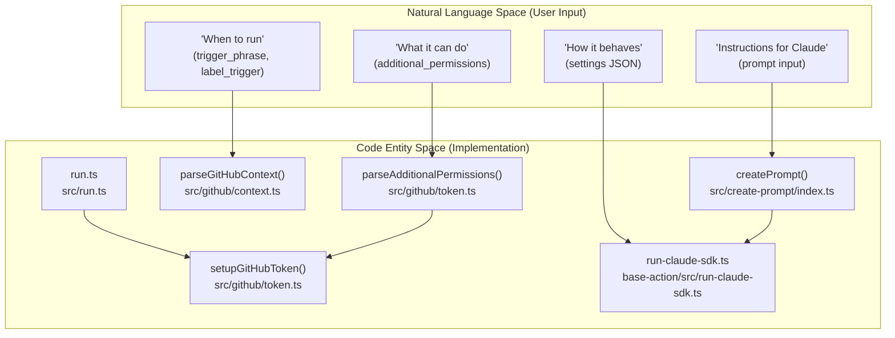
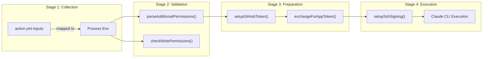

<!-- source: DeepWiki mcp.deepwiki.com · repo anthropics/claude-code-action · page 5 Configuration · fetched 2026-10-26 -->

# Configuration

Relevant source files

The following files were used as context for generating this wiki page:

- [action.yml](action.yml)
- [base-action/action.yml](base-action/action.yml)
- [docs/capabilities-and-limitations.md](docs/capabilities-and-limitations.md)
- [docs/cloud-providers.md](docs/cloud-providers.md)
- [docs/experimental.md](docs/experimental.md)
- [docs/faq.md](docs/faq.md)
- [docs/security.md](docs/security.md)
- [docs/usage.md](docs/usage.md)
- [src/github/operations/git-config.ts](src/github/operations/git-config.ts)
- [test/ssh-signing.test.ts](test/ssh-signing.test.ts)

## Purpose and Scope

This document provides a high-level overview of the Claude Code Action's configuration system. It explains how inputs are collected, processed, and passed between the main action and the base execution engine. The action supports a wide range of settings from basic triggers to advanced cloud provider authentication.

For detailed configuration guides, see the following child pages:
- [Action Inputs Reference](#5.1) — Complete reference of all parameters for `claude-code-action` and `claude-code-base-action`.
- [Authentication Configuration](#5.2) — Setup for Anthropic API, AWS Bedrock, Google Vertex AI, and OIDC token exchange.
- [Tool and Permission Configuration](#5.3) — Managing allowed tools, GitHub permissions, and MCP server access.
- [Advanced Settings](#5.4) — Commit signing, branch templates, sticky comments, and JSON settings.

## Configuration Architecture

The system uses a layered architecture. The main action ([action.yml:1-2]()) orchestrates the GitHub environment, while the base action ([base-action/action.yml:1-2]()) handles the actual execution of the Claude Code CLI.

### Configuration Flow: Natural Language to Code Entities

The following diagram bridges user-provided configuration (Natural Language Space) to the specific code entities that handle them (Code Entity Space).

**Sources:** [src/run.ts:1-50](), [src/github/token.ts:32-58](), [src/create-prompt/index.ts:1-50](), [base-action/src/run-claude-sdk.ts:1-30]()

## Configuration Methods

The action supports four primary configuration methods:

| Method | Source | Purpose |
| :--- | :--- | :--- |
| **Action Inputs** | `with:` block | Primary UI for users in YAML workflows. [action.yml:7-150]() |
| **Environment Variables** | `env:` block | Provider credentials and low-level CLI overrides (e.g. `CLAUDE_CODE_SUBPROCESS_ENV_SCRUB`). [docs/security.md:16-17]() |
| **Settings JSON** | `settings` input | Direct configuration of Claude Code CLI internal behavior. [base-action/action.yml:17-20]() |
| **Claude Args** | `claude_args` input | Raw CLI flags passed directly to the `claude` command. [base-action/action.yml:23-26]() |

**Sources:** [action.yml:7-150](), [base-action/action.yml:17-26](), [docs/security.md:16-17]()

## Configuration Categories

### 1. Trigger & Mode Configuration
Controls how the action detects events. It uses `trigger_phrase` (default `@claude`), `assignee_trigger`, and `label_trigger`. The action intelligently switches between **Tag Mode** (interactive) and **Agent Mode** (automation) based on the presence of the `prompt` input. For details, see [Action Inputs Reference](#5.1).
**Sources:** [action.yml:8-18](), [docs/experimental.md:5-49]()

### 2. Authentication & Cloud Providers
The action supports direct Anthropic API keys, OAuth, and OIDC-based authentication for AWS Bedrock, Google Vertex AI, and Microsoft Foundry. It can exchange a GitHub OIDC token for a GitHub App token via `setupGitHubToken()`. For details, see [Authentication Configuration](#5.2).
**Sources:** [docs/cloud-providers.md:1-52](), [src/github/token.ts:128-155]()

### 3. Tool & Permission Configuration
Users can restrict or expand Claude's capabilities using `claude_args` (e.g., `--allowedTools`). The action also manages repository-level permissions through `additional_permissions`. For details, see [Tool and Permission Configuration](#5.3).
**Sources:** [docs/security.md:18-22](), [action.yml:108-111]()

### 4. Git & Branching
Configures how Claude interacts with the repository. Key settings include `branch_name_template`, `use_commit_signing`, and `ssh_signing_key` for secure, verified commits. For details, see [Advanced Settings](#5.4).
**Sources:** [action.yml:26-29](), [src/github/operations/git-config.ts:90-123]()

## Configuration Processing Pipeline

The configuration flows through several stages before reaching the Claude CLI.

**Sources:** [src/github/token.ts:32-155](), [src/github/operations/git-config.ts:90-123](), [action.yml:186-273]()

### Key Code Entities in the Pipeline:
- `parseAdditionalPermissions`: Merges user-requested permissions with `DEFAULT_PERMISSIONS` (`contents`, `pull_requests`, `issues`). [src/github/token.ts:32-58]()
- `setupGitHubToken`: Orchestrates the retrieval of the `github_token` or the OIDC exchange. [src/github/token.ts:128-155]()
- `exchangeForAppToken`: Communicates with the Anthropic API to trade a GitHub OIDC token for a scoped installation token. [src/github/token.ts:60-126]()
- `setupSshSigning`: Configures the local git environment to use a provided SSH key for verified commits. [src/github/operations/git-config.ts:90-123]()
- `WorkflowValidationSkipError`: A specialized error used when validation fails in a way that should allow the workflow to exit gracefully (e.g., on an untrusted fork). [src/github/token.ts:6-11]()

**Sources:** [src/github/token.ts:1-156](), [src/github/operations/git-config.ts:90-123]()

---

