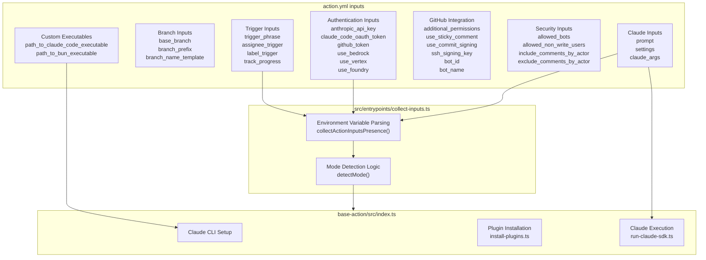
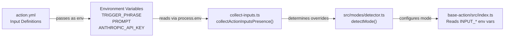

<!-- source: DeepWiki mcp.deepwiki.com · repo anthropics/claude-code-action · page 5.1 Action Inputs Reference · fetched 2026-10-26 -->

# Action Inputs Reference

Relevant source files

The following files were used as context for generating this wiki page:

- [action.yml](action.yml)
- [base-action/action.yml](base-action/action.yml)
- [base-action/src/parse-sdk-options.ts](base-action/src/parse-sdk-options.ts)
- [base-action/test/parse-sdk-options.test.ts](base-action/test/parse-sdk-options.test.ts)
- [src/entrypoints/collect-inputs.ts](src/entrypoints/collect-inputs.ts)
- [src/entrypoints/post-buffered-inline-comments.ts](src/entrypoints/post-buffered-inline-comments.ts)
- [test/modes/detector.test.ts](test/modes/detector.test.ts)

This page provides a complete reference of all input parameters defined in `claude-code-action` and its underlying `claude-code-base-action`. These inputs control trigger behavior, authentication, Claude configuration, GitHub integration, and advanced features.

## Input Categories Overview

The action accepts nearly 30 input parameters organized into functional categories. Each input is optional unless explicitly marked as required, with sensible defaults provided for most cases.

**Sources:** [action.yml:7-147](), [src/entrypoints/collect-inputs.ts:1-60](), [base-action/action.yml:7-93]()

## Input Processing Pipeline

Inputs flow through the action's execution pipeline, being transformed from GitHub Action YAML inputs into environment variables, and finally into CLI arguments or configuration files for the Claude CLI. The `collectActionInputsPresence` function identifies which inputs have been explicitly overridden by the user [src/entrypoints/collect-inputs.ts:1-60]().

**Sources:** [action.yml:148-173](), [src/entrypoints/collect-inputs.ts:1-60](), [base-action/action.yml:109-142]()

## Complete Input Reference

### Trigger Configuration

These inputs define how the action identifies when it should activate during `issue_comment`, `pull_request`, or `issues` events.

| Input | Type | Default | Description |
|-------|------|---------|-------------|
| `trigger_phrase` | string | `"@claude"` | The phrase Claude looks for in comments or issue bodies. [action.yml:8-11]() |
| `assignee_trigger` | string | - | The username that triggers the action when assigned to an issue. [action.yml:12-14]() |
| `label_trigger` | string | `"claude"` | The label that triggers the action when applied. [action.yml:15-18]() |
| `track_progress` | boolean | `"false"` | Forces "Tag Mode" with tracking comments for specific PR/Issue events. [action.yml:136-139]() |

**Trigger Logic Implementation:**
The function `detectMode` in `src/modes/detector.ts` uses these inputs to decide between `tag` (interactive) and `agent` (automation) modes. If a `prompt` is provided, it typically defaults to `agent` mode. If `track_progress` is true, it forces `tag` mode for supported events like `pull_request.opened` or `issues.opened` [test/modes/detector.test.ts:36-109]().

**Sources:** [action.yml:8-18](), [action.yml:136-139](), [test/modes/detector.test.ts:5-151]()

### Branch Management

Claude creates branches to perform work. These inputs control naming and source.

| Input | Type | Default | Description |
|-------|------|---------|-------------|
| `base_branch` | string | - | The source branch for new Claude branches. [action.yml:19-21]() |
| `branch_prefix` | string | `"claude/"` | Prefix for generated branches. [action.yml:22-25]() |
| `branch_name_template` | string | (see desc) | Template for branch naming. Supports variables like `{{prefix}}`, `{{entityNumber}}`, `{{timestamp}}`, and `{{description}}`. [action.yml:26-29]() |

**Sources:** [action.yml:19-29]()

### Authentication

The action supports multiple authentication providers, including workload identity federation for OIDC-based access.

| Input | Type | Default | Description |
|-------|------|---------|-------------|
| `anthropic_api_key` | string | - | API key for direct Anthropic API access. [action.yml:67-69]() |
| `claude_code_oauth_token`| string | - | OAuth token alternative to API key. [action.yml:70-72]() |
| `anthropic_federation_rule_id` | string | - | Workload identity federation rule ID (fdrl_...). [action.yml:73-75]() |
| `anthropic_organization_id` | string | - | Anthropic organization UUID for OIDC. [action.yml:77-78]() |
| `github_token` | string | - | Token for GitHub operations (optional if using GitHub App). [action.yml:88-90]() |
| `use_bedrock` | boolean | `"false"` | Use Amazon Bedrock with OIDC. [action.yml:91-94]() |
| `use_vertex` | boolean | `"false"` | Use Google Vertex AI with OIDC. [action.yml:95-98]() |
| `use_foundry` | boolean | `"false"` | Use Microsoft Foundry with OIDC. [action.yml:99-102]() |

**Sources:** [action.yml:67-102](), [base-action/action.yml:29-68]()

### Claude CLI Configuration

These inputs map directly to how the Claude CLI is invoked and how its output is handled.

| Input | Type | Default | Description |
|-------|------|---------|-------------|
| `prompt` | string | `""` | Instructions for Claude. Triggers Agent mode if provided. [action.yml:57-60]() |
| `settings` | string | `""` | JSON string or path to settings JSON file for Claude Code. [action.yml:61-64]() |
| `claude_args` | string | `""` | Additional raw arguments for the Claude CLI (e.g. `--max-turns 5`). [action.yml:104-107]() |
| `classify_inline_comments`| boolean | `"true"` | Buffers and classifies inline comments (Real vs Test) before posting. [action.yml:116-119]() |
| `include_fix_links` | boolean | `"true"` | Includes "Fix this" links in PR review feedback. [action.yml:140-143]() |

**Claude Args Parsing:**
Arguments passed via `claude_args` are parsed using `parseSdkOptions`. This handles complex flags like `--allowedTools` by preserving shell metacharacters (e.g., `Bash(gh:*)`) and merging multiple occurrences [base-action/src/parse-sdk-options.ts:133-187]().

**Sources:** [action.yml:57-64](), [action.yml:104-119](), [base-action/src/parse-sdk-options.ts:193-195](), [base-action/test/parse-sdk-options.test.ts:140-156]()

### Security and Access Control

Controls which users and bots can interact with the action.

| Input | Type | Default | Description |
|-------|------|---------|-------------|
| `allowed_bots` | string | `""` | Comma-separated list of bots allowed to trigger Claude. [action.yml:30-33]() |
| `allowed_non_write_users`| string | `""` | Bypasses write permission check for listed users. **High Risk.** [action.yml:34-46]() |
| `include_comments_by_actor`| string | `""` | Allowlist of actors whose comments are included in context. [action.yml:47-50]() |
| `exclude_comments_by_actor`| string | `""` | Blocklist of actors whose comments are excluded. [action.yml:51-54]() |

**Sources:** [action.yml:30-54]()

### Git Operations and Signing

| Input | Type | Default | Description |
|-------|------|---------|-------------|
| `use_commit_signing` | boolean | `"false"` | Enable GitHub API-based commit signing. [action.yml:120-123]() |
| `ssh_signing_key` | string | `""` | Private key for SSH-based git commit signing. [action.yml:124-127]() |
| `bot_id` | string | `"41898282"` | GitHub user ID for git attribution. [action.yml:128-131]() |
| `bot_name` | string | `"claude[bot]"` | GitHub username for git attribution. [action.yml:132-135]() |

**Sources:** [action.yml:120-135]()

## Base Action Specific Inputs

The `claude-code-base-action` (located in `/base-action`) includes inputs specific to the execution environment and Claude SDK configuration.

| Input | Type | Default | Description |
|-------|------|---------|-------------|
| `prompt_file` | string | `""` | Path to a file containing the prompt (mutually exclusive with `prompt`). [base-action/action.yml:13-16]() |
| `use_node_cache` | boolean | `"false"` | Enables Node.js dependency caching for the runner. [base-action/action.yml:70-73]() |
| `show_full_output` | boolean | `"false"` | Logs all Claude messages, including tool results (Security Risk). [base-action/action.yml:82-85]() |
| `plugins` | string | `""` | Newline-separated list of Claude Code plugins to install. [base-action/action.yml:86-89]() |
| `plugin_marketplaces` | string | `""` | Newline-separated list of Git URLs for plugin marketplaces. [base-action/action.yml:90-93]() |

**Sources:** [base-action/action.yml:13-93]()

## Action Outputs

The action provides outputs that can be consumed by subsequent steps in a GitHub workflow.

| Output | Description | Source |
|--------|-------------|--------|
| `conclusion` | Execution status (`success` or `failure`). | [base-action/action.yml:96-98]() |
| `execution_file` | Path to the JSON log of the Claude session. | [base-action/action.yml:99-101]() |
| `structured_output` | JSON string of fields when `--json-schema` is used. | [base-action/action.yml:102-104]() |
| `session_id` | The Claude Code session ID for resuming conversations. | [base-action/action.yml:105-107]() |

**Sources:** [base-action/action.yml:95-107]()

---

