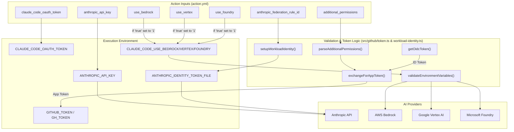

<!-- source: DeepWiki mcp.deepwiki.com · repo anthropics/claude-code-action · page 5.2 Authentication Configuration · fetched 2026-10-26 -->

# Authentication Configuration

Relevant source files

The following files were used as context for generating this wiki page:

- [base-action/src/validate-env.ts](base-action/src/validate-env.ts)
- [base-action/test/validate-env.test.ts](base-action/test/validate-env.test.ts)
- [base-action/test/workload-identity.test.ts](base-action/test/workload-identity.test.ts)
- [docs/configuration.md](docs/configuration.md)
- [docs/create-app.html](docs/create-app.html)
- [docs/setup.md](docs/setup.md)
- [examples/claude-wif.yml](examples/claude-wif.yml)
- [github-app-manifest.json](github-app-manifest.json)
- [src/github/token.ts](src/github/token.ts)
- [src/utils/retry.ts](src/utils/retry.ts)
- [test/parse-permissions.test.ts](test/parse-permissions.test.ts)
- [test/token.test.ts](test/token.test.ts)

## Purpose and Scope

This document provides a detailed technical guide for configuring authentication within the Claude Code Action. It covers the supported AI provider methods (Anthropic API, AWS Bedrock, Google Vertex AI, and Microsoft Foundry), the OIDC-based GitHub App token exchange flow, Workload Identity Federation (WIF), and the management of granular permissions via `ADDITIONAL_PERMISSIONS`.

For general action inputs, see [Action Inputs Reference](#5.1). For configuring tool permissions and GitHub access scopes, see [Tool and Permission Configuration](#5.3).

---

## Authentication Architecture Overview

The action supports multiple authentication pathways configured through action inputs and environment variables. These are validated and passed to the Claude Code CLI and MCP servers.

### Logic Flow and Entity Mapping

The following diagram maps high-level configuration concepts to the specific code entities and environment variables used during execution.

**Sources:** [src/github/token.ts:158-185](), [base-action/src/validate-env.ts:5-89](), [base-action/src/workload-identity.ts:64-126](), [docs/setup.md:15-58]()

---

## GitHub OIDC Token Exchange Flow

The Claude Code Action utilizes GitHub's OIDC (OpenID Connect) provider to securely exchange a short-lived GitHub identity token for a scoped GitHub App installation token. This removes the need for users to manually manage `GITHUB_TOKEN` secrets for the official Claude App.

### Implementation Details

1.  **OIDC Retrieval**: The function `getOidcToken` calls `core.getIDToken` with the audience `claude-code-github-action` [src/github/token.ts:56-67]().
2.  **Permission Parsing**: The `parseAdditionalPermissions` function reads the `ADDITIONAL_PERMISSIONS` environment variable. It merges user-defined scopes with `DEFAULT_PERMISSIONS` [src/github/token.ts:75-101]().
3.  **Token Exchange**: The OIDC token and requested permissions are sent to `https://api.anthropic.com/api/github/github-app-token-exchange` via `exchangeForAppToken` [src/github/token.ts:103-156]().
4.  **Error Handling**: If the exchange fails because the workflow is not on the default branch, a `WorkflowValidationSkipError` is thrown to gracefully skip the action [src/github/token.ts:129-136]().

### Default and Additional Permissions

The action requests a base set of permissions by default to ensure core functionality.

| Permission | Level | Source |
| :--- | :--- | :--- |
| `contents` | `write` | `DEFAULT_PERMISSIONS` [src/github/token.ts:70]() |
| `pull_requests` | `write` | `DEFAULT_PERMISSIONS` [src/github/token.ts:71]() |
| `issues` | `write` | `DEFAULT_PERMISSIONS` [src/github/token.ts:72]() |

Users can extend these via the `additional_permissions` input (e.g., `actions: read` for CI/CD log analysis) [docs/configuration.md:110-140]().

**Sources:** [src/github/token.ts:69-73](), [src/github/token.ts:75-101](), [docs/configuration.md:110-140]()

---

## Workload Identity Federation (WIF)

Workload Identity Federation allows the action to authenticate to the Anthropic API by exchanging the GitHub Actions OIDC token for a short-lived Anthropic access token, eliminating the need for a static `ANTHROPIC_API_KEY`.

### WIF Setup and Execution

1.  **Configuration Check**: `isWorkloadIdentityConfigured` verifies if both `ANTHROPIC_FEDERATION_RULE_ID` and `ANTHROPIC_ORGANIZATION_ID` are set [base-action/src/workload-identity.ts:46-62]().
2.  **Token Retrieval**: `setupWorkloadIdentity` requests a GitHub OIDC token, defaulting to the audience `https://api.anthropic.com` [base-action/src/workload-identity.ts:105]().
3.  **Credential Injection**: The identity token is written to a temporary file, and its path is exported to `ANTHROPIC_IDENTITY_TOKEN_FILE` for the Claude CLI to consume [base-action/src/workload-identity.ts:95-97]().
4.  **Precedence**: Static credentials (`ANTHROPIC_API_KEY` or `CLAUDE_CODE_OAUTH_TOKEN`) take precedence over WIF. If both are present, a warning is issued and WIF is skipped [base-action/src/workload-identity.ts:71-82]().

**Sources:** [base-action/src/workload-identity.ts:9-11](), [base-action/src/workload-identity.ts:64-126](), [docs/setup.md:15-58]()

---

## Cloud Provider Configuration

The action supports AWS Bedrock, Google Vertex AI, and Microsoft Foundry. These providers are enabled via boolean flags that the `base-action` validates.

### Environment Validation

The `validateEnvironmentVariables` function ensures that provider configurations are mutually exclusive and that all required variables for the selected provider are present [base-action/src/validate-env.ts:5-89]().

| Provider | Activation Flag | Required Variables |
| :--- | :--- | :--- |
| **AWS Bedrock** | `CLAUDE_CODE_USE_BEDROCK=1` | `AWS_REGION`, (`AWS_BEARER_TOKEN_BEDROCK` OR `AWS_ACCESS_KEY_ID` + `AWS_SECRET_ACCESS_KEY`) [base-action/src/validate-env.ts:42-61]() |
| **Google Vertex** | `CLAUDE_CODE_USE_VERTEX=1` | `ANTHROPIC_VERTEX_PROJECT_ID`, `CLOUD_ML_REGION` [base-action/src/validate-env.ts:62-72]() |
| **MS Foundry** | `CLAUDE_CODE_USE_FOUNDRY=1` | `ANTHROPIC_FOUNDRY_RESOURCE` OR `ANTHROPIC_FOUNDRY_BASE_URL` [base-action/src/validate-env.ts:73-83]() |

**Sources:** [base-action/src/validate-env.ts:5-89](), [base-action/test/validate-env.test.ts:77-175]()

---

## Error Handling: WorkflowValidationSkipError

The `WorkflowValidationSkipError` handles the scenario where a GitHub App cannot validate a workflow file that hasn't been merged into the default branch yet.

- **Trigger**: Received when the exchange endpoint returns the error code `workflow_not_found_on_default_branch` or the message includes "workflow validation failed" [src/github/token.ts:24-26](), [src/github/token.ts:50-53]().
- **Behavior**: The action catches this error and logs a warning instead of failing the build, as this is expected during initial setup or PRs changing workflows [src/github/token.ts:131-135]().
- **Retry Logic**: `setupGitHubToken` uses `retryWithBackoff` but explicitly excludes `WorkflowValidationSkipError` from retries [src/github/token.ts:174-179]().

**Sources:** [src/github/token.ts:6-11](), [src/github/token.ts:24-54](), [src/github/token.ts:174-179]()

---

## Custom GitHub App Setup

Users requiring restrictive permissions can use a custom GitHub App.

1.  **Manifest Configuration**: A `github-app-manifest.json` is provided, requesting `contents: write`, `issues: write`, `pull_requests: write`, and `actions: read` [github-app-manifest.json:13-19]().
2.  **Manual Override**: When `OVERRIDE_GITHUB_TOKEN` is detected, the action skips the OIDC exchange and uses the provided token directly [src/github/token.ts:160-165]().

**Sources:** [github-app-manifest.json:1-27](), [docs/setup.md:59-160](), [src/github/token.ts:160-165]()

---

