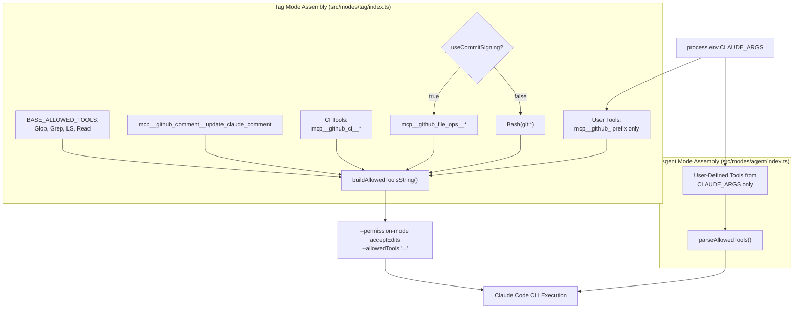
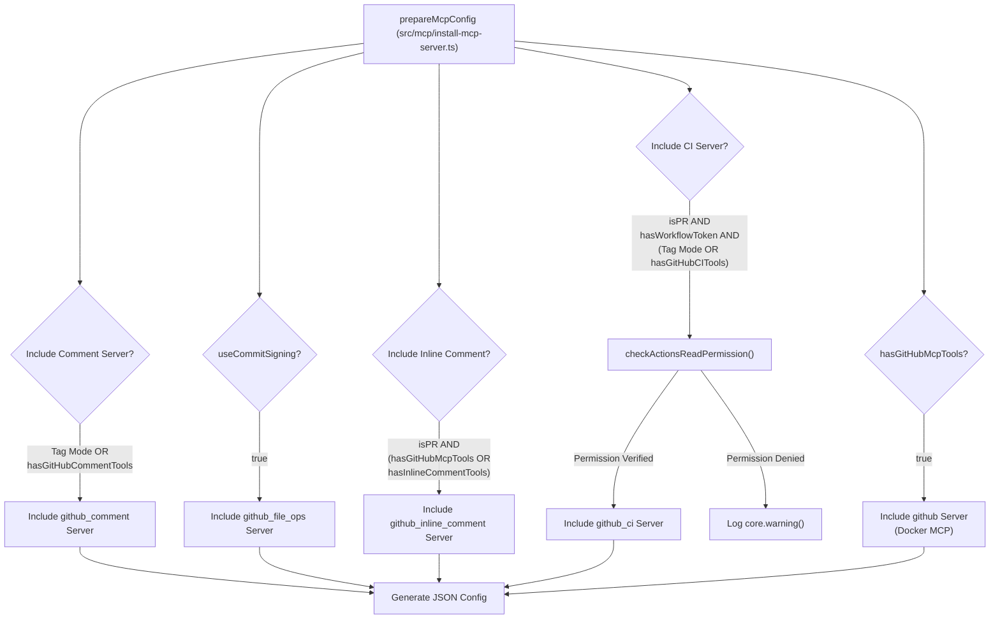
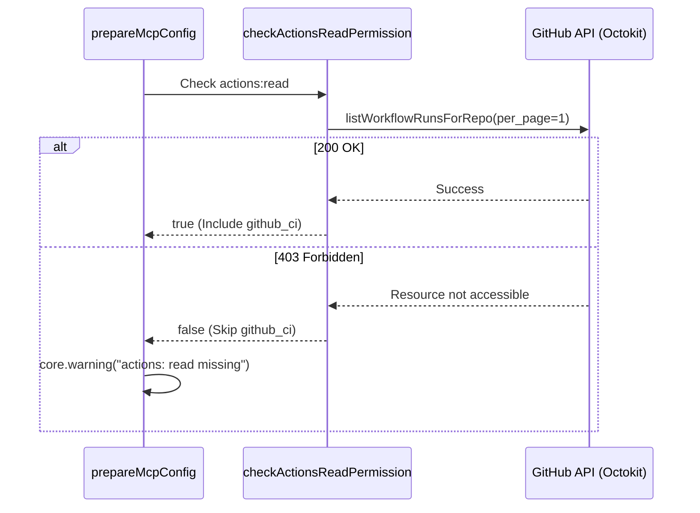

<!-- source: DeepWiki mcp.deepwiki.com · repo anthropics/claude-code-action · page 5.3 Tool and Permission Configuration · fetched 2026-10-26 -->

# Tool and Permission Configuration

<details>
<summary>Relevant source files</summary>

The following files were used as context for generating this wiki page:

- [src/create-prompt/index.ts](src/create-prompt/index.ts)
- [src/create-prompt/types.ts](src/create-prompt/types.ts)
- [src/mcp/install-mcp-server.ts](src/mcp/install-mcp-server.ts)
- [src/modes/agent/parse-tools.ts](src/modes/agent/parse-tools.ts)
- [test/create-prompt.test.ts](test/create-prompt.test.ts)
- [test/install-mcp-server.test.ts](test/install-mcp-server.test.ts)
- [test/modes/parse-tools.test.ts](test/modes/parse-tools.test.ts)
- [test/prepare-context.test.ts](test/prepare-context.test.ts)

</details>


This document explains how to configure tool access and GitHub permissions for the `claude-code-action`. It covers the tool allowlisting system, MCP server configuration logic, and GitHub permission management. For general action inputs, see [Action Inputs Reference](). For authentication setup, see [Authentication Configuration]().

## Tool Allowlisting System

The action uses a two-level security model: (1) MCP servers must be conditionally included in the configuration, and (2) individual tools must be explicitly allowed. This defense-in-depth approach ensures that even if a server is configured, Claude cannot use its tools without explicit permission.

### Tool Naming Convention

Tools follow a hierarchical naming pattern that enables pattern-based filtering:

| Tool Type | Pattern | Example |
|-----------|---------|---------|
| Built-in file tools | `<ToolName>` | `Glob`, `Grep`, `LS`, `Read` |
| Bash commands | `Bash(<command>:*)` | `Bash(git add:*)`, `Bash(npm:*)` |
| MCP tools | `mcp__<server>__<action>` | `mcp__github__create_issue` |

The double-underscore delimiter in MCP tool names enables prefix-based filtering. For example, allowing `mcp__github__*` grants access to all tools from the `github` MCP server.

Sources: [src/create-prompt/index.ts:34-77](), [src/mcp/install-mcp-server.ts:72-86]()

### Configuring Allowed Tools

Tools are configured via the `--allowedTools` argument in `claude_args`. The action automatically constructs this argument based on the execution mode, but users can extend it with additional tools. The function `parseAllowedTools` in `src/modes/agent/parse-tools.ts` is responsible for tokenizing these arguments and extracting tool names, ensuring it handles quotes, comments, and multiple flags correctly.

```yaml
# Tag mode - extends default required tools
with:
  claude_args: '--allowedTools "mcp__github__create_issue,mcp__github__create_pr"'

# Agent mode - defines all allowed tools
with:
  prompt: "Review this PR and create issues"
  claude_args: '--allowedTools "Read,mcp__github__create_issue"'
```

**Tag Mode Tool Configuration**: Tag mode requires a predefined set of core tools for proper functionality. These are automatically included by `buildAllowedToolsString`:

- **File manipulation**: `Glob`, `Grep`, `LS`, `Read`. 
- **Comment tracking**: `mcp__github_comment__update_claude_comment`.
- **CI integration**: `mcp__github_ci__get_ci_status`, `mcp__github_ci__get_workflow_run_details`, `mcp__github_ci__download_job_log`.
- **Git operations** (when not using API signing): `Bash(git add:*)`, `Bash(git commit:*)`, `Bash(git-push.sh:*)`, `Bash(git rm:*)`.
- **File operations** (when using API signing): `mcp__github_file_ops__commit_files`, `mcp__github_file_ops__delete_files`.

**Note on File Edits**: `Edit`, `MultiEdit`, and `Write` are intentionally omitted from the explicit allowlist in tag mode. Instead, the action uses `--permission-mode acceptEdits`. This mode auto-allows file edits inside the `$GITHUB_WORKSPACE` and denies writes outside it (e.g., to system files), providing a safer execution environment.

Sources: [src/create-prompt/index.ts:31-77](), [src/modes/agent/parse-tools.ts:52-81](), [src/modes/tag/index.ts:119-150](), [src/modes/tag/index.ts:172-175]()

### Configuring Disallowed Tools

The `buildDisallowedToolsString` function provides negative filtering. Disallowed tools are blocked even if they appear in `allowedTools`. By default, web access tools are disabled for security:

- **Default Disallowed**: `WebSearch`, `WebFetch`.

Users can override these defaults by explicitly including them in `allowedTools` or add new restrictions via `customDisallowedTools`.

Sources: [src/create-prompt/index.ts:79-102]()

### Mode-Specific Tool Configuration Diagram

This diagram shows how `buildAllowedToolsString` and mode preparation pathways assemble the final tool list.



Sources: [src/create-prompt/index.ts:31-77](), [src/modes/tag/index.ts:112-180](), [src/modes/agent/parse-tools.ts:52-81]()

## MCP Server Configuration

The `prepareMcpConfig` function dynamically generates an MCP configuration JSON that specifies which servers Claude can access. Each server has conditional inclusion logic based on context, permissions, and allowed tools.

### Server Inclusion Decision Tree



Sources: [src/mcp/install-mcp-server.ts:52-230]()

### Individual MCP Servers

#### github_comment Server
- **Purpose**: Updates the tracking comment in tag mode.
- **Inclusion**: Always in tag mode; in agent mode only if `mcp__github_comment__` tools are requested.
- **Command**: `bun run src/mcp/github-comment-server.ts`.
Sources: [src/mcp/install-mcp-server.ts:92-113]()

#### github_file_ops Server
- **Purpose**: API-based file operations (commits/deletes).
- **Inclusion**: Only when `useCommitSigning` is enabled.
- **Command**: `bun run src/mcp/github-file-ops-server.ts`.
Sources: [src/mcp/install-mcp-server.ts:116-135]()

#### github_inline_comment Server
- **Purpose**: Creates code review comments on PR diffs.
- **Inclusion**: PR context and `mcp__github_inline_comment__` or `mcp__github__` tools are requested.
- **Command**: `bun run src/mcp/github-inline-comment-server.ts`.
Sources: [src/mcp/install-mcp-server.ts:138-160]()

#### github_ci Server
- **Purpose**: Accesses CI status and logs.
- **Inclusion**: PR context, `DEFAULT_WORKFLOW_TOKEN` present, and `actions: read` permission verified via `checkActionsReadPermission`.
- **Command**: `bun run src/mcp/github-actions-server.ts`.
Sources: [src/mcp/install-mcp-server.ts:162-204]()

#### github Server (Docker MCP)
- **Purpose**: Official GitHub MCP server for broad API access.
- **Inclusion**: Tools matching `mcp__github__` prefix are requested.
- **Command**: `docker run ghcr.io/github/github-mcp-server`.
Sources: [src/mcp/install-mcp-server.ts:206-224]()

## GitHub Permission Configuration

The action uses GitHub's OIDC token exchange to obtain a scoped GitHub App installation token. This token has repository-specific permissions that can be extended via the `additional_permissions` input.

### Default Permissions

The `DEFAULT_PERMISSIONS` object defines the baseline for the exchanged token:

| Permission | Level | Purpose |
|------------|-------|---------|
| `contents` | `write` | Read/write repository files and branches |
| `pull_requests` | `write` | Create and update pull requests |
| `issues` | `write` | Create and update issues |

Sources: [src/github/token.ts:26-30]()

### Additional Permissions

The `parseAdditionalPermissions` function processes the `ADDITIONAL_PERMISSIONS` environment variable (from the `additional_permissions` input) and merges it with defaults.

```yaml
with:
  additional_permissions: |
    actions: read
    discussions: write
```

**Workflow Requirements**: When requesting additional permissions, the workflow's `GITHUB_TOKEN` must also be granted those permissions, and `id-token: write` is required for the OIDC exchange.

Sources: [src/github/token.ts:32-58](), [docs/configuration.md:110-146]()

### Permission Verification Flow

The `checkActionsReadPermission` function ensures the token actually has the rights it claims before configuring the `github_ci` server.



Sources: [src/mcp/install-mcp-server.ts:20-50](), [src/mcp/install-mcp-server.ts:172-187]()

## Tool-to-Server Mapping

The following table maps tool patterns to their corresponding MCP servers:

| Tool Pattern | MCP Server | Inclusion Condition |
|--------------|------------|---------------------|
| `mcp__github_comment__*` | `github_comment` | Tag mode OR explicit tool |
| `mcp__github_file_ops__*` | `github_file_ops` | `useCommitSigning: true` |
| `mcp__github_inline_comment__*` | `github_inline_comment` | PR context AND explicit tool |
| `mcp__github_ci__*` | `github_ci` | PR + workflow token + permission + (tag mode OR explicit tool) |
| `mcp__github__*` | `github` (Docker) | Explicit tool |

Sources: [src/mcp/install-mcp-server.ts:72-86](), [src/mcp/install-mcp-server.ts:92-224]()

---

