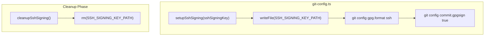
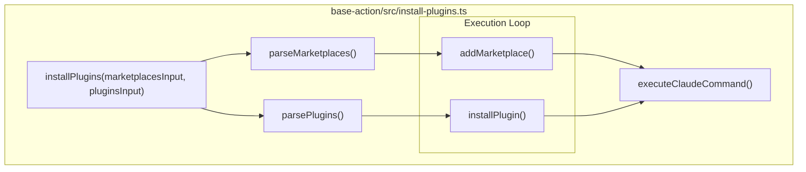

<!-- source: DeepWiki mcp.deepwiki.com · repo anthropics/claude-code-action · page 5.4 Advanced Settings · fetched 2026-10-26 -->

# Advanced Settings

Relevant source files

The following files were used as context for generating this wiki page:

- [base-action/package-lock.json](base-action/package-lock.json)
- [base-action/src/install-plugins.ts](base-action/src/install-plugins.ts)
- [base-action/test/install-plugins.test.ts](base-action/test/install-plugins.test.ts)
- [docs/security.md](docs/security.md)
- [docs/usage.md](docs/usage.md)
- [src/github/operations/git-config.ts](src/github/operations/git-config.ts)
- [src/mcp/github-inline-comment-server.ts](src/mcp/github-inline-comment-server.ts)
- [src/mcp/inline-comment-buffer.ts](src/mcp/inline-comment-buffer.ts)
- [src/utils/branch-template.ts](src/utils/branch-template.ts)
- [test/branch-template.test.ts](test/branch-template.test.ts)
- [test/inline-comment-buffer.test.ts](test/inline-comment-buffer.test.ts)
- [test/ssh-signing.test.ts](test/ssh-signing.test.ts)

This page documents advanced configuration options for the Claude Code Action, including commit signing, branch naming templates, comment management, and the plugin system.

## Overview

Advanced settings provide fine-grained control over how Claude interacts with your repository and how its feedback is presented. These settings allow you to:
- **Secure Git Operations**: Enable verified commit signing via GitHub API or SSH keys.
- **Customize Branching**: Define templates for automated branch creation.
- **Optimize PR Feedback**: Use sticky comments and classify inline feedback.
- **Extend Capabilities**: Install custom plugins and manage marketplaces.

Sources: [docs/usage.md:65-71](), [src/github/operations/git-config.ts:1-136]()

## Git and Commit Signing

The action supports two methods for creating verified commits, which is often required by repository branch protection rules.

### Commit Signing Methods

| Method | Input | Description |
| :--- | :--- | :--- |
| **GitHub API Signing** | `use_commit_signing: true` | Uses GitHub's web-based signing. Claude performs operations via API calls rather than local git commands. |
| **SSH Key Signing** | `ssh_signing_key: "..."` | Configures the local git environment to sign commits using a provided SSH private key. This takes precedence over `use_commit_signing`. |

### SSH Signing Implementation

When `ssh_signing_key` is provided, the function `setupSshSigning` performs the following setup:
1. Validates the key format (must contain `BEGIN` and `PRIVATE KEY`) [src/github/operations/git-config.ts:93-102]().
2. Creates a secure `.ssh` directory with mode `0o700` [src/github/operations/git-config.ts:105-106]().
3. Writes the key to `~/.ssh/claude_signing_key` with mode `0o600` [src/github/operations/git-config.ts:114-115]().
4. Configures git to use the SSH key: `gpg.format ssh`, `user.signingkey`, and `commit.gpgsign true` [src/github/operations/git-config.ts:118-120]().

**SSH Signing Lifecycle**

Sources: [src/github/operations/git-config.ts:90-136](), [test/ssh-signing.test.ts:41-114](), [test/ssh-signing.test.ts:194-205]()

## Branch Name Templates

When Claude needs to create a branch (e.g., to fix an issue), it uses a template to generate the branch name via `generateBranchName`.

### Template Variables

The `branch_name_template` input supports several placeholders that are substituted by `applyBranchTemplate`:

| Variable | Description | Example |
| :--- | :--- | :--- |
| `{{prefix}}` | The value of `branch_prefix` (default: `claude/`) | `claude/` |
| `{{entityType}}` | Type of entity triggering the action | `issue` or `pr` |
| `{{entityNumber}}` | The issue or PR number | `123` |
| `{{timestamp}}` | Current date/time (YYYYMMDD-HHmm) | `20240520-1430` |
| `{{sha}}` | First 8 characters of the current commit SHA | `a1b2c3d4` |
| `{{label}}` | First label on the issue/PR (falls back to `entityType`) | `bug` |
| `{{description}}` | First 5 words of the title in kebab-case | `fix-login-auth-error` |

### Default Behavior and Fallbacks

If no template is provided, the action defaults to `{{prefix}}{{entityType}}-{{entityNumber}}-{{timestamp}}` [src/utils/branch-template.ts:96](). The resulting string is lowercased and truncated to 50 characters for Kubernetes compatibility [src/utils/branch-template.ts:98]().

Sources: [src/utils/branch-template.ts:31-99](), [test/branch-template.test.ts:11-53](), [test/branch-template.test.ts:195-207]()

## Pull Request and Comment Settings

### Sticky Comments
Setting `use_sticky_comment: true` instructs the action to reuse a single comment for all status updates and feedback within a PR thread [docs/usage.md:69](). This reduces notification noise by editing the existing comment instead of creating new ones.

### Inline Comment Classification
The `classify_inline_comments` setting (default: `true`) enables a buffering mechanism in `github-inline-comment-server.ts`. Claude's suggested inline comments are collected in `/tmp/inline-comments-buffer.jsonl` [src/mcp/github-inline-comment-server.ts:19-20](). 

If a comment is later posted with `confirmed: true`, the earlier buffered copy is removed by `removeBufferedComment` to prevent duplicates [src/mcp/github-inline-comment-server.ts:187-192]().

### Fix Links
The `include_fix_links: true` (default) option adds "Fix this" links to PR code review feedback [docs/usage.md:66](). These links open Claude Code with the specific context needed to address the identified issue.

Sources: [docs/usage.md:66-70](), [src/mcp/github-inline-comment-server.ts:15-20](), [src/mcp/inline-comment-buffer.ts:23-54]()

## Plugin and Marketplace Management

The action allows extending Claude's capabilities by installing plugins from Git marketplaces during initialization via `installPlugins`.

### Installation Logic

The `installPlugins` function in `base-action` handles the sequential setup of marketplaces and plugins by spawning the Claude CLI.

### Security and Validation
Plugin names and marketplace URLs are strictly validated to prevent command injection:
- **Marketplace URLs**: Must match `MARKETPLACE_URL_REGEX` (HTTPS and `.git` suffix required) [base-action/src/install-plugins.ts:7-8]().
- **Plugin Names**: Must match `PLUGIN_NAME_REGEX` (alphanumeric, `@`, `/`, `-`, `_`, `.`) [base-action/src/install-plugins.ts:3]().
- **Path Traversal**: Any patterns like `../` or `./` are rejected by `PATH_TRAVERSAL_REGEX` [base-action/src/install-plugins.ts:5-6]().

Sources: [base-action/src/install-plugins.ts:3-128,212-222](), [base-action/test/install-plugins.test.ts:58-96,233-250]()

## Custom Executables

You can override the default installation of Claude Code or Bun by providing paths to existing executables.

- `path_to_claude_code_executable`: Skips the default installation and uses the provided binary path.
- `path_to_bun_executable`: Uses the specified Bun runtime already present on the runner.

This is particularly useful in self-hosted runners or environments with restricted internet access where dependencies are pre-cached.

Sources: [docs/usage.md:30-38](), [base-action/src/install-plugins.ts:208-216]()

---

