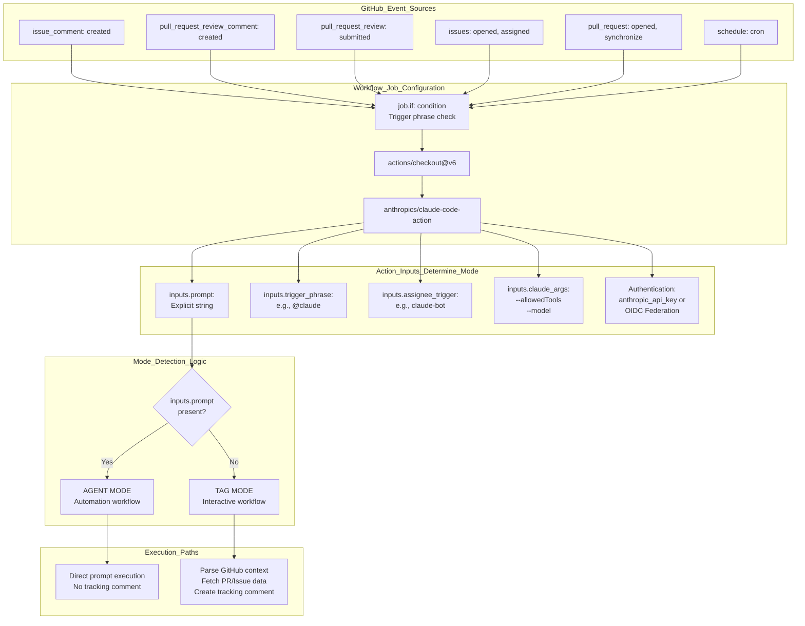
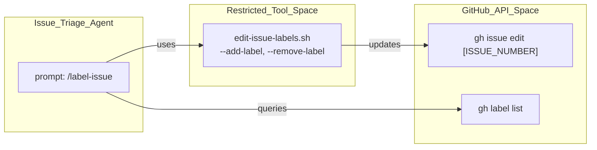

<!-- source: DeepWiki mcp.deepwiki.com · repo anthropics/claude-code-action · page 6 Usage Examples · fetched 2026-10-26 -->

# Usage Examples

<details>
<summary>Relevant source files</summary>

The following files were used as context for generating this wiki page:

- [.github/workflows/claude-review.yml](.github/workflows/claude-review.yml)
- [.github/workflows/claude.yml](.github/workflows/claude.yml)
- [.github/workflows/issue-triage.yml](.github/workflows/issue-triage.yml)
- [README.md](README.md)
- [examples/claude.yml](examples/claude.yml)
- [examples/manual-code-analysis.yml](examples/manual-code-analysis.yml)
- [examples/pr-review-comprehensive.yml](examples/pr-review-comprehensive.yml)
- [examples/pr-review-filtered-authors.yml](examples/pr-review-filtered-authors.yml)
- [examples/pr-review-filtered-paths.yml](examples/pr-review-filtered-paths.yml)

</details>


This page provides practical workflow configurations demonstrating how to use `claude-code-action` in real GitHub Actions workflows. Examples show both **tag mode** (interactive @claude mentions) and **agent mode** (automated execution with explicit prompts), along with various trigger mechanisms and tool configurations.

For comprehensive implementation patterns including path-specific triggers, contributor handling, and structured outputs, see the **Solutions Guide** referenced in the [README.md:35-49]().

## Workflow Structure Overview

The following diagram shows how different workflow configurations map to the action's inputs and mode detection logic:

Title: Workflow Configuration and Mode Detection

Sources: [README.md:9-18](), [examples/claude.yml:1-20](), [examples/claude-review.yml:1-5]()

## Basic Interactive Workflow (Tag Mode)

The most common usage pattern is interactive assistance triggered by `@claude` mentions in issues and pull requests. This configuration uses tag mode automatically [README.md:9-10]().

```yaml
name: Claude Code
on:
  issue_comment:
    types: [created]
  pull_request_review_comment:
    types: [created]
  issues:
    types: [opened, assigned]
  pull_request_review:
    types: [submitted]

jobs:
  claude:
    if: |
      (github.event_name == 'issue_comment' && contains(github.event.comment.body, '@claude')) ||
      (github.event_name == 'pull_request_review_comment' && contains(github.event.comment.body, '@claude')) ||
      (github.event_name == 'pull_request_review' && contains(github.event.review.body, '@claude')) ||
      (github.event_name == 'issues' && (contains(github.event.issue.body, '@claude') || contains(github.event.issue.title, '@claude')))
    runs-on: ubuntu-latest
    permissions:
      contents: write
      pull-requests: write
      issues: write
      id-token: write
    steps:
      - uses: actions/checkout@v6
      - uses: anthropics/claude-code-action@main
        with:
          anthropic_api_key: ${{ secrets.ANTHROPIC_API_KEY }}
```

**Key characteristics:**
- **No `prompt` input**: Triggers tag mode [examples/claude.yml:33-38]().
- **Event filtering in `job.if`**: Ensures the action only runs when the trigger phrase is present [examples/claude.yml:15-19]().
- **Required permissions**: `contents: write` is necessary for Claude to implement changes [examples/claude.yml:21-25]().

For details, see [Interactive AI Assistant](#6.1).

Sources: [examples/claude.yml:1-59](), [.github/workflows/claude.yml:1-45]()

## Automated PR Review Workflow (Agent Mode)

Agent mode is triggered by providing an explicit `prompt` input. This enables automation without user interaction [README.md:9-12]().

```yaml
name: PR Review
on:
  pull_request:
    types: [opened]

jobs:
  review:
    runs-on: ubuntu-latest
    permissions:
      contents: read
      pull-requests: write
      id-token: write
    steps:
      - uses: actions/checkout@v6
      - uses: anthropics/claude-code-action@v1
        with:
          prompt: "/review-pr REPO: ${{ github.repository }} PR_NUMBER: ${{ github.event.pull_request.number }}"
          claude_args: |
            --allowedTools "mcp__github_inline_comment__create_inline_comment"
```

**Key characteristics:**
- **`prompt` input present**: Triggers agent mode [README.md:9-12]().
- **Specific MCP tools**: Enabling `mcp__github_inline_comment__create_inline_comment` allows Claude to leave line-by-line feedback [.github/workflows/claude-review.yml:31-33]().
- **Progress Tracking**: Optional `track_progress: true` provides visual status updates in the PR [examples/pr-review-comprehensive.yml:29-30]().

For details, see [Automated Pull Request Review](#6.2).

Sources: [.github/workflows/claude-review.yml:1-34](), [examples/pr-review-comprehensive.yml:1-75]()

## Issue Triage Automation

Claude can be configured to automatically label and categorize new issues. This uses the `prompt` input to execute specific triage instructions [.github/workflows/issue-triage.yml:29]().

Title: Issue Triage Tool Interaction

Sources: [.github/workflows/issue-triage.yml:24-38](), [README.md:44]()

**Key characteristics:**
- **Task Specificity**: Uses the `/label-issue` command pattern [.github/workflows/issue-triage.yml:29]().
- **Tool Permissions**: Specifically allows script capabilities for editing labels [.github/workflows/issue-triage.yml:26-27]().
- **External Access**: Uses `allowed_non_write_users: "*"` to allow Claude to process issues from any user [.github/workflows/issue-triage.yml:36]().

For details, see [Issue Triage Automation](#6.3).

Sources: [.github/workflows/issue-triage.yml:1-38]()

## Structured Output Workflows

For programmatic consumption, the action can output validated JSON using the `--json-output-schema` flag in `claude_args` [README.md:16]().

```yaml
- uses: anthropics/claude-code-action@v1
  id: claude
  with:
    prompt: "Analyze repository for security vulnerabilities."
    claude_args: |
      --json-output-schema '{"type": "object", "properties": {"vulns": {"type": "array"}}}'
```

**Key characteristics:**
- **Programmatic Integration**: The `structured_output` can be used by subsequent steps in the workflow [README.md:16]().
- **Validation**: Claude is forced to follow the provided JSON schema for its final response.

For details, see [Structured Output Workflows](#6.4).

Sources: [README.md:16-18]()

## Usage Summary Matrix

| Workflow Pattern | Mode | Trigger | Purpose |
| :--- | :--- | :--- | :--- |
| **Interactive Assistant** | Tag | `@claude` mention | On-demand coding help and debugging [examples/claude.yml:15-19](). |
| **PR Auto-Review** | Agent | `pull_request` event | Automatic feedback on new code [.github/workflows/claude-review.yml:3-5](). |
| **Issue Triage** | Agent | `issues.opened` | Automatic labeling and categorization [.github/workflows/issue-triage.yml:3-5](). |
| **Structured Data** | Agent | Manual/Workflow Dispatch | Generating JSON for CI/CD logic [README.md:16](). |

Sources: [README.md:9-18](), [.github/workflows/claude.yml:1-12]()

---

