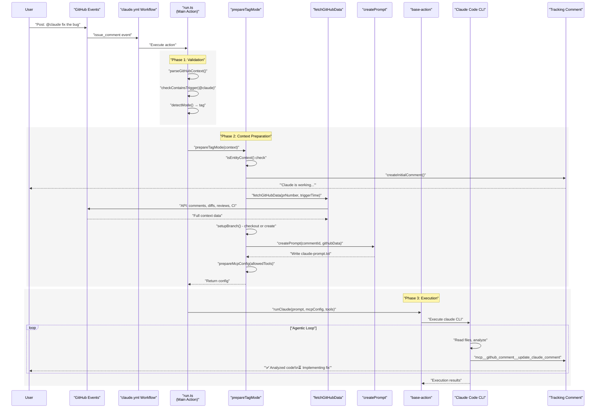
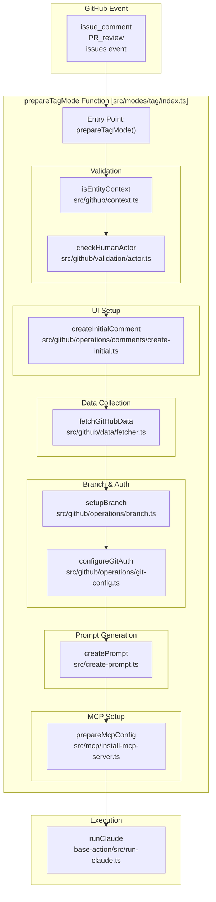

<!-- source: DeepWiki mcp.deepwiki.com · repo anthropics/claude-code-action · page 6.1 Interactive AI Assistant · fetched 2026-10-26 -->

# Interactive AI Assistant

<details>
<summary>Relevant source files</summary>

The following files were used as context for generating this wiki page:

- [.github/workflows/claude-review.yml](.github/workflows/claude-review.yml)
- [.github/workflows/claude.yml](.github/workflows/claude.yml)
- [.github/workflows/issue-triage.yml](.github/workflows/issue-triage.yml)
- [README.md](README.md)
- [examples/claude.yml](examples/claude.yml)

</details>


## Purpose and Scope

This document demonstrates how to configure and use the **Interactive AI Assistant** pattern with `claude-code-action`. This pattern enables users to mention `@claude` in GitHub issues and pull requests to get interactive code assistance, question answering, and implementation help. The assistant creates tracking comments, fetches full context, and can implement code changes through natural language conversation.

For automated workflows that run without user interaction, see **6.2 Automated Pull Request Review**, **6.3 Issue Triage Automation**, and **6.4 Structured Output Workflows**. For the underlying mode architecture, see **4.2 Mode System Architecture**.

## What is Tag Mode

The Interactive AI Assistant operates in **tag mode**, which is the execution mode triggered by user interactions rather than explicit prompts. Tag mode activates when Claude is mentioned through `@claude` comments, issue assignments, or labels on GitHub entities (issues and PRs).

Key characteristics of tag mode:

| Characteristic | Description |
|---------------|-------------|
| Trigger Method | Event-driven: responds to `@claude` mentions, assignments, or labels [src/github/validation/trigger.ts:1-40]() |
| Context Assembly | Comprehensive: fetches comments, diffs, reviews, CI status, file changes [src/github/data/fetcher.ts:15-120]() |
| User Interface | Creates and updates tracking comments showing real-time progress [src/github/operations/comments/create-initial.ts:1-30]() |
| Interaction Model | Conversational: users can reply to continue the discussion [README.md:13-13]() |
| Required Context | Must operate on a concrete Issue or PR (validated by `isEntityContext`) [src/github/context.ts:140-160]() |
| Branch Strategy | Intelligent: checks out existing PR branch or creates new branch [src/github/operations/branch.ts:10-50]() |
| Tool Configuration | Prescriptive: enforces required tools for proper functionality [src/modes/tag/index.ts:119-152]() |

Tag mode is detected automatically when no explicit `prompt` input is provided in the workflow configuration.

Sources: [src/modes/tag/index.ts:21-26](), [README.md:9-10](), [test/modes/detector.test.ts:139-151]()

## Minimal Workflow Configuration

### Basic Setup

The simplest configuration for Interactive AI Assistant uses the standard `claude.yml` template:

```yaml
name: Claude Code

on:
  issue_comment:
    types: [created]
  pull_request_review_comment:
    types: [created]
  issues:
    types: [opened, assigned]
  pull_request_review:
    types: [submitted]

jobs:
  claude:
    if: |
      (github.event_name == 'issue_comment' && contains(github.event.comment.body, '@claude')) ||
      (github.event_name == 'pull_request_review_comment' && contains(github.event.comment.body, '@claude')) ||
      (github.event_name == 'pull_request_review' && contains(github.event.review.body, '@claude')) ||
      (github.event_name == 'issues' && (contains(github.event.issue.body, '@claude') || contains(github.event.issue.title, '@claude')))
    runs-on: ubuntu-latest
    permissions:
      contents: write
      pull-requests: write
      issues: write
      id-token: write
      actions: read  # Required for Claude to read CI results on PRs
    steps:
      - name: Checkout repository
        uses: actions/checkout@v6
        with:
          fetch-depth: 1

      - name: Run Claude Code
        id: claude
        uses: anthropics/claude-code-action@main
        with:
          anthropic_api_key: ${{ secrets.ANTHROPIC_API_KEY }}
```

**Key configuration elements:**

1.  **Event listeners**: Listens to `issue_comment`, `pull_request_review_comment`, `issues`, and `pull_request_review` events [examples/claude.yml:3-11]().
2.  **Trigger filtering**: The `if` condition filters for `@claude` mentions before running the job [examples/claude.yml:15-19]().
3.  **Permissions**: Provides write access to contents, PRs, and issues for Claude to make changes [examples/claude.yml:21-26]().
4.  **No `prompt` input**: Absence of explicit prompt triggers tag mode automatically [test/modes/detector.test.ts:139-151]().

Sources: [examples/claude.yml:1-38](), [README.md:9-10](), [.github/workflows/claude.yml:1-45]()

### Required Permissions

| Permission | Purpose | Required |
|-----------|---------|----------|
| `contents: write` | Push commits, create branches | Yes |
| `pull-requests: write` | Create/update PRs, post comments | Yes |
| `issues: write` | Post/update issue comments | Yes |
| `id-token: write` | OIDC token exchange for Cloud Providers | Yes |
| `actions: read` | Read CI status and workflow logs | Recommended [examples/claude.yml:26-26]() |

Sources: [examples/claude.yml:21-26](), [.github/workflows/claude.yml:21-25]()

## Trigger Methods

### Supported Trigger Types

The Interactive AI Assistant supports three trigger mechanisms defined in `collectActionInputsPresence` [src/entrypoints/collect-inputs.ts:3-5]():

| Trigger Type | Input Parameter | Default Value | Example |
|--------------|----------------|---------------|---------|
| Mention | `trigger_phrase` | `@claude` | User types `@claude please fix this bug` |
| Assignee | `assignee_trigger` | (none) | Issue assigned to `claude-bot` [examples/claude.yml:43-43]() |
| Label | `label_trigger` | `claude` | Label `claude` added to PR |

### Mention Trigger (Default)

The mention trigger activates when users include the trigger phrase in any comment. The trigger is matched using word boundaries via `escapeRegExp` logic [src/github/validation/trigger.ts:25-35]().

### Assignee and Label Triggers

Claude can also be triggered when a specific user is assigned or a label is applied [examples/claude.yml:42-43]().

Sources: [src/entrypoints/collect-inputs.ts:3-5](), [examples/claude.yml:39-43](), [src/github/validation/trigger.ts:25-35]()

## Event Processing Flow

### High-Level Sequence

The following diagram illustrates the data flow from a GitHub event through the `prepareTagMode` function to the Claude CLI execution.



Sources: [src/entrypoints/run.ts:1-100](), [src/modes/tag/index.ts:27-188](), [src/github/data/fetcher.ts:15-50]()

## Tag Mode Preparation Pipeline

### Component Mapping

This diagram maps system names to code entities involved in the tag mode preparation pipeline.



Sources: [src/modes/tag/index.ts:1-189](), [src/github/context.ts:140-160](), [src/github/data/fetcher.ts:15-120](), [src/mcp/install-mcp-server.ts:10-100]()

### Tool Configuration Logic

Tag mode enforces a specific tool set to ensure Claude can update tracking comments and access GitHub context. The tools are defined in `prepareTagMode` [src/modes/tag/index.ts:119-152]().

*   **Core tools**: `Edit`, `MultiEdit`, `Glob`, `Grep`, `LS`, `Read`, `Write`.
*   **GitHub MCP tools**: `mcp__github_comment__update_claude_comment`, `mcp__github_ci__get_ci_status`.
*   **Git operation tools**: Depends on `use_commit_signing`. If `true`, it uses `mcp__github_file_ops__commit_files`. If `false`, it uses `Bash(git *)` [src/modes/tag/index.ts:125-145]().
*   **Custom Tools**: Users can add tools via `claude_args` [examples/claude.yml:46-49]().

Sources: [src/modes/tag/index.ts:119-152](), [examples/claude.yml:46-49]()

## Tracking Comment System

### Comment Lifecycle

Tag mode creates a tracking comment that provides real-time progress updates. This is managed by the `github_comment` MCP server [mcp/src/github-comment-server.ts]().

1.  `createInitialComment()` creates the comment and returns `commentId` [src/modes/tag/index.ts:44-46]().
2.  The `commentId` is passed to the `github_comment` MCP server via environment variables [src/modes/tag/index.ts:162-162]().
3.  Claude uses the `update_claude_comment` tool to provide status updates [mcp/src/github-comment-server.ts:10-50]().

Sources: [src/modes/tag/index.ts:44-46](), [src/modes/tag/index.ts:162-162](), [mcp/src/github-comment-server.ts:10-50]()

## Branch Management

Tag mode determines which branch to use based on the GitHub event context via `setupBranch()` [src/github/operations/branch.ts:10-50]().

*   **Open PR**: Checks out the existing PR head branch.
*   **Issue/Closed PR**: Creates a new branch from the base branch using the `branch_prefix` (default: `claude/`) [src/entrypoints/collect-inputs.ts:7-7]().

Sources: [src/github/operations/branch.ts:10-50](), [src/entrypoints/collect-inputs.ts:7-7]()

## Prompt Generation

Tag mode generates comprehensive prompts using `createPrompt()` [src/create-prompt.ts](). The prompt includes:
*   **Entity Body**: The original issue/PR description [src/github/data/fetcher.ts:15-50]().
*   **Comments**: Filtered comment thread [src/github/data/fetcher.ts:55-80]().
*   **Changed Files**: Diffs for PRs [src/github/data/fetcher.ts:85-110]().
*   **Task Instructions**: Specific instructions on which branch to use and which comment to update [src/create-prompt.ts:50-100]().

Sources: [src/create-prompt.ts:1-150](), [src/github/data/fetcher.ts:15-120]()

## Actor Filtering

Tag mode supports filtering comments by actor via `include_comments_by_actor` and `exclude_comments_by_actor`. This logic is implemented in `fetchGitHubData` to ensure Claude only processes relevant input [src/github/data/fetcher.ts:55-80]().

Sources: [src/github/data/fetcher.ts:55-80]()

## Git Authentication Methods

The action supports multiple git authentication methods:
1.  **Standard Git**: Uses the provided `github_token` for CLI operations.
2.  **API Signing**: Uses `use_commit_signing: true` to sign commits via the GitHub API.

Sources: [src/github/operations/git-config.ts:10-60](), [.github/workflows/claude.yml:21-25]()

## Troubleshooting

### Issue: Claude Doesn't Respond to @mentions
*   **Cause**: Workflow `if` condition doesn't match or `trigger_phrase` is customized [examples/claude.yml:15-19]().
*   **Solution**: Verify the `if` condition in your workflow file and ensure the `trigger_phrase` input matches your mention.

### Issue: Tracking Comment Not Updating
*   **Cause**: Missing `pull-requests: write` or `issues: write` permissions [.github/workflows/claude.yml:23-24]().
*   **Solution**: Ensure the workflow `permissions` block includes necessary write scopes.

### Issue: Branch Creation Fails
*   **Cause**: Missing `contents: write` permission or invalid branch name [.github/workflows/claude.yml:22-22]().
*   **Solution**: Check `contents` permission and ensure `branch_prefix` doesn't conflict with existing branches.

Sources: [.github/workflows/claude.yml:15-26](), [src/github/operations/branch.ts:10-50]()

---

