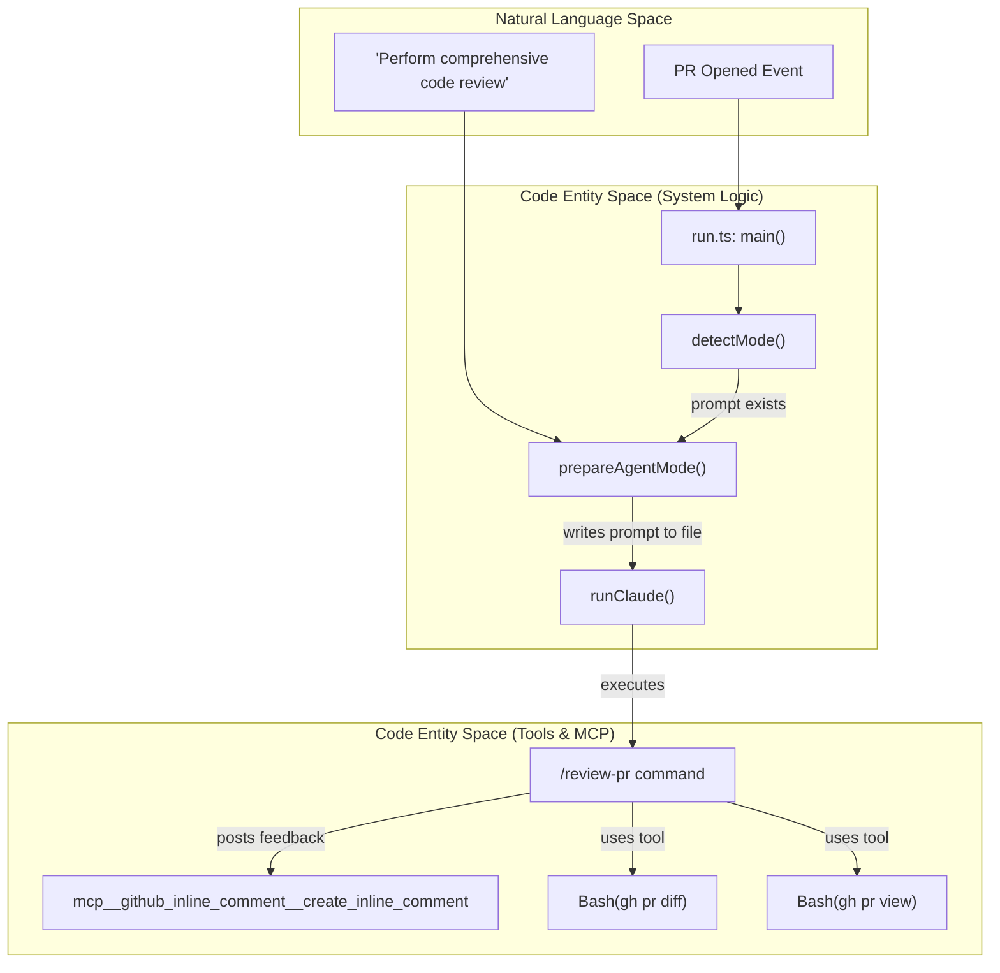
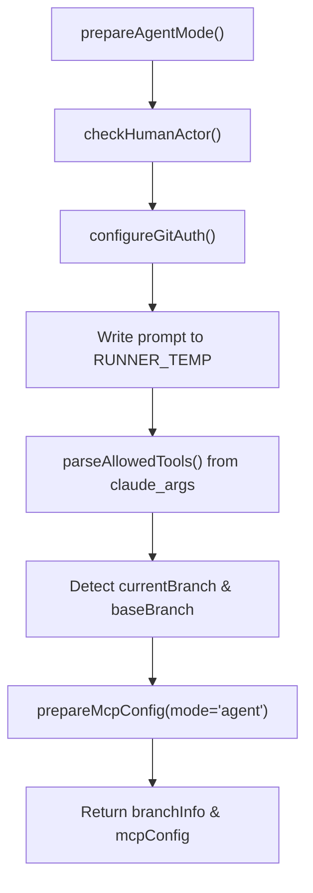

<!-- source: DeepWiki mcp.deepwiki.com · repo anthropics/claude-code-action · page 6.2 Automated Pull Request Review · fetched 2026-10-26 -->

# Automated Pull Request Review

<details>
<summary>Relevant source files</summary>

The following files were used as context for generating this wiki page:

- [.github/workflows/claude-review.yml](.github/workflows/claude-review.yml)
- [.github/workflows/claude.yml](.github/workflows/claude.yml)
- [.github/workflows/issue-triage.yml](.github/workflows/issue-triage.yml)
- [examples/manual-code-analysis.yml](examples/manual-code-analysis.yml)
- [examples/pr-review-comprehensive.yml](examples/pr-review-comprehensive.yml)
- [examples/pr-review-filtered-authors.yml](examples/pr-review-filtered-authors.yml)
- [examples/pr-review-filtered-paths.yml](examples/pr-review-filtered-paths.yml)

</details>


This page documents how to configure automated pull request review workflows that trigger on PR events without requiring `@claude` mentions. These workflows use **agent mode** to execute programmatic reviews based on explicit prompts and specialized subagents defined in the repository.

**Scope**: This page covers automated review workflows that run on GitHub events (`pull_request`). For interactive reviews triggered by `@claude` mentions, see [6.1 Interactive AI Assistant](). For architectural details about agent mode, see [4.2 Mode System Architecture]().

## Overview

Automated PR review workflows use the action in **agent mode**, which is detected when the `prompt` input is provided [src/modes/agent/index.ts:14-16](). Unlike tag mode (triggered by mentions), agent mode:

- Runs on standard GitHub workflow events (e.g., `pull_request.opened`) [.github/workflows/claude-review.yml:3-5]().
- Does not create tracking comments by default unless `track_progress` is set to `true` [examples/pr-review-comprehensive.yml:29-30]().
- Uses an explicit prompt or command from the workflow configuration [examples/pr-review-comprehensive.yml:32-64]().
- Allows granular control over tool availability via `claude_args` [examples/pr-review-comprehensive.yml:67-68]().
- Can utilize built-in subagents or commands for specialized analysis [.github/workflows/claude-review.yml:30]().

Sources: [src/modes/agent/index.ts:1-134](), [.github/workflows/claude-review.yml:1-34](), [examples/pr-review-comprehensive.yml:1-75]()

## Implementation: The Review Pipeline

The automated review follows a structured execution flow from event trigger to final comment posting.

### Data Flow and Component Mapping

The following diagram bridges the "Natural Language Space" (Review Request) to the "Code Entity Space" (Functions and Scripts).

**Title: Automated Review Execution Pipeline**

Sources: [src/entrypoints/run.ts:1-50](), [src/modes/agent/index.ts:19-134](), [.github/workflows/claude-review.yml:30-32](), [examples/pr-review-comprehensive.yml:67-68]()

## Basic Workflow Configuration (`claude-review.yml`)

To enable automatic reviews, create a workflow file that provides the `prompt` input.

```yaml
name: PR Review
on:
  pull_request:
    types: [opened]

jobs:
  review:
    runs-on: ubuntu-latest
    permissions:
      contents: read
      pull-requests: write
      id-token: write
    steps:
      - uses: actions/checkout@v6
      - uses: anthropics/claude-code-action@v1
        with:
          prompt: "/review-pr REPO: ${{ github.repository }} PR_NUMBER: ${{ github.event.pull_request.number }}"
          claude_args: |
            --allowedTools "mcp__github_inline_comment__create_inline_comment"
            --model "claude-opus-4-7"
```
Sources: [.github/workflows/claude-review.yml:1-34]()

### Required Permissions
The workflow requires `pull-requests: write` to post comments and `id-token: write` if using OIDC-based authentication providers [.github/workflows/claude-review.yml:10-13]().

## Specialized Review Patterns

### Comprehensive Review with Progress Tracking
By setting `track_progress: true`, the action creates a tracking comment with progress checkboxes, similar to interactive mode [examples/pr-review-comprehensive.yml:29-30](). This is useful for long-running reviews that cover multiple focus areas like Security, Performance, and Testing [examples/pr-review-comprehensive.yml:36-62]().

### Path-Specific Reviews
You can restrict reviews to critical paths using standard GitHub Actions `paths` filters. This ensures Claude only runs when relevant files (e.g., source code or APIs) are modified [examples/pr-review-filtered-paths.yml:3-11]().

```yaml
on:
  pull_request:
    types: [opened, synchronize]
    paths:
      - "src/**/*.ts"
      - "api/**/*.py"
```
Sources: [examples/pr-review-filtered-paths.yml:3-11]()

### Filtered Author Reviews
To target specific contributors (e.g., external contributors or specific developers), use GitHub context conditionals in the `if` block of the job [examples/pr-review-filtered-authors.yml:10-13]().

```yaml
jobs:
  review-by-author:
    if: |
      github.event.pull_request.user.login == 'developer1' ||
      github.event.pull_request.user.login == 'external-contributor'
```
Sources: [examples/pr-review-filtered-authors.yml:8-13]()

## Agent Mode Preparation Flow

When `prompt` is detected, the system bypasses trigger detection and enters `prepareAgentMode` [src/modes/agent/index.ts:14-19]().

**Title: prepareAgentMode Logic Flow**

Sources: [src/modes/agent/index.ts:28-134](), [src/github/validation/actor.ts:1-20]()

### Key Preparation Steps:
1. **Bot Loop Prevention**: `checkHumanActor()` ensures the action doesn't respond to other bots by default, preventing infinite loops [src/modes/agent/index.ts:29]().
2. **Prompt Injection**: The `prompt` input is written to a temporary file in `process.env.RUNNER_TEMP` which Claude reads as its initial task [src/modes/agent/index.ts:74-76]().
3. **Tool Isolation**: Only tools explicitly listed in `--allowedTools` within `claude_args` are available to the agent [src/modes/agent/index.ts:82-84](). For reviews, this typically includes the `mcp__github_inline_comment` server [examples/pr-review-comprehensive.yml:68]().

## Progress Tracking Mechanics
When `track_progress: true` is enabled in agent mode:
1. A tracking comment is created on the PR [examples/pr-review-comprehensive.yml:71]().
2. The comment includes all PR context (comments, attachments) [examples/pr-review-comprehensive.yml:72]().
3. Progress checkboxes are updated as the review proceeds [examples/pr-review-comprehensive.yml:73]().
4. The comment is marked as completed once the agent finishes its execution [examples/pr-review-comprehensive.yml:74]().

Sources: [examples/pr-review-comprehensive.yml:29-75](), [src/modes/agent/index.ts:112-114]()

---

