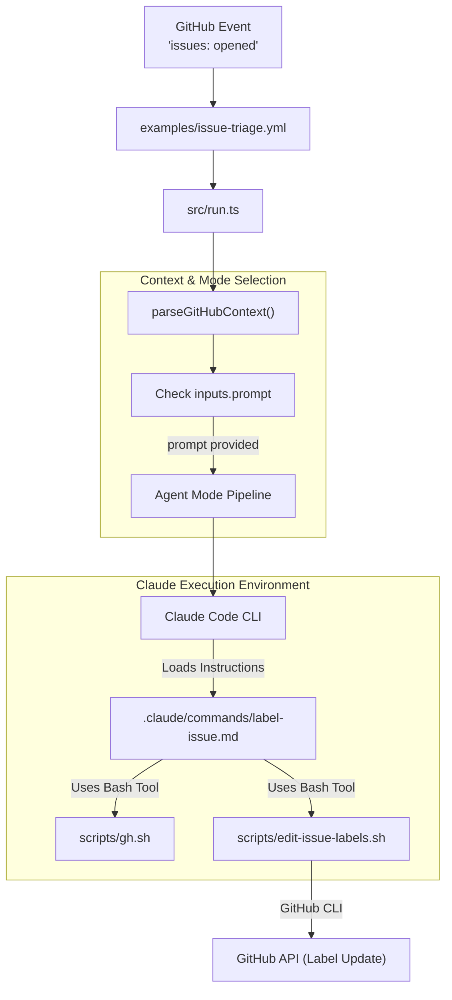
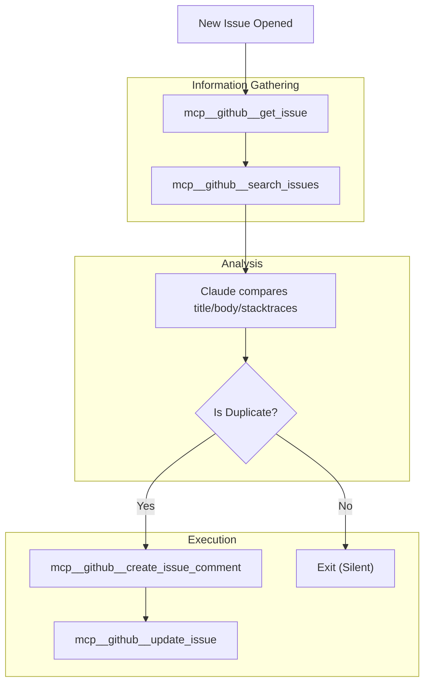

<!-- source: DeepWiki mcp.deepwiki.com · repo anthropics/claude-code-action · page 6.3 Issue Triage Automation · fetched 2026-10-26 -->

# Issue Triage Automation

<details>
<summary>Relevant source files</summary>

The following files were used as context for generating this wiki page:

- [.claude/commands/label-issue.md](.claude/commands/label-issue.md)
- [docs/solutions.md](docs/solutions.md)
- [examples/issue-deduplication.yml](examples/issue-deduplication.yml)
- [examples/issue-triage.yml](examples/issue-triage.yml)
- [scripts/edit-issue-labels.sh](scripts/edit-issue-labels.sh)
- [scripts/gh.sh](scripts/gh.sh)

</details>


## Purpose and Scope

This document demonstrates how to configure automated issue triage using the Claude Code Action. Issue triage automation executes automatically when new issues are opened, enabling Claude to label, categorize, detect duplicates, and perform other triage tasks without human intervention.

This page focuses on automated workflows triggered by issue events. For interactive issue assistance using `@claude` mentions, see [Interactive AI Assistant](#6.1). For general configuration options, see [Configuration](#5). For security considerations when allowing non-write users, see [Security Model](#9.1).

## Overview

Issue triage automation uses **Agent Mode** (see [Execution Modes](#3.1)) with explicit prompts triggered by GitHub issue events. When `inputs.prompt` is provided, the action executes immediately without waiting for trigger phrases or creating tracking comments.

### Key Characteristics

| Aspect | Configuration |
|--------|---------------|
| **Execution Mode** | Agent Mode (`inputs.prompt` triggers immediate execution) |
| **Trigger** | `issues: [opened]` event |
| **Required Permissions** | `issues: write`, `contents: read` |
| **Authentication Bypass** | `allowed_non_write_users: "*"` bypasses write-access checks |
| **Primary Tools** | MCP `github` server tools or repository-specific scripts |

Sources: [examples/issue-triage.yml:1-30](), [examples/issue-deduplication.yml:1-64](), [docs/solutions.md:12-14]()

## Basic Issue Triage Workflow

### Workflow Structure

The basic issue triage workflow monitors for newly opened issues and executes a triage prompt immediately. It often uses repository-specific scripts to perform the actual labeling to ensure consistency and safety.

```yaml
name: Claude Issue Triage
on:
  issues:
    types: [opened]

jobs:
  triage-issue:
    runs-on: ubuntu-latest
    timeout-minutes: 10
    permissions:
      contents: read
      issues: write

    steps:
      - name: Checkout repository
        uses: actions/checkout@v6
        with:
          fetch-depth: 0

      - name: Run Claude Code for Issue Triage
        uses: anthropics/claude-code-action@v1
        with:
          # Uses a custom command defined in .claude/commands/label-issue.md
          prompt: "/label-issue REPO: ${{ github.repository }} ISSUE_NUMBER: ${{ github.event.issue.number }}"
          anthropic_api_key: ${{ secrets.ANTHROPIC_API_KEY }}
          allowed_non_write_users: "*" # Essential for issues from external users
          github_token: ${{ secrets.GITHUB_TOKEN }}
```

Sources: [examples/issue-triage.yml:1-30](), [.claude/commands/label-issue.md:12-13]()

### Workflow Components Diagram

This diagram bridges the Natural Language prompt to the underlying code entities and script execution.



**Agent Mode Execution Flow for Triage**

Sources: [examples/issue-triage.yml:21-25](), [scripts/gh.sh:1-12](), [scripts/edit-issue-labels.sh:1-12]()

## Custom Commands and Scripts

### Custom Command Definition

The `/label-issue` command is defined in `.claude/commands/label-issue.md`. This file acts as a specialized system prompt for the triage task, specifying allowed tools and the decision-making process.

Key elements of the command include:
- **Allowed Tools**: Restricted specifically to the wrapper scripts `scripts/gh.sh` and `scripts/edit-issue-labels.sh` [.claude/commands/label-issue.md:2]().
- **Task Overview**: Instructions to fetch available labels using `./scripts/gh.sh label list` [.claude/commands/label-issue.md:17]().
- **Analysis Criteria**: Guidelines for analyzing title, description, and severity [.claude/commands/label-issue.md:30-37]().
- **Priority Assignment**: Specific instruction to add priority labels (P1, P2, P3) [.claude/commands/label-issue.md:43]().

### Triage Scripts

To ensure safety and predictable behavior, the triage assistant uses wrapper scripts that restrict the scope of what Claude can do via the `Bash` tool.

1.  **`scripts/gh.sh`**: A wrapper for the GitHub CLI that only allows read-only operations like `issue view`, `issue list`, `search issues`, and `label list` [scripts/gh.sh:29-36](). It strictly validates flags to prevent command injection or unauthorized API calls [scripts/gh.sh:44-60]().
2.  **`scripts/edit-issue-labels.sh`**: A targeted script for modifying labels. It reads the issue number directly from the `GITHUB_EVENT_PATH` environment variable, ensuring Claude can only modify the issue that triggered the workflow [scripts/edit-issue-labels.sh:12](). It validates requested labels against the repository's existing label list before applying them [scripts/edit-issue-labels.sh:44-59]().

Sources: [.claude/commands/label-issue.md:1-62](), [scripts/gh.sh:1-97](), [scripts/edit-issue-labels.sh:1-84]()

## Advanced Example: Issue Deduplication

Deduplication workflows leverage Claude's reasoning to identify if a new issue describes the same problem as an existing one, reducing maintainer overhead.

### Deduplication Logic

The deduplication workflow uses the `mcp-server-github` tools directly via `claude_args` instead of custom scripts.

```yaml
prompt: |
  Analyze this new issue and check if it's a duplicate of existing issues...
  1. Use mcp__github__get_issue for details
  2. Search for similar issues using mcp__github__search_issues
  3. If duplicate found: comment linking to original and apply "duplicate" label.

claude_args: |
  --allowedTools "mcp__github__get_issue,mcp__github__search_issues,mcp__github__list_issues,mcp__github__create_issue_comment,mcp__github__update_issue"
```

Sources: [examples/issue-deduplication.yml:25-64]()

### Deduplication Execution Diagram

This diagram maps the logical steps to the specific MCP tools used by the agent.



**Deduplication Logic and MCP Tool Mapping**

Sources: [examples/issue-deduplication.yml:31-59](), [examples/issue-deduplication.yml:63-64]()

## Permission Configuration

### Required Permissions

Issue triage workflows require specific permissions to interact with the repository and its issues.

```yaml
permissions:
  contents: read      # To read .claude/commands and scripts/
  issues: write        # To add labels and post comments
  id-token: write      # Required if using OIDC/Workload Identity Federation
```

Sources: [examples/issue-triage.yml:11-13](), [examples/issue-deduplication.yml:11-14]()

### Handling External Contributors

A critical setting for triage is `allowed_non_write_users: "*"`. By default, the action only responds to users with write access to the repository. However, since most issues are opened by external users, this check must be bypassed for triage. Setting this to `"*"` allows Claude to process issues from any user, while remaining constrained by the `prompt` and `claude_args` defined in the workflow.

```yaml
with:
  allowed_non_write_users: "*" # Required for triage of external issues
```

Sources: [examples/issue-triage.yml:28](), [docs/solutions.md:231-233]()

## Configuration Summary

| Input | Recommended Value | Purpose |
|-------|-------------------|---------|
| `prompt` | `/label-issue ...` or custom text | Defines the specific triage task and triggers Agent Mode. |
| `allowed_non_write_users` | `"*"` | Enables the action to run for issues created by the general public. |
| `claude_args` | `--allowedTools "..."` | Restricts Claude's tool access to a safe, minimal set. |
| `github_token` | `${{ secrets.GITHUB_TOKEN }}` | Provides the necessary authentication for GitHub CLI and MCP tools. |

Sources: [examples/issue-triage.yml:21-29](), [examples/issue-deduplication.yml:61-64]()

---

