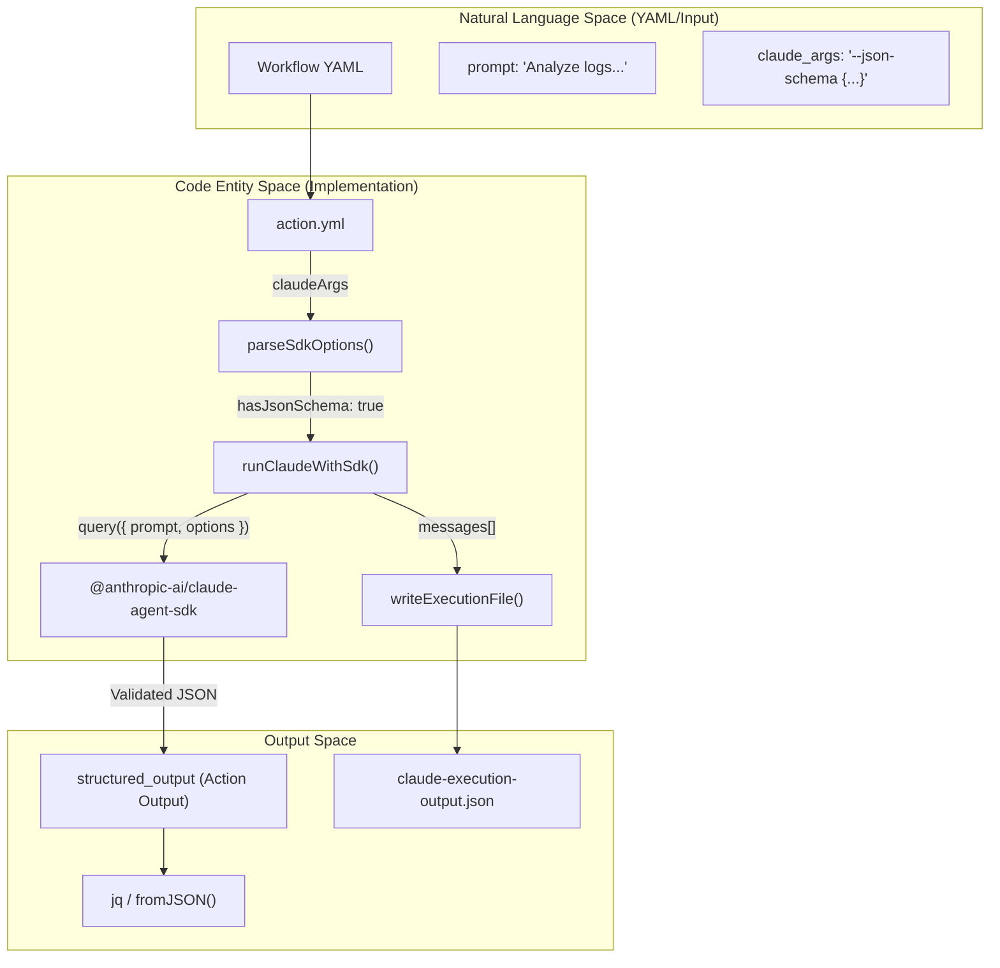
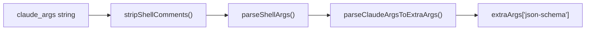
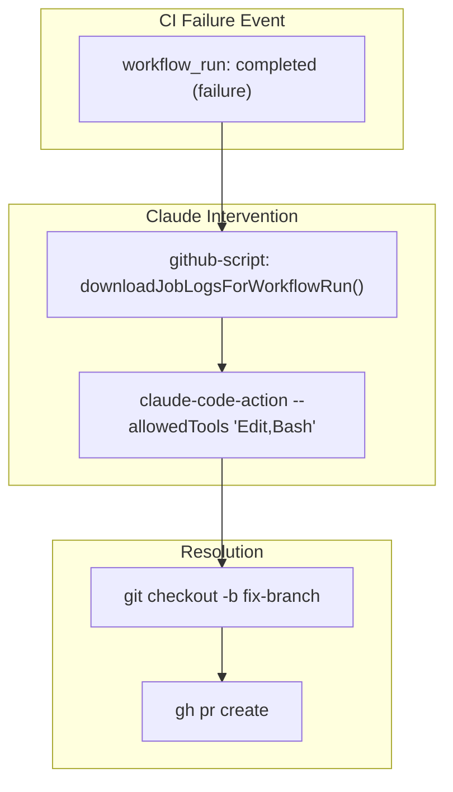

<!-- source: DeepWiki mcp.deepwiki.com · repo anthropics/claude-code-action · page 6.4 Structured Output Workflows · fetched 2026-10-26 -->

# Structured Output Workflows

<details>
<summary>Relevant source files</summary>

The following files were used as context for generating this wiki page:

- [base-action/src/execution-file.ts](base-action/src/execution-file.ts)
- [base-action/src/run-claude-sdk.ts](base-action/src/run-claude-sdk.ts)
- [base-action/test/execution-file.test.ts](base-action/test/execution-file.test.ts)
- [base-action/test/run-claude-sdk.test.ts](base-action/test/run-claude-sdk.test.ts)
- [examples/ci-failure-auto-fix.yml](examples/ci-failure-auto-fix.yml)
- [examples/test-failure-analysis.yml](examples/test-failure-analysis.yml)

</details>


## Purpose and Scope

This document provides technical details and practical examples of workflows that leverage JSON schema validation to produce structured, machine-readable outputs from Claude. These patterns enable building complex automation pipelines where Claude analyzes data and subsequent workflow steps consume the validated results programmatically via the `structured_output` action output.

For general action configuration, see [Action Inputs Reference](5.1). For internal implementation details of how these arguments are processed, see [Claude Execution System](7.6).

---

## Overview

The structured output feature allows Claude to return validated JSON data that automatically becomes available as a GitHub Action output. This is primarily controlled via the `--json-schema` flag passed within the `claude_args` input [base-action/src/parse-sdk-options.ts:161-162]().

Key capabilities include:
- **Conditional workflow logic** based on programmatic analysis (e.g., "if flaky then retry").
- **Data passing** between workflow steps without parsing unstructured text.
- **Type-safe automation** through JSON schema enforcement at the model level.

The `structured_output` field is populated in the action's outputs [base-action/action.yml:82-84]().

**Sources:** [base-action/src/parse-sdk-options.ts:161-162](), [base-action/action.yml:82-84]()

---

## Technical Architecture

### Data Flow Pipeline

The following diagram illustrates how a schema defined in a workflow YAML traverses the system to become a validated output.



**Figure 1: Structured Output Data Flow Pipeline**

The `runClaudeWithSdk` function in `base-action/src/run-claude-sdk.ts` iterates over messages from the `@anthropic-ai/claude-agent-sdk` [base-action/src/run-claude-sdk.ts:160-181](). If a result message is received, it extracts the `structured_output` and saves the entire message history to `claude-execution-output.json` via `writeExecutionFile` [base-action/src/run-claude-sdk.ts:192-195]().

**Sources:** [base-action/src/run-claude-sdk.ts:160-195](), [base-action/src/execution-file.ts:6-13](), [base-action/src/parse-sdk-options.ts:153-162]()

---

## Schema Definition and Validation

### Argument Parsing Logic

The action uses `parseClaudeArgsToExtraArgs` to handle CLI-style arguments within the GitHub Action environment [base-action/src/parse-sdk-options.ts:103-105](). This function strips shell comments [base-action/src/parse-sdk-options.ts:89-94]() and handles accumulating flags like `--allowed-tools` [base-action/src/parse-sdk-options.ts:123-135]().

When `--json-schema` is provided, the `ParsedSdkOptions` object sets `hasJsonSchema` to `true` [base-action/src/parse-sdk-options.ts:11-12]().



**Figure 2: Argument Processing for Structured Output**

**Sources:** [base-action/src/parse-sdk-options.ts:8-12](), [base-action/src/parse-sdk-options.ts:89-147]()

---

## Example 1: Flaky Test Detection and Auto-Retry

This workflow detects flaky test failures and automatically re-triggers CI workflows. It uses a specific JSON schema to quantify Claude's confidence in the determination.

### Implementation Pattern

The following example is based on the pattern found in `examples/test-failure-analysis.yml`.

```yaml
- name: Detect flaky test failures
  id: detect
  uses: anthropics/claude-code-action@main
  with:
    anthropic_api_key: ${{ secrets.ANTHROPIC_API_KEY }}
    prompt: |
      The CI workflow failed. Determine if this looks like a flaky test.
    claude_args: |
      --json-schema '{"type":"object","properties":{"is_flaky":{"type":"boolean"},"confidence":{"type":"number","minimum":0,"maximum":1},"summary":{"type":"string"}},"required":["is_flaky","confidence","summary"]}'

# Auto-retry only if flaky AND high confidence (>= 0.7)
- name: Retry flaky tests
  if: |
    fromJSON(steps.detect.outputs.structured_output).is_flaky == true &&
    fromJSON(steps.detect.outputs.structured_output).confidence >= 0.7
  run: |
    gh workflow run "${{ github.event.workflow_run.name }}" --ref ${{ github.event.workflow_run.head_branch }}
```

**Sources:** [examples/test-failure-analysis.yml:25-53]()

---

## Example 2: CI Failure Auto-Fix Pattern

While Example 1 focuses on detection, the auto-fix pattern uses Claude's ability to modify code to resolve CI issues discovered in logs.

### Workflow Architecture



**Figure 3: CI Auto-Fix Data Flow**

In `examples/ci-failure-auto-fix.yml`, the action is configured with a wide range of `allowedTools` including `Edit`, `Bash(npm:*)`, and `Bash(git:*)` to allow Claude to actively repair the build [examples/ci-failure-auto-fix.yml:117-118]().

**Sources:** [examples/ci-failure-auto-fix.yml:33-118]()

---

## Output Consumption Patterns

### Accessing Data via GitHub Actions Expressions

The most common way to use structured output is via the `fromJSON` expression in an `if` condition or an environment variable.

| Pattern | Syntax |
| :--- | :--- |
| **Boolean Check** | `fromJSON(steps.id.outputs.structured_output).is_flaky == true` |
| **Numeric Threshold** | `fromJSON(steps.id.outputs.structured_output).confidence >= 0.7` |
| **String Extraction** | `env: SUMMARY: ${{ fromJSON(steps.id.outputs.structured_output).summary }}` |

### Accessing Data via Shell (jq)

For complex scripts, the output can be processed using `jq` [examples/test-failure-analysis.yml:59-61]().

```bash
OUTPUT='${{ steps.detect.outputs.structured_output }}'
CONFIDENCE=$(echo "$OUTPUT" | jq -r '.confidence')
SUMMARY=$(echo "$OUTPUT" | jq -r '.summary')
```

**Sources:** [examples/test-failure-analysis.yml:51-61]()

---

## Execution Monitoring and Logging

### The Execution File

Every run of the action, whether successful or failed, attempts to write an execution log to `claude-execution-output.json` [base-action/src/execution-file.ts:6-12](). This file contains the full array of `SDKMessage` objects returned by the Agent SDK [base-action/src/run-claude-sdk.ts:156, 192]().

If the SDK throws an error mid-stream, the action still attempts to write the partial message history to help with debugging [base-action/src/run-claude-sdk.ts:182-186]().

### Success vs. Failure Criteria

A run is considered a "failure" if:
1. The SDK throws an error [base-action/src/run-claude-sdk.ts:185]().
2. No `result` message is received [base-action/src/run-claude-sdk.ts:208]().
3. The result message has `is_error: true`, even if the subtype is `success` [base-action/src/run-claude-sdk.ts:213-215]().

**Sources:** [base-action/src/run-claude-sdk.ts:182-215](), [base-action/src/execution-file.ts:15-32](), [base-action/test/run-claude-sdk.test.ts:20-60]()

---

## Troubleshooting

### Common Schema Issues

1.  **Malformed JSON**: Ensure the `--json-schema` string is valid JSON. Use single quotes for the flag value in YAML to avoid escaping issues with double quotes inside the schema.
2.  **Missing Required Fields**: If Claude fails to provide a field marked as `required` in the schema, the action may fail validation.
3.  **Shell Comments**: The parser removes lines starting with `#` inside `claude_args` [base-action/src/parse-sdk-options.ts:89-94](), allowing you to document complex schemas inline.
4.  **SDK Hangs**: In some environments, the SDK iterator may stay open after a result. The action explicitly breaks the loop after the `result` message to prevent workflow timeouts [base-action/src/run-claude-sdk.ts:170-179]().

**Sources:** [base-action/src/parse-sdk-options.ts:89-94](), [base-action/src/run-claude-sdk.ts:170-179]()

---

