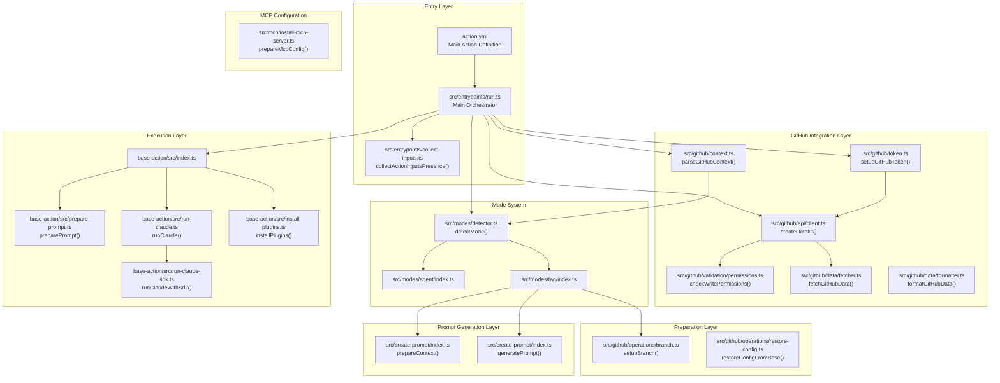
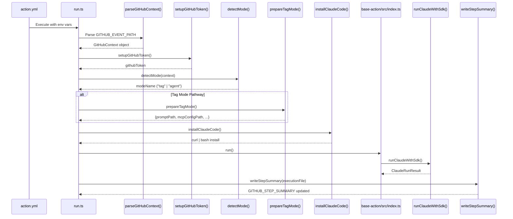

<!-- source: DeepWiki mcp.deepwiki.com · repo anthropics/claude-code-action · page 7 Internal Components · fetched 2026-10-26 -->

# Internal Components

Relevant source files

The following files were used as context for generating this wiki page:

- [src/create-prompt/index.ts](src/create-prompt/index.ts)
- [src/create-prompt/types.ts](src/create-prompt/types.ts)
- [src/entrypoints/run.ts](src/entrypoints/run.ts)
- [src/mcp/install-mcp-server.ts](src/mcp/install-mcp-server.ts)
- [test/create-prompt.test.ts](test/create-prompt.test.ts)
- [test/install-mcp-server.test.ts](test/install-mcp-server.test.ts)
- [test/install-pipefail.test.ts](test/install-pipefail.test.ts)
- [test/prepare-context.test.ts](test/prepare-context.test.ts)

This document provides a technical overview of the internal components that comprise the Claude Code Action. It is intended for developers who need to understand or modify the codebase architecture. Each major component is introduced here with references to detailed documentation in child pages.

For user-facing configuration options, see [Configuration](#5). For architectural concepts, see [Architecture](#4).

## Component Architecture

The codebase is organized into distinct layers, each with specific responsibilities. The following diagram maps high-level system concepts to their concrete implementations in the codebase.

### System Component Map

**Sources:** [src/entrypoints/run.ts:163-182](), [src/github/context.ts:1-25](), [src/modes/detector.ts:1-26](), [src/create-prompt/index.ts:104-109](), [src/mcp/install-mcp-server.ts:52-54]()

## Execution Flow Through Components

The following diagram shows how execution flows through the internal components during a typical run, with specific function calls and data transformations.

**Sources:** [src/entrypoints/run.ts:58-116](), [src/entrypoints/run.ts:121-146](), [src/entrypoints/run.ts:163-200](), [src/github/context.ts:1-50](), [src/github/token.ts:14-30]()

## Component Overview

### Action Entrypoints

The entry layer consists of the GitHub Action definition files and the main orchestration logic:

- **`src/entrypoints/run.ts`**: Unified orchestrator merging prepare, install, run, and cleanup phases. It includes retry logic for Claude CLI installation. [src/entrypoints/run.ts:4-116]()
- **`src/entrypoints/collect-inputs.ts`**: Utility to verify which inputs are present for the run. [src/entrypoints/run.ts:32-32]()
- **`src/entrypoints/update-comment-link.ts`**: Manages the link between the trigger comment and the action run. [src/entrypoints/run.ts:33-33]()

The `run.ts` entrypoint uses `installClaudeCode` to fetch the CLI, implementing a 3-attempt retry loop with `set -o pipefail` to ensure download failures are caught. [src/entrypoints/run.ts:50-116]()

**Detailed documentation:** [Action Entrypoints](#7.1)

**Sources:** [src/entrypoints/run.ts:1-116](), [test/install-pipefail.test.ts:5-22]()

### Prompt Generation System

The prompt generation system handles the complex transformation of GitHub event data into a structured prompt for the LLM:

- **`src/create-prompt/index.ts`**: Contains `prepareContext` and `generatePrompt`. It manages `USER_REQUEST_FILENAME` and defines `BASE_ALLOWED_TOOLS`. [src/create-prompt/index.ts:29-34]()
- **`src/create-prompt/types.ts`**: Defines the `PreparedContext` and `EventData` union types used to pass data between fetching and generation. [src/create-prompt/types.ts:99-115]()

The system filters tools based on configuration, such as adding `mcp__github_comment__update_claude_comment` by default for tag mode. [src/create-prompt/index.ts:45-45]()

**Detailed documentation:** [Prompt Generation System](#7.2)

**Sources:** [src/create-prompt/index.ts:36-77](), [src/create-prompt/index.ts:104-146]()

### GitHub Context and Data Fetching

This layer provides a type-safe interface to the GitHub Action environment:

- **`src/github/context.ts`**: Logic for parsing `GITHUB_EVENT_PATH` and identifying event types (e.g., `isPullRequestEvent`). [src/github/context.ts:18-25]()
- **`src/github/token.ts`**: Handles the complexity of GitHub token acquisition, including OIDC exchange for cloud providers. [src/entrypoints/run.ts:14-14]()
- **`src/github/validation/permissions.ts`**: Validates that the actor has sufficient permissions to trigger the action. [src/entrypoints/run.ts:15-15]()

**Detailed documentation:** [GitHub Context and Data Fetching](#7.3)

**Sources:** [src/entrypoints/run.ts:163-180](), [src/github/context.ts:1-50]()

### MCP Server System

The Model Context Protocol (MCP) system enables Claude to interact with GitHub resources:

- **`src/mcp/install-mcp-server.ts`**: The `prepareMcpConfig` function dynamically generates the MCP settings file. It configures servers like `github_comment`, `github_file_ops`, and `github_ci`. [src/mcp/install-mcp-server.ts:52-204]()
- **Permission Guarding**: Includes `checkActionsReadPermission` to verify if the token can access CI logs before installing the `github_ci` server. [src/mcp/install-mcp-server.ts:20-50]()

The system routes tool calls by prefix (e.g., `mcp__github_comment__`) to the appropriate internal server script. [src/mcp/install-mcp-server.ts:72-86]()

**Detailed documentation:** [MCP Server System](#7.4)

**Sources:** [src/mcp/install-mcp-server.ts:1-227](), [test/install-mcp-server.test.ts:7-155]()

### Branch and File Operations

Components responsible for managing the local Git state and remote synchronization:

- **`src/github/operations/branch.ts`**: Validates branch names against templates and sets up the working branch. [src/entrypoints/run.ts:31-31]()
- **`src/github/operations/restore-config.ts`**: Ensures Git configuration (like `user.name` and `user.email`) is correctly restored after Claude execution. [src/entrypoints/run.ts:30-30]()

**Detailed documentation:** [Branch and File Operations](#7.5)

**Sources:** [src/entrypoints/run.ts:30-31](), [src/github/operations/branch.ts:1-100]()

### Claude Execution System

The final execution layer that interfaces with the Claude Code CLI:

- **`base-action/src/run-claude.ts`**: The high-level entry for running the CLI. [src/entrypoints/run.ts:43-43]()
- **`base-action/src/run-claude-sdk.ts`**: Handles spawning the CLI process, managing standard I/O, and capturing structured results. [src/entrypoints/run.ts:44-44]()
- **`base-action/src/setup-claude-code-settings.ts`**: Prepares the `~/.claude/settings.json` file before execution. [src/entrypoints/run.ts:40-40]()

The system captures Claude's "turns" and writes them to a step summary using `writeStepSummary` after execution finishes. [src/entrypoints/run.ts:121-146]()

**Detailed documentation:** [Claude Execution System](#7.6)

**Sources:** [src/entrypoints/run.ts:148-280](), [base-action/src/run-claude-sdk.ts:1-100]()

---

