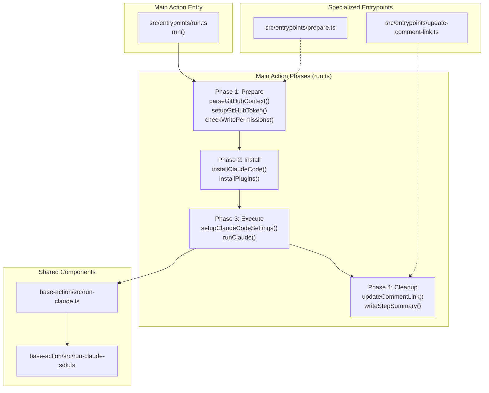
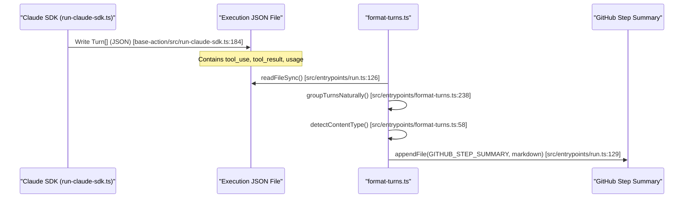

<!-- source: DeepWiki mcp.deepwiki.com · repo anthropics/claude-code-action · page 7.1 Action Entrypoints · fetched 2026-10-26 -->

# Action Entrypoints

Relevant source files

The following files were used as context for generating this wiki page:

- [.prettierignore](.prettierignore)
- [src/entrypoints/cleanup-ssh-signing.ts](src/entrypoints/cleanup-ssh-signing.ts)
- [src/entrypoints/format-turns.ts](src/entrypoints/format-turns.ts)
- [src/entrypoints/prepare.ts](src/entrypoints/prepare.ts)
- [src/entrypoints/run.ts](src/entrypoints/run.ts)
- [src/entrypoints/update-comment-link.ts](src/entrypoints/update-comment-link.ts)
- [src/github/operations/comment-logic.ts](src/github/operations/comment-logic.ts)
- [test/fixtures/sample-turns-expected-output.md](test/fixtures/sample-turns-expected-output.md)
- [test/format-turns.test.ts](test/format-turns.test.ts)
- [test/install-pipefail.test.ts](test/install-pipefail.test.ts)

This document covers the primary entry points that orchestrate the `claude-code-action` execution flow. These entrypoints serve as the main coordination layer between GitHub Actions workflow execution and the underlying Claude integration systems.

The action has two usage patterns:
1. **Main Action** - Full GitHub integration with mode detection, comment tracking, and branch management.
2. **Base Action** - Standalone Claude execution without GitHub-specific features.

For information about prompt generation, see page 7.2. For GitHub context parsing, see page 7.3. For MCP server configuration, see page 7.4.

## Overview

The `claude-code-action` uses a unified orchestrator at `src/entrypoints/run.ts` that executes four sequential phases:

1. **Prepare** - Parse context, authenticate, check permissions, create tracking comments. [src/entrypoints/run.ts:163-211]()
2. **Install** - Install Claude Code CLI and plugins. [src/entrypoints/run.ts:214-230]()
3. **Execute** - Run Claude via the SDK with configured tools. [src/entrypoints/run.ts:232-262]()
4. **Cleanup** - Update comments, write summaries, and clean up resources (always runs in a `finally` block). [src/entrypoints/run.ts:272-316]()

The base-action provides a simpler entrypoint at `base-action/src/index.ts` for direct Claude execution without GitHub integration.

## Entrypoint Architecture

The main action entrypoint `run.ts` now encapsulates logic previously split across multiple scripts, though specialized entrypoints like `prepare.ts` and `update-comment-link.ts` remain available for specific workflow steps.

### Unified Orchestrator Flow

Title: Orchestration Flow of Entrypoint Scripts

**Sources:** [src/entrypoints/run.ts:4-46](), [src/entrypoints/prepare.ts:19-82](), [src/entrypoints/update-comment-link.ts:35-212]()

## Main Action Entrypoint: `src/entrypoints/run.ts`

The `run.ts` script is the primary entrypoint. It manages state across the lifecycle, including the GitHub token, comment IDs, and branch names. [src/entrypoints/run.ts:149-161]()

### Phase 1: Preparation and Permission Checking
The orchestrator first collects input presence via `collectActionInputsPresence` and parses the GitHub context to detect the execution mode (`tag` or `agent`). [src/entrypoints/run.ts:164-169]()
* **Token Setup**: Calls `setupGitHubToken()` to handle OIDC or secret-based auth. [src/entrypoints/run.ts:172]()
* **Permission Validation**: For entity contexts (Issues/PRs), it verifies the actor has write permissions using `checkWritePermissions()`. [src/entrypoints/run.ts:184-196]()
* **Trigger Detection**: Checks if the event contains the required trigger (e.g., `@claude` mention) via `checkContainsTrigger()` before proceeding. [src/entrypoints/run.ts:199-205]()

### Phase 2: Installation and Environment Setup
The `installClaudeCode()` function handles the deployment of the Claude CLI. [src/entrypoints/run.ts:58-116]()
* **Custom Executables**: If `PATH_TO_CLAUDE_CODE_EXECUTABLE` is provided, it skips installation and updates the system `PATH` and `GITHUB_PATH`. [src/entrypoints/run.ts:59-76]()
* **Retry Logic**: It attempts to install Claude Code via `curl | bash` up to 3 times with a 5-second delay between failures. [src/entrypoints/run.ts:81-114]()
* **Pipefail Safety**: The `buildInstallCommand` function uses `set -o pipefail` to ensure `curl` errors (like 429/403) propagate through the pipe to trigger the retry loop. [src/entrypoints/run.ts:50-52]()
* **Plugin Installation**: Invokes `installPlugins()` from the base-action to load marketplace or local plugins. [src/entrypoints/run.ts:226-230]()

### Phase 3: Claude Execution
The orchestrator prepares the prompt configuration and executes Claude.
* **Environment Validation**: Ensures all required keys (Anthropic, AWS, or Google) are present using `validateEnvironmentVariables`. [src/entrypoints/run.ts:222]()
* **SDK Invocation**: Calls `runClaude()` which utilizes the `@anthropic-ai/claude-agent-sdk` to perform the actual AI reasoning and tool use. [src/entrypoints/run.ts:240-247]()

### Phase 4: Cleanup and Reporting
Regardless of success or failure, the `finally` block executes cleanup tasks. [src/entrypoints/run.ts:272]()
* **Comment Updating**: `updateCommentLink()` transitions the "Claude is working" comment to a final status (Success/Error) with execution metrics. [src/entrypoints/run.ts:275-299]()
* **Step Summary**: `writeStepSummary()` reads the execution JSON and generates a Markdown report. [src/entrypoints/run.ts:121-146]()

**Sources:** [src/entrypoints/run.ts:37-316](), [test/install-pipefail.test.ts:5-50]()

## Specialized Entrypoints

### `update-comment-link.ts`
This script manages the lifecycle of the GitHub comment that tracks Claude's progress.
* **Namespace Handling**: It distinguishes between PR Review Comments (using `pulls.getReviewComment`) and Issue/PR Comments (using `issues.getComment`). [src/entrypoints/update-comment-link.ts:59-83]()
* **Branch/PR Links**: It uses `checkAndCommitOrDeleteBranch()` to determine if a branch link or a "Create PR" URL should be appended to the comment. [src/entrypoints/update-comment-link.ts:112-162]()
* **Execution Metrics**: Parses the `outputFile` (last element of the JSON array) to extract `total_cost_usd`, `duration_ms`, and `duration_api_ms`. [src/entrypoints/update-comment-link.ts:179-197]()

### `format-turns.ts`
This utility transforms the raw JSON output from the Claude SDK into human-readable Markdown for the GitHub Step Summary.
* **Content Detection**: `detectContentType()` identifies `json`, `python`, `javascript`, `bash`, `diff`, or `html` blocks for syntax highlighting. [src/entrypoints/format-turns.ts:58-142]()
* **Natural Grouping**: `groupTurnsNaturally()` associates `tool_result` items from user messages with their corresponding `tool_use` items from assistant messages. [src/entrypoints/format-turns.ts:238-280]()

### `cleanup-ssh-signing.ts`
A security-focused post-execution script that ensures SSH signing keys are removed from the runner after the action completes via `cleanupSshSigning()`. [src/entrypoints/cleanup-ssh-signing.ts:1-21]()

**Sources:** [src/entrypoints/update-comment-link.ts:35-212](), [src/entrypoints/format-turns.ts:1-280](), [src/entrypoints/cleanup-ssh-signing.ts:1-21]()

## Data Flow: From Execution to Summary

The following diagram illustrates how execution data is captured and formatted for the user.

Title: Data Transformation from SDK to GitHub Summary

**Sources:** [src/entrypoints/run.ts:121-146](), [src/entrypoints/format-turns.ts:1-280](), [base-action/src/run-claude-sdk.ts:184]()

## Comment Body Logic

The `updateCommentBody` function in `src/github/operations/comment-logic.ts` is responsible for the final string manipulation of the GitHub comment. It performs the following:
1. **Header Construction**: Creates strings like `**Claude finished @user's task in 2m 15s**` or error headers. [src/github/operations/comment-logic.ts:112-132]()
2. **Link Aggregation**: Appends links to the specific Job Run, the generated branch, and the "Create PR" comparison URL. [src/github/operations/comment-logic.ts:135-179]()
3. **Content Cleaning**: Removes temporary `Claude Code is working…` indicators and old duration info to keep the thread clean. [src/github/operations/comment-logic.ts:84-85](), [src/github/operations/comment-logic.ts:191-198]()

**Sources:** [src/github/operations/comment-logic.ts:69-203]()

---

