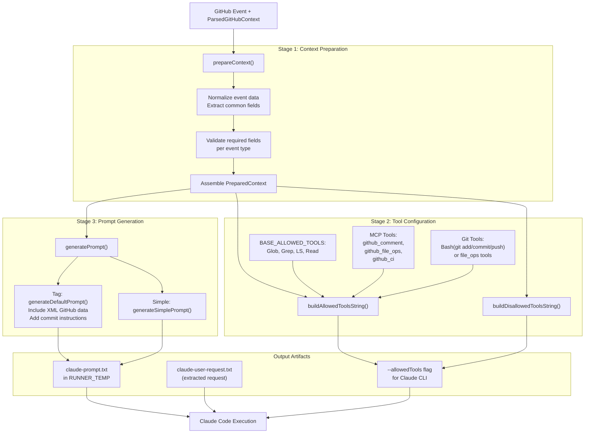
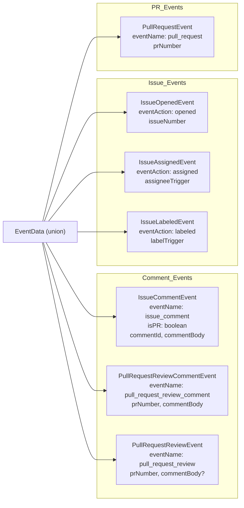
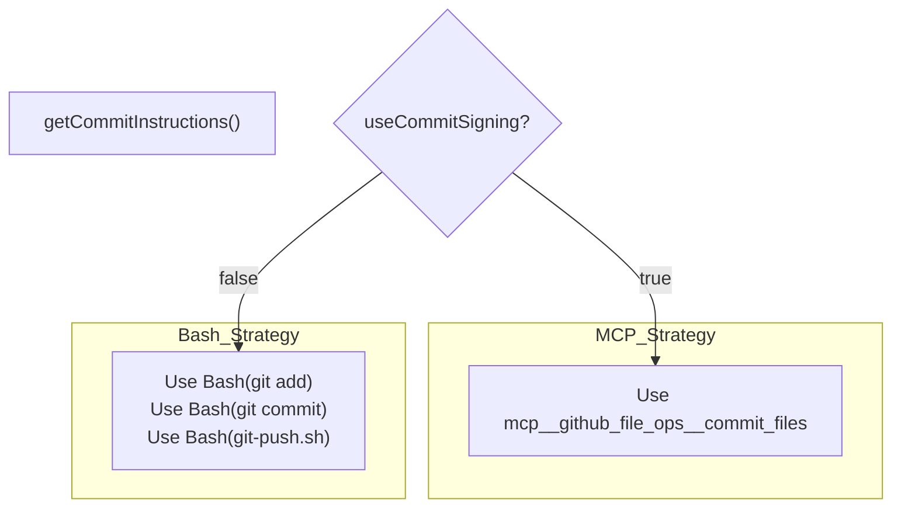

<!-- source: DeepWiki mcp.deepwiki.com · repo anthropics/claude-code-action · page 7.2 Prompt Generation System · fetched 2026-10-26 -->

# Prompt Generation System

<details>
<summary>Relevant source files</summary>

The following files were used as context for generating this wiki page:

- [src/create-prompt/index.ts](src/create-prompt/index.ts)
- [src/create-prompt/types.ts](src/create-prompt/types.ts)
- [src/github/data/formatter.ts](src/github/data/formatter.ts)
- [src/utils/extract-user-request.ts](src/utils/extract-user-request.ts)
- [test/create-prompt.test.ts](test/create-prompt.test.ts)
- [test/data-formatter.test.ts](test/data-formatter.test.ts)
- [test/extract-user-request.test.ts](test/extract-user-request.test.ts)
- [test/prepare-context.test.ts](test/prepare-context.test.ts)

</details>


## Purpose and Scope

The Prompt Generation System transforms raw GitHub event data into structured prompts that Claude AI can execute. This system is responsible for:

- Normalizing diverse GitHub event types into a unified `PreparedContext` structure [src/create-prompt/index.ts:104-109]().
- Configuring allowed and disallowed tools based on mode and user settings [src/create-prompt/index.ts:36-102]().
- Generating mode-specific prompts with appropriate GitHub context [src/create-prompt/index.ts:583-600]().
- Managing the file system layout in `RUNNER_TEMP` for the Claude CLI to consume [src/create-prompt/index.ts:892-896]().

For information about how modes are detected and selected, see [Mode System Architecture](#4.2). For details on GitHub event parsing, see [GitHub Context and Data Fetching](#7.3). For Claude execution with generated prompts, see [Claude Execution System](#7.6).

---

## System Architecture

The prompt generation system operates as a multi-stage pipeline that processes GitHub events through validation, normalization, and template generation phases.

### Prompt Generation Pipeline



**Sources:** [src/create-prompt/index.ts:104-154](), [src/create-prompt/index.ts:36-77](), [src/create-prompt/index.ts:583-600]()

---

## Core Data Types

The system uses strongly-typed structures to represent GitHub event data in a normalized format.

### CommonFields

Basic metadata shared by all events:

| Field | Type | Description |
|-------|------|-------------|
| `repository` | `string` | Full repository name (owner/repo) |
| `claudeCommentId` | `string` | ID of tracking comment (tag mode) |
| `triggerPhrase` | `string` | Phrase that triggered execution (default `@claude`) |
| `triggerUsername?` | `string` | User who triggered the action |
| `prompt?` | `string` | Custom user-provided prompt |
| `claudeBranch?` | `string` | Branch created for changes |

**Sources:** [src/create-prompt/types.ts:3-11]()

### EventData Union

The `EventData` type is a discriminated union representing all supported GitHub event types:



**Sources:** [src/create-prompt/types.ts:13-108]()

---

## Context Preparation Pipeline

The `prepareContext` function [src/create-prompt/index.ts:104-109]() normalizes diverse GitHub event payloads into the unified `PreparedContext` structure.

### Validation Rules

The system enforces strict validation based on event type:

| Event Type | Required Fields | Validation |
|------------|----------------|------------|
| `issue_comment` (issue) | `commentId`, `commentBody`, `baseBranch`, `claudeBranch`, `issueNumber` | Must have `isPR: false` [src/create-prompt/index.ts:223-239]() |
| `issue_comment` (PR) | `commentId`, `commentBody`, `prNumber` | Must have `isPR: true` [src/create-prompt/index.ts:208-221]() |
| `pull_request_review` | `prNumber` | `isPR: true` [src/create-prompt/index.ts:190-205]() |
| `pull_request_review_comment` | `prNumber`, `commentBody` | `isPR: true` [src/create-prompt/index.ts:163-188]() |
| `issues` (opened) | `issueNumber`, `baseBranch`, `claudeBranch` | `isPR: false` [src/create-prompt/index.ts:243-264]() |

**Sources:** [src/create-prompt/index.ts:156-335]()

---

## Tool Configuration System

The tool configuration system builds lists of allowed and disallowed tools based on mode, user settings, and authentication method.

### BASE_ALLOWED_TOOLS

Tag mode requires a minimum set of file system tools to function. Note that `Edit`, `MultiEdit`, and `Write` are intentionally omitted from this list because the `acceptEdits` permission mode auto-allows edits inside `$GITHUB_WORKSPACE` [src/create-prompt/index.ts:31-34]().

```typescript
const BASE_ALLOWED_TOOLS = ["Glob", "Grep", "LS", "Read"];
```

### buildAllowedToolsString

This function assembles the complete allowed tools list [src/create-prompt/index.ts:36-77]().

1. **Start with Base**: `Glob`, `Grep`, `LS`, `Read`.
2. **Comment Tool**: Always includes `mcp__github_comment__update_claude_comment` [src/create-prompt/index.ts:45]().
3. **Commit Strategy**:
   - If `useCommitSigning` is true: Adds `mcp__github_file_ops__commit_files` and `delete_files` [src/create-prompt/index.ts:48-52]().
   - Otherwise: Adds specific Bash git commands: `git add`, `git commit`, `git rm`, and the `git-push.sh` wrapper [src/create-prompt/index.ts:54-61]().
4. **CI Tools**: If `includeActionsTools` is true, adds `mcp__github_ci__get_ci_status`, etc [src/create-prompt/index.ts:64-70]().

**Sources:** [src/create-prompt/index.ts:36-77]()

---

## Tag Mode Prompt Generation

Tag mode generates comprehensive prompts with extensive GitHub context and instructions.

### Prompt Structure and XML Tags

The `generateDefaultPrompt` function [src/create-prompt/index.ts:583-600]() constructs a prompt using XML tags for structured data:

| XML Tag | Content |
|---------|---------|
| `<formatted_context>` | PR/Issue metadata (title, state, author) [src/create-prompt/index.ts:626]() |
| `<pr_or_issue_body>` | The body of the PR or Issue [src/create-prompt/index.ts:643]() |
| `<comments>` | Formatted thread of comments [src/create-prompt/index.ts:645]() |
| `<changed_files>` | List of files with SHAs (PR only) [src/create-prompt/index.ts:655]() |
| `<trigger_comment>` | The specific comment that triggered Claude [src/create-prompt/index.ts:684]() |

### User Request Extraction

The system separates the specific instruction from the trigger phrase using `extractUserRequest` [src/utils/extract-user-request.ts:11-32]().
- Input: `@claude /review-pr please check auth`
- Trigger: `@claude`
- Result: `/review-pr please check auth`

This result is written to `claude-user-request.txt` in the `RUNNER_TEMP` directory [src/create-prompt/index.ts:29]().

**Sources:** [src/create-prompt/index.ts:602-691](), [src/utils/extract-user-request.ts:11-32]()

---

## Commit Instructions Generation

The `getCommitInstructions` function [src/create-prompt/index.ts:395-400]() provides Claude with specific git strategy instructions.

### Co-Author Attribution

The system builds a `Co-authored-by` line to credit the user who triggered the action [src/create-prompt/index.ts:413-418]().

### Strategy Mapping



**Sources:** [src/create-prompt/index.ts:395-451]()

---

## Simple vs Default Variants

The system supports a "simple" prompt variant, toggled via the `USE_SIMPLE_PROMPT` environment variable [src/create-prompt/index.ts:587-591]().

- **Default Prompt**: Includes full instructions for todo lists, context gathering, and complex execution steps [src/create-prompt/index.ts:693-845]().
- **Simple Prompt**: A stripped-down version containing only basic context and the user request, used for debugging or lightweight tasks [src/create-prompt/index.ts:453-581]().

**Sources:** [src/create-prompt/index.ts:453-847]()

---

## RUNNER_TEMP File System Layout

The system prepares a specific directory structure in the GitHub Actions runner's temporary directory [src/create-prompt/index.ts:887-896]().

```text
$RUNNER_TEMP/
└── claude-prompts/
    ├── claude-prompt.txt        # The generated system/context prompt
    └── claude-user-request.txt   # The specific user instruction
```

The Claude CLI is then invoked with these files as inputs.

**Sources:** [src/create-prompt/index.ts:887-896](), [src/create-prompt/index.ts:29]()

---

