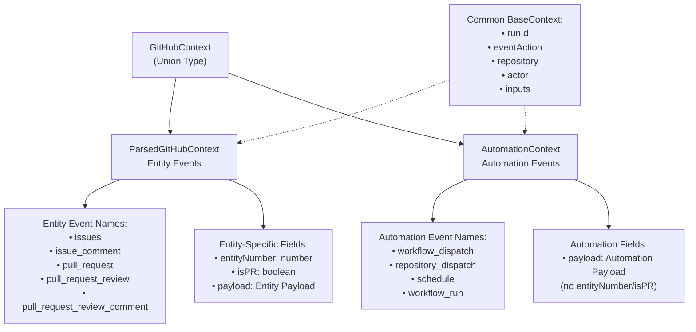
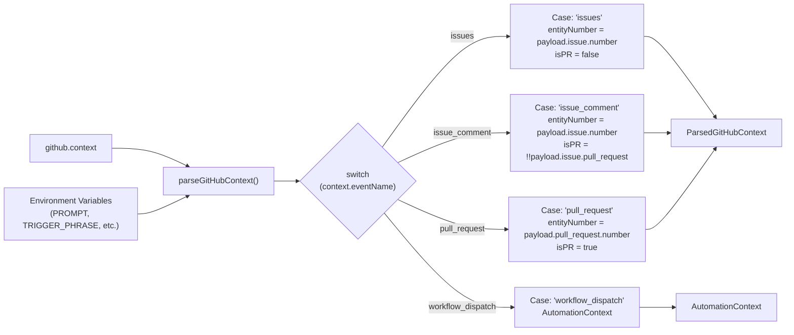
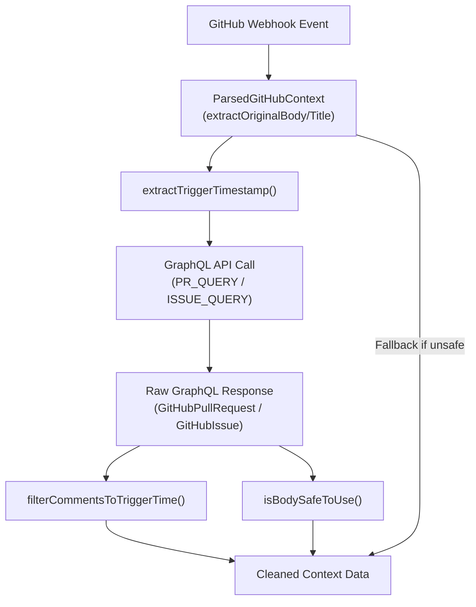

<!-- source: DeepWiki mcp.deepwiki.com · repo anthropics/claude-code-action · page 7.3 GitHub Context and Data Fetching · fetched 2026-10-26 -->

# GitHub Context and Data Fetching

Relevant source files

The following files were used as context for generating this wiki page:

- [src/github/api/client.ts](src/github/api/client.ts)
- [src/github/api/queries/github.ts](src/github/api/queries/github.ts)
- [src/github/context.ts](src/github/context.ts)
- [src/github/data/fetcher.ts](src/github/data/fetcher.ts)
- [src/github/types.ts](src/github/types.ts)
- [test/data-fetcher.test.ts](test/data-fetcher.test.ts)
- [test/github-context.test.ts](test/github-context.test.ts)
- [test/mockContext.ts](test/mockContext.ts)

This document describes the GitHub context parsing system and the data fetching pipeline used to gather comprehensive GitHub information for tag mode prompts. For information about how this data is transformed into prompts, see [Prompt Generation System](7.2). For trigger detection logic that operates on parsed contexts, see [Trigger Validation and Event Processing](9.3).

## Overview

The GitHub context and data fetching subsystem performs two primary functions:

1.  **Context Parsing**: Normalizes GitHub webhook events into strongly-typed context objects with discriminated unions.
2.  **Data Fetching**: Retrieves comprehensive GitHub data (comments, diffs, reviews, CI status) via GraphQL and REST for tag mode execution.

The `parseGitHubContext` function serves as the single entry point for all event processing, converting GitHub's webhook payloads into a normalized `GitHubContext` type. The data fetching pipeline (`fetchGitHubData`) is used by tag mode to gather the full context needed for Claude's prompts.

---

## Context Parsing Architecture

### Type System and Discriminated Unions

The context parsing system uses TypeScript discriminated unions to provide type-safe handling of different GitHub event types. The core type hierarchy separates entity-based events (issues, PRs) from automation events (workflow_dispatch, schedule).

**Context Type Hierarchy Diagram**

**Sources**: [src/github/context.ts:75-132]()

### The parseGitHubContext Function

The `parseGitHubContext` function is the central normalization point. It reads from `github.context` and environment variables to produce a strongly-typed context object.

**Logic Flow of parseGitHubContext**

**Sources**: [src/github/context.ts:134-245]()

**Input Processing Details**:
*   **Common Fields**: Built from `process.env.GITHUB_RUN_ID`, `context.repo`, and `context.actor` [src/github/context.ts:137-146]().
*   **Action Inputs**: Captured from environment variables like `TRIGGER_PHRASE` (defaulting to `@claude`) and `BRANCH_PREFIX` (defaulting to `claude/`) [src/github/context.ts:147-167]().
*   **Entity Resolution**: For `issue_comment`, `isPR` is determined by checking if `payload.issue.pull_request` exists [src/github/context.ts:181-190]().
*   **PR Target Normalization**: Events of type `pull_request_target` are normalized to the `pull_request` event name [src/github/context.ts:192-201]().

### Type Guards for Safe Access

The system provides type guard functions to narrow the `GitHubContext` union type:

| Function | Return Type | File Pointer |
| :--- | :--- | :--- |
| `isIssuesEvent` | `context is ParsedGitHubContext & { payload: IssuesEvent }` | [src/github/context.ts:257-259]() |
| `isIssueCommentEvent` | `context is ParsedGitHubContext & { payload: IssueCommentEvent }` | [src/github/context.ts:261-263]() |
| `isPullRequestEvent` | `context is ParsedGitHubContext & { payload: PullRequestEvent }` | [src/github/context.ts:265-267]() |
| `isAutomationContext` | `context is AutomationContext` | [src/github/context.ts:251-255]() |
| `isEntityContext` | `context is ParsedGitHubContext` | [src/github/context.ts:247-249]() |

---

## Data Fetching Pipeline

### GraphQL and REST Fetching

While basic event data comes from the webhook payload, `fetchGitHubData` (invoked during tag mode preparation) retrieves deep context using the GitHub GraphQL API for performance and the REST API where necessary.

**GraphQL Queries**:
*   `PR_QUERY`: Fetches PR title, body, commits (first 100), files (first 100), comments, and reviews with inline comments [src/github/api/queries/github.ts:3-101]().
*   `ISSUE_QUERY`: Fetches issue title, body, and comments [src/github/api/queries/github.ts:103-138]().
*   `USER_QUERY`: Resolves user logins to display names [src/github/api/queries/github.ts:140-146]().

**Sources**: [src/github/api/queries/github.ts:1-147](), [src/github/data/fetcher.ts:213-335]()

### Security and TOCTOU Protection

The fetcher implements several security measures to prevent "Time-of-Check Time-of-Use" (TOCTOU) attacks, where an attacker might edit a comment or issue body after the action has been triggered but before it fetches data.

1.  **`extractTriggerTimestamp`**: Captures the exact moment the trigger (comment/review) was created from the webhook payload [src/github/data/fetcher.ts:35-47]().
2.  **`filterCommentsToTriggerTime`**: Filters out any comments created or edited *at or after* the trigger timestamp [src/github/data/fetcher.ts:109-135]().
3.  **`filterReviewsToTriggerTime`**: Performs similar filtering for PR reviews using `submittedAt` [src/github/data/fetcher.ts:141-166]().
4.  **`isBodySafeToUse`**: Checks if the issue or PR body was edited after the trigger. If it was, the system can fallback to the "original" body captured at trigger time [src/github/data/fetcher.ts:177-200]().

### Data Flow from Webhook to Claude Context

**Sources**: [src/github/data/fetcher.ts:1-200](), [src/github/types.ts:1-124]()

### Content Formatting

Fetched data is formatted into a clean markdown-like structure for the Claude prompt:

*   **`formatContext`**: Summarizes PR/Issue metadata (Title, Author, State, Additions/Deletions) [src/github/data/formatter.ts:11-33]().
*   **`formatComments`**: Aggregates comments with author and timestamp: `[author at timestamp]: body` [src/github/data/formatter.ts:50-70]().
*   **`formatReviewComments`**: Groups inline comments by review, including file path and line numbers: `[Comment on path:line]: body` [src/github/data/formatter.ts:72-126]().

**Sources**:
*   **Context Logic**: [src/github/context.ts]()
*   **Data Fetching**: [src/github/data/fetcher.ts]()
*   **Data Formatting**: [src/github/data/formatter.ts]()
*   **GraphQL Queries**: [src/github/api/queries/github.ts]()
*   **Types**: [src/github/types.ts]()

---

