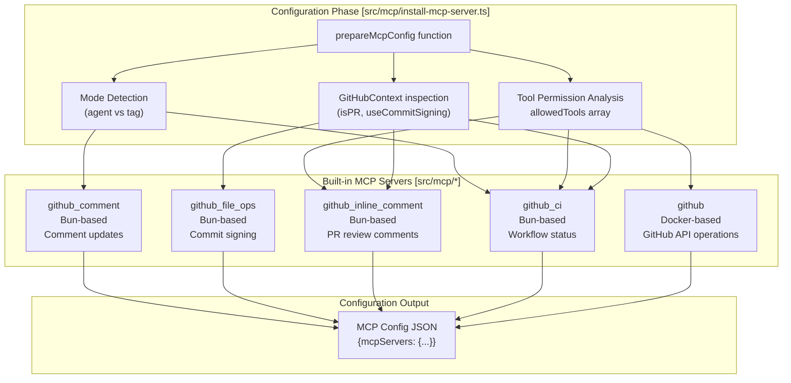
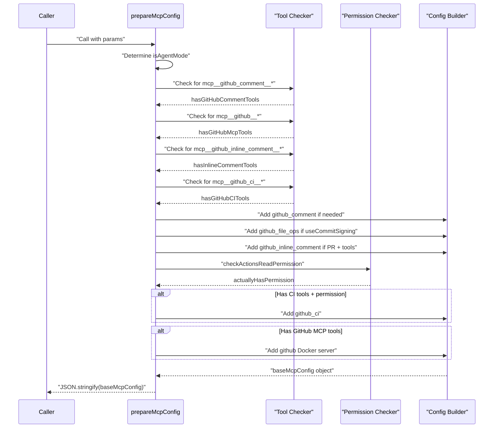
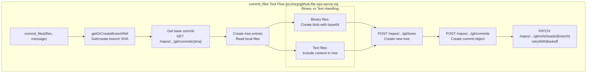
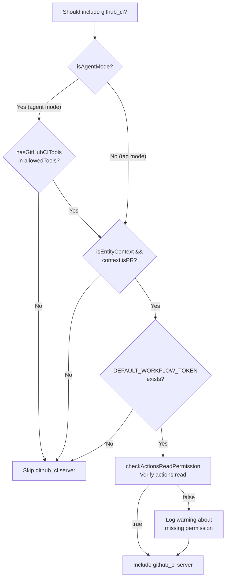

<!-- source: DeepWiki mcp.deepwiki.com · repo anthropics/claude-code-action · page 7.4 MCP Server System · fetched 2026-10-26 -->

# MCP Server System

<details>
<summary>Relevant source files</summary>

The following files were used as context for generating this wiki page:

- [src/github/operations/branch-cleanup.ts](src/github/operations/branch-cleanup.ts)
- [src/github/utils/sanitizer.ts](src/github/utils/sanitizer.ts)
- [src/mcp/github-actions-server.ts](src/mcp/github-actions-server.ts)
- [src/mcp/github-comment-server.ts](src/mcp/github-comment-server.ts)
- [src/mcp/github-file-ops-server.ts](src/mcp/github-file-ops-server.ts)
- [src/mcp/github-inline-comment-server.ts](src/mcp/github-inline-comment-server.ts)
- [src/mcp/inline-comment-buffer.ts](src/mcp/inline-comment-buffer.ts)
- [src/mcp/install-mcp-server.ts](src/mcp/install-mcp-server.ts)
- [test/branch-cleanup.test.ts](test/branch-cleanup.test.ts)
- [test/comment-logic.test.ts](test/comment-logic.test.ts)
- [test/inline-comment-buffer.test.ts](test/inline-comment-buffer.test.ts)
- [test/install-mcp-server.test.ts](test/install-mcp-server.test.ts)
- [test/integration-sanitization.test.ts](test/integration-sanitization.test.ts)
- [test/sanitizer.test.ts](test/sanitizer.test.ts)

</details>


## Purpose and Scope

This document details the Model Context Protocol (MCP) server configuration and management system within `claude-code-action`. It covers how MCP servers are prepared, configured, and integrated into the Claude Code execution environment to provide GitHub-specific capabilities.

The system manages five distinct server types, handling dynamic configuration based on execution mode (Tag vs. Agent), tool permissions, and environment capabilities like Docker availability or GitHub Actions permissions.

## Overview

The MCP Server System is responsible for configuring and providing MCP servers that extend Claude's capabilities with GitHub-specific operations. The system dynamically determines which servers to include based on execution mode, enabled features, and tool permissions.

### System Architecture



**Sources:** [src/mcp/install-mcp-server.ts:1-229]()

## Configuration Preparation

### prepareMcpConfig Function

The `prepareMcpConfig` function is the central entry point for MCP server configuration. It accepts parameters describing the GitHub context, mode, and permissions, then returns a JSON configuration string for the MCP servers. [src/mcp/install-mcp-server.ts:52-54]()

**Function Signature:**

| Parameter | Type | Description |
|-----------|------|-------------|
| `githubToken` | string | GitHub authentication token |
| `owner` | string | Repository owner |
| `repo` | string | Repository name |
| `branch` | string | Target branch name |
| `baseBranch` | string | Base branch for comparisons |
| `claudeCommentId` | string (optional) | Comment ID for tracking |
| `allowedTools` | string[] | List of allowed tool names |
| `mode` | AutoDetectedMode | Execution mode (agent/tag) |
| `context` | GitHubContext | Full GitHub context |

**Sources:** [src/mcp/install-mcp-server.ts:8-18](), [src/mcp/install-mcp-server.ts:52-65]()

### Configuration Process Flow

The function analyzes the `allowedTools` list using prefix matching to determine which specialized servers are required. [src/mcp/install-mcp-server.ts:72-86]()



**Sources:** [src/mcp/install-mcp-server.ts:52-228]()

## Built-in MCP Servers

### github_comment Server

The `github_comment` server provides tools for updating Claude's tracking comment during execution. [src/mcp/install-mcp-server.ts:92-95]() It uses `updateClaudeComment` to handle both issue and PR comments. [src/mcp/github-comment-server.ts:8-33]()

**Configuration:**

```typescript
{
  command: "bun",
  args: ["run", `${process.env.GITHUB_ACTION_PATH}/src/mcp/github-comment-server.ts`],
  env: {
    GITHUB_TOKEN: githubToken,
    REPO_OWNER: owner,
    REPO_NAME: repo,
    CLAUDE_COMMENT_ID: claudeCommentId,
    GITHUB_EVENT_NAME: process.env.GITHUB_EVENT_NAME || "",
    GITHUB_API_URL: GITHUB_API_URL
  }
}
```

**Inclusion Logic:**

| Mode | Condition |
|------|-----------|
| Tag Mode | Always included (for updating Claude comments) [src/mcp/install-mcp-server.ts:93-95]() |
| Agent Mode | Only if `allowedTools` contains `mcp__github_comment__` [src/mcp/install-mcp-server.ts:95]() |

**Sources:** [src/mcp/install-mcp-server.ts:92-113](), [src/mcp/github-comment-server.ts:27-66]()

### github_file_ops Server

The `github_file_ops` server provides commit signing capabilities using the GitHub API's Git Data endpoints. It implements `commit_files` and `delete_files` tools that create commits atomically via the API. [src/mcp/github-file-ops-server.ts:196-198]()

**Inclusion Logic:**
- Included when `context.inputs.useCommitSigning` is `true`. [src/mcp/install-mcp-server.ts:116-117]()

**Sources:** [src/mcp/install-mcp-server.ts:115-135](), [src/mcp/github-file-ops-server.ts:196-207]()

### File Operations Implementation

The file operations server uses the GitHub Git Data API to create commits without local git operations, enabling signed commits through the GitHub App's identity.



**Key Implementation Details:**

| Aspect | Implementation |
|--------|----------------|
| File Mode Detection | `getFileMode` uses `fs.stat()` to check execute bits (100755 vs 100644). [src/mcp/github-file-ops-server.ts:168-193]() |
| Path Validation | `validatePathWithinRepo` prevents traversal attacks via `realpath`. [src/mcp/path-validation.ts:12-64]() |
| Branch Creation | `getOrCreateBranchRef` creates from `BASE_BRANCH` or default branch if missing. [src/mcp/github-file-ops-server.ts:58-165]() |
| Retry Logic | `retryWithBackoff` is used for the final reference update. [src/mcp/github-file-ops-server.ts:11]() |

**Sources:** [src/mcp/github-file-ops-server.ts:58-193](), [src/mcp/path-validation.ts:12-64]()

### github_inline_comment Server

Provides tools for creating inline review comments on PR file diffs. [src/mcp/github-inline-comment-server.ts:28-34]()

**Inclusion Logic:**
- Requires: `isEntityContext(context) && context.isPR`. [src/mcp/install-mcp-server.ts:139-140]()
- AND: `hasGitHubMcpTools || hasInlineCommentTools` in `allowedTools`. [src/mcp/install-mcp-server.ts:141]()

**Buffering and Classification:**
Calls without `confirmed: true` are buffered in `/tmp/inline-comments-buffer.jsonl`. [src/mcp/github-inline-comment-server.ts:14-18]() The `removeBufferedComment` function ensures that if a comment is posted live, its buffered copy is removed to prevent duplicates. [src/mcp/inline-comment-buffer.ts:23-54]()

**Sources:** [src/mcp/install-mcp-server.ts:137-160](), [src/mcp/github-inline-comment-server.ts:14-123](), [src/mcp/inline-comment-buffer.ts:23-54]()

### github_ci Server

Provides tools for querying GitHub Actions workflow status and CI/CD information. [src/mcp/install-mcp-server.ts:162-170]()

**Inclusion Logic:**

The CI server requires explicit verification of the `DEFAULT_WORKFLOW_TOKEN` permissions: [src/mcp/install-mcp-server.ts:174-178]()



**Permission Verification:**
`checkActionsReadPermission` proactively checks if the token has `actions:read` permission by attempting to list workflow runs. [src/mcp/install-mcp-server.ts:20-50]()

**Sources:** [src/mcp/install-mcp-server.ts:159-204](), [src/mcp/install-mcp-server.ts:20-50]()

### github Server (Docker-based)

The external GitHub MCP server provides comprehensive GitHub API operations via a Docker container. [src/mcp/install-mcp-server.ts:207-223]()

**Inclusion Logic:**
- Included when `allowedTools` contains any tool starting with `mcp__github__`. [src/mcp/install-mcp-server.ts:206]()

**Execution Strategy:**
Unlike the Bun-based servers, this uses `docker run -i --rm` to execute `ghcr.io/github/github-mcp-server`. [src/mcp/install-mcp-server.ts:208-217]()

**Sources:** [src/mcp/install-mcp-server.ts:206-224]()

## Execution Strategies

The system employs two primary execution strategies for MCP servers:

| Strategy | Servers | Description |
|----------|---------|-------------|
| **Local Bun** | `github_comment`, `github_file_ops`, `github_inline_comment`, `github_ci` | Executes TypeScript files directly using the `bun` runtime installed in the action environment. [src/mcp/install-mcp-server.ts:99-102]() |
| **Docker** | `github` | Runs a containerized server image. Requires Docker to be available on the runner. [src/mcp/install-mcp-server.ts:208-210]() |

All servers communicate using the `StdioServerTransport` provided by the MCP SDK. [src/mcp/github-file-ops-server.ts:4](), [src/mcp/github-inline-comment-server.ts:3]()

**Sources:** [src/mcp/install-mcp-server.ts:99-217](), [src/mcp/github-file-ops-server.ts:1-10]()

## Content Sanitization

To ensure security, all content posted via MCP servers is sanitized using `sanitizeContent`. [src/github/utils/sanitizer.ts:62-71]()

**Sanitization Measures:**
- **Token Redaction:** `redactGitHubTokens` identifies and masks GitHub PATs, OAuth tokens, and installation tokens. [src/github/utils/sanitizer.ts:73-105]()
- **Invisible Characters:** `stripInvisibleCharacters` removes zero-width and control characters. [src/github/utils/sanitizer.ts:1-9]()
- **HTML/Markdown Scrubbing:** Removes HTML comments, image alt text, and hidden attributes like `aria-label`. [src/github/utils/sanitizer.ts:12-41]()

**Sources:** [src/github/utils/sanitizer.ts:1-105](), [src/mcp/github-inline-comment-server.ts:102]()

## Testing

### prepareMcpConfig Validation

The test suite in `test/install-mcp-server.test.ts` validates the complex conditional logic for server inclusion:

- **Comment Server:** Verified to be included by default in tag mode. [test/install-mcp-server.test.ts:90-110]()
- **File Ops:** Verified to be included only when `useCommitSigning` is enabled. [test/install-mcp-server.test.ts:112-134]()
- **Docker GitHub Server:** Verified to trigger when `mcp__github__` tools are requested. [test/install-mcp-server.test.ts:136-155]()
- **Inline Comments:** Verified to be included for PR contexts with appropriate tools. [test/install-mcp-server.test.ts:157-176]()

**Sources:** [test/install-mcp-server.test.ts:7-215]()

---

