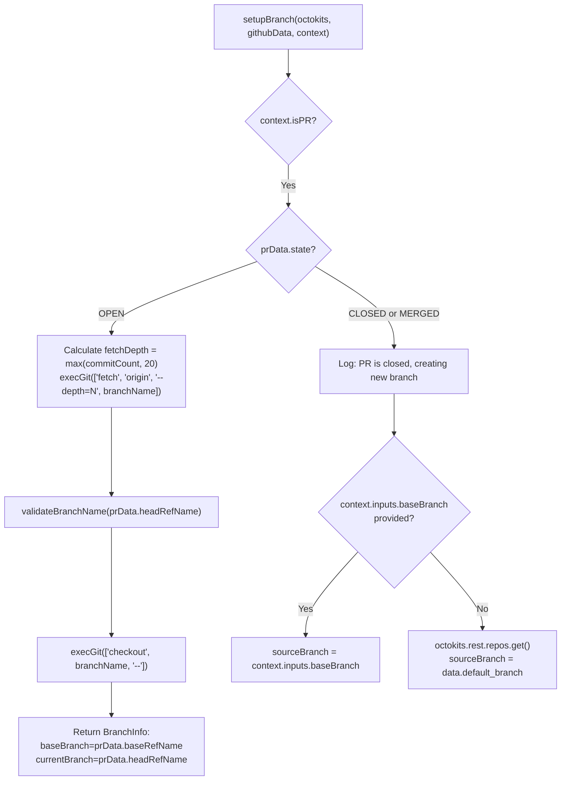
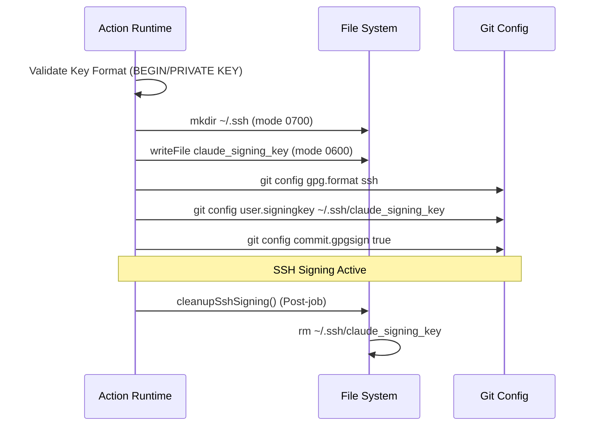
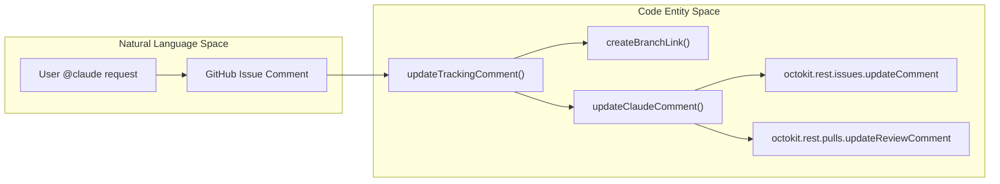

<!-- source: DeepWiki mcp.deepwiki.com · repo anthropics/claude-code-action · page 7.5 Branch and File Operations · fetched 2026-10-26 -->

# Branch and File Operations

Relevant source files

The following files were used as context for generating this wiki page:

- [CLAUDE.md](CLAUDE.md)
- [bunfig.toml](bunfig.toml)
- [docs/security.md](docs/security.md)
- [docs/usage.md](docs/usage.md)
- [src/github/operations/branch.ts](src/github/operations/branch.ts)
- [src/github/operations/comments/create-initial.ts](src/github/operations/comments/create-initial.ts)
- [src/github/operations/comments/update-claude-comment.ts](src/github/operations/comments/update-claude-comment.ts)
- [src/github/operations/comments/update-with-branch.ts](src/github/operations/comments/update-with-branch.ts)
- [src/github/operations/git-config.ts](src/github/operations/git-config.ts)
- [src/github/operations/restore-config.ts](src/github/operations/restore-config.ts)
- [test/pull-request-target.test.ts](test/pull-request-target.test.ts)
- [test/restore-config.test.ts](test/restore-config.test.ts)
- [test/ssh-signing.test.ts](test/ssh-signing.test.ts)
- [test/update-claude-comment.test.ts](test/update-claude-comment.test.ts)
- [test/validate-branch-name.test.ts](test/validate-branch-name.test.ts)

This document covers the branch management and file operation systems used by Claude Code Action to interact with Git repositories and GitHub. These components handle branch creation, validation, templating, lifecycle management, and security-sensitive configuration restoration.

---

## Overview

The branch and file operations system provides four primary subsystems:

1.  **Branch Management** ([src/github/operations/branch.ts:3-128]()): `setupBranch`, `validateBranchName`, and `generateBranchName` functions that create, validate, and checkout Git branches based on event context.
2.  **Git Configuration** ([src/github/operations/git-config.ts:1-137]()): `configureGitAuth`, `setupSshSigning`, and `cleanupSshSigning` functions that manage git credentials, commit signing, and security cleanup.
3.  **Config Restoration** ([src/github/operations/restore-config.ts:1-157]()): `restoreConfigFromBase` function that protects against RCE by reverting sensitive files to known-good versions from the base branch.
4.  **Tracking Updates** ([src/github/operations/comments/update-with-branch.ts:1-58]()): `updateTrackingComment` which links the generated branch back to the initial GitHub comment.

Sources: [src/github/operations/branch.ts:3-128](), [src/github/operations/git-config.ts:1-137](), [src/github/operations/restore-config.ts:1-157](), [src/github/operations/comments/update-with-branch.ts:1-58]()

---

## Branch Setup System

### setupBranch Function

The `setupBranch` function ([src/github/operations/branch.ts:149-236]()) orchestrates branch preparation based on whether the action is running on a Pull Request or an Issue.

| Event Type | Action | Branch Source |
| :--- | :--- | :--- |
| **Open PR** | Checkout existing PR branch | PR's `headRefName` [src/github/operations/branch.ts:173]() |
| **Closed/Merged PR** | Create new branch | PR's `baseRefName` or default branch [src/github/operations/branch.ts:166-168]() |
| **Issue** | Create new branch | `baseBranch` input or repository default branch [src/github/operations/branch.ts:213-228]() |

#### setupBranch Execution Flow

Sources: [src/github/operations/branch.ts:149-236](), [src/github/operations/branch.ts:160-162]()

---

## Branch Name Validation and Security

### validateBranchName Function

The `validateBranchName` function ([src/github/operations/branch.ts:41-128]()) implements strict security validation to prevent command injection and option injection. It uses a strict whitelist pattern `^[a-zA-Z0-9@][a-zA-Z0-9/_.#+,@-]*$` [src/github/operations/branch.ts:72]().

#### Validation Rules

| Rule | Purpose | Code Reference |
| :--- | :--- | :--- |
| **No leading dash** | Prevent option injection (e.g., `-rf`) | [src/github/operations/branch.ts:48-52]() |
| **No control chars** | Prevent shell escaping/special git chars | [src/github/operations/branch.ts:56-60]() |
| **No `..`** | Prevent path traversal | [src/github/operations/branch.ts:102-106]() |
| **No `@{`** | Prevent git reflog syntax injection | [src/github/operations/branch.ts:114-118]() |
| **No `.lock`** | Prevent interference with git index | [src/github/operations/branch.ts:108-112]() |
| **No bare `@`** | Prevent HEAD shorthand interpretation | [src/github/operations/branch.ts:123-127]() |

### Security: execGit with execFileSync

The `execGit` helper function ([src/github/operations/branch.ts:139-141]()) uses Node.js `execFileSync` to avoid shell interpolation. This ensures that even if a branch name contained shell metacharacters (like `;`, `|`, `&&`), they are passed literally to the git binary [src/github/operations/branch.ts:131-135]().

Sources: [src/github/operations/branch.ts:41-141](), [test/validate-branch-name.test.ts:1-160]()

---

## Branch Name Template System

The branch template system supports dynamic branch name generation through variable substitution using `{{variableName}}` syntax.

### Template Variables

| Variable | Description |
| :--- | :--- |
| `{{prefix}}` | Branch prefix from input (e.g., `claude/`) |
| `{{entityType}}` | Type of entity (`issue` or `pr`) |
| `{{entityNumber}}` | Issue or PR number |
| `{{timestamp}}` | Creation timestamp (YYYYMMDD-HHMM) |
| `{{sha}}` | First 8 characters of source branch SHA |
| `{{description}}` | First 5 words of title in kebab-case |

Sources: [src/github/operations/branch.ts:15-16](), [src/github/operations/branch.ts:156-157]()

---

## Git Configuration and Signing

### configureGitAuth Function

The `configureGitAuth` function ([src/github/operations/git-config.ts:22-84]()) sets up the environment for git operations.

1.  **Identity**: Sets `user.name` and `user.email` using the bot's login and ID, calculating the `noreplyDomain` based on the GitHub server URL [src/github/operations/git-config.ts:30-43]().
2.  **Credential Helper**: If `ALLOWED_NON_WRITE_USERS` is set, it writes a `.git-credential-gh-token` script to avoid embedding tokens in the `.git/config` file [src/github/operations/git-config.ts:54-74]().
3.  **Remote URL**: Updates the `origin` URL to include the access token for authentication when not using the credential helper [src/github/operations/git-config.ts:76-81]().

### SSH Signing Lifecycle

For organizations requiring signed commits, `setupSshSigning` ([src/github/operations/git-config.ts:90-123]()) configures a local SSH key.

Sources: [src/github/operations/git-config.ts:22-137](), [test/ssh-signing.test.ts:40-114]()

---

## Restore Config Security

To prevent Remote Code Execution (RCE) via malicious PRs, the action implements `restoreConfigFromBase` ([src/github/operations/restore-config.ts:92-157]()).

### The RCE Surface
The Claude CLI reads configuration files like `.mcp.json` or `.claude/settings.json` from the current working directory. An attacker could submit a PR modifying these files to execute arbitrary hooks or approve malicious MCP servers before any tool-permission gating occurs [src/github/operations/restore-config.ts:73-80]().

### Restoration Process
1.  **Snapshot**: Copies current PR-authored sensitive files to `.claude-pr/` before deletion so review agents can inspect them without execution [src/github/operations/restore-config.ts:97-110]().
2.  **Exclude**: Ensures `.claude-pr/` is added to `.git/info/exclude` so it is not accidentally committed [src/github/operations/restore-config.ts:48-68]().
3.  **Nuke**: Deletes the sensitive paths from the working directory [src/github/operations/restore-config.ts:123-125]().
4.  **Fetch & Checkout**: Fetches the base branch using `--no-recurse-submodules` and checks out the "known-good" versions of sensitive files [src/github/operations/restore-config.ts:129-146]().
5.  **Reset**: Unstages the restored files so they don't accidentally leak into new commits made by the CLI [src/github/operations/restore-config.ts:149-156]().

**Sensitive Paths**: `.claude`, `.mcp.json`, `.claude.json`, `.gitmodules`, `.ripgreprc`, `CLAUDE.md`, `CLAUDE.local.md`, `.husky` [src/github/operations/restore-config.ts:20-29]().

Sources: [src/github/operations/restore-config.ts:1-157](), [test/restore-config.test.ts:67-124]()

---

## Comment Linking

After a branch is successfully created for an issue, the `updateTrackingComment` function ([src/github/operations/comments/update-with-branch.ts:20-57]()) updates the initial tracking comment with a link to the new branch.

The function handles both standard issue comments and PR review comments by calling `updateClaudeComment` [src/github/operations/comments/update-with-branch.ts:40-48](). The initial comment creation also outputs the `claude_comment_id` to `GITHUB_OUTPUT` for downstream usage [src/github/operations/comments/create-initial.ts:85-88]().

Sources: [src/github/operations/comments/update-with-branch.ts:20-57](), [src/github/operations/comments/create-initial.ts:85-88](), [src/github/operations/comments/update-claude-comment.ts:1-70]()

---

