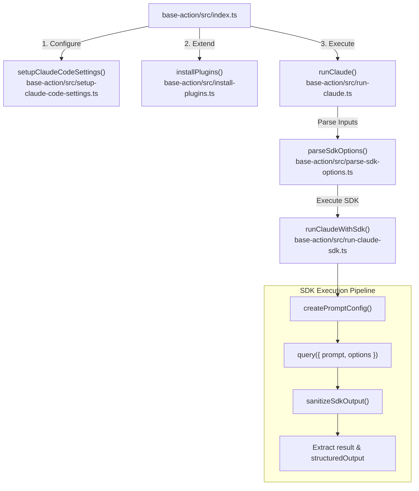
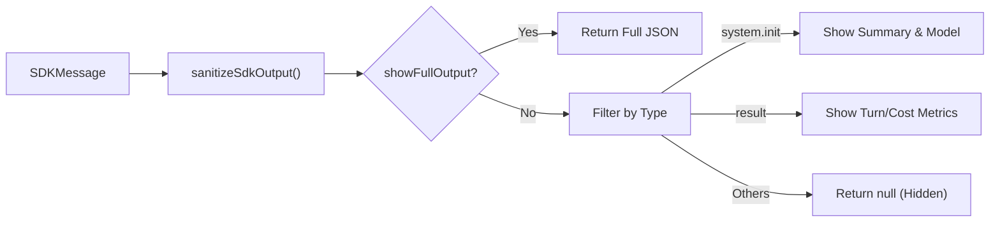

<!-- source: DeepWiki mcp.deepwiki.com · repo anthropics/claude-code-action · page 7.6 Claude Execution System · fetched 2026-10-26 -->

# Claude Execution System

Relevant source files

The following files were used as context for generating this wiki page:

- [base-action/README.md](base-action/README.md)
- [base-action/package-lock.json](base-action/package-lock.json)
- [base-action/src/execution-file.ts](base-action/src/execution-file.ts)
- [base-action/src/index.ts](base-action/src/index.ts)
- [base-action/src/install-plugins.ts](base-action/src/install-plugins.ts)
- [base-action/src/parse-sdk-options.ts](base-action/src/parse-sdk-options.ts)
- [base-action/src/run-claude-sdk.ts](base-action/src/run-claude-sdk.ts)
- [base-action/src/run-claude.ts](base-action/src/run-claude.ts)
- [base-action/src/setup-claude-code-settings.ts](base-action/src/setup-claude-code-settings.ts)
- [base-action/test/execution-file.test.ts](base-action/test/execution-file.test.ts)
- [base-action/test/install-plugins.test.ts](base-action/test/install-plugins.test.ts)
- [base-action/test/parse-sdk-options.test.ts](base-action/test/parse-sdk-options.test.ts)
- [base-action/test/run-claude-sdk.test.ts](base-action/test/run-claude-sdk.test.ts)
- [base-action/test/setup-claude-code-settings.test.ts](base-action/test/setup-claude-code-settings.test.ts)

## Purpose and Scope

The Claude Execution System is responsible for executing Claude Code via the Agent SDK, streaming and sanitizing output messages, extracting results, and setting GitHub Action outputs. This system is the final stage of the action pipeline, where prepared prompts and configurations are sent to Claude AI for processing.

The system handles the base-action execution flow, including settings setup via `setup-claude-code-settings.ts`, plugin installation via `install-plugins.ts`, and the actual invocation of the Claude CLI/SDK. It manages the transformation of action inputs into SDK-compatible options and ensures that sensitive output is sanitized before being logged to GitHub Actions.

**Key Components:**
- **Settings Setup**: Configures `.claude/settings.json` and ensures `enableAllProjectMcpServers` is active [[base-action/src/setup-claude-code-settings.ts:30-37]]().
- **Plugin Management**: Installs verified Claude Code plugins and adds marketplaces [[base-action/src/install-plugins.ts:212-230]]().
- **SDK Options Parsing**: Merges `claudeArgs`, `allowedTools`, and `mcpConfig` into a unified SDK configuration [[base-action/src/parse-sdk-options.ts:193-210]]().
- **SDK Execution**: Runs Claude via the `@anthropic-ai/claude-agent-sdk` and processes real-time message streams [[base-action/src/run-claude-sdk.ts:135-181]]().
- **Result Handling**: Extracts session IDs and structured JSON output for use in subsequent workflow steps [[base-action/src/run-claude-sdk.ts:188-228]]().

## System Architecture

The Claude Execution System is implemented in the Base Action and serves as the bridge between the GitHub Actions environment and the Claude Agent SDK.

### Execution Flow Overview

**Sources:** [base-action/src/index.ts:13-59](), [base-action/src/run-claude.ts:19-25](), [base-action/src/run-claude-sdk.ts:135-181]()

## Settings and Plugin Setup

Before execution, the system prepares the local environment to ensure Claude has the correct permissions and tools.

### Claude Settings Setup
The `setupClaudeCodeSettings` function manages the `.claude/settings.json` file. It merges user-provided settings (from a JSON string or file path) with a mandatory security override: `enableAllProjectMcpServers` is always set to `true` to ensure MCP servers defined in the repository are accessible [[base-action/src/setup-claude-code-settings.ts:30-37]]().

### Plugin Installation
The `installPlugins` function allows extending Claude's capabilities via the `plugin` CLI command [[base-action/src/install-plugins.ts:171-182]]().
- **Marketplaces**: Adds custom Git repositories or local paths as plugin sources [[base-action/src/install-plugins.ts:191-202]]().
- **Validation**: Enforces strict regex checks on plugin names to prevent command injection and path traversal [[base-action/src/install-plugins.ts:60-76]]().

**Sources:** [base-action/src/setup-claude-code-settings.ts:30-37](), [base-action/src/install-plugins.ts:171-230]()

## SDK Options Parsing

The `parseSdkOptions` function is a critical bridge that transforms raw action inputs and CLI-style `claudeArgs` into the `SdkOptions` required by the `@anthropic-ai/claude-agent-sdk`.

### Merging and Accumulation Logic
Certain flags, such as `--allowed-tools`, `--disallowed-tools`, and `--mcp-config`, are "accumulating." If they appear multiple times in `claudeArgs` or are provided via direct action inputs, the system merges them rather than overwriting [[base-action/src/parse-sdk-options.ts:16-23]]().

| Input Source | Logic | Code Entity |
|--------------|-------|-------------|
| `claudeArgs` | Parsed using `shell-quote` with shell meta-character escaping | `parseClaudeArgsToExtraArgs` [[base-action/src/parse-sdk-options.ts:133-187]]() |
| `allowedTools` | Accumulates multiple occurrences using a null-character delimiter | `ACCUMULATE_DELIMITER` [[base-action/src/parse-sdk-options.ts:26]]() |
| `mcpConfig` | Merges multiple JSON strings; handles file paths | `mergeMcpConfigs` [[base-action/src/parse-sdk-options.ts:67-110]]() |

### Shell Meta-Character Handling
To prevent mangling of complex tool definitions like `Bash(gh:*)`, the parser escapes shell control operators (e.g., `(`, `)`, `|`, `&`) to Unicode private-use codepoints before parsing with `shell-quote` and restores them afterward [[base-action/src/parse-sdk-options.ts:28-55]]().

**Sources:** [base-action/src/parse-sdk-options.ts:16-110](), [base-action/src/parse-sdk-options.ts:133-187]()

## SDK Execution and Message Handling

The `runClaudeWithSdk` function manages the lifecycle of the Claude request.

### Multi-Block Message Support
If a `claude-user-request.txt` exists alongside the main prompt, the system creates a multi-block `SDKUserMessage`. This allows the Claude CLI to distinguish between context/instructions and the actual user request, enabling slash command detection [[base-action/src/run-claude-sdk.ts:41-83]]().

### Output Sanitization
To prevent leaking sensitive data in GitHub Actions logs, `sanitizeSdkOutput` filters the message stream unless `showFullOutput` is enabled [[base-action/src/run-claude-sdk.ts:88-130]]().

**Sources:** [base-action/src/run-claude-sdk.ts:41-130]()

## Structured Output Handling

When `--json-schema` is provided in `claudeArgs`, the system expects and validates a structured response from Claude.

1. **Detection**: `parseClaudeArgsToExtraArgs` identifies flags [[base-action/src/parse-sdk-options.ts:153-184]]().
2. **Extraction**: After execution, the system looks for the `structured_output` field in the final `SDKResultMessage` [[base-action/src/run-claude-sdk.ts:217-219]]().
3. **Validation**: If `hasJsonSchema` is true but no structured output was returned, the action throws an error [[base-action/src/run-claude-sdk.ts:220-224]]().
4. **Output**: The JSON data is stringified and set as the `structured_output` GitHub Action output [[base-action/src/run-claude-sdk.ts:218]]().

**Sources:** [base-action/src/run-claude-sdk.ts:217-228](), [base-action/src/parse-sdk-options.ts:153-184]()

## Summary of Outputs

The execution system populates the following GitHub Action outputs via `core.setOutput`:

| Output Name | Source | Description |
|-------------|--------|-------------|
| `conclusion` | `result.conclusion` | `"success"` or `"failure"` [[base-action/src/index.ts:62]]() |
| `execution_file` | `executionFile` | Path to the full JSON log of the SDK session [[base-action/src/index.ts:64]]() |
| `session_id` | `result.sessionId` | The ID used to resume this session later [[base-action/src/index.ts:67]]() |
| `structured_output` | `result.structuredOutput` | The JSON response (if schema provided) [[base-action/src/index.ts:70]]() |

**Sources:** [base-action/src/index.ts:61-71](), [base-action/src/run-claude-sdk.ts:188-228]()

---

