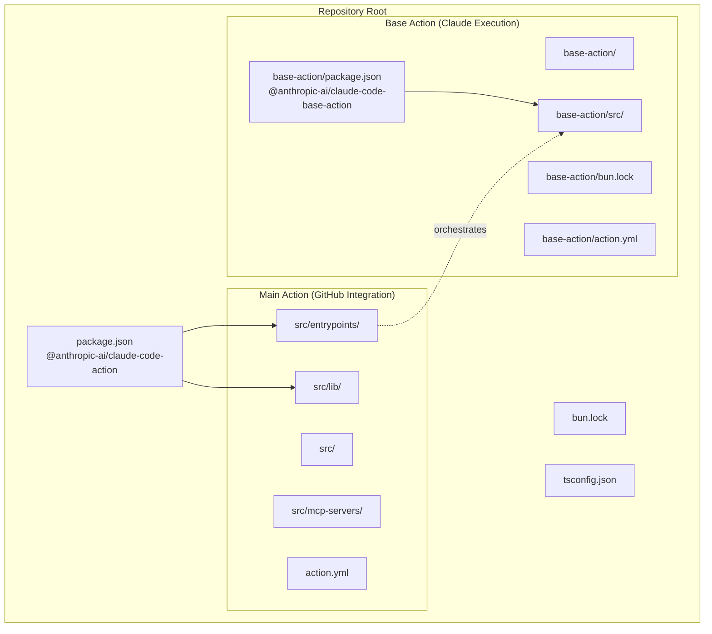
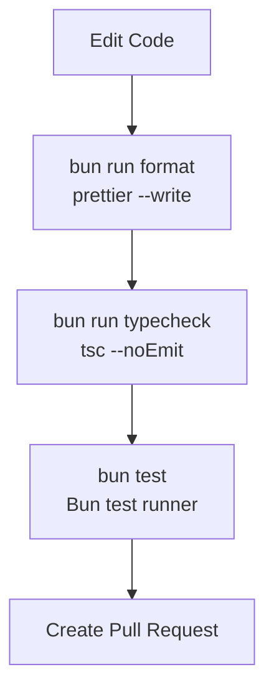
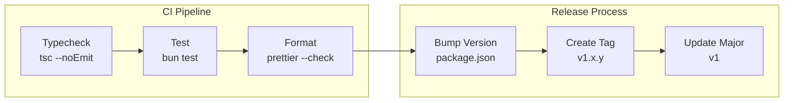

<!-- source: DeepWiki mcp.deepwiki.com · repo anthropics/claude-code-action · page 8 Development Guide · fetched 2026-10-26 -->

# Development Guide

Relevant source files

The following files were used as context for generating this wiki page:

- [.claude/commands/commit-and-pr.md](.claude/commands/commit-and-pr.md)
- [.gitignore](.gitignore)
- [.npmrc](.npmrc)
- [.prettierrc](.prettierrc)
- [CODE_OF_CONDUCT.md](CODE_OF_CONDUCT.md)
- [CONTRIBUTING.md](CONTRIBUTING.md)
- [base-action/bun.lock](base-action/bun.lock)
- [base-action/package.json](base-action/package.json)
- [bun.lock](bun.lock)
- [package.json](package.json)

This guide provides technical documentation for contributors and maintainers of the `claude-code-action` repository. It covers the project structure, dependency architecture, testing framework, and build/release processes.

---

## Project Structure and Dependencies

The repository follows a **dual-package monorepo structure** with two independent npm packages that share common development tooling but have distinct dependency trees. The root package handles GitHub integration and context parsing, while the `base-action` package manages core Claude execution.

### Code Entity to System Mapping
The following diagram maps high-level architectural components to their specific code implementations within the monorepo.

For details on the directory layout and dependency management, see **[Project Structure and Dependencies](#8.1)**.

**Sources:** [package.json:1-32](), [base-action/package.json:1-24](), [bun.lock:1-28](), [base-action/bun.lock:1-20]()

---

## Testing Framework

The repository uses **Bun's built-in test runner** (`bun test`) for all unit and integration testing. This choice eliminates the need for additional test framework dependencies like Jest or Vitest and allows for high-performance execution of TypeScript tests.

### Test Infrastructure Overview

| Feature | Implementation |
|---------|----------------|
| **Runner** | `bun test` [package.json:9]() |
| **Assertions** | `expect()` (Bun built-in) |
| **Mocking** | `mock()` utilities (Bun built-in) |
| **Organization** | Co-located `*.test.ts` files |

### Development Workflow
Contributors are expected to follow the lifecycle defined in `CONTRIBUTING.md`, which leverages the `bun` scripts defined in the root `package.json`.

The testing strategy focuses on mocking the GitHub API and environment variables to validate logic in isolation. For documentation on mock utilities and integration test setup, see **[Testing Framework](#8.2)**.

**Sources:** [package.json:9-10](), [base-action/package.json:9-10](), [CONTRIBUTING.md:37-42](), [CONTRIBUTING.md:47-51]()

---

## Build and Release Process

The repository uses **TypeScript for type checking only** via `tsc --noEmit` [package.json:10](). Bun executes `.ts` files directly in the GitHub Actions runner, removing the need for a complex transpilation or bundling step.

### CI/CD and Release Pipeline

The release process involves semantic versioning and the management of "rolling" major version tags (e.g., `v1`) to ensure users always receive the latest stable patches. For details on the CI workflows and automated versioning, see **[Build and Release Process](#8.3)**.

**Sources:** [package.json:3-11](), [base-action/package.json:3-11]()

---

## Runtime and Tooling

The development environment is standardized on **Bun** to provide a unified experience for package management, testing, and execution.

| Tool | Version | Role |
|------|---------|------|
| **Bun** | `1.2.11` | Runtime & Test Runner [package.json:25]() |
| **TypeScript** | `^5.8.3` | Static Analysis [package.json:30]() |
| **Prettier** | `3.5.3` | Code Formatting [package.json:29]() |
| **Claude SDK** | `^0.3.209` | AI Orchestration [package.json:15]() |

**Sources:** [package.json:24-31](), [base-action/package.json:17-23](), [bun.lock:40-40]()

---

