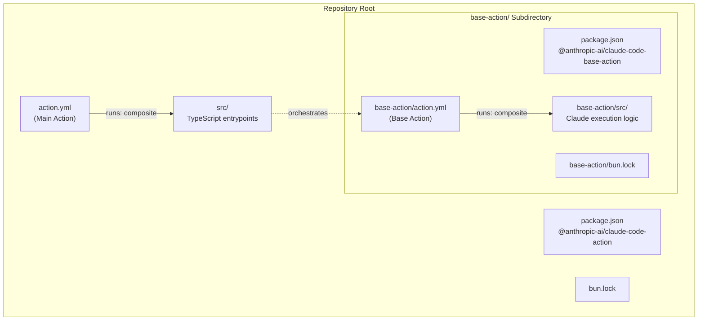
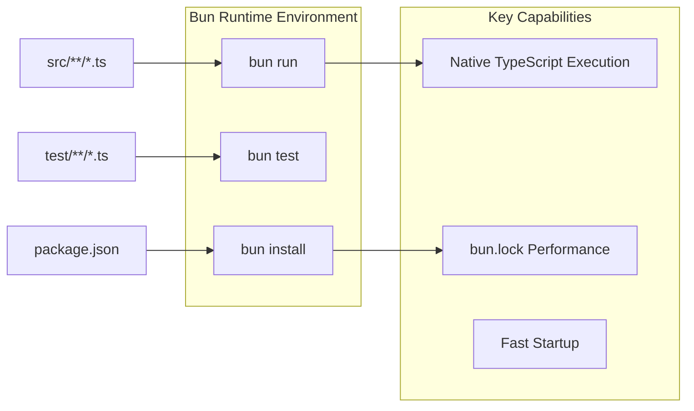
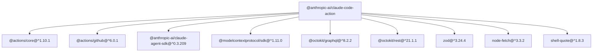
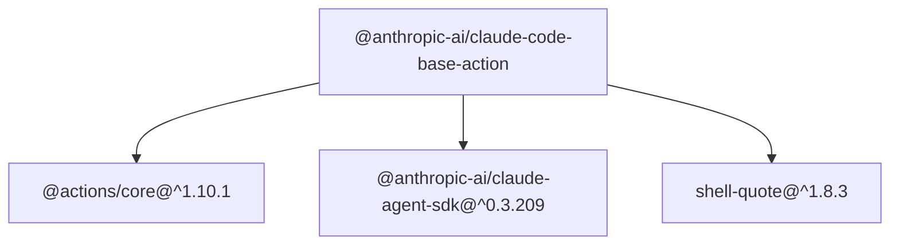

<!-- source: DeepWiki mcp.deepwiki.com · repo anthropics/claude-code-action · page 8.1 Project Structure and Dependencies · fetched 2026-10-26 -->

# Project Structure and Dependencies

Relevant source files

The following files were used as context for generating this wiki page:

- [.claude/agents/code-quality-reviewer.md](.claude/agents/code-quality-reviewer.md)
- [.claude/agents/documentation-accuracy-reviewer.md](.claude/agents/documentation-accuracy-reviewer.md)
- [.claude/agents/performance-reviewer.md](.claude/agents/performance-reviewer.md)
- [.claude/agents/security-code-reviewer.md](.claude/agents/security-code-reviewer.md)
- [.claude/agents/test-coverage-reviewer.md](.claude/agents/test-coverage-reviewer.md)
- [.claude/commands/commit-and-pr.md](.claude/commands/commit-and-pr.md)
- [.claude/commands/review-pr.md](.claude/commands/review-pr.md)
- [.gitignore](.gitignore)
- [.npmrc](.npmrc)
- [.prettierrc](.prettierrc)
- [CODE_OF_CONDUCT.md](CODE_OF_CONDUCT.md)
- [CONTRIBUTING.md](CONTRIBUTING.md)
- [base-action/bun.lock](base-action/bun.lock)
- [base-action/package.json](base-action/package.json)
- [bun.lock](bun.lock)
- [package.json](package.json)
- [tsconfig.json](tsconfig.json)

This document describes the repository structure, build system, and dependency architecture of the `claude-code-action` project. It covers the monorepo layout, the dual-action organization, package management with Bun, and the dependency relationships between components.

For information about the execution architecture and how the two actions interact at runtime, see [Dual-Action Architecture](). For details on MCP servers and tool dependencies, see [MCP Integration Architecture]().

---

## Repository Organization

The repository uses a **monorepo structure** with two separate GitHub Actions packages. While it is not a traditional NPM workspace, it contains nested `package.json` files and separate dependency trees.

**Sources:** [package.json:1-32](), [base-action/package.json:1-24](), [bun.lock:1-28]()

### Directory Structure

| Path | Purpose | Type |
|------|---------|------|
| `package.json` | Main action dependencies (GitHub context, MCP, Orchestration) | NPM Package |
| `bun.lock` | Main action dependency lock file | Bun Lock |
| `src/` | Main action source: context parsing, prompt generation, and orchestration | TypeScript |
| `base-action/package.json` | Base action dependencies (Claude SDK, core execution) | NPM Package |
| `base-action/bun.lock` | Base action dependency lock file | Bun Lock |
| `base-action/src/` | Claude Code execution, settings, and SDK integration | TypeScript |
| `.claude/agents/` | Specialized agent definitions (e.g., `security-code-reviewer`) | Markdown |
| `.claude/commands/` | Reusable command definitions (e.g., `review-pr`) | Markdown |
| `scripts/` | Maintenance scripts (e.g., `install-hooks.sh`) | Shell |

**Sources:** [package.json:1-32](), [base-action/package.json:1-24](), [CONTRIBUTING.md:36-42]()

---

## Action Architecture

Both actions are designed to execute TypeScript code via the **Bun** runtime. The project utilizes a dual-layer design where the main action handles GitHub-specific logic and the base action focuses on the Claude agent execution.

### Runtime Environment: Bun

The project uses **Bun** as the primary runtime and package manager. Bun is required for local development and testing.

**Sources:** [package.json:9-10](), [CONTRIBUTING.md:7-12](), [tsconfig.json:11-15]()

---

## Dependency Architecture

### Main Action Dependencies

The main action (`@anthropic-ai/claude-code-action`) contains dependencies for GitHub API interaction, MCP server support, and schema validation.

**Sources:** [package.json:12-23]()

### Base Action Dependencies

The base action (`@anthropic-ai/claude-code-base-action`) is kept minimal to reduce the footprint during the core execution phase, focusing primarily on the Claude SDK.

**Sources:** [base-action/package.json:12-16]()

### Shared Infrastructure

Both actions leverage the `@anthropic-ai/claude-agent-sdk` for interfacing with Claude.

| Package | Version | Role |
|---------|---------|------|
| `@actions/core` | ^1.10.1 | Input/Output handling for GitHub Actions |
| `@anthropic-ai/claude-agent-sdk` | ^0.3.209 | Core agent communication and tool execution |
| `shell-quote` | ^1.8.3 | Safe command argument escaping |
| `@modelcontextprotocol/sdk` | ^1.11.0 | Support for Model Context Protocol servers |

**Sources:** [package.json:12-23](), [base-action/package.json:12-16]()

---

## Agent and Command Definitions

The repository includes a set of pre-configured agents and commands located in the `.claude/` directory. These serve as templates for Claude's behavior during specific tasks.

### Specialized Agents
Agents are defined with specific system prompts and tool access:
*   **`security-code-reviewer`**: Scans for OWASP Top 10, injection flaws, and auth issues. [ .claude/agents/security-code-reviewer.md:1-60]()
*   **`performance-reviewer`**: Analyzes algorithmic complexity and resource bottlenecks. [ .claude/agents/performance-reviewer.md:1-54]()
*   **`code-quality-reviewer`**: Focuses on clean code, SOLID principles, and maintainability. [ .claude/agents/code-quality-reviewer.md:1-62]()
*   **`test-coverage-reviewer`**: Identifies untested paths and evaluates test quality. [ .claude/agents/test-coverage-reviewer.md:1-53]()
*   **`documentation-accuracy-reviewer`**: Verifies READMEs and API comments against implementation. [ .claude/agents/documentation-accuracy-reviewer.md:1-57]()

### Reusable Commands
Commands like `review-pr` orchestrate multiple subagents to provide comprehensive feedback.
*   **`review-pr`**: Calls quality, performance, test, documentation, and security reviewers sequentially. [ .claude/commands/review-pr.md:1-21]()

---

## Build and Development Configuration

### TypeScript Configuration
The project uses a modern TypeScript setup optimized for the Bun runtime.

*   **Target**: `ESNext` for latest JavaScript features. [tsconfig.json:5-5]()
*   **Module Resolution**: `bundler` (Bun-specific). [tsconfig.json:12-12]()
*   **Strictness**: `strict: true` with additional flags like `noUnusedLocals` and `noUncheckedIndexedAccess`. [tsconfig.json:18-25]()

### Dependency Resolution (Lock Files)
Bun maintains separate lock files for the root and the base-action subdirectory to ensure dependency isolation.
*   **Root Lock**: [bun.lock:1-77]() (Includes full graph for `@octokit` and `@modelcontextprotocol`)
*   **Base Action Lock**: [base-action/bun.lock:1-74]() (Optimized for SDK execution)

**Sources:** [tsconfig.json:1-31](), [package.json:1-32](), [base-action/package.json:1-24]()

---

