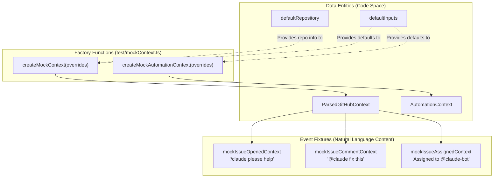
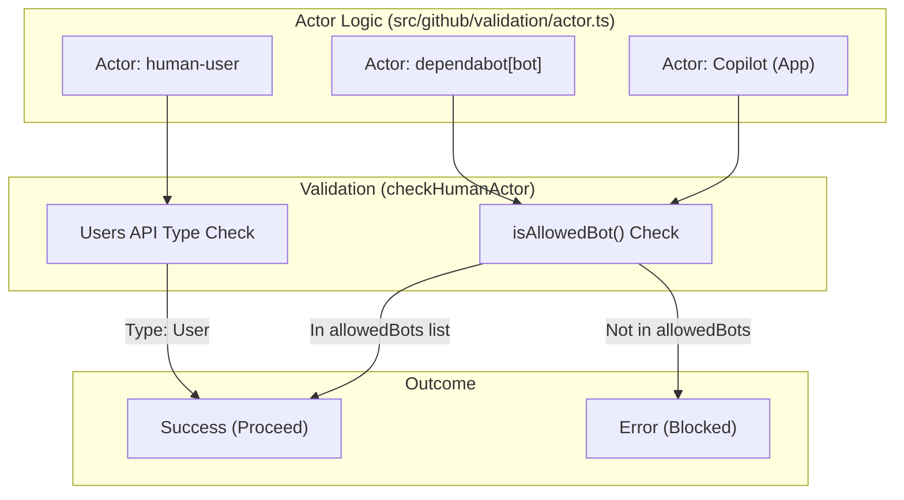

<!-- source: DeepWiki mcp.deepwiki.com · repo anthropics/claude-code-action · page 8.2 Testing Framework · fetched 2026-10-26 -->

# Testing Framework

Relevant source files

The following files were used as context for generating this wiki page:

- [.github/workflows/ci-all.yml](.github/workflows/ci-all.yml)
- [.github/workflows/test-base-action.yml](.github/workflows/test-base-action.yml)
- [.github/workflows/test-custom-executables.yml](.github/workflows/test-custom-executables.yml)
- [.github/workflows/test-mcp-servers.yml](.github/workflows/test-mcp-servers.yml)
- [.github/workflows/test-settings.yml](.github/workflows/test-settings.yml)
- [.github/workflows/test-structured-output.yml](.github/workflows/test-structured-output.yml)
- [base-action/src/retry.ts](base-action/src/retry.ts)
- [base-action/src/workload-identity.ts](base-action/src/workload-identity.ts)
- [src/github/context.ts](src/github/context.ts)
- [src/github/validation/actor.ts](src/github/validation/actor.ts)
- [src/github/validation/permissions.ts](src/github/validation/permissions.ts)
- [test/actor.test.ts](test/actor.test.ts)
- [test/fixtures/sample-turns.json](test/fixtures/sample-turns.json)
- [test/mockContext.ts](test/mockContext.ts)
- [test/permissions.test.ts](test/permissions.test.ts)

## Purpose and Scope

This document describes the testing infrastructure used in the Claude Code Action project. It covers the test framework, mock utilities, and test coverage for major components including GitHub context parsing, permission validation, trigger detection, and Model Context Protocol (MCP) integration.

The testing system validates:
- **GitHub Context Parsing**: Correct transformation of GitHub event payloads into `GitHubContext` types [src/github/context.ts:134-245]().
- **Permission Validation**: Enforcement of write access requirements and security bypasses [src/github/validation/permissions.ts:35-121]().
- **Actor Validation**: Verification of human vs. bot actors and allow-list processing [src/github/validation/actor.ts:30-88]().
- **MCP Integration**: Verification that local and Docker-based MCP servers are correctly registered and callable [test-mcp-servers.yml:31-94]().
- **Structured Output**: Validation of JSON schema enforcement and type conversion for agent outputs [test-structured-output.yml:16-190]().

## Test Framework Overview

The project uses the **Bun test runner** (`bun:test`) for all unit and integration tests. Bun provides a Jest-compatible API with native TypeScript support and high-performance execution [CLAUDE.md:41-41]().

### Test Commands
| Command | Description |
|---------|-------------|
| `bun test` | Runs the full test suite [CLAUDE.md:6-6]() |
| `bun test <file>` | Runs a specific test file (e.g., `bun test test/actor.test.ts`) [base-action/CLAUDE.md:16-16]() |
| `bun run typecheck` | Validates TypeScript types across tests and source [CLAUDE.md:7-7]() |

**Sources:** [CLAUDE.md:5-10](), [base-action/CLAUDE.md:5-17]()

## Mock Context Utilities

The `test/mockContext.ts` file provides factory functions and pre-configured constants to simulate GitHub Actions environments. This is the primary method for bridging "Natural Language Space" (user comments/PR descriptions) to "Code Entity Space" (context objects).

### Context Creation Flow

**Sources:** [test/mockContext.ts:46-71](), [test/mockContext.ts:77-100](), [test/mockContext.ts:129-207]()

### Key Mock Utilities
- **`createMockContext`**: Generates a `ParsedGitHubContext` for entity-based events (Issues, PRs). It merges `defaultInputs` with provided overrides [test/mockContext.ts:46-71]().
- **`createMockAutomationContext`**: Generates an `AutomationContext` for workflow dispatches or schedules [test/mockContext.ts:77-100]().
- **`defaultInputs`**: Standardizes configuration for tests, including `triggerPhrase: "/claude"`, `branchPrefix: "claude/"`, and bot identification [test/mockContext.ts:15-33]().

## Component Testing

### Permission Validation
Tests for `checkWritePermissions` verify that only authorized users can trigger Claude. The suite uses `spyOn` to intercept `core` logging and verifies logic for various permission levels [test/permissions.test.ts:7-23]().

| Scenario | Expected Result | Code Reference |
|----------|-----------------|----------------|
| Admin/Write permissions | `true` | [test/permissions.test.ts:84-108]() |
| Read/None permissions | `false` | [test/permissions.test.ts:110-132]() |
| GitHub App (`[bot]`) | `true` | [test/permissions.test.ts:134-142]() |
| `allowed_non_write_users` bypass | `true` (with warning) | [test/permissions.test.ts:186-201]() |

**Sources:** [test/permissions.test.ts:84-201](), [src/github/validation/permissions.ts:35-121]()

### Actor Validation
The `checkHumanActor` function ensures that automated tools do not trigger infinite loops unless explicitly allowed.

**Sources:** [src/github/validation/actor.ts:30-88](), [test/actor.test.ts:20-170]()

## Integration Testing

The project uses GitHub Actions workflows as a form of integration testing, executing the action against real environments with simulated prompts.

### MCP Integration Tests
The `test-mcp-servers.yml` workflow verifies that Claude can interact with MCP servers. It uses a custom `test-server` and `jq` to validate the JSON execution log [test-mcp-servers.yml:44-94]().
- **Registration**: Checks if `test-server` appears in the `init` event [test-mcp-servers.yml:66-72]().
- **Execution**: Verifies that `mcp__test-server__test_tool` was called and returned the expected response [test-mcp-servers.yml:74-87]().

### Structured Output Tests
The `test-structured-output.yml` workflow ensures that the `--json-schema` flag correctly shapes the `structured_output` action output [test-structured-output.yml:25-40]().
- **Type Conversion**: Validates that numbers, booleans, and arrays are correctly stringified/parsed [test-structured-output.yml:42-129]().
- **Edge Cases**: Tests handling of zero values, empty strings, and negative numbers [test-structured-output.yml:156-190]().

### Custom Executable Tests
The `test-custom-executables.yml` workflow validates that the action can run using manually installed versions of Bun and Claude Code via the `path_to_claude_code_executable` and `path_to_bun_executable` inputs [test-custom-executables.yml:51-62]().

**Sources:** [.github/workflows/test-mcp-servers.yml:1-170](), [.github/workflows/test-structured-output.yml:1-190](), [.github/workflows/test-custom-executables.yml:1-97]()

---

