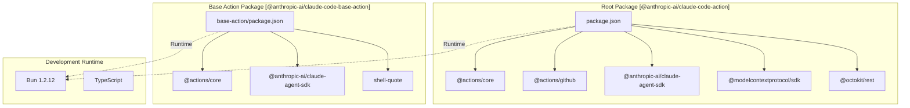
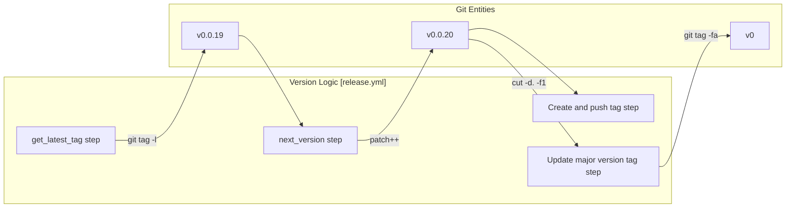

<!-- source: DeepWiki mcp.deepwiki.com · repo anthropics/claude-code-action · page 8.3 Build and Release Process · fetched 2026-10-26 -->

# Build and Release Process

<details>
<summary>Relevant source files</summary>

The following files were used as context for generating this wiki page:

- [.github/workflows/ci.yml](.github/workflows/ci.yml)
- [.github/workflows/release.yml](.github/workflows/release.yml)
- [.github/workflows/sync-base-action.yml](.github/workflows/sync-base-action.yml)
- [base-action/MIRROR_DISCLAIMER.md](base-action/MIRROR_DISCLAIMER.md)
- [scripts/install-hooks.sh](scripts/install-hooks.sh)
- [scripts/pre-commit](scripts/pre-commit)

</details>


This document describes the build toolchain, continuous integration pipeline, and automated release process for the Claude Code Action. It covers dependency management, testing, versioning strategy, and the GitHub Actions workflows that automate releases and repository synchronization.

---

## Build Toolchain

The project uses **Bun** as its primary build tool, package manager, and test runner. Bun provides fast installation, native TypeScript support, and integrated testing capabilities.

### Package Structure

The repository is organized as a monorepo with two main packages:

| Package | Location | Purpose |
|---------|----------|---------|
| `claude-code-action` | Root directory | Main GitHub Action with orchestration logic |
| `claude-code-base-action` | `base-action/` | Claude execution runtime and SDK integration |

### Available Scripts

Both packages define identical scripts in their `package.json`:

| Script | Command | Purpose |
|--------|---------|---------|
| `format` | `prettier --write .` | Format all files with Prettier |
| `format:check` | `prettier --check .` | Verify formatting without changes |
| `test` | `bun test` | Run test suite with Bun |
| `typecheck` | `tsc --noEmit` | TypeScript type checking without compilation |

Sources: [package.json:5-11](), [base-action/package.json:5-11]()

### Dependency Management

The following diagram maps the high-level dependency structure to the specific packages and external libraries used.

**Dependency Mapping**


Sources: [package.json:12-31](), [base-action/package.json:12-23](), [.github/workflows/ci.yml:15-16]()

---

## Continuous Integration Pipeline

The CI pipeline runs on every pull request and is triggered by the release workflow to validate code before deployment.

### Local Development Hooks

To ensure code quality before pushing to CI, the project provides a pre-commit hook script that automates formatting, type checking, and testing.

*   **`scripts/install-hooks.sh`**: Installs the pre-commit hook into the `.git/hooks` directory [scripts/install-hooks.sh:1-13]().
*   **`scripts/pre-commit`**: Executes `bun run format:check`, `bun run typecheck`, and `bun run test` in sequence. If formatting fails, it attempts to run `bun run format` automatically [scripts/pre-commit:1-46]().

### CI Workflow Structure

The CI workflow ([.github/workflows/ci.yml]()) defines three parallel jobs:

*   **Test Job**: Runs the test suite using `bun test`. It uses Ubuntu latest and Bun version 1.2.12 [[.github/workflows/ci.yml:8-21]]().
*   **Prettier Job**: Validates code formatting using `bun run format:check` [[.github/workflows/ci.yml:23-36]]().
*   **Typecheck Job**: Validates TypeScript types using `bun run typecheck` which invokes `tsc --noEmit` [[.github/workflows/ci.yml:38-51]]().

Sources: [.github/workflows/ci.yml:1-52](), [scripts/install-hooks.sh:1-13](), [scripts/pre-commit:1-46]()

---

## Release Automation Workflow

The release process is fully automated through the `release.yml` workflow, which handles version calculation, tag creation, and GitHub release generation.

### Release Triggers

The workflow runs when:
1.  **Manual dispatch**: Developer triggers via GitHub UI with optional `dry_run` mode [[.github/workflows/release.yml:4-10]]().
2.  **Automatic trigger**: After the `CI All` workflow succeeds on the `main` branch, provided the head commit message starts with `chore: bump Claude Code to` [[.github/workflows/release.yml:11-27]]().

### Version Management Strategy

The project follows semantic versioning (semver) with automatic patch version increments.

**Release Pipeline Logic**


Sources: [.github/workflows/release.yml:39-66](), [.github/workflows/release.yml:112-125]()

### Update Major Tag Job

After release creation, the `update-major-tag` job maintains a moving major version tag (e.g., `v0`). This allows users to reference `anthropics/claude-code-action@v0` to automatically receive the latest patch updates within that major version [[.github/workflows/release.yml:113-125]]().

---

## Repository Synchronization (Base Action Mirror)

The `base-action` directory is mirrored to a standalone repository at `anthropics/claude-code-base-action`. This allows the base logic to be used independently.

### Sync Process

The `sync-base-action.yml` workflow automates this mirror process:
1.  **Trigger**: On every push to `main` affecting the `base-action/**` path [[.github/workflows/sync-base-action.yml:3-8]]().
2.  **Authentication**: Uses a deploy key stored in `CLAUDE_CODE_BASE_ACTION_REPO_DEPLOY_KEY` [[.github/workflows/sync-base-action.yml:30]]().
3.  **Content Sync**:
    *   Clones the target repository [[.github/workflows/sync-base-action.yml:43]]().
    *   Removes all existing files except `.git` [[.github/workflows/sync-base-action.yml:54]]().
    *   Copies `base-action/` contents to the target [[.github/workflows/sync-base-action.yml:57]]().
    *   Prepends `MIRROR_DISCLAIMER.md` to the `README.md` [[.github/workflows/sync-base-action.yml:60-63]]().
4.  **Commit**: Creates a commit in the target repo referencing the source commit SHA and message [[.github/workflows/sync-base-action.yml:75-82]]().

Sources: [.github/workflows/sync-base-action.yml:1-99](), [base-action/MIRROR_DISCLAIMER.md:1-12]()

---

## Release Configuration

### GitHub Actions Permissions

The release workflow requires specific permissions to interact with the repository:
```yaml
permissions:
  contents: write  # To create tags and releases
```
Sources: [.github/workflows/release.yml:29-30]()

### Dry Run Mode

Manual releases support a `dry_run` input. When `true`, the workflow calculates the next version and displays it in the logs but skips the actual `git tag` and `gh release create` steps [[.github/workflows/release.yml:68-75]]().

---

## Build Artifacts

The Claude Code Action does not produce compiled binary artifacts. It distributes source code directly via Git tags. 

**Execution Environment:**
*   The action is executed using the **Bun** runtime.
*   Dependencies are installed at runtime via `bun install` during the action's execution flow.
*   The main entry point for the action is `src/run.ts`, while the base action uses `src/index.ts`.

Sources: [package.json:1-32](), [base-action/package.json:1-24](), [.github/workflows/ci.yml:15-21]()

---

