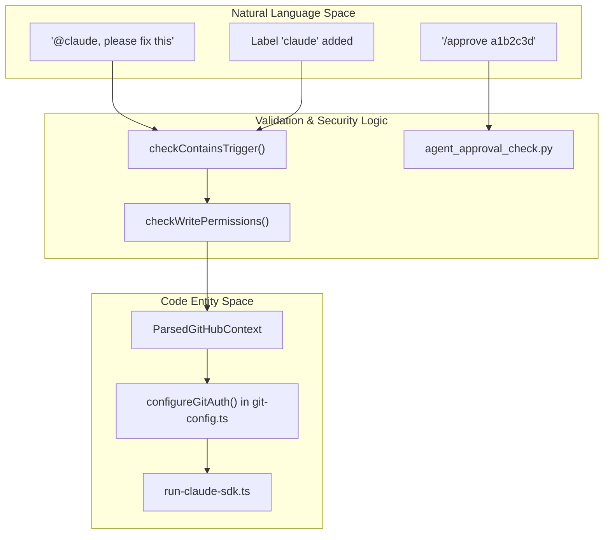
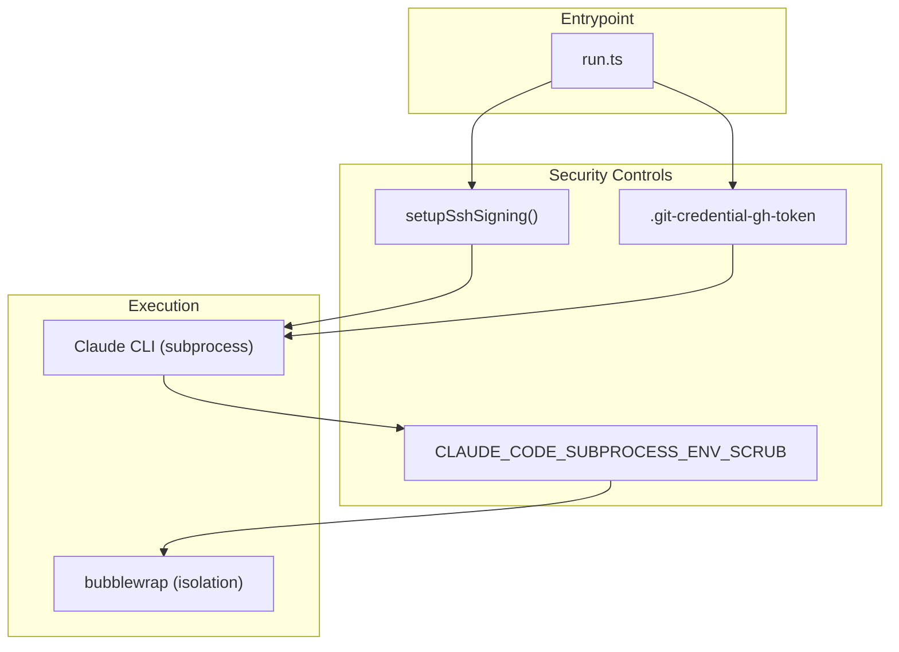

<!-- source: DeepWiki mcp.deepwiki.com · repo anthropics/claude-code-action · page 9 Advanced Topics · fetched 2026-10-26 -->

# Advanced Topics

Relevant source files

The following files were used as context for generating this wiki page:

- [SECURITY.md](SECURITY.md)
- [agent-approval-check/README.md](agent-approval-check/README.md)
- [agent-approval-check/action.yml](agent-approval-check/action.yml)
- [agent-approval-check/agent-identities.example.yaml](agent-approval-check/agent-identities.example.yaml)
- [agent-approval-check/agent_approval_check.py](agent-approval-check/agent_approval_check.py)
- [docs/security.md](docs/security.md)
- [docs/usage.md](docs/usage.md)
- [examples/agent-approval-check.yml](examples/agent-approval-check.yml)
- [src/github/operations/git-config.ts](src/github/operations/git-config.ts)
- [test/ssh-signing.test.ts](test/ssh-signing.test.ts)

This section provides a high-level overview of the security-critical subsystems, validation logic, and specialized configurations for power users and contributors. These systems ensure that the Claude Code GitHub Action operates within a secure boundary while providing the flexibility needed for complex automation.

## Overview

The action implements a defense-in-depth strategy across four primary domains:

1.  **Security Model**: Multi-layer architecture including subprocess isolation, environment scrubbing, and content sanitization to prevent prompt injection and secret leakage.
2.  **Permission Validation System**: A robust access control layer that manages who can trigger the action, handling repository write permissions, bot allowlists, and risky non-write user exceptions.
3.  **Trigger Validation and Event Processing**: The logic responsible for detecting intent, from matching `@claude` phrases with word boundaries to processing specific GitHub events like issue assignments or label applications.
4.  **Agent Approval Check**: A specialized sub-action that enforces human oversight for code generated by AI agents, ensuring that automated changes are reviewed by authorized humans before merging.

## Security and Isolation

The action is designed to handle untrusted input from issues and pull requests safely. It employs several layers of isolation and sanitization to protect the runner environment.

*   **Subprocess Scrubbing**: When running in potentially risky contexts (like `allowed_non_write_users`), the action performs a best-effort scrub of Anthropic, cloud, and GitHub Actions secrets from subprocess environments [docs/security.md:16-16]().
*   **Bubblewrap Isolation**: On Linux runners where `bubblewrap` is available, subprocesses are executed with PID-namespace isolation to reduce the impact of potential escapes [docs/security.md:16-16]().
*   **Content Sanitization**: To mitigate prompt injection, the action strips HTML comments, invisible characters, and hidden markdown attributes from incoming content before passing it to Claude [docs/security.md:67-70]().
*   **Git Authentication Security**: For non-write users, the action uses a credential helper via `.git-credential-gh-token` to keep the `github_token` out of the `.git/config` file [src/github/operations/git-config.ts:54-74]().
*   **SSH Signing**: Support for `setupSshSigning` provides an alternative to API-based signing, ensuring commit integrity with secure key handling [src/github/operations/git-config.ts:90-123]().

For a deep dive into the architecture of these protections, see the **[Security Model](#9.1)** child page.

## Permission Validation

Access control is enforced at the entry point of the action to ensure only authorized actors can consume API quota or modify the repository.

*   **Write Permission Requirement**: By default, only users with explicit write access to the repository can trigger Claude [docs/security.md:5-5]().
*   **Bot Allowlist**: GitHub Apps and bots are blocked by default. They must be explicitly added to the `allowed_bots` input or allowed via a wildcard `*` [docs/security.md:6-10]().
*   **Non-Write User Exceptions**: The `allowed_non_write_users` parameter allows bypassing the write requirement for specific automation tasks, but requires a provided `github_token` and triggers enhanced security scrubbing [docs/security.md:11-16]().
*   **Collaborator Verification**: The system verifies permissions via the GitHub collaborators API, ensuring that even if an actor is a member, they have the necessary `write`, `push`, `maintain`, or `admin` levels [agent-approval-check/agent_approval_check.py:105-111]().

For implementation details on how permissions are checked, see the **[Permission Validation System](#9.2)** child page.

## Triggering and Event Logic

The action supports a variety of triggers, ranging from explicit mentions to automated event-based execution.

*   **Trigger Phrases**: The default `@claude` trigger uses regex with word boundaries to ensure reliable matching in comments and bodies [docs/usage.md:40-41]().
*   **Event-Based Triggers**: Beyond comments, the action can be configured to trigger on issue assignments (`assignee_trigger`) or label applications (`label_trigger`) [docs/usage.md:42-45]().
*   **Event Type Handling**: The action distinguishes between `ENTITY_EVENT_NAMES` (like `issue_comment`) and `AUTOMATION_EVENT_NAMES` to apply different processing logic based on the event source.
*   **Security Considerations**: Specific care is taken for `pull_request_target` events to ensure that code from forks does not gain unauthorized access to repository secrets [docs/security.md:23-50]().

For more information on the regex logic and event filtering, see the **[Trigger Validation and Event Processing](#9.3)** child page.

## Agent Approval Check

To ensure safety in automated workflows, the `agent-approval-check` sub-action provides a "human-in-the-loop" gate for agent-authored commits.

*   **Identity Detection**: Identifies agent activity based on committer emails (e.g., `noreply@anthropic.com`) or bot logins (e.g., `claude[bot]`) [agent-approval-check/action.yml:15-22]().
*   **Approval Mechanisms**: Supports both native GitHub `APPROVED` reviews and a custom `/approve <sha>` comment command [agent-approval-check/agent_approval_check.py:35-40]().
*   **Tamper Resistance**: Designed to run from the base/default branch via `pull_request_target` so that a PR cannot modify the check that gates it [agent-approval-check/README.md:104-112]().
*   **Commit Status**: Posts a status named `agent-approval-check` that can be marked as a required check in branch protection settings [agent-approval-check/README.md:30-31]().

For details on the Python-based implementation and threat model, see the **[Agent Approval Check](#9.4)** child page.

## Advanced Component Interaction

The following diagrams illustrate how these advanced topics bridge the gap between a user's natural language request and the underlying code entities.

**Natural Language to Code Entity Mapping**

**Sources**: [src/github/operations/git-config.ts:22-26](), [agent-approval-check/agent_approval_check.py:40-40](), [docs/usage.md:40-45]()

**Security Layer Implementation**

**Sources**: [src/github/operations/git-config.ts:54-74](), [src/github/operations/git-config.ts:90-123](), [docs/security.md:16-16]()

## Related Pages
- **[Security Model](#9.1)**
- **[Permission Validation System](#9.2)**
- **[Trigger Validation and Event Processing](#9.3)**
- **[Agent Approval Check](#9.4)**

---

