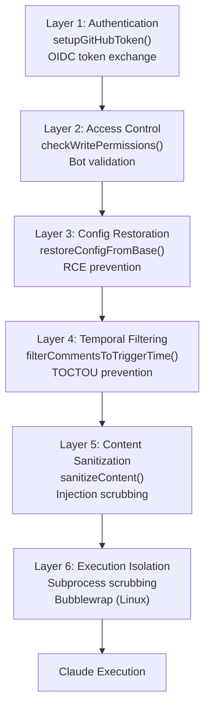
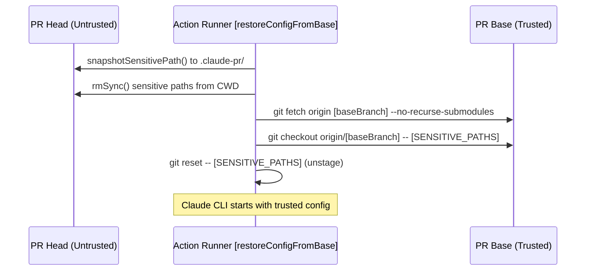
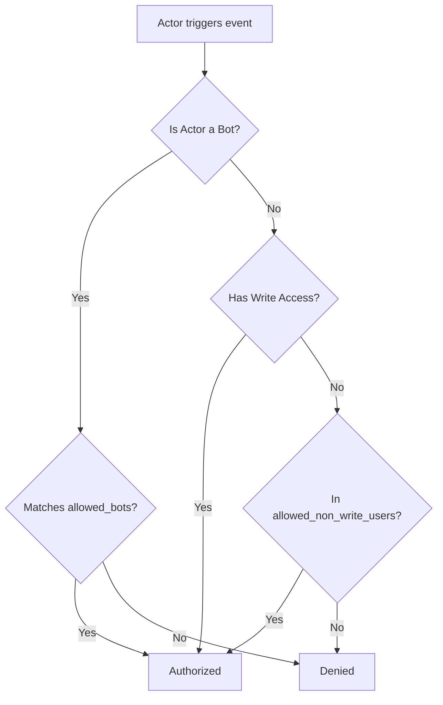

<!-- source: DeepWiki mcp.deepwiki.com · repo anthropics/claude-code-action · page 9.1 Security Model · fetched 2026-10-26 -->

# Security Model

Relevant source files

The following files were used as context for generating this wiki page:

- [SECURITY.md](SECURITY.md)
- [bunfig.toml](bunfig.toml)
- [docs/security.md](docs/security.md)
- [docs/usage.md](docs/usage.md)
- [src/github/operations/git-config.ts](src/github/operations/git-config.ts)
- [src/github/operations/restore-config.ts](src/github/operations/restore-config.ts)
- [src/github/utils/sanitizer.ts](src/github/utils/sanitizer.ts)
- [src/mcp/github-comment-server.ts](src/mcp/github-comment-server.ts)
- [test/integration-sanitization.test.ts](test/integration-sanitization.test.ts)
- [test/restore-config.test.ts](test/restore-config.test.ts)
- [test/sanitizer.test.ts](test/sanitizer.test.ts)
- [test/ssh-signing.test.ts](test/ssh-signing.test.ts)

This page documents the multi-layer security architecture of the `claude-code-action`. The security model implements defense-in-depth through authentication, access control, temporal filtering, content sanitization, and execution isolation. Each layer is designed to prevent unauthorized execution and protect against attack vectors including privilege escalation, RCE via malicious configuration, and prompt injection.

## Security Layers Overview

The security model consists of several primary layers that execute in sequence to ensure a safe execution environment for Claude:

| Layer | Function | Prevents |
|-------|----------|----------|
| 1. Authentication | `setupGitHubToken()` | Unauthorized GitHub API access |
| 2. Access Control | `checkWritePermissions()` | Privilege escalation from external actors |
| 3. Config Restoration | `restoreConfigFromBase()` | RCE via malicious `.claude/` or `.mcp.json` |
| 4. Temporal Filtering | `filterCommentsToTriggerTime()` | TOCTOU attacks via post-trigger edits |
| 5. Content Sanitization | `sanitizeContent()` | Prompt injection via hidden characters/HTML |
| 6. Execution Isolation | `CLAUDE_CODE_SUBPROCESS_ENV_SCRUB` | Secret leakage to untrusted subprocesses |

**Sources:** [src/github/operations/restore-config.ts:92-112](), [src/github/utils/sanitizer.ts:62-71](), [docs/security.md:1-21]()

---

## Configuration Restoration (RCE Prevention)

A critical security boundary is the `restoreConfigFromBase` function. Because GitHub Actions check out the PR head branch, an attacker could include a malicious `.mcp.json` or `.claude/settings.json` that executes arbitrary code when the Claude CLI starts (e.g., via `SessionStart` hooks or `apiKeyHelper` commands).

### Sensitive Path Protection

The system identifies `SENSITIVE_PATHS` that are PR-controllable and read by the CLI at startup [src/github/operations/restore-config.ts:20-29]():
- `.claude/` (Hooks, settings, plugins)
- `.mcp.json` (MCP server configurations)
- `.claude.json`
- `.gitmodules` (Prevents submodule recursion attacks)
- `.ripgreprc`
- `CLAUDE.md` / `CLAUDE.local.md`
- `.husky`

### Restoration Flow

1. **Snapshot**: Moves PR-authored versions to `.claude-pr/` using `snapshotSensitivePath` so review agents can inspect changes without executing them [src/github/operations/restore-config.ts:97-106](). It also ensures `.claude-pr/` is added to `info/exclude` via `ensureClaudePrExcludedFromGit` [src/github/operations/restore-config.ts:111-112]().
2. **Nuke**: Deletes PR versions from the working directory BEFORE fetching to ensure no malicious `.gitmodules` is present during the network operation, preventing submodule recursion attacks [src/github/operations/restore-config.ts:123-125]().
3. **Restore**: Fetches and checks out the versions of these files from the **base branch** (which has been reviewed and merged by maintainers) [src/github/operations/restore-config.ts:129-146]().
4. **Unstage**: Calls `git reset` on restored paths so the revert doesn't silently leak into commits the CLI makes later [src/github/operations/restore-config.ts:151-153]().

**Sources:** [src/github/operations/restore-config.ts:1-157](), [test/restore-config.test.ts:67-124]()

---

## Content Sanitization Utility

The `sanitizer.ts` utility provides the `sanitizeContent` function, which is used to scrub untrusted input before it is passed to Claude. This is used in prompt generation and within built-in MCP servers like the `GitHub Comment Server` [src/mcp/github-comment-server.ts:58-64]().

### Sanitization Measures

The `sanitizeContent` function applies the following filters in order [src/github/utils/sanitizer.ts:62-71]():

| Filter | Implementation | Purpose |
|--------|----------------|---------|
| **HTML Comments** | `stripHtmlComments` | Removes hidden instructions in `<!-- -->` [src/github/utils/sanitizer.ts:107-108]() |
| **Invisible Chars** | `stripInvisibleCharacters` | Removes zero-width spaces, directional overrides, and control characters [src/github/utils/sanitizer.ts:1-10]() |
| **Image Alt Text** | `stripMarkdownImageAltText` | Prevents injection in `` [src/github/utils/sanitizer.ts:12-14]() |
| **Link Titles** | `stripMarkdownLinkTitles` | Removes titles from markdown links [src/github/utils/sanitizer.ts:16-20]() |
| **Hidden Attributes** | `stripHiddenAttributes` | Removes `alt`, `title`, `aria-label`, and `data-*` HTML attributes [src/github/utils/sanitizer.ts:22-42]() |
| **HTML Entities** | `normalizeHtmlEntities` | Decodes numeric/hex entities to reveal hidden text [src/github/utils/sanitizer.ts:44-60]() |
| **Token Redaction** | `redactGitHubTokens` | Replaces GitHub PATs/OAuth/Installation tokens with `[REDACTED_GITHUB_TOKEN]` [src/github/utils/sanitizer.ts:73-105]() |

**Sources:** [src/github/utils/sanitizer.ts:1-109](), [test/sanitizer.test.ts:176-203](), [test/integration-sanitization.test.ts:6-66]()

---

## Execution Isolation and Subprocess Scrubbing

When dealing with untrusted input (especially when `allowed_non_write_users` is used), the action implements environment isolation for subprocesses.

### Secret Scrubbing
By default, the action performs a "best-effort" scrub of sensitive environment variables before spawning subprocesses. This includes:
- Anthropic API keys
- Cloud provider credentials (AWS/GCP/Azure)
- GitHub Actions internal secrets

Users can opt out by setting `CLAUDE_CODE_SUBPROCESS_ENV_SCRUB: 0` in their workflow environment [docs/security.md:16]().

### Bubblewrap Isolation (Linux)
On Linux runners where `bubblewrap` is available, the action attempts to run subprocesses with PID-namespace isolation. This prevents a malicious process from seeing or signaling other processes in the runner environment [docs/security.md:16]().

### Script Call Caps
Maintainers can limit the blast radius of write-capable helper scripts by setting `CLAUDE_CODE_SCRIPT_CAPS`. This is a JSON mapping of script names to the maximum number of times Claude is allowed to invoke them [docs/security.md:17]().
*Example*: `CLAUDE_CODE_SCRIPT_CAPS: '{"edit-issue-labels.sh": 2}'`

**Sources:** [docs/security.md:11-18]()

---

## Access Control Tiers

The action implements a three-tier access control model.

1. **Write Permission (Default)**: The action can only be triggered by users with write access to the repository [docs/security.md:5]().
2. **Bot Allowlist**: Bots are blocked by default. The `allowed_bots` input allows specific bots to bypass write checks. Note that allowed bots are not checked for repository permissions [docs/security.md:6-10]().
3. **Non-Write Bypass**: The `allowed_non_write_users` input allows specific users or `*` to trigger the action without repo permissions. This is flagged as **RISKY** and triggers the subprocess scrubbing/isolation logic [docs/security.md:11-16]().

### Git Authentication Security
When `allowed_non_write_users` is active, the action uses a credential helper `configureGitAuth` to avoid embedding tokens in the remote URL. The helper script reads from `GH_TOKEN` at auth time, ensuring `.git/config` remains token-free [src/github/operations/git-config.ts:54-74]().

**Sources:** [docs/security.md:3-18](), [src/github/operations/git-config.ts:22-84]()

---

## Commit Signing Security

The action supports two methods of secure commit signing:
1. **GitHub API Signing**: Managed via the GitHub App.
2. **SSH Signing**: Configured via `setupSshSigning`.

For SSH signing, the action:
- Validates the SSH key format [src/github/operations/git-config.ts:93-102]().
- Creates the `.ssh` directory and key file with strict permissions (`0o700` for directory, `0o600` for file) [src/github/operations/git-config.ts:104-114]().
- Provides a `cleanupSshSigning` function to remove the key file after execution [src/github/operations/git-config.ts:129-136]().

**Sources:** [src/github/operations/git-config.ts:90-137](), [test/ssh-signing.test.ts:41-114]()

---

