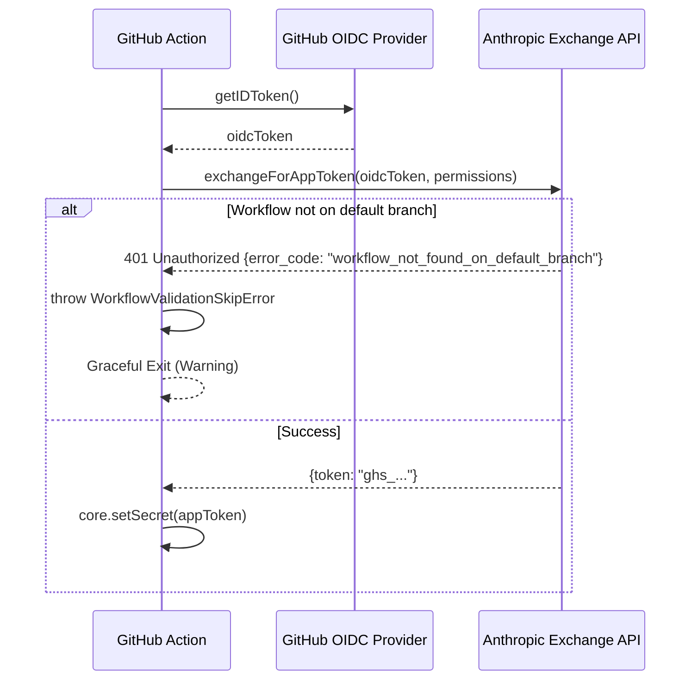

<!-- source: DeepWiki mcp.deepwiki.com · repo anthropics/claude-code-action · page 9.2 Permission Validation System · fetched 2026-10-26 -->

# Permission Validation System

<details>
<summary>Relevant source files</summary>

The following files were used as context for generating this wiki page:

- [docs/configuration.md](docs/configuration.md)
- [src/github/token.ts](src/github/token.ts)
- [src/github/utils/actor-filter.ts](src/github/utils/actor-filter.ts)
- [src/github/validation/actor.ts](src/github/validation/actor.ts)
- [src/github/validation/permissions.ts](src/github/validation/permissions.ts)
- [src/utils/retry.ts](src/utils/retry.ts)
- [test/actor-filter.test.ts](test/actor-filter.test.ts)
- [test/actor.test.ts](test/actor.test.ts)
- [test/parse-permissions.test.ts](test/parse-permissions.test.ts)
- [test/permissions.test.ts](test/permissions.test.ts)
- [test/token.test.ts](test/token.test.ts)

</details>


## Purpose and Scope

This document explains the technical implementation of the permission validation system in `claude-code-action`. This system ensures that only authorized actors can trigger Claude's execution, particularly in interactive "Tag Mode" scenarios (issues and pull requests). It covers the logic for `checkWritePermissions`, the `allowed_non_write_users` bypass, bot actor auto-approval, and the `WorkflowValidationSkipError` flow during token exchange.

For trigger phrase detection logic, see [Trigger Validation and Event Processing](9.3). For the broader security architecture, see [Security Model](9.1).

## Overview

The permission system acts as a gatekeeper during the `prepare` phase of the action. It uses a combination of GitHub API calls, actor metadata analysis, and input configuration to determine if a workflow should proceed.

The system enforces a **deny-by-default** policy for interactive events. An actor is authorized if they meet one of these criteria:
1. They have `write` or `admin` collaborator permissions on the repository. [src/github/validation/permissions.ts:91-93]()
2. They are a GitHub App bot (username ending in `[bot]`). [src/github/validation/permissions.ts:72-75]()
3. They are explicitly listed in the `allowed_non_write_users` input (requires a custom `github_token`). [src/github/validation/permissions.ts:48-67]()

**Sources:** [src/github/validation/permissions.ts:8-25](), [src/github/validation/actor.ts:11-28]()

## Permission Validation Flow

The validation logic is primarily orchestrated in `prepare.ts` and implemented in the `src/github/validation/` directory.

```mermaid
flowchart TD
    Start["prepare.ts"] --> ParseCtx["parseGitHubContext()"]
    ParseCtx --> IsAutomation{"Is Automation Event?<br/>(workflow_dispatch, schedule, etc.)"}
    
    IsAutomation -->|Yes| SkipPerms["Skip Collaborator Check"]
    IsAutomation -->|No| CheckBot{"Is Actor a Bot?<br/>(ends with '[bot]')"}
    
    CheckBot -->|Yes| AllowBot["Auto-Approve Bot Actor"]
    CheckBot -->|No| GetPerms["octokit.repos.getCollaboratorPermissionLevel"]
    
    GetPerms --> LevelCheck{"Permission Level?"}
    LevelCheck -->|"admin" | "write"| Authorized["Authorized"]
    LevelCheck -->|"read" | "none"| BypassCheck{"Actor in<br/>allowed_non_write_users?"}
    
    BypassCheck -->|Yes| TokenCheck{"Is custom GITHUB_TOKEN<br/>provided?"}
    TokenCheck -->|Yes| Warning["Log Security Warning"]
    Warning --> Authorized
    
    BypassCheck -->|No| Unauthorized["Unauthorized: Return False"]
    TokenCheck -->|No| Unauthorized
    
    Authorized --> TriggerCheck["checkContainsTrigger()"]
    Unauthorized --> Fail["core.setFailed()"]

    style IsAutomation fill:#fff9e6
    style CheckBot fill:#fff9e6
    style LevelCheck fill:#fff9e6
    style BypassCheck fill:#fff9e6
    style Unauthorized fill:#ffe6e6
    style Authorized fill:#e6ffe6
```

**Permission Validation Decision Logic**

**Sources:** [src/github/validation/permissions.ts:35-97](), [src/github/validation/actor.ts:30-88]()

## Key Components

### checkWritePermissions Function
Located in `src/github/validation/permissions.ts`, this function is the primary entry point for verifying user authority.

| Logic Step | Code Entity / Implementation |
|:---|:---|
| **Bot Detection** | Checks `actor.endsWith("[bot]")` [src/github/validation/permissions.ts:72-75]() |
| **Bypass Check** | Compares `actor` against `allowedNonWriteUsers` list [src/github/validation/permissions.ts:48-67]() |
| **API Call** | Invokes `octokit.repos.getCollaboratorPermissionLevel` [src/github/validation/permissions.ts:82-86]() |
| **Wildcard Support** | Supports `*` in `allowed_non_write_users` to permit all actors [src/github/validation/permissions.ts:50-54]() |

### checkHumanActor and Bot Allowlist
While `checkWritePermissions` handles repository access, `checkHumanActor` (in `src/github/validation/actor.ts`) manages which automated actors are allowed to trigger Claude.

- **Human Verification**: Checks if the GitHub `userData.type` is `User`. [src/github/validation/actor.ts:70]()
- **Bot Allowlist**: If the actor is not a `User`, it checks the `allowed_bots` input via `isAllowedBot`. [src/github/validation/actor.ts:11-28](), [src/github/validation/actor.ts:72-77]()
- **Wildcard Bots**: Setting `allowed_bots: "*"` permits any bot or GitHub App to trigger the action. [src/github/validation/actor.ts:13]()

**Sources:** [src/github/validation/actor.ts:30-88](), [src/github/validation/permissions.ts:8-25]()

## Token Exchange and Validation Errors

The action uses an OIDC-based token exchange with Anthropic's API to obtain a GitHub App token. This process includes a specific error flow for "Cold Start" scenarios.

### WorkflowValidationSkipError
During the `setupGitHubToken` flow, the action may encounter a `workflow_not_found_on_default_branch` error from the exchange endpoint.

- **Cause**: GitHub's security model requires that a workflow file exist on the default branch before it can be granted certain permissions via OIDC. This happens when first adding the action via a PR. [src/github/token.ts:129-136]()
- **Handling**: The system throws a `WorkflowValidationSkipError`. [src/github/token.ts:6-11](), [src/github/token.ts:135]()
- **Behavior**: The action catches this error and skips the run gracefully with a warning instead of a failure, allowing the PR to be merged so the workflow can become active on the default branch. [src/github/token.ts:131-134](), [src/github/token.ts:177]()



**OIDC Token Exchange and Validation Skip Flow**

**Sources:** [src/github/token.ts:24-54](), [src/github/token.ts:103-156](), [src/github/token.ts:158-185]()

## Configuration and Permissions

### Default and Additional Permissions
The action requests a set of standard permissions by default, which can be extended via the `ADDITIONAL_PERMISSIONS` environment variable.

- **Default Permissions**: `contents: write`, `pull_requests: write`, `issues: write`. [src/github/token.ts:69-73]()
- **Additional Permissions**: Users can specify extra scopes (e.g., `actions: read`) in a newline-separated format. [src/github/token.ts:75-101]()
- **Parsing**: `parseAdditionalPermissions` splits the input string and merges it with the defaults. [src/github/token.ts:84-100]()

### Allowed Non-Write Users
This bypass mechanism is designed for repositories where external contributors (without write access) need to interact with Claude.

| Input | Logic | Security Impact |
|:---|:---|:---|
| `allowed_non_write_users: "user1, user2"` | Checks if `actor` is in the list. [src/github/validation/permissions.ts:60-65]() | High - Bypasses standard GitHub RBAC. |
| `allowed_non_write_users: "*"` | Permits any actor to trigger. [src/github/validation/permissions.ts:50-54]() | Very High - Requires custom token for safety. |

**Note**: This bypass is only active if `githubTokenProvided` is true, ensuring that the repository owner has intentionally provided a token with the necessary scopes. [src/github/validation/permissions.ts:48]()

**Sources:** [src/github/token.ts:69-101](), [src/github/validation/permissions.ts:35-67](), [docs/configuration.md:110-182]()

## Error Handling and Logging

The system uses `core.warning` and `core.error` to provide feedback when validation fails.

1. **Insufficient Permissions**: If `checkWritePermissions` returns `false`, a warning is logged with the retrieved permission level (e.g., `read`). [src/github/validation/permissions.ts:95-96]()
2. **API Failures**: If the GitHub API call fails (e.g., rate limiting or network issues), the error is caught, logged, and re-thrown to halt execution. [src/github/validation/permissions.ts:118-119]()
3. **Security Warnings**: Whenever a bypass (`allowed_non_write_users`) is used, a prominent `⚠️ SECURITY WARNING` is logged to the workflow output. [src/github/validation/permissions.ts:51-53](), [src/github/validation/permissions.ts:61-63]()

**Sources:** [src/github/validation/permissions.ts:82-120](), [test/permissions.test.ts:186-201]()

---

