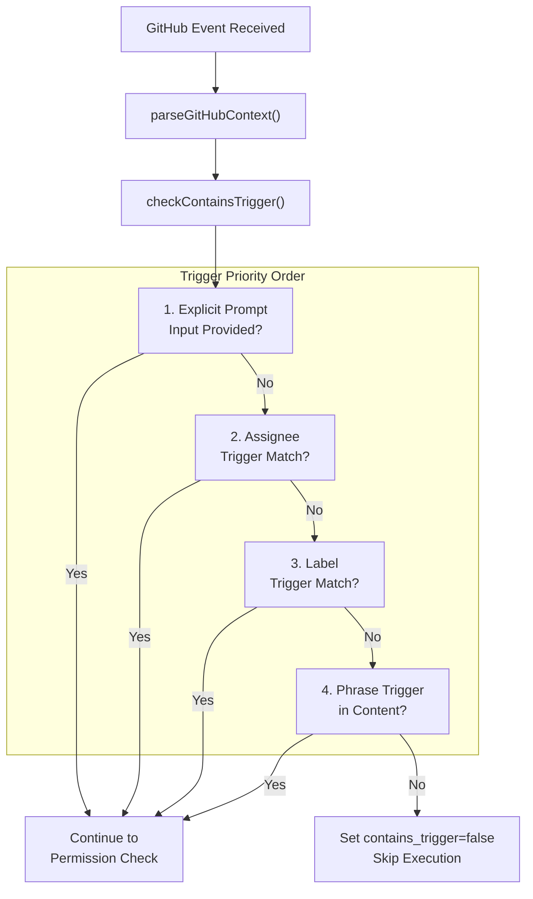
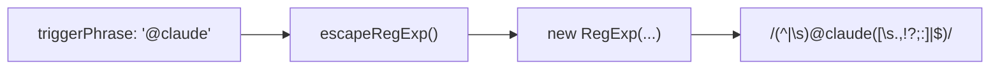
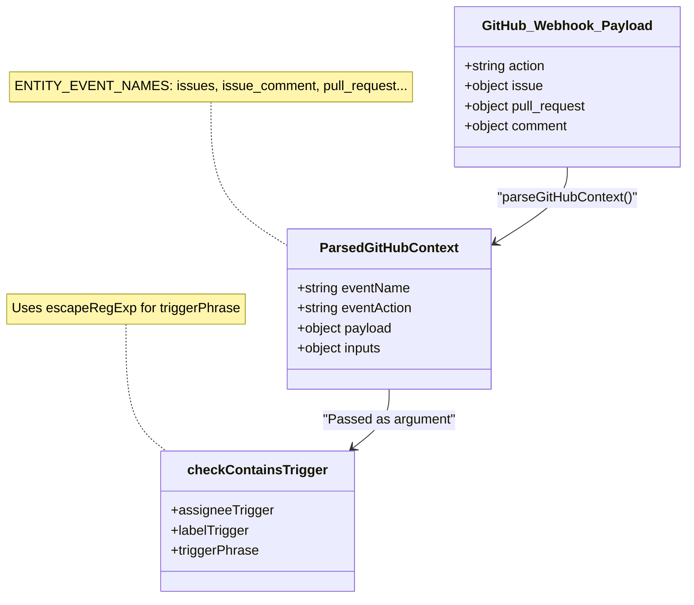

<!-- source: DeepWiki mcp.deepwiki.com · repo anthropics/claude-code-action · page 9.3 Trigger Validation and Event Processing · fetched 2026-10-26 -->

# Trigger Validation and Event Processing

Relevant source files

The following files were used as context for generating this wiki page:

- [src/github/constants.ts](src/github/constants.ts)
- [src/github/context.ts](src/github/context.ts)
- [src/github/validation/trigger.ts](src/github/validation/trigger.ts)
- [test/mockContext.ts](test/mockContext.ts)
- [test/trigger-validation.test.ts](test/trigger-validation.test.ts)

## Purpose and Scope

This document describes the trigger validation system that determines whether a GitHub event should activate Claude Code execution. The validation logic acts as an early gate in the action pipeline, examining event payloads to detect explicit or implicit triggers before proceeding to mode detection and Claude execution.

The core logic resides in `checkContainsTrigger`, which evaluates input parameters like `trigger_phrase`, `assignee_trigger`, and `label_trigger` against incoming GitHub webhook payloads.

## System Overview

The trigger validation system implements a priority-based decision tree that evaluates four distinct trigger types. This validation occurs in the `prepare` entrypoint after context parsing but before any Claude execution or GitHub operations.

### Trigger Logic Flow

The following diagram illustrates how `checkContainsTrigger` processes an event.

Title: Trigger Validation Decision Tree

**Sources:** [src/github/validation/trigger.ts:14-23](), [src/github/context.ts:134-170](), [test/trigger-validation.test.ts:24-43]()

## Trigger Types

### 1. Prompt Trigger (Agent Mode)
The highest priority trigger. When the `prompt` input is provided (typically via `workflow_dispatch` or a manual action input), the action always executes. This bypasses all content-based checks.

*   **Implementation**: Checked first in `checkContainsTrigger` [src/github/validation/trigger.ts:19-23]().
*   **Context**: Associated with `AUTOMATION_EVENT_NAMES` like `workflow_dispatch` or `schedule` [src/github/context.ts:63-68]().

### 2. Assignee Trigger
Activates when an issue or PR is assigned to a specific user. The system automatically normalizes the input by removing any leading `@` symbol before comparison.

*   **Logic**: Uses `isIssuesAssignedEvent(context)` type guard [src/github/validation/trigger.ts:26-35]().
*   **Normalization**: `let triggerUser = assigneeTrigger.replace(/^@/, "")` [src/github/validation/trigger.ts:28]().

### 3. Label Trigger
Activates when an issue is labeled. This is specific to the `labeled` action on `issues` events.

*   **Logic**: Checks if `context.eventAction === "labeled"` and matches `labelTrigger` against `payload.label.name` [src/github/validation/trigger.ts:38-45]().

### 4. Phrase Trigger (Tag Mode)
The most common trigger for interactive use. It searches for a specific phrase (default `@claude`) within the body or title of various GitHub entities.

**Sources:** [src/github/validation/trigger.ts:14-138](), [test/mockContext.ts:15-33]()

## Phrase Matching and Word Boundaries

To prevent false positives (e.g., matching "claudette" when the trigger is "claude"), the system uses regular expressions with word boundaries and punctuation handling.

### Implementation Detail
The system uses `escapeRegExp` to ensure that trigger phrases containing special characters (like `@` or `/`) are treated as literal strings in the regex [src/github/validation/trigger.ts:144-146]().

Title: Regex Pattern Construction

The regex pattern used is: `(^|\\s)${escapeRegExp(triggerPhrase)}([\\s.,!?;:]|$)` [src/github/validation/trigger.ts:52-54]().

| Content | Trigger | Match | Reason |
| :--- | :--- | :--- | :--- |
| `@claude help` | `@claude` | Yes | Start of line/space boundary |
| `hey @claude!` | `@claude` | Yes | Punctuation boundary (`!`) |
| `claudette` | `claude` | No | No word boundary |
| `email@claude.com`| `@claude` | No | No leading space/start of line |

**Sources:** [src/github/validation/trigger.ts:51-54](), [src/github/validation/trigger.ts:144-146](), [test/trigger-validation.test.ts:171-206]()

## Event Handling Matrix

The `checkContainsTrigger` function dispatches logic based on the event type parsed in `parseGitHubContext`.

| Event Type (`eventName`) | Checked Fields | Trigger Logic |
| :--- | :--- | :--- |
| `issues` | `body`, `title` | Checks for phrase on `opened` action [src/github/validation/trigger.ts:48-71](). |
| `issue_comment` | `comment.body` | Checks for phrase on `created` [src/github/validation/trigger.ts:121-137](). |
| `pull_request` | `body`, `title` | Checks for phrase on `opened`, `synchronize`, etc [src/github/validation/trigger.ts:75-98](). |
| `pull_request_review` | `review.body` | Checks for phrase on `submitted` or `edited` [src/github/validation/trigger.ts:102-118](). |
| `pull_request_review_comment`| `comment.body` | Checks for phrase [src/github/validation/trigger.ts:121-137](). |

### pull_request_target Security Note
The action supports `pull_request_target`. While this event provides a write-capable `GITHUB_TOKEN` even for forks, the trigger validation still requires the phrase to be present in the PR body or title. The `parseGitHubContext` function maps `pull_request_target` to the internal `pull_request` event name to ensure trigger logic is applied consistently [src/github/context.ts:191-201]().

**Sources:** [src/github/context.ts:191-201](), [src/github/validation/trigger.ts:75-98](), [src/github/validation/trigger.ts:121-137]()

## Internal Data Flow

This diagram maps the relationship between the raw GitHub event and the internal validation structures.

Title: Event Processing Data Map

**Sources:** [src/github/context.ts:55-61](), [src/github/context.ts:134-146](), [src/github/validation/trigger.ts:14-17]()

## Permission Integration

Trigger validation is the first gate, but not the only one. Even if `contains_trigger` is true, the action may skip execution if the user lacks permissions.

1.  **Trigger Check**: `checkTriggerAction(context)` sets the `contains_trigger` output [src/github/validation/trigger.ts:148-152]().
2.  **Output Propagation**: The result of `checkContainsTrigger` is converted to a string and set as an action output [src/github/validation/trigger.ts:150]().

**Sources:** [src/github/validation/trigger.ts:148-152](), [src/github/context.ts:55-68]()

---

