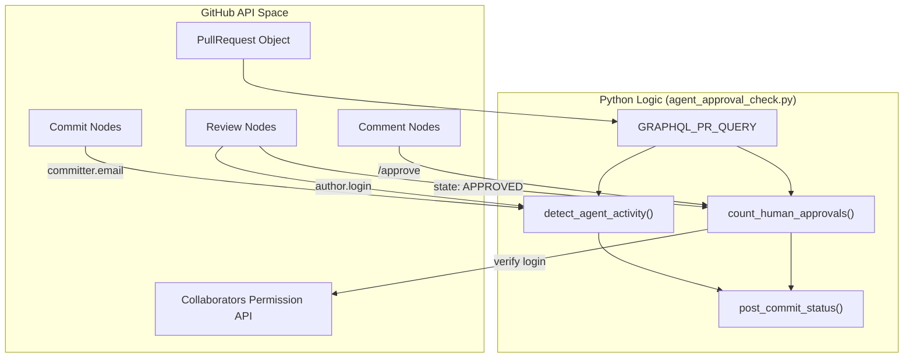
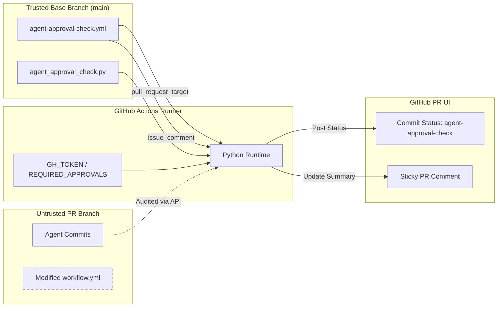

<!-- source: DeepWiki mcp.deepwiki.com · repo anthropics/claude-code-action · page 9.4 Agent Approval Check · fetched 2026-10-26 -->

# Agent Approval Check

<details>
<summary>Relevant source files</summary>

The following files were used as context for generating this wiki page:

- [SECURITY.md](SECURITY.md)
- [agent-approval-check/README.md](agent-approval-check/README.md)
- [agent-approval-check/action.yml](agent-approval-check/action.yml)
- [agent-approval-check/agent-identities.example.yaml](agent-approval-check/agent-identities.example.yaml)
- [agent-approval-check/agent_approval_check.py](agent-approval-check/agent_approval_check.py)
- [examples/agent-approval-check.yml](examples/agent-approval-check.yml)

</details>


The **Agent Approval Check** is a specialized sub-action designed to enforce human oversight on Pull Requests (PRs) that contain agent-authored content. It ensures that any changes suggested or committed by an AI agent (such as Claude or Claude Code) receive a configurable number of distinct human approvals before the PR is eligible for merging.

This check is implemented as a fail-closed Python script that runs within a GitHub Action composite runner, utilizing GraphQL and REST APIs to audit PR history and permissions.

## Overview and Purpose

The primary goal of the agent-approval-check is to mitigate the risk of automated agents introducing regressions or security vulnerabilities without human review. It functions by:
1.  **Detecting Agent Activity**: Scanning commit history and PR metadata for known agent identities [agent-approval-check/agent_approval_check.py:28-33]().
2.  **Counting Human Approvals**: Validating approvals from users with `write` access while excluding agents and rubber-stamp bots [agent-approval-check/agent_approval_check.py:35-46]().
3.  **Enforcing Merge Gates**: Posting a commit status (`agent-approval-check`) that must be marked as "Required" in GitHub branch protection settings [agent-approval-check/README.md:30-32]().

### Data Flow and Code Entity Mapping

The following diagram illustrates how the Python execution environment interacts with GitHub's API entities to determine the approval status.

**Agent Approval Verification Flow**

**Sources:** [agent-approval-check/agent_approval_check.py:125-229](), [agent-approval-check/agent_approval_check.py:28-46](), [agent-approval-check/agent_approval_check.py:102-111]()

## Implementation Details

### Agent Identity Detection
The system identifies "Agent Activity" through three primary vectors defined in `agent_approval_check.py`:
*   **Commit Authorship**: Any commit where the committer email matches the `AGENT_EMAILS` list (default: `noreply@anthropic.com`) [agent-approval-check/agent_approval_check.py:29-29]().
*   **PR Authorship**: If the PR creator's login is in `AGENT_LOGINS` [agent-approval-check/agent_approval_check.py:30-30]().
*   **Agent Reviews**: If an agent identity submits an `APPROVED` review, the PR is flagged for human oversight (an agent's approval cannot satisfy the check) [agent-approval-check/agent_approval_check.py:31-33]().

### Approval Mechanisms
Approvals are tracked via two mechanisms:
1.  **Native Reviews**: Non-dismissed `APPROVED` reviews from users with write access [agent-approval-check/agent_approval_check.py:38-39]().
2.  **Comment-based Approval**: A human may comment `/approve <sha>` [agent-approval-check/agent_approval_check.py:40-40](). This is particularly useful for PR authors who cannot natively "approve" their own PRs but need to vouch for agent-generated commits pushed to their branch [agent-approval-check/README.md:94-97]().

### The Sibling-PR Guard
Because GitHub commit statuses are attached to a git SHA rather than a PR object, a security risk exists where a "clean" PR and an "agent" PR share the same head SHA. To prevent a green status on one PR from accidentally unblocking another, the script implements a **Sibling-PR Guard**:
*   It fetches all open PRs associated with the head SHA [agent-approval-check/agent_approval_check.py:170-180]().
*   It withholds `success` if any other open PR targeting a protected base branch shares the same SHA [agent-approval-check/README.md:116-121]().

**Sources:** [agent-approval-check/agent_approval_check.py:12-60](), [agent-approval-check/README.md:89-101](), [agent-approval-check/action.yml:15-22]()

## Security Model and Threat Profile

The action is designed to be tamper-proof by leveraging specific GitHub Actions triggers.

### Tamper-Proof Triggers
The check must run via `pull_request_target` or `issue_comment` [examples/agent-approval-check.yml:15-18](). These triggers execute the workflow definition from the **base branch** (e.g., `main`), meaning a PR author cannot modify the workflow file in their branch to bypass the approval logic [agent-approval-check/README.md:104-112]().

### Fail-Closed Execution
The Python script is designed to be "fail-closed." Any unhandled exception, API failure, or detection of more than 100 commits (which exceeds the single-page verification limit) results in a non-zero exit code, keeping the commit status in a `pending` (yellow) state and blocking the merge [agent-approval-check/README.md:113-115]().

### System Architecture Diagram
The following diagram maps the workflow triggers to the internal execution logic and the resulting GitHub UI states.

**Workflow Orchestration and Security Boundaries**

**Sources:** [agent-approval-check/action.yml:49-72](), [agent-approval-check/README.md:104-123](), [examples/agent-approval-check.yml:1-12]()

## Configuration

The check can be configured via action inputs or an external YAML file.

### Key Inputs
| Input | Role | Code Reference |
| :--- | :--- | :--- |
| `required_approvals` | Number of human signatures needed | [agent-approval-check/action.yml:12-14]() |
| `agent_emails` | List of emails identifying agent commits | [agent-approval-check/action.yml:15-17]() |
| `protected_bases` | Branches where this check is enforced | [agent-approval-check/action.yml:35-41]() |
| `config_file` | Path to an `agent-identities.yaml` | [agent-approval-check/action.yml:42-44]() |

### External Configuration Example
Using a `config_file` allows for centralized management of agent identities across multiple workflows.

```yaml
# .github/agent-identities.yaml
agent_emails:
  - noreply@anthropic.com
agent_app_logins:
  - claude[bot]
protected_bases:
  owner/repo:
    exact: [main]
    prefixes: [release/]
```
**Sources:** [agent-approval-check/agent-identities.example.yaml:1-34](), [agent-approval-check/action.yml:8-48]()

---

