# Page: Overview

# Overview

<details>
<summary>Relevant source files</summary>

The following files were used as context for generating this wiki page:

- [README.md](README.md)
- [action.yml](action.yml)
- [base-action/action.yml](base-action/action.yml)
- [bun.lock](bun.lock)
- [examples/claude.yml](examples/claude.yml)
- [package.json](package.json)

</details>


The `claude-code-action` repository provides a GitHub Action that integrates Claude AI into GitHub workflows for code assistance, automated reviews, and repository automation. The action automatically detects execution mode based on workflow configuration: **Tag Mode** for interactive `@claude` mentions in issues/PRs, or **Agent Mode** for automation tasks with explicit `prompt` inputs. The action executes entirely on your GitHub Actions infrastructure and supports multiple Claude API providers (Anthropic API, AWS Bedrock, Google Vertex AI, Microsoft Foundry).

**Sources:** [README.md:3-5](), [action.yml:1-2]()

## Repository Structure

The repository contains two GitHub Actions organized in a parent-child relationship:

| Action | Location | Purpose |
|--------|----------|---------|
| **Claude Code Action** | [action.yml:1-170]() | Main action with GitHub integration, mode detection, authentication, and prompt generation. |
| **Claude Code Base Action** | [base-action/action.yml:1-216]() | Reusable action focused solely on executing Claude Code CLI with minimal GitHub dependencies. |

The main action delegates Claude execution to the base action's source code, sharing a unified Bun-based runtime environment.

**Sources:** [action.yml:1-170](), [base-action/action.yml:1-216](), [package.json:1-32]()

## Primary Use Cases

The action provides two automation patterns that share execution infrastructure but differ in interaction model:

### Tag Mode (Interactive)
Responds to user triggers (`@claude` mentions, issue assignments, label additions) with:
- Tracking comments showing real-time progress.
- Automatic branch creation and management.
- Full GitHub context injection (PR diffs, comment threads, review comments, CI status).
- PR creation links when work completes on a new branch.

### Agent Mode (Automation)
Executes predefined tasks from the `prompt` input for:
- Scheduled maintenance workflows.
- Event-driven automation (PR opened, issue labeled).
- Headless CI/CD pipelines.
- Structured output generation with JSON schema validation.

**Sources:** [README.md:7-18](), [action.yml:8-18](), [action.yml:57-60](), [action.yml:136-139]()

## Core Capabilities

| Capability | Implementation Logic | Configuration Input |
|------------|----------------------|---------------------|
| **Interactive Assistant** | Tag Mode Detection | `trigger_phrase` [action.yml:8-11]() |
| **Automated Tasks** | Agent Mode Detection | `prompt` [action.yml:57-60]() |
| **PR Review Feedback** | Inline Classification | `classify_inline_comments` [action.yml:116-119]() |
| **Commit Signing** | SSH or GitHub Web Flow | `use_commit_signing`, `ssh_signing_key` [action.yml:120-127]() |
| **Multi-Provider Auth** | OIDC Token Exchange | `use_bedrock`, `use_vertex`, `use_foundry` [action.yml:91-102]() |
| **Progress Tracking** | Dynamic Status Updates | `track_progress` [action.yml:136-139]() |
| **Structured Outputs** | JSON Schema Validation | `claude_args` [action.yml:104-107]() |

**Sources:** [action.yml:7-170](), [README.md:7-18]()

## Dual-Action Architecture

The repository implements a two-layer architecture where the main action handles GitHub integration and delegates Claude execution to the base action components.

**Diagram: Action Composition and Function Flow**

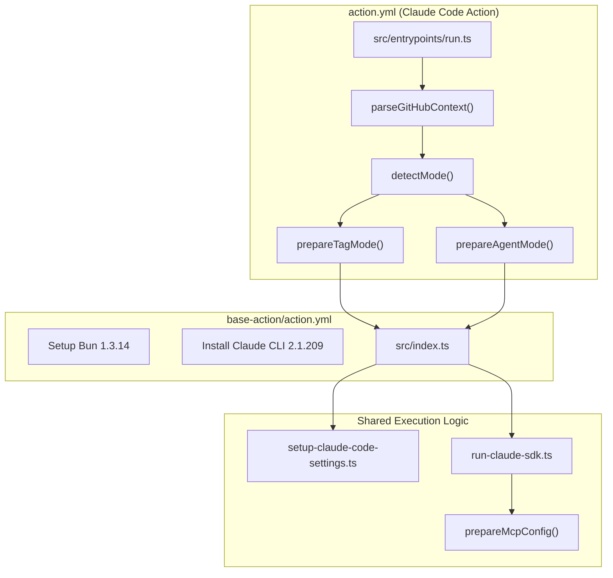

### Main Action Responsibilities
The main action ([action.yml:1-170]()) orchestrates GitHub-specific logic:
- **Context Parsing**: Normalizes various GitHub events (issue comments, PR reviews, labels).
- **Trigger Validation**: Checks for `@claude` or specific labels/assignees. [action.yml:8-18]()
- **Branch Management**: Handles `branch_prefix` and `branch_name_template`. [action.yml:22-29]()
- **Permission Checking**: Validates `allowed_bots` and `allowed_non_write_users`. [action.yml:30-46]()

### Base Action Responsibilities
The base action ([base-action/action.yml:1-216]()) provides the execution engine:
- **Environment Setup**: Installs Bun v1.3.14 and the Claude Code CLI v2.1.209. [base-action/action.yml:123-148]()
- **Plugin Management**: Installs plugins from marketplaces. [base-action/action.yml:86-93]()
- **CLI Invocation**: Runs Claude with `claude_args` and `prompt`. [base-action/action.yml:171-182]()
- **Output Capture**: Produces `structured_output` and `execution_file`. [base-action/action.yml:95-107]()

**Sources:** [action.yml:1-170](), [base-action/action.yml:1-216](), [package.json:12-23]()

## Mode Detection and Execution

The system automatically switches behavior based on inputs and event types.

**Diagram: Mode Selection Logic**

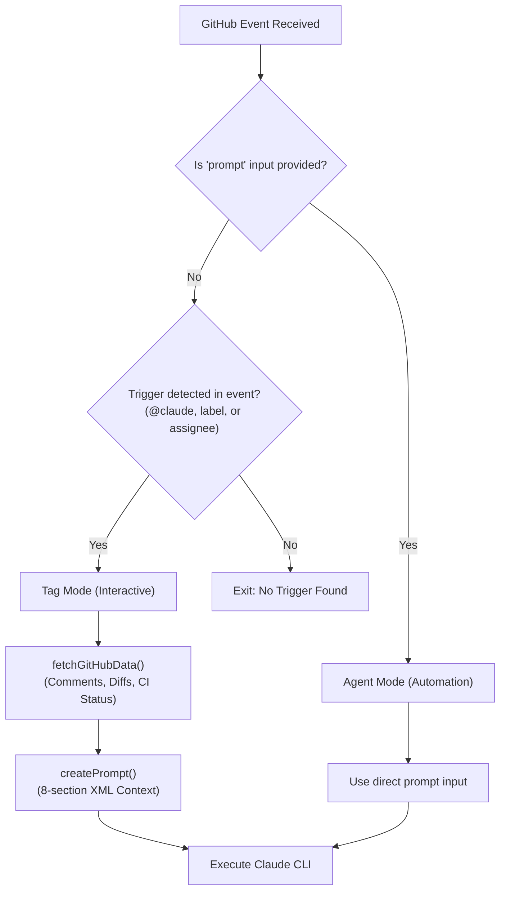

### Mode Comparison

| Aspect | Tag Mode | Agent Mode |
|--------|----------|------------|
| **Activation** | Trigger phrase, Label, or Assignee | Presence of `prompt` input |
| **Context** | Automatic (PR diffs, comments, etc.) | Manual (provided in prompt) |
| **Feedback** | Dynamic tracking comments | GitHub Step Summary only |
| **Branching** | Auto-creates branches for changes | Operates on current branch |
| **Primary Use** | Interactive PR/Issue assistance | Scheduled tasks, CI auto-fixes |

**Sources:** [action.yml:8-18](), [action.yml:57-60](), [action.yml:136-139](), [README.md:9-16]()

## Execution Pipeline

The action follows a structured four-phase execution flow:

1.  **Parse & Validate**: Extracts GitHub context and validates that the actor has appropriate permissions or is in the `allowed_bots` list. [action.yml:30-33]()
2.  **Prepare Mode**: 
    *   **Tag Mode**: Fetches historical comments and code diffs to build a rich context.
    *   **Agent Mode**: Sets up the environment for a single-turn automation task.
3.  **Execute Claude**: Installs the specific version of Claude Code (v2.1.209) and runs it using the configured authentication (API Key, Bedrock, Vertex, or Foundry). [base-action/action.yml:142-154]()
4.  **Cleanup & Report**: Revokes temporary tokens, signs commits if configured, and writes the final execution report to the GitHub Step Summary. [action.yml:120-127](), [base-action/action.yml:184-194]()

**Sources:** [action.yml:1-170](), [base-action/action.yml:109-216]()

## Authentication Architecture

Claude Code Action supports four primary authentication providers via OIDC (OpenID Connect) to avoid long-lived secrets:

*   **Anthropic API**: Direct usage via `anthropic_api_key` or Workload Identity Federation. [action.yml:67-87]()
*   **AWS Bedrock**: Enabled via `use_bedrock`, utilizing OIDC for AWS credentials. [action.yml:91-94]()
*   **Google Vertex AI**: Enabled via `use_vertex`, utilizing OIDC for GCP credentials. [action.yml:95-98]()
*   **Microsoft Foundry**: Enabled via `use_foundry`, utilizing OIDC for Azure credentials. [action.yml:99-102]()

Additionally, it uses a `github_token` or GitHub App installation token to interact with the repository's API for comments, reviews, and file changes. [action.yml:88-90]()

**Sources:** [action.yml:67-102](), [README.md:5]()

---

# Page: Getting Started

# Getting Started

<details>
<summary>Relevant source files</summary>

The following files were used as context for generating this wiki page:

- [README.md](README.md)
- [base-action/src/validate-env.ts](base-action/src/validate-env.ts)
- [base-action/test/validate-env.test.ts](base-action/test/validate-env.test.ts)
- [docs/capabilities-and-limitations.md](docs/capabilities-and-limitations.md)
- [docs/cloud-providers.md](docs/cloud-providers.md)
- [docs/create-app.html](docs/create-app.html)
- [docs/experimental.md](docs/experimental.md)
- [docs/faq.md](docs/faq.md)
- [docs/setup.md](docs/setup.md)
- [examples/claude-wif.yml](examples/claude-wif.yml)
- [examples/claude.yml](examples/claude.yml)
- [github-app-manifest.json](github-app-manifest.json)

</details>


This page provides step-by-step instructions for installing and configuring the Claude Code Action in your GitHub repository. It covers authentication setup, basic workflow configuration, and verification steps to ensure the action is working correctly.

For detailed information about configuration options, see **Action Inputs Reference** (Section 5.1). For usage patterns and examples, see **Usage Examples** (Section 6). For understanding the underlying execution modes, see **Execution Modes** (Section 3.1).

---

## Prerequisites

Before installing the Claude Code Action, ensure you have:

| Requirement | Description |
|------------|-------------|
| **GitHub Repository Access** | Repository admin permissions to install GitHub apps and configure secrets [README.md:30-32]() |
| **Authentication Method** | One of: Anthropic API key, Claude Code OAuth token, AWS Bedrock, Google Vertex AI, or Microsoft Foundry [README.md:5]() |
| **GitHub Actions Enabled** | GitHub Actions must be enabled in your repository settings |
| **Runner Availability** | Access to `ubuntu-latest` runners (default environment) [examples/claude.yml:20]() |

**Sources:** [README.md:5](), [README.md:30-32](), [examples/claude.yml:20]()

---

## Quickstart Installation (Recommended)

The easiest way to set up the action is through the Claude Code CLI using the `/install-github-app` command.

### Installation Steps

1. **Open Claude Code in your terminal:**
   ```bash
   claude
   ```

2. **Run the installation command:**
   ```
   /install-github-app
   ```

3. **Follow the interactive setup:**
   - Select your target repository.
   - Authorize the GitHub app installation.
   - Configure required secrets automatically.

**Diagram: Quickstart Installation Flow**

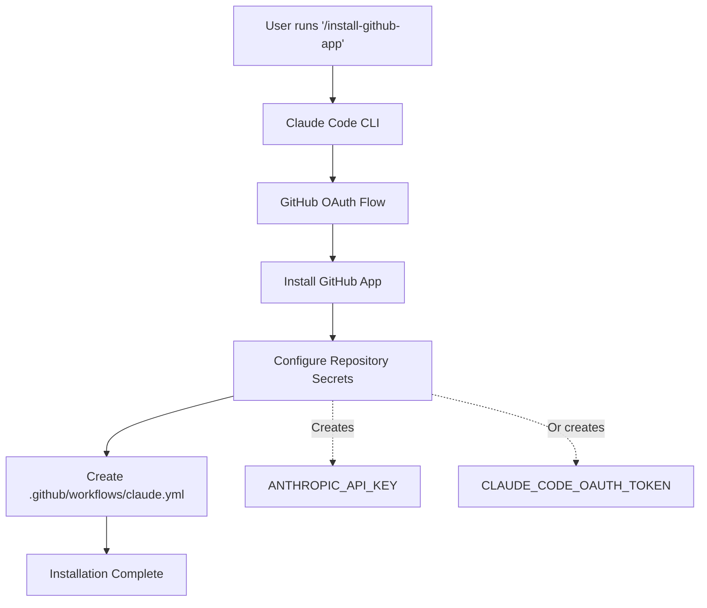

**Limitations:**
- Only available for direct Anthropic API users [README.md:33]().
- Requires repository admin permissions [README.md:32]().
- For cloud providers (AWS Bedrock, Google Vertex AI, Microsoft Foundry), use manual setup [README.md:33]().

**Sources:** [README.md:24-33]()

---

## Manual Setup

For cloud providers or custom configurations, manually configure the action in your repository.

### Step 1: Create Workflow File

Create `.github/workflows/claude.yml` in your repository. A standard configuration listens for comments, issues, and PR reviews:

```yaml
name: Claude Code
on:
  issue_comment:
    types: [created]
  pull_request_review_comment:
    types: [created]
  issues:
    types: [opened, assigned]
  pull_request_review:
    types: [submitted]

jobs:
  claude:
    if: |
      (github.event_name == 'issue_comment' && contains(github.event.comment.body, '@claude')) ||
      (github.event_name == 'pull_request_review_comment' && contains(github.event.comment.body, '@claude')) ||
      (github.event_name == 'pull_request_review' && contains(github.event.review.body, '@claude')) ||
      (github.event_name == 'issues' && (contains(github.event.issue.body, '@claude') || contains(github.event.issue.title, '@claude')))
    runs-on: ubuntu-latest
    permissions:
      contents: write
      pull-requests: write
      issues: write
      id-token: write
      actions: read
    steps:
      - name: Checkout repository
        uses: actions/checkout@v6
        with:
          fetch-depth: 1

      - name: Run Claude Code
        id: claude
        uses: anthropics/claude-code-action@v1
        with:
          anthropic_api_key: ${{ secrets.ANTHROPIC_API_KEY }}
```

**Diagram: GitHub Event to Logic Orchestration**

This diagram bridges the Natural Language trigger (event) to the specific internal logic that handles the environment validation and execution.

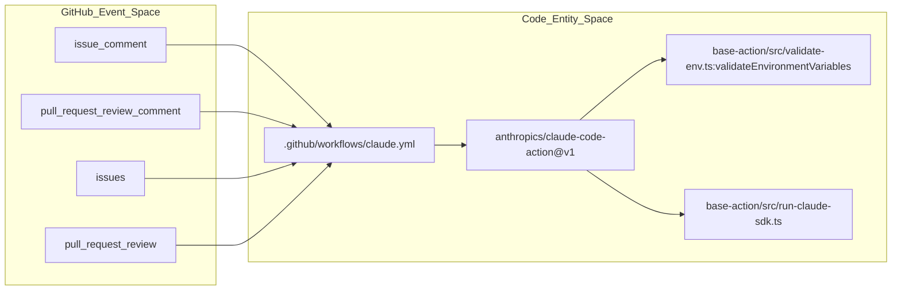

**Sources:** [examples/claude.yml:1-37](), [base-action/src/validate-env.ts:5-89](), [github-app-manifest.json:20-26]()

### Step 2: Configure Repository Secrets

Navigate to **Settings → Secrets and variables → Actions** and add the necessary credentials [docs/setup.md:8-10]():

| Secret Name | Description | Provider |
|------------|-------------|----------|
| `ANTHROPIC_API_KEY` | Direct Anthropic API key (starts with `sk-ant-`) | Anthropic |
| `CLAUDE_CODE_OAUTH_TOKEN` | OAuth token generated via `claude setup-token` | Anthropic |

For AWS Bedrock, Google Vertex AI, or Microsoft Foundry, you typically use OIDC and do not need a static API key, but you must set `use_bedrock: "true"`, `use_vertex: "true"`, or `use_foundry: "true"` in the action inputs [docs/cloud-providers.md:29-52]().

**Sources:** [docs/setup.md:8-10](), [docs/cloud-providers.md:29-52](), [base-action/src/validate-env.ts:30-41]()

### Step 3: Set Permissions

The action requires specific permissions to interact with your repository [examples/claude.yml:21-26]():

- `contents: write`: To read files and create branches [docs/capabilities-and-limitations.md:11-13]().
- `pull-requests: write`: To read PR data and post comments [docs/faq.md:88-89]().
- `issues: write`: To read issue data and update comments [docs/faq.md:89-90]().
- `id-token: write`: Required for OIDC authentication with the GitHub App or Cloud Providers [docs/faq.md:21-27]().
- `actions: read`: Required if you want Claude to analyze CI/CD results [docs/faq.md:79-91]().

**Sources:** [examples/claude.yml:21-26](), [docs/faq.md:21-27](), [docs/faq.md:79-91]()

---

## Basic Configuration Options

### Essential Inputs

The action uses environment validation to ensure all necessary parameters are present based on the selected provider.

| Input | Purpose | Default |
|-------|---------|---------|
| `anthropic_api_key` | Authentication for direct API [examples/claude.yml:37]() | - |
| `prompt` | Instructions for automation (Agent Mode) [docs/experimental.md:24-31]() | - |
| `trigger_phrase` | Phrase to look for in comments [examples/claude.yml:40]() | `@claude` |
| `claude_args` | Arguments passed to Claude CLI (e.g., `--model`, `--system-prompt`) [examples/claude.yml:46-51]() | `""` |
| `use_bedrock` | Enable Amazon Bedrock provider [docs/cloud-providers.md:32]() | `false` |

**Diagram: Input to Provider Validation**

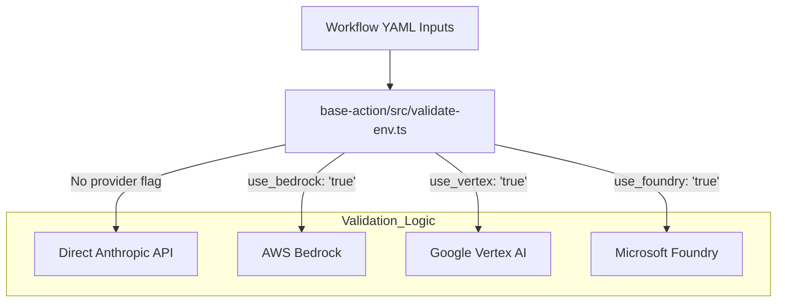

**Sources:** [base-action/src/validate-env.ts:5-83](), [docs/experimental.md:5-49](), [docs/cloud-providers.md:22-52]()

---

## First Interaction

### Testing Interactive Mode (Tag Mode)

1. **Create a Pull Request** or Issue.
2. **Post a comment** containing the trigger:
   ```text
   @claude How does the authentication flow work in this repo?
   ```
3. **Observation**: Claude will post a "tracking comment" with progress indicators and eventually respond with the analysis [README.md:15](), [docs/capabilities-and-limitations.md:5]().

### Testing Automation Mode (Agent Mode)

1. **Modify your workflow** to include a `prompt`:
   ```yaml
   - uses: anthropics/claude-code-action@v1
     with:
       anthropic_api_key: ${{ secrets.ANTHROPIC_API_KEY }}
       prompt: "Summarize the changes in this PR."
   ```
2. **Trigger the event** (e.g., by pushing a commit or opening the PR).
3. **Observation**: The action runs automatically without needing a manual `@claude` mention [docs/experimental.md:24-31]().

**Sources:** [docs/experimental.md:9-49](), [docs/capabilities-and-limitations.md:5-14]()

---

## Verification and Troubleshooting

### Common Verification Checks

- **Check Workflow Runs**: Go to the **Actions** tab. If the run didn't start, verify the `if:` condition in your workflow YAML [examples/claude.yml:15-19]().
- **Check Permissions**: If Claude fails to post a comment, verify the `id-token: write` permission is present [docs/faq.md:21-27]().
- **Check Secrets**: If you see "Authentication failed", ensure `ANTHROPIC_API_KEY` is correctly set in Repository Secrets [docs/setup.md:8-10]().

### Troubleshooting Table

| Symptom | Likely Cause | Reference |
|---------|--------------|-----------|
| No response to `@claude` | Trigger phrase mismatch or event not in `on:` | [examples/claude.yml:3-19]() |
| "Resource not accessible" | Missing `write` permissions or GitHub App token issue | [docs/faq.md:31-56]() |
| Workflow loop | Automated tagging from another GitHub Action | [docs/faq.md:7-9]() |
| OIDC Error | Missing `id-token: write` permission | [docs/faq.md:19-29]() |

**Sources:** [docs/faq.md:1-150](), [examples/claude.yml:1-58]()

---

# Page: Core Concepts

# Core Concepts

<details>
<summary>Relevant source files</summary>

The following files were used as context for generating this wiki page:

- [docs/configuration.md](docs/configuration.md)
- [src/entrypoints/collect-inputs.ts](src/entrypoints/collect-inputs.ts)
- [src/entrypoints/post-buffered-inline-comments.ts](src/entrypoints/post-buffered-inline-comments.ts)
- [src/github/token.ts](src/github/token.ts)
- [src/modes/detector.ts](src/modes/detector.ts)
- [src/utils/retry.ts](src/utils/retry.ts)
- [test/modes/detector.test.ts](test/modes/detector.test.ts)
- [test/parse-permissions.test.ts](test/parse-permissions.test.ts)
- [test/token.test.ts](test/token.test.ts)

</details>


This document explains the fundamental concepts that govern how the Claude Code Action operates. It covers the dual-action architecture, mode detection system, GitHub context parsing, MCP tool integration, and security model. These concepts form the foundation for understanding the system's behavior and capabilities.

For detailed information about specific execution modes, see [Execution Modes](#3.1). For trigger validation mechanisms, see [Trigger System](#3.2). For authentication configuration, see [Authentication Providers](#3.3).

## Dual-Action Architecture

The system consists of two GitHub Actions that work together to provide a complete automation platform. This separation allows the main action to handle complex GitHub logic while the base action focuses on the Claude Code environment.

| Component | File | Purpose |
|-----------|------|---------|
| Main Action | [action.yml:1-290]() | GitHub orchestration, mode detection, context preparation |
| Base Action | [base-action/action.yml:1-216]() | Claude Code execution, provider integration |

**Main Action Flow**

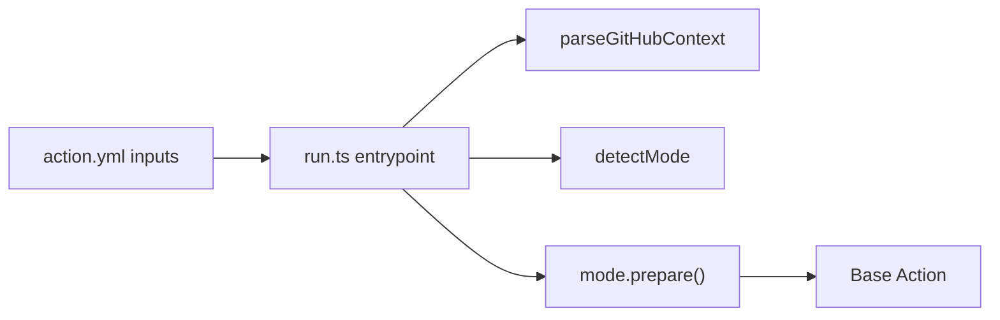

The main action ([action.yml:1-290]()) collects inputs via `collectActionInputsPresence` ([src/entrypoints/collect-inputs.ts:1-60]()), parses GitHub event payloads, detects the appropriate execution mode, and prepares the environment. It then delegates Claude execution to the base action.

**Base Action Flow**

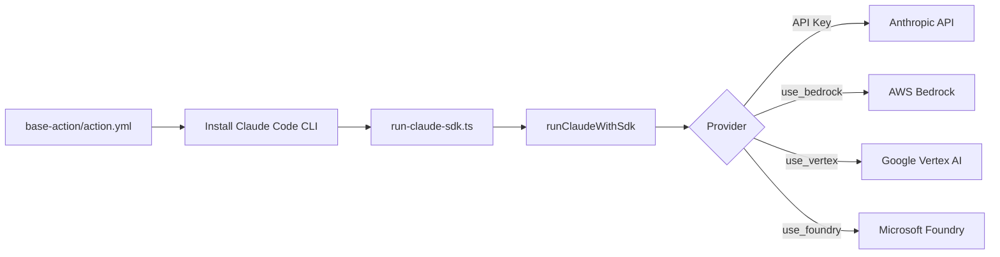

The base action ([base-action/action.yml:1-216]()) installs Claude Code, configures authentication, and executes Claude with the prepared prompt and tools. It supports multiple AI providers through environment variable configuration.

**Sources:** [action.yml:1-290](), [base-action/action.yml:1-216](), [src/entrypoints/collect-inputs.ts:1-60]()

## Mode System

The mode system is the primary mechanism for determining execution behavior. The `AutoDetectedMode` type ([src/modes/detector.ts:12]()) defines the two primary paths: `tag` and `agent`.

**Mode Detection Architecture**

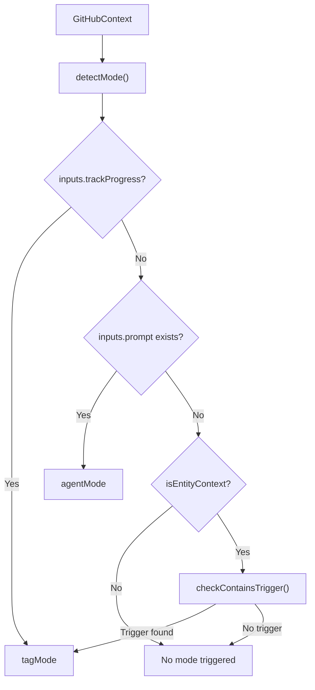

The detector ([src/modes/detector.ts:14-81]()) evaluates the parsed GitHub context. If `trackProgress` is enabled for supported events like `pull_request` or `issues`, it forces **Tag Mode** ([src/modes/detector.ts:16-31]()).

1. If `inputs.prompt` is provided, use **Agent Mode** ([src/modes/detector.ts:41-43]()).
2. If the event is entity-based (PR/issue) and contains a trigger phrase (like `@claude`), use **Tag Mode** ([src/modes/detector.ts:45-47]()).
3. Otherwise, it defaults to `agent` mode, which remains idle without an explicit prompt ([src/modes/detector.ts:80]()).

**Mode Comparison**

| Aspect | Agent Mode | Tag Mode |
|--------|------------|----------|
| Trigger | Explicit `prompt` input | `@claude` mention, assignment, label |
| Tracking Comments | No | Yes (enabled via `track_progress`) |
| Use Case | Automation (CI/CD) | Interactive assistance |

**Sources:** [src/modes/detector.ts:1-115](), [test/modes/detector.test.ts:1-225]()

## GitHub Context Parsing

The system transforms GitHub webhook events into structured contexts that modes can consume.

**Context Parsing Flow**

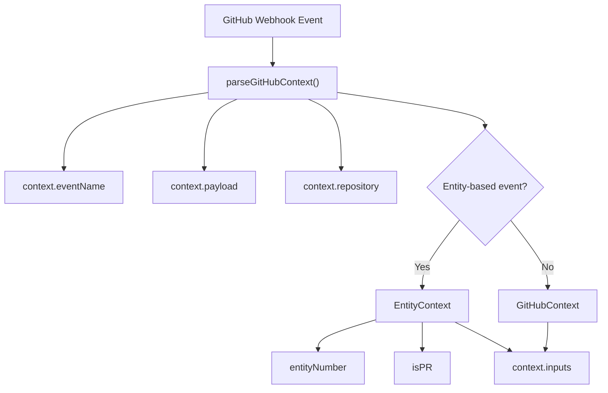

The system handles specific events like `issue_comment`, `pull_request_review_comment`, and `issues`. It also processes specialized logic for PR review comments, including classification of "real" vs "test/probe" comments using Claude Haiku ([src/entrypoints/post-buffered-inline-comments.ts:45-109]()).

**Sources:** [src/modes/detector.ts:1-11](), [src/entrypoints/post-buffered-inline-comments.ts:28-43]()

## MCP Tool Integration

The Model Context Protocol (MCP) system provides Claude with specialized tools. Users can extend Claude's capabilities by adding custom MCP servers via `claude_args` ([docs/configuration.md:3-17]()).

**Custom MCP Configuration**
Users can pass JSON configuration for MCP servers, including environment variables and secrets ([docs/configuration.md:19-47]()):

```yaml
claude_args: |
  --mcp-config '{"mcpServers": {"thinking": {"command": "npx", "args": ["@modelcontextprotocol/server-sequential-thinking"]}}}'
  --allowedTools mcp__thinking__sequentialthinking
```

The system also supports Python-based MCP servers using `uv` ([docs/configuration.md:49-88]()) and can integrate with GitHub CI tools like `mcp__github_ci__download_job_log` if `actions: read` permissions are granted ([docs/configuration.md:141-146]()).

**Sources:** [docs/configuration.md:1-108](), [docs/configuration.md:141-146]()

## Security and Permission Model

The system implements multiple security layers, including OIDC-based token exchange and granular permission management.

**Authentication Flow**

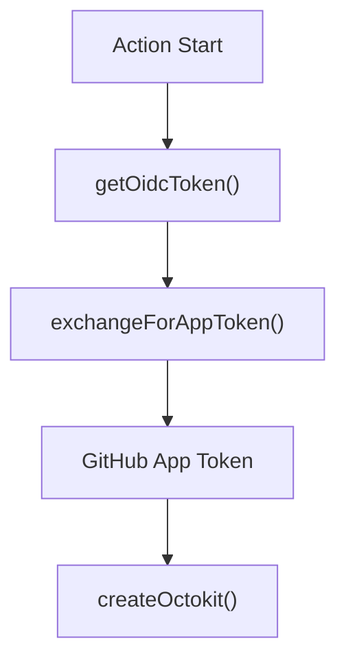

**Permission Validation**
The action requests a scoped GitHub App token via OIDC ([src/github/token.ts:56-67]()). Default permissions include `contents: write`, `pull_requests: write`, and `issues: write` ([src/github/token.ts:69-73]()). Users can request `additional_permissions` (e.g., `actions: read`) which are merged with defaults ([src/github/token.ts:75-101]()).

If a workflow change is detected on a PR that hasn't been merged to the default branch, the exchange may fail with a `WorkflowValidationSkipError` ([src/github/token.ts:6-11]()), causing the action to skip gracefully ([src/github/token.ts:129-136]()).

**Sources:** [src/github/token.ts:1-185](), [test/parse-permissions.test.ts:1-97]()

## Execution Phases

The system executes in four distinct phases, ensuring proper resource management even when errors occur.

**Phase Execution Flow**

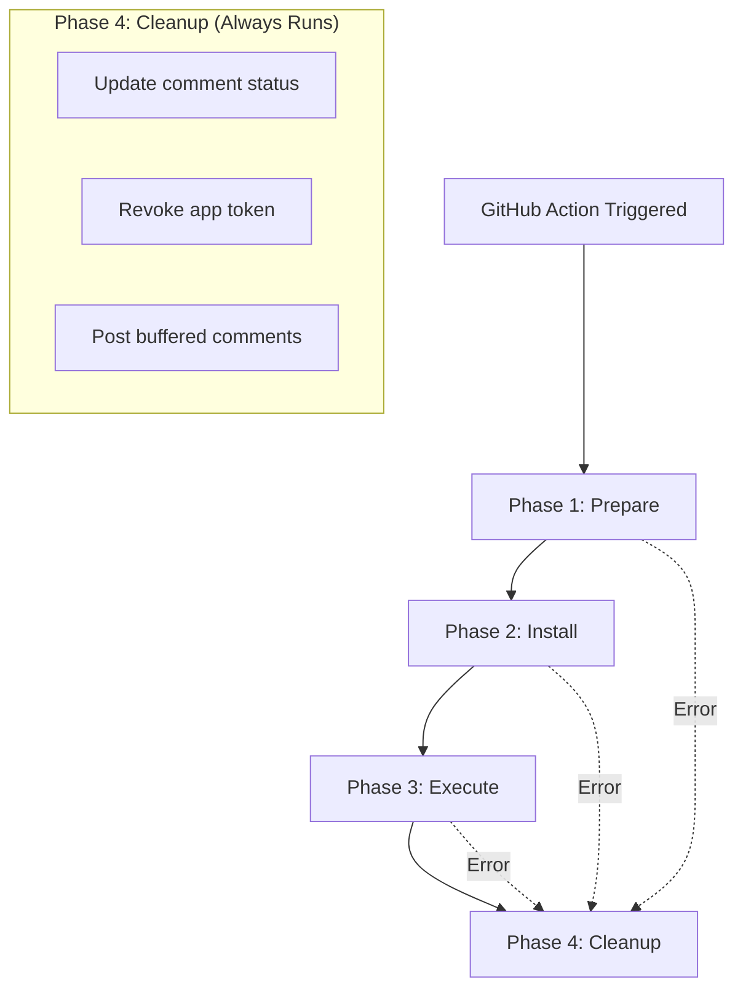

**Phase Responsibilities**

| Phase | Entry Point | Purpose |
|-------|-------------|---------|
| **Prepare** | `src/entrypoints/prepare.ts` | Context parsing, mode detection, and token setup ([src/github/token.ts:158]()). |
| **Install** | `base-action/action.yml` | Environment setup and Claude Code CLI installation. |
| **Execute** | `base-action/src/run-claude-sdk.ts` | Claude invocation and task execution. |
| **Cleanup** | `src/entrypoints/post-buffered-inline-comments.ts` | Finalizing PR comments and classification ([src/entrypoints/post-buffered-inline-comments.ts:146-228]()). |

**Sources:** [src/github/token.ts:158-185](), [src/entrypoints/post-buffered-inline-comments.ts:146-228]()

---

# Page: Execution Modes

# Execution Modes

<details>
<summary>Relevant source files</summary>

The following files were used as context for generating this wiki page:

- [src/entrypoints/collect-inputs.ts](src/entrypoints/collect-inputs.ts)
- [src/entrypoints/post-buffered-inline-comments.ts](src/entrypoints/post-buffered-inline-comments.ts)
- [src/modes/agent/index.ts](src/modes/agent/index.ts)
- [src/modes/detector.ts](src/modes/detector.ts)
- [src/modes/tag/index.ts](src/modes/tag/index.ts)
- [test/modes/agent.test.ts](test/modes/agent.test.ts)
- [test/modes/detector.test.ts](test/modes/detector.test.ts)

</details>


The `claude-code-action` supports two primary execution paradigms: **Tag Mode** (interactive, context-rich) and **Agent Mode** (automation-focused, prompt-driven). The system uses an intelligent routing mechanism to detect the appropriate mode based on GitHub event context and user inputs.

## Mode Detection Logic

Mode detection is handled by the `detectMode` function in [src/modes/detector.ts:14-81](). The logic prioritizes explicit user intent (via the `prompt` or `track_progress` inputs) and falls back to event-based heuristics.

### Mode Selection Criteria

| Input / Context | Detected Mode | Behavior |
| :--- | :--- | :--- |
| `track_progress: true` | **Tag Mode** | Forces interactive behavior with tracking comments for supported events [src/modes/detector.ts:16-31](). |
| `prompt` provided | **Agent Mode** | Executes the specific prompt immediately without creating progress comments [src/modes/detector.ts:41-43](). |
| `@claude` mention (no prompt) | **Tag Mode** | Responds to mentions in issues or PR comments [src/modes/detector.ts:45-47](). |
| Issue Assignment/Labeling | **Tag Mode** | Triggers based on `assignee_trigger` or `label_trigger` [src/modes/detector.ts:58-60](). |
| Default (No prompt/trigger) | **Agent Mode** | Default fallback; typically results in a no-op if no trigger is found later [src/modes/detector.ts:80](). |

### The `track_progress` Parameter
The `track_progress` input is a bridge between modes. It allows automation workflows (which normally use Agent Mode) to leverage Tag Mode features like:
1.  **Tracking Comments**: Real-time status updates in the GitHub UI [src/modes/tag/index.ts:45-46]().
2.  **Full Context**: Automatic inclusion of PR/issue history, attachments, and metadata [src/modes/tag/index.ts:52-63]().

**Supported Events for `track_progress`**:
- `pull_request` (actions: `opened`, `synchronize`, `ready_for_review`, `reopened`) [src/modes/detector.ts:100-113]().
- `issues`, `issue_comment`, `pull_request_review`, `pull_request_review_comment`, `pull_request_review` [src/modes/detector.ts:85-91]().

Sources: [src/modes/detector.ts:14-114](), [src/modes/tag/index.ts:45-63]()

## Tag Mode (Interactive)

Tag Mode is designed for human-in-the-loop interactions. It treats Claude as a collaborator that responds to specific triggers within a GitHub Issue or Pull Request.

### Technical Implementation: `prepareTagMode`
When Tag Mode is active, the execution pipeline calls `prepareTagMode` [src/modes/tag/index.ts:27-188](). This pathway performs heavy data fetching to provide Claude with maximum context.

**Tag Mode Data Flow**
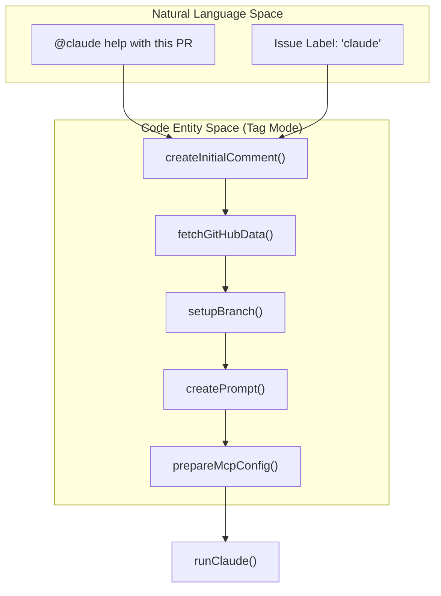

**Key Characteristics**:
-   **Tracking**: Immediately creates a "Claude is thinking..." comment via `createInitialComment` [src/modes/tag/index.ts:45-46]().
-   **Context**: Calls `fetchGitHubData` to pull the entire conversation history, diffs, and CI status [src/modes/tag/index.ts:52-63]().
-   **Branching**: Automatically manages git branches via `setupBranch` to ensure Claude operates on the correct code state [src/modes/tag/index.ts:66]().
-   **Tooling**: Configures a specific set of `tagModeTools` including GitHub-specific MCP tools for CI logs and comment updates [src/modes/tag/index.ts:123-150]().

Sources: [src/modes/tag/index.ts:27-188](), [src/github/data/fetcher.ts:1-63]()

## Agent Mode (Automation)

Agent Mode is optimized for "fire-and-forget" automations where a specific task is defined in the workflow YAML. It is the default mode when the `prompt` input is used.

### Technical Implementation: `prepareAgentMode`
The `prepareAgentMode` function [src/modes/agent/index.ts:19-134]() is a lightweight preparation pathway that avoids the overhead of fetching full GitHub conversation histories unless explicitly requested.

**Agent Mode Execution Pipeline**
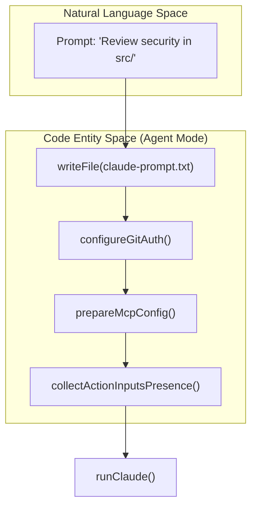

**Key Characteristics**:
-   **Direct Input**: The `prompt` input is written directly to a temporary file on the runner (`RUNNER_TEMP/claude-prompts/claude-prompt.txt`) [src/modes/agent/index.ts:70-79]().
-   **No Tracking**: By default, it does not post progress comments to GitHub (`commentId` is `undefined`) [src/modes/agent/index.ts:104]().
-   **Branch Detection**: Detects the current branch from environment variables like `GITHUB_HEAD_REF` or `GITHUB_REF_NAME` [src/modes/agent/index.ts:90-95]().
-   **Tooling**: Parses allowed tools directly from the user's `claude_args` [src/modes/agent/index.ts:81-83]().

Sources: [src/modes/agent/index.ts:19-134](), [src/entrypoints/collect-inputs.ts:1-60]()

## Workflow Comparison Summary

| Feature | Tag Mode (Interactive) | Agent Mode (Automation) |
| :--- | :--- | :--- |
| **Trigger** | `@claude`, Labels, Assignees | `prompt` input in YAML |
| **Progress Visibility** | Sticky/Tracking comments | Action logs only (unless `track_progress: true`) |
| **Branch Management** | Auto-creates `claude/` branches | Operates on current checked-out HEAD |
| **GitHub Context** | Deep (Comments, Reviews, CI logs) | Shallow (Environment variables) |
| **Primary Use Case** | Ad-hoc coding help, PR discussions | Scheduled reviews, Auto-docs, CI fixes |

### Implementation Convergence
Regardless of the mode, both pathways converge at the final execution phase. Both modes return a common interface containing:
-   `commentId`: (Optional) The ID of the tracking comment [src/modes/tag/index.ts:183]().
-   `branchInfo`: Details about the base, current, and Claude-specific branches [src/modes/tag/index.ts:184](), [src/modes/agent/index.ts:125-129]().
-   `mcpConfig`: Configuration for the Model Context Protocol servers [src/modes/tag/index.ts:185](), [src/modes/agent/index.ts:130]().
-   `claudeArgs`: Final CLI arguments passed to the Claude binary [src/modes/tag/index.ts:186](), [src/modes/agent/index.ts:131]().

Sources: [src/modes/tag/index.ts:182-188](), [src/modes/agent/index.ts:123-133]()

---

# Page: Trigger System

# Trigger System

<details>
<summary>Relevant source files</summary>

The following files were used as context for generating this wiki page:

- [src/github/constants.ts](src/github/constants.ts)
- [src/github/context.ts](src/github/context.ts)
- [src/github/validation/trigger.ts](src/github/validation/trigger.ts)
- [test/mockContext.ts](test/mockContext.ts)
- [test/trigger-validation.test.ts](test/trigger-validation.test.ts)

</details>


This document explains the trigger mechanisms that determine when the Claude Code Action executes. It covers the various trigger types (`prompt`, `trigger_phrase`, `assignee_trigger`, `label_trigger`), how trigger detection works across different GitHub event types, and the validation logic that ensures triggers are properly detected while avoiding false positives.

For information about how triggers affect execution behavior (Agent Mode vs Tag Mode), see [Execution Modes](3.1). For detailed validation implementation, see [Trigger Validation and Event Processing](9.3).

## Trigger Types Overview

The Claude Code Action supports four distinct trigger mechanisms that can activate Claude execution:

| Trigger Type | Configuration Input | Execution Mode | Use Case |
|-------------|-------------------|----------------|----------|
| **Explicit Prompt** | `prompt` | Agent Mode | Automated workflows with predefined prompts (`workflow_dispatch`, `schedule`, `repository_dispatch`) |
| **Phrase Trigger** | `trigger_phrase` | Tag Mode | Interactive assistance via mentions in comments, issues, or PRs (default: `@claude`) |
| **Assignee Trigger** | `assignee_trigger` | Tag Mode | Automatic activation when specific user is assigned to an issue |
| **Label Trigger** | `label_trigger` | Tag Mode | Automatic activation when specific label is applied to an issue |

**Sources:** [src/github/context.ts:85-106](), [test/mockContext.ts:15-33](), [src/github/validation/trigger.ts:15-17]()

## Trigger Detection Architecture

The detection logic is encapsulated in the `checkContainsTrigger` function, which processes the `ParsedGitHubContext` to determine if the execution criteria are met.

### Logic Flow Diagram

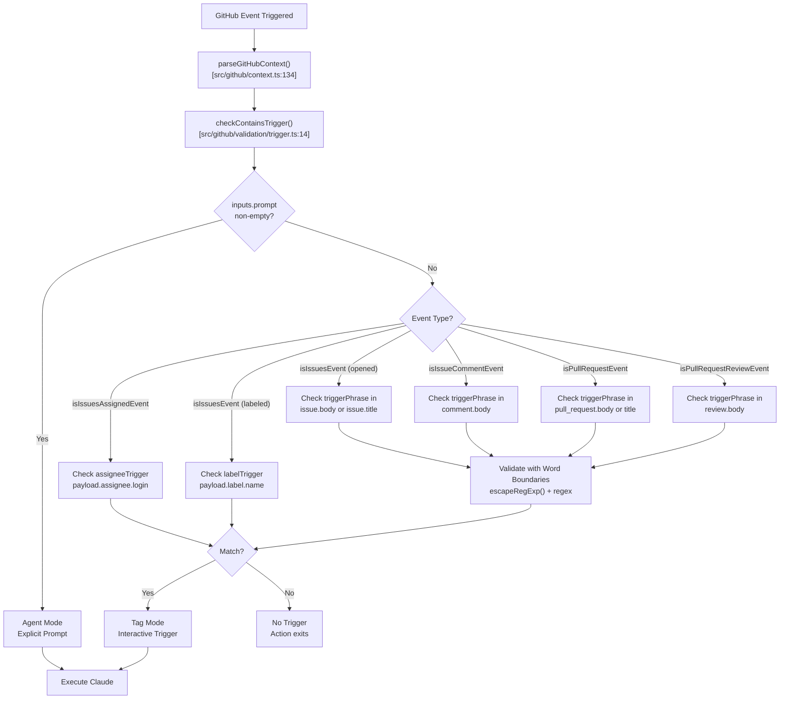

**Sources:** [src/github/context.ts:134-243](), [src/github/validation/trigger.ts:14-138](), [test/trigger-validation.test.ts:24-150]()

## Explicit Prompt Trigger

The `prompt` input provides an explicit instruction for Claude, bypassing all other trigger checks. When `prompt` is non-empty, the action enters Agent Mode and executes immediately.

### Configuration

```yaml
- uses: anthropics/claude-code-action@v1
  with:
    anthropic_api_key: ${{ secrets.ANTHROPIC_API_KEY }}
    prompt: "Review all TypeScript files and suggest improvements"
```

### Behavior

- **Mode**: Agent Mode (see [Execution Modes](3.1)).
- **Event Types**: Typically used with automation events (`workflow_dispatch`, `repository_dispatch`, `schedule`, `workflow_run`) [src/github/context.ts:63-68]().
- **Validation**: If `prompt` is non-empty, `checkContainsTrigger()` returns `true` immediately [src/github/validation/trigger.ts:20-23]().
- **Priority**: Takes precedence over all other trigger types.

**Sources:** [src/github/validation/trigger.ts:20-23](), [test/trigger-validation.test.ts:25-43]()

## Phrase Trigger

The `trigger_phrase` enables interactive Claude assistance by detecting mentions in text content. The default value is `@claude` [src/github/context.ts:149]().

### Word Boundary Detection

The phrase trigger uses word boundary validation to avoid false positives (e.g., matching "claudette" when looking for "@claude"). The system constructs a regular expression using `escapeRegExp` to handle special characters in custom phrases [src/github/validation/trigger.ts:144-146]().

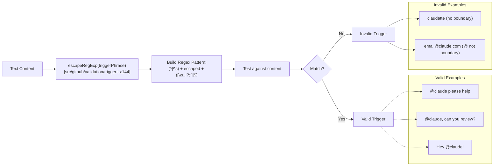

**Sources:** [src/github/validation/trigger.ts:52-54](), [src/github/validation/trigger.ts:79-82](), [test/trigger-validation.test.ts:171-206]()

### Event Content Coverage

| Event Type | Content Checked | Source Implementation |
|-----------|----------------|-------|
| `issues` (opened) | `issue.body`, `issue.title` | [src/github/validation/trigger.ts:48-71]() |
| `issue_comment` | `comment.body` | [src/github/validation/trigger.ts:122-133]() |
| `pull_request` | `pull_request.body`, `pull_request.title` | [src/github/validation/trigger.ts:74-97]() |
| `pull_request_review` | `review.body` | [src/github/validation/trigger.ts:102-118]() |
| `pull_request_review_comment` | `comment.body` | [src/github/validation/trigger.ts:122-133]() |

**Sources:** [src/github/validation/trigger.ts:48-133](), [test/trigger-validation.test.ts:150-451]()

## Assignee Trigger

The `assignee_trigger` activates Claude when a specific user is assigned to an issue.

### Configuration

```yaml
- uses: anthropics/claude-code-action@v1
  with:
    assignee_trigger: "claude-bot"
```

The system automatically removes a leading `@` from the input for comparison [src/github/validation/trigger.ts:28]().

### Detection Logic

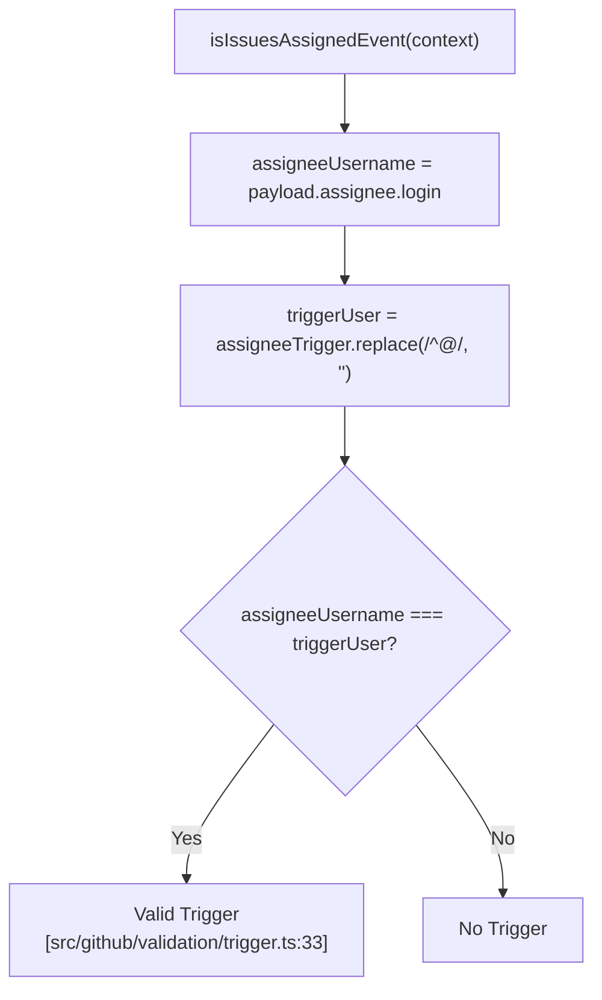

**Sources:** [src/github/validation/trigger.ts:26-35](), [test/trigger-validation.test.ts:75-115]()

## Label Trigger

The `label_trigger` activates Claude when a specific label is applied to an issue.

### Configuration

```yaml
- uses: anthropics/claude-code-action@v1
  with:
    label_trigger: "claude-task"
```

### Detection Logic

The trigger is checked during `issues` events where the action is `labeled`. The system compares `payload.label.name` against the `label_trigger` input [src/github/validation/trigger.ts:38-45]().

**Sources:** [src/github/validation/trigger.ts:38-45](), [test/trigger-validation.test.ts:117-148]()

## Trigger Priority and Hierarchy

When multiple inputs are provided, the system evaluates them in a specific order within `checkContainsTrigger`:

1.  **Prompt Check**: If `prompt` is provided, the function returns `true` immediately [src/github/validation/trigger.ts:20-23]().
2.  **Assignee Check**: If the event is an assignment, it checks the `assigneeTrigger` [src/github/validation/trigger.ts:26-35]().
3.  **Label Check**: If the event is a labeling, it checks the `labelTrigger` [src/github/validation/trigger.ts:38-45]().
4.  **Content Check**: Finally, it scans titles, bodies, and comments for the `triggerPhrase` using regex [src/github/validation/trigger.ts:47-133]().

**Sources:** [src/github/validation/trigger.ts:14-138](), [test/trigger-validation.test.ts:24-451]()

---

# Page: Authentication Providers

# Authentication Providers

<details>
<summary>Relevant source files</summary>

The following files were used as context for generating this wiki page:

- [action.yml](action.yml)
- [base-action/action.yml](base-action/action.yml)
- [docs/capabilities-and-limitations.md](docs/capabilities-and-limitations.md)
- [docs/cloud-providers.md](docs/cloud-providers.md)
- [docs/configuration.md](docs/configuration.md)
- [docs/experimental.md](docs/experimental.md)
- [docs/faq.md](docs/faq.md)
- [src/github/token.ts](src/github/token.ts)
- [src/utils/retry.ts](src/utils/retry.ts)
- [test/parse-permissions.test.ts](test/parse-permissions.test.ts)
- [test/token.test.ts](test/token.test.ts)

</details>


This document describes the authentication mechanisms supported by Claude Code Action for connecting to Claude AI services. The action supports four distinct authentication providers: direct Anthropic API, Amazon Bedrock, Google Vertex AI, and Microsoft Foundry.

## Overview

Claude Code Action supports multiple authentication providers to access Claude AI services. The provider is selected based on input flags (`use_bedrock`, `use_vertex`, `use_foundry`). When no provider flag is set, the action defaults to the direct Anthropic API.

| Provider | Authentication Method | Primary Use Case |
|----------|---------------------|------------------|
| **Direct Anthropic API** | API Key or OAuth Token | Standard deployments with direct Anthropic access |
| **Amazon Bedrock** | AWS OIDC + IAM Roles | AWS-native deployments, enterprise AWS environments |
| **Google Vertex AI** | GCP OIDC + Service Accounts | GCP-native deployments, Google Cloud Platform integration |
| **Microsoft Foundry** | Azure OIDC + Managed Identity | Azure-native deployments, Microsoft ecosystem integration |

**Sources:** [action.yml:66-102](), [base-action/action.yml:28-68](), [docs/cloud-providers.md:3-8]()

## Provider Selection and Validation

The action uses `validateEnvironmentVariables` in the base action to ensure that required credentials for the selected provider are present and that providers are not mixed.

### Code Entity Mapping: Environment Validation

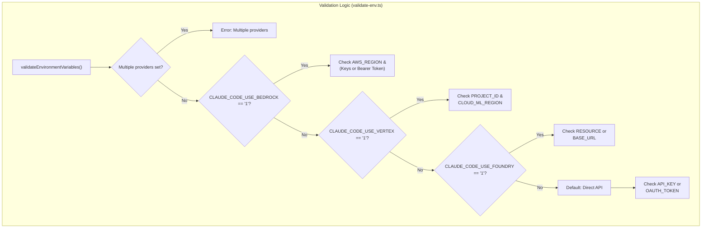

**Sources:** [base-action/src/validate-env.ts:5-75](), [base-action/test/validate-env.test.ts:36-180]()

## Direct Anthropic API Authentication

The default provider. It requires either an `anthropic_api_key` or a `claude_code_oauth_token`.

### Configuration
```yaml
- uses: anthropics/claude-code-action@v1
  with:
    anthropic_api_key: ${{ secrets.ANTHROPIC_API_KEY }}
```

### Validation Requirements
- `ANTHROPIC_API_KEY` or `CLAUDE_CODE_OAUTH_TOKEN` must be present.
- If both are missing, the action throws an error during the validation phase.
- Support for Workload Identity Federation is available via `anthropic_federation_rule_id` and `anthropic_organization_id`, which allows the action to exchange a GitHub OIDC token for an Anthropic API token.

**Sources:** [base-action/src/validate-env.ts:23-27](), [base-action/action.yml:37-56](), [action.yml:73-86]()

## Amazon Bedrock Authentication

Uses Amazon Bedrock with OIDC authentication. This allows the action to assume an IAM role without storing long-lived AWS secrets.

### Configuration
```yaml
- uses: anthropics/claude-code-action@v1
  with:
    use_bedrock: "true"
    claude_args: "--model anthropic.claude-3-5-sonnet-20241022-v2:0"
```

### Validation Requirements
- `AWS_REGION` is mandatory.
- Must provide either `AWS_BEARER_TOKEN_BEDROCK` OR both `AWS_ACCESS_KEY_ID` and `AWS_SECRET_ACCESS_KEY`.
- The action automatically constructs `ANTHROPIC_BEDROCK_BASE_URL` from the region if not explicitly provided.

**Sources:** [base-action/src/validate-env.ts:28-47](), [docs/cloud-providers.md:29-35](), [base-action/action.yml:57-60]()

## Google Vertex AI Authentication

Integrates with Google Cloud's Vertex AI platform using OIDC and Workload Identity Federation.

### Configuration
```yaml
- uses: anthropics/claude-code-action@v1
  with:
    use_vertex: "true"
    claude_args: "--model claude-3-5-sonnet@20241022"
```

### Validation Requirements
- `ANTHROPIC_VERTEX_PROJECT_ID` is mandatory.
- `CLOUD_ML_REGION` is mandatory.

**Sources:** [base-action/src/validate-env.ts:48-58](), [docs/cloud-providers.md:38-43](), [base-action/action.yml:61-64]()

## Microsoft Foundry Authentication

Supports Microsoft Azure AI Foundry integration via OIDC.

### Configuration
```yaml
- uses: anthropics/claude-code-action@v1
  with:
    use_foundry: "true"
    env:
      ANTHROPIC_FOUNDRY_BASE_URL: https://my-resource.services.ai.azure.com
```

### Validation Requirements
- At least one of `ANTHROPIC_FOUNDRY_RESOURCE` or `ANTHROPIC_FOUNDRY_BASE_URL` must be provided.

**Sources:** [base-action/src/validate-env.ts:59-69](), [docs/cloud-providers.md:46-52](), [base-action/action.yml:65-68]()

## OIDC Token Exchange and GitHub App Tokens

The action features a sophisticated token exchange mechanism to securely obtain GitHub App tokens via OIDC. This is used for performing GitHub operations (like posting comments or creating branches) without requiring a manual `GITHUB_TOKEN` input.

### Code Entity Mapping: Token Exchange Flow

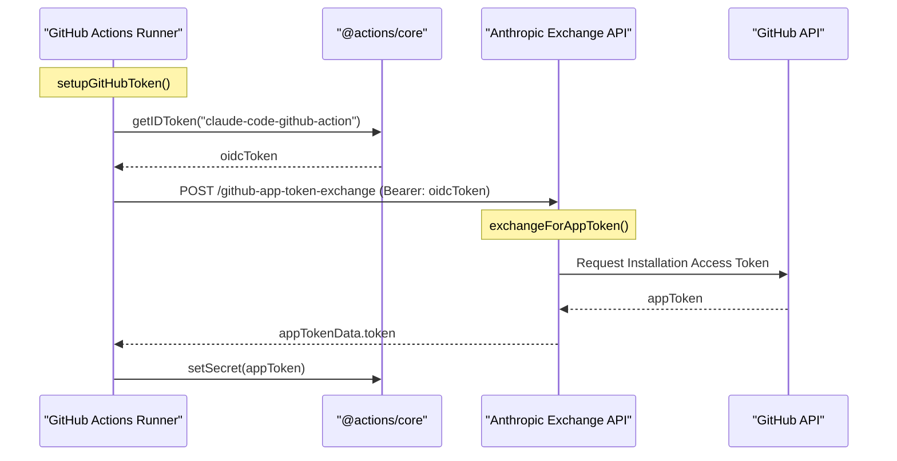

### Implementation Details
- **`getOidcToken()`**: Fetches the OIDC token from the GitHub environment using `core.getIDToken`. Requires `id-token: write` permission in the workflow. [src/github/token.ts:56-67]()
- **`exchangeForAppToken()`**: Sends the OIDC token to `https://api.anthropic.com/api/github/github-app-token-exchange` to receive a short-lived GitHub App token. It optionally includes requested `permissions`. [src/github/token.ts:103-156]()
- **`setupGitHubToken()`**: Orchestrates the flow, including `retryWithBackoff` and handling `WorkflowValidationSkipError`. [src/github/token.ts:158-185]()

### Workflow Validation Handling
If the token exchange fails with `workflow_not_found_on_default_branch` or "workflow validation failed", the system throws a `WorkflowValidationSkipError`. This typically happens when the action is first added to a repository on a non-default branch. The action will log a warning and skip execution rather than failing the build. [src/github/token.ts:24-54](), [src/github/token.ts:129-136]()

**Sources:** [src/github/token.ts:1-185](), [docs/faq.md:19-29]()

## Permissions and Scoping

When requesting an App token, the action passes requested permissions to the exchange API.

### Default Permissions
The action requests the following by default via `DEFAULT_PERMISSIONS`:
- `contents: write`
- `pull_requests: write`
- `issues: write`

**Sources:** [src/github/token.ts:69-73]()

### Additional Permissions
Users can request extra permissions (e.g., `actions: read` for CI log analysis) via the `additional_permissions` input. The `parseAdditionalPermissions` function merges these with the defaults. [src/github/token.ts:75-101]()

```yaml
with:
  additional_permissions: |
    actions: read
    checks: read
```

**Sources:** [docs/configuration.md:110-146](), [test/parse-permissions.test.ts:34-54]()

---

# Page: Architecture

# Architecture

<details>
<summary>Relevant source files</summary>

The following files were used as context for generating this wiki page:

- [action.yml](action.yml)
- [base-action/action.yml](base-action/action.yml)
- [base-action/bun.lock](base-action/bun.lock)
- [base-action/package.json](base-action/package.json)
- [bun.lock](bun.lock)
- [package.json](package.json)

</details>


## Purpose and Scope

This document provides a technical overview of the `claude-code-action` system architecture, including its dual-layer component design, execution phases, and major subsystems. This page covers the high-level architectural decisions and component relationships for developers and maintainers.

For detailed information on specific subsystems, see:
- [Dual-Action Architecture](#4.1) — Relationship between main and base actions.
- [Mode System Architecture](#4.2) — Tag vs agent mode detection and preparation.
- [MCP Integration Architecture](#4.3) — Model Context Protocol server configuration and tool permissions.
- [Prompt Generation Pipeline](#4.4) — Context-to-prompt transformation.
- [Execution Pipeline](#4.5) — Detailed phase-by-phase execution flow and cleanup guarantees.

## System Overview

The `claude-code-action` is a GitHub Actions integration that enables Claude AI to interact with GitHub repositories through two execution paradigms: **tag mode** (interactive, triggered by `@claude` mentions) and **agent mode** (automated, triggered by explicit prompts). The system uses a dual-layer architecture where the main action ([action.yml:1-156]()) handles GitHub-specific orchestration and delegates core Claude execution to a standalone base action ([base-action/action.yml:1-108]()).

The architecture consists of five major subsystems:

1.  **Event Processing & Validation**: Parses GitHub events, validates permissions, and detects triggers.
2.  **Mode Detection & Preparation**: Determines execution mode and prepares context/prompts.
3.  **Authentication Management**: Handles OIDC token exchange and multi-provider auth (Anthropic, Bedrock, Vertex, Foundry).
4.  **Claude Execution**: Runs Claude CLI with MCP tool integration.
5.  **Cleanup & Reporting**: Updates tracking comments and generates step summaries.

Sources: [action.yml:1-156](), [base-action/action.yml:1-108](), [src/entrypoints/run.ts:139-316]()

## Component Hierarchy

The system is structured as a hierarchical component architecture where the main action orchestrates GitHub integration while the base action focuses solely on Claude CLI execution.

### Architecture: Bridge from Natural Language to Code Entities

```mermaid
graph TB
    subgraph "Main Action Layer (claude-code-action)"
        ActionYML["action.yml<br/>(Main Entrypoint)"]
        RunTS["src/entrypoints/run.ts<br/>(Unified Orchestrator)"]
        
        subgraph "GitHub Integration"
            Token["src/github/token.ts<br/>(setupGitHubToken)"]
            Perms["src/github/validation/permissions.ts<br/>(checkWritePermissions)"]
            Context["src/github/context.ts<br/>(parseGitHubContext)"]
            Trigger["src/github/validation/trigger.ts<br/>(checkContainsTrigger)"]
        end
        
        subgraph "Mode Subsystem"
            Detector["src/modes/detector.ts<br/>(detectMode)"]
            TagMode["src/modes/tag/index.ts<br/>(prepareTagMode)"]
            AgentMode["src/modes/agent/index.ts<br/>(prepareAgentMode)"]
        end
        
        subgraph "Support Utilities"
            UpdateComment["src/entrypoints/update-comment-link.ts<br/>(updateCommentLink)"]
            FormatTurns["src/entrypoints/format-turns.ts<br/>(formatTurnsFromData)"]
        end
    end
    
    subgraph "Base Action Layer (claude-code-base-action)"
        BaseActionYML["base-action/action.yml<br/>(Standalone Entrypoint)"]
        
        subgraph "Claude Execution Core"
            ValidateEnv["base-action/src/validate-env.ts<br/>(validateEnvironmentVariables)"]
            SetupSettings["base-action/src/setup-claude-code-settings.ts<br/>(setupClaudeCodeSettings)"]
            InstallPlugins["base-action/src/install-plugins.ts<br/>(installPlugins)"]
            PreparePrompt["base-action/src/prepare-prompt.ts<br/>(preparePrompt)"]
            RunClaude["base-action/src/run-claude.ts<br/>(runClaude)"]
        end
    end
    
    ActionYML --> RunTS
    RunTS --> Token
    RunTS --> Perms
    RunTS --> Context
    RunTS --> Trigger
    RunTS --> Detector
    Detector --> TagMode
    Detector --> AgentMode
    RunTS --> UpdateComment
    RunTS --> FormatTurns
    
    RunTS -.->|"direct function imports"| ValidateEnv
    RunTS -.->|"direct function imports"| SetupSettings
    RunTS -.->|"direct function imports"| InstallPlugins
    RunTS -.->|"direct function imports"| PreparePrompt
    RunTS -.->|"direct function imports"| RunClaude
    
    BaseActionYML -.->|"invokes"| IndexTS["base-action/src/index.ts"]
    IndexTS --> ValidateEnv
    IndexTS --> SetupSettings
    IndexTS --> InstallPlugins
    IndexTS --> PreparePrompt
    IndexTS --> RunClaude
```

**Key Architectural Pattern**: The main action imports base action functions directly ([src/entrypoints/run.ts:37-41]()) rather than spawning a subprocess. This enables shared state, unified error handling, and a single process lifecycle for cleanup operations.

Sources: [src/entrypoints/run.ts:14-42](), [action.yml:152-161](), [base-action/action.yml:109-161]()

## Execution Phases

The system executes in four distinct phases with specific error handling boundaries, orchestrated by the `run()` function in `src/entrypoints/run.ts`.

### Execution Flow: Phase-by-Phase

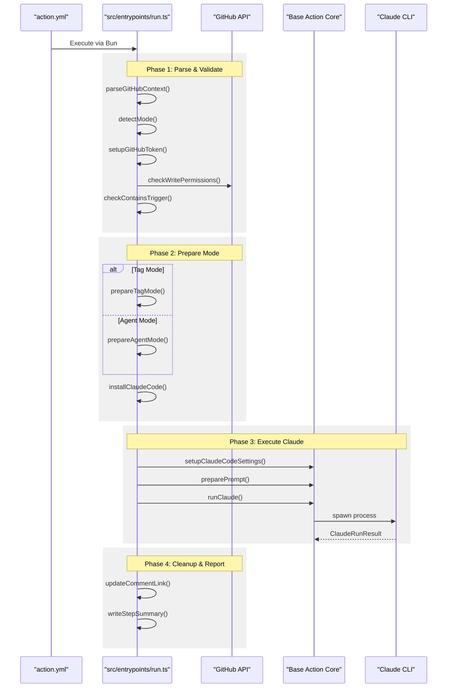

**Error Attribution Mechanism**: The orchestrator uses a `prepareCompleted` flag ([src/entrypoints/run.ts:151]()) to distinguish between preparation failures (Phases 1-2) and execution failures (Phase 3). This allows the system to provide more accurate feedback in tracking comments and summaries.

Sources: [src/entrypoints/run.ts:139-316](), [src/entrypoints/run.ts:47-107]() (installClaudeCode), [src/entrypoints/run.ts:112-137]() (writeStepSummary)

## Component Responsibilities

| Component | Primary Responsibilities | Key Functions/Files |
|-----------|-------------------------|---------------------|
| **action.yml** | Entry point, input definitions, environment mapping, and composite run steps. | [action.yml:1-295]() |
| **run.ts** | Main orchestrator, phase coordination, error handling, and output management. | [src/entrypoints/run.ts:139-316]() |
| **GitHub Integration** | Token exchange, permission validation, event parsing, and trigger detection. | [src/github/token.ts](), [src/github/validation/permissions.ts](), [src/github/context.ts](), [src/github/validation/trigger.ts]() |
| **Mode System** | Auto-detection of Tag vs Agent mode and preparation of mode-specific prompts. | [src/modes/detector.ts](), [src/modes/tag/index.ts](), [src/modes/agent/index.ts]() |
| **Base Action** | Claude settings configuration, plugin installation, and CLI invocation. | [base-action/src/index.ts](), [base-action/src/run-claude.ts]() |
| **Reporting** | Formatting Claude's execution turns into GitHub Step Summaries. | [src/entrypoints/format-turns.ts](), [src/entrypoints/run.ts:112-137]() |

Sources: [src/entrypoints/run.ts:14-42](), [action.yml:7-139](), [base-action/action.yml:7-94]()

## Key Architectural Decisions

### 1. Dual-Layer Design
The repository maintains two actions: the feature-rich `claude-code-action` and the minimal `claude-code-base-action`. The main action handles GitHub context and interactive features, while the base action provides a clean interface for running Claude in any workflow. For details, see [Dual-Action Architecture](#4.1).

### 2. Mode Auto-Detection
The system uses `detectMode` ([src/modes/detector.ts]()) to automatically switch between **Tag Mode** (interactive) and **Agent Mode** (automated) based on whether a `prompt` input is provided or a GitHub event trigger (like an `@claude` mention) is detected. For details, see [Mode System Architecture](#4.2).

### 3. MCP-Based Tool Access
Claude interacts with the GitHub environment via the Model Context Protocol (MCP). The action dynamically configures MCP servers for tasks like file operations, commenting, and CI status checks. For details, see [MCP Integration Architecture](#4.3).

### 4. File-Based Prompt Communication
To avoid command-line length limits and handle large GitHub contexts (especially in Tag Mode), the action writes prompts to temporary files before execution using `preparePrompt` ([base-action/src/prepare-prompt.ts]()). For details, see [Prompt Generation Pipeline](#4.4).

### 5. Robust Installation & Cleanup
The `installClaudeCode` function ([src/entrypoints/run.ts:47-107]()) includes retry logic and timeout handling for the Claude CLI installation. A `finally` block in the orchestrator ensures that tracking comments are updated and summaries are written regardless of execution success. For details, see [Execution Pipeline](#4.5).

Sources: [src/entrypoints/run.ts:153-159](), [src/entrypoints/run.ts:228-234](), [src/entrypoints/run.ts:47-107](), [src/entrypoints/run.ts:260-311]()

---

# Page: Dual-Action Architecture

# Dual-Action Architecture

<details>
<summary>Relevant source files</summary>

The following files were used as context for generating this wiki page:

- [.github/workflows/sync-base-action.yml](.github/workflows/sync-base-action.yml)
- [action.yml](action.yml)
- [base-action/MIRROR_DISCLAIMER.md](base-action/MIRROR_DISCLAIMER.md)
- [base-action/README.md](base-action/README.md)
- [base-action/action.yml](base-action/action.yml)
- [base-action/bun.lock](base-action/bun.lock)
- [base-action/package.json](base-action/package.json)
- [base-action/src/setup-claude-code-settings.ts](base-action/src/setup-claude-code-settings.ts)
- [base-action/test/setup-claude-code-settings.test.ts](base-action/test/setup-claude-code-settings.test.ts)

</details>


This document explains the two-layer architecture that separates GitHub automation concerns (main action) from Claude Code execution concerns (base action). For execution flow details, see [Execution Pipeline](). For mode-specific preparation logic, see [Mode System Architecture]().

## Overview

The repository contains two GitHub Actions that work together but can also operate independently:

1.  **Main action** (`claude-code-action`) - A GitHub-aware orchestrator that handles events, permissions, mode detection, and GitHub API integration. It is defined in the root [action.yml:1-205]().
2.  **Base action** (`claude-code-base-action`) - A standalone Claude Code executor with minimal dependencies, located in the `base-action/` directory. It is defined in [base-action/action.yml:1-216]().

The separation serves three architectural goals:
*   **Reusability**: Users can call `base-action` directly for simple Claude Code execution without GitHub integration overhead.
*   **Maintainability**: Clear responsibility boundaries between GitHub logic (main) and execution logic (base).
*   **Distribution**: The base action is synchronized to a separate mirror repository via an automated workflow [/.github/workflows/sync-base-action.yml:1-99]().

### Architectural Relationship Diagram

```mermaid
graph TB
    subgraph "User Workflows"
        SimpleUser["Simple workflow:<br/>Run Claude with prompt"]
        ComplexUser["Complex workflow:<br/>@claude mentions on PRs"]
    end
    
    subgraph "Main Action: claude-code-action"
        ActionYML["action.yml<br/>GitHub Actions interface"]
        
        subgraph "GitHub Integration Layer"
            Context["parseGitHubContext<br/>Event parsing"]
            Perms["checkWritePermissions<br/>Access control"]
            Mode["detectMode<br/>tag vs agent"]
            TagPrep["prepareTagMode<br/>Fetch GitHub data"]
        end
    end
    
    subgraph "Base Action: claude-code-base-action"
        BaseYML["base-action/action.yml<br/>GitHub Actions interface"]
        
        subgraph "Execution Layer"
            SetupSettings["setupClaudeCodeSettings<br/>Config file"]
            InstallClaude["Install Claude Code<br/>curl install.sh"]
            RunClaude["run_claude step<br/>CLI invocation"]
        end
    end
    
    SimpleUser -->|"uses: base-action"| BaseYML
    ComplexUser -->|"uses: main action"| ActionYML
    
    ActionYML --> Context
    ActionYML --> Perms
    ActionYML --> Mode
    Mode --> TagPrep
    
    ActionYML -.->|"Invokes via composite"| BaseYML
    
    BaseYML --> SetupSettings
    BaseYML --> InstallClaude
    BaseYML --> RunClaude
```

**Sources:** [action.yml:1-205](), [base-action/action.yml:1-216](), [/.github/workflows/sync-base-action.yml:1-99]()

## Design Rationale

### Why Two Actions?

The dual-action architecture emerged from competing requirements:

1.  **Simple use case**: Users who want to run Claude Code with a prompt in GitHub Actions should not need to understand GitHub event parsing or permission validation.
2.  **Complex use case**: Users who want `@claude` mentions on PRs need sophisticated GitHub integration (comment tracking, branch management, diff fetching).
3.  **Mirroring**: The `base-action` directory is mirrored to `anthropics/claude-code-base-action` to allow users to pin to a specialized, lightweight version of the tool [/.github/workflows/sync-base-action.yml:43-43]().

### Runtime and Dependencies

The `base-action` uses `Bun` as its primary runtime and package manager [base-action/package.json:8-10](). It relies on the `@anthropic-ai/claude-agent-sdk` for the core interaction with Claude [base-action/package.json:14-14](). By default, it uses Node.js `18.x` [base-action/action.yml:115-115]() and Bun `1.3.14` [base-action/action.yml:123-123]().

**Sources:** [base-action/package.json:1-24](), [base-action/action.yml:109-135]()

## Responsibility Boundaries

### Main Action Responsibilities
The main action (`claude-code-action`) acts as the "brain" for GitHub interactions, handling trigger detection and context gathering.

```mermaid
graph TB
    MainAction["Main Action:<br/>claude-code-action"]
    
    subgraph "GitHub Integration"
        EventParsing["Event Parsing:<br/>parseGitHubContext"]
        PermValidation["Permission Validation:<br/>checkWritePermissions"]
        BranchOps["Branch Management:<br/>setupBranch"]
    end
    
    subgraph "Trigger System"
        TriggerCheck["Trigger Detection:<br/>checkContainsTrigger"]
        ModeDetect["Mode Detection:<br/>detectMode"]
    end
    
    MainAction --> EventParsing
    MainAction --> PermValidation
    MainAction --> TriggerCheck
    MainAction --> ModeDetect
```

### Base Action Responsibilities
The base action (`claude-code-base-action`) is the "executor" responsible for environment setup and CLI invocation.

```mermaid
graph TB
    BaseAction["Base Action:<br/>claude-code-base-action"]
    
    subgraph "Environment Setup"
        SetupSettings["setupClaudeCodeSettings:<br/>Write settings.json"]
        InstallBun["Install Bun:<br/>setup-bun"]
        InstallClaude["Install Claude Code:<br/>curl install.sh"]
    end
    
    subgraph "Claude Execution"
        RunClaude["run_claude step:<br/>Spawn Claude Code CLI"]
        PluginMgmt["Plugin Installation:<br/>install-plugins.ts"]
    end
    
    BaseAction --> InstallBun
    BaseAction --> SetupSettings
    BaseAction --> InstallClaude
    BaseAction --> RunClaude
```

**Key Boundary Rules:**

| Concern | Owner | Implementation |
| :--- | :--- | :--- |
| **GitHub Context** | Main Action | Parsed from `github.event` [action.yml:1-55]() |
| **Claude Installation** | Base Action | Installs specific version (e.g., `2.1.209`) [base-action/action.yml:148-148]() |
| **Settings Management** | Base Action | Merges JSON and enforces `enableAllProjectMcpServers` [base-action/src/setup-claude-code-settings.ts:5-68]() |
| **CLI Arguments** | Shared | Main generates them; Base passes them to CLI [base-action/action.yml:23-26]() |

**Sources:** [action.yml:1-205](), [base-action/action.yml:1-216](), [base-action/src/setup-claude-code-settings.ts:5-68]()

## Communication Interface

The two actions communicate through environment variables and a shared file system (typically `RUNNER_TEMP`).

### Input Mapping
The `base-action` exposes a subset of inputs specifically for Claude execution:
*   `prompt` and `prompt_file` [base-action/action.yml:9-16]()
*   `claude_args` [base-action/action.yml:23-26]()
*   `anthropic_api_key`, `claude_code_oauth_token` [base-action/action.yml:29-36]()
*   Cloud provider flags (`use_bedrock`, `use_vertex`, `use_foundry`) [base-action/action.yml:57-68]()
*   Workload Identity Federation parameters [base-action/action.yml:37-56]()

### Sync Mechanism
The `base-action` directory is synchronized to the `claude-code-base-action` repository whenever changes are pushed to `main` in the `base-action/**` path [/.github/workflows/sync-base-action.yml:3-8](). 

The sync process:
1.  Clones the target repository [/.github/workflows/sync-base-action.yml:43-43]().
2.  Removes existing files (except `.git`) [/.github/workflows/sync-base-action.yml:54-54]().
3.  Copies contents from the `base-action/` directory [/.github/workflows/sync-base-action.yml:57-57]().
4.  Prepends a mirror disclaimer to the `README.md` [/.github/workflows/sync-base-action.yml:59-63]().

**Sources:** [/.github/workflows/sync-base-action.yml:1-99](), [base-action/MIRROR_DISCLAIMER.md:1-12]()

## Settings Configuration
The function `setupClaudeCodeSettings` in the base action ensures that the environment is correctly configured before Claude runs. It creates the `.claude/` directory [base-action/src/setup-claude-code-settings.ts:15-15](), merges provided JSON settings [base-action/src/setup-claude-code-settings.ts:58-58](), and forces `enableAllProjectMcpServers` to `true` to ensure MCP tools are available in CI [base-action/src/setup-claude-code-settings.ts:63-63]().

**Sources:** [base-action/src/setup-claude-code-settings.ts:5-68](), [base-action/test/setup-claude-code-settings.test.ts:30-37]()

---

# Page: Mode System Architecture

# Mode System Architecture

<details>
<summary>Relevant source files</summary>

The following files were used as context for generating this wiki page:

- [src/modes/agent/index.ts](src/modes/agent/index.ts)
- [src/modes/agent/parse-tools.ts](src/modes/agent/parse-tools.ts)
- [src/modes/detector.ts](src/modes/detector.ts)
- [src/modes/tag/index.ts](src/modes/tag/index.ts)
- [test/modes/agent.test.ts](test/modes/agent.test.ts)
- [test/modes/parse-tools.test.ts](test/modes/parse-tools.test.ts)

</details>


## Purpose and Scope

This document details the mode system architecture, which determines how the action executes based on workflow configuration and event context. The system automatically detects between two execution modes—**tag mode** and **agent mode**—and prepares distinct execution pathways for each.

The architecture is centered around the `prepare.ts` entrypoint, which orchestrates detection and preparation before passing control to the main execution phase.

## Mode Detection System

Mode detection occurs early in the execution pipeline via the `detectMode()` function in [src/modes/detector.ts:14-81](). The detection logic is deterministic and based on the event context and input parameters like `prompt` and `track_progress`.

### Detection Logic Flow

```mermaid
graph TB
    Start["parseGitHubContext()"]
    Detect["detectMode(context)"]
    
    subgraph Logic["detectMode Logic"]
        TrackCheck{"track_progress<br/>enabled?"}
        EntityCheck{"isEntityContext?"}
        PromptCheck{"context.inputs.prompt<br/>exists?"}
        TriggerCheck{"checkContainsTrigger?"}
    end

    Start --> Detect
    Detect --> TrackCheck
    
    TrackCheck -->|"Yes"| EntityCheck
    EntityCheck -->|"Yes"| TagMode["return 'tag'"]
    
    TrackCheck -->|"No"| PromptCheck
    PromptCheck -->|"Yes"| AgentMode["return 'agent'"]
    PromptCheck -->|"No"| TriggerCheck
    
    TriggerCheck -->|"Yes"| TagMode
    TriggerCheck -->|"No"| DefaultAgent["return 'agent'"]
```

**Detection Rules**

| Condition | Mode | Use Case |
|-----------|------|----------|
| `track_progress: true` on PR/Issue events | `tag` | Forced interactive mode for progress tracking [src/modes/detector.ts:21-31]() |
| `prompt` input provided | `agent` | Automation workflows with explicit instructions [src/modes/detector.ts:41-43](), [src/modes/detector.ts:54-56](), [src/modes/detector.ts:73-75]() |
| `@claude` mention, label, or assignee found | `tag` | Standard interactive UI-driven workflow [src/modes/detector.ts:45-47](), [src/modes/detector.ts:58-60]() |
| No prompt and no trigger | `agent` | Default state (will skip execution) [src/modes/detector.ts:80]() |

**Sources:** [src/modes/detector.ts:14-81]()

## Mode Dispatching

Once detected, the `prepare.ts` entrypoint dispatches to the specific preparation logic for that mode.

```mermaid
graph LR
    PrepareTS["prepare.ts"]
    ModeName["modeName: 'tag' | 'agent'"]
    Dispatch{"modeName"}
    TagPrep["prepareTagMode()<br/>src/modes/tag/index.ts"]
    AgentPrep["prepareAgentMode()<br/>src/modes/agent/index.ts"]
    
    PrepareTS --> ModeName
    ModeName --> Dispatch
    Dispatch -->|"'tag'"| TagPrep
    Dispatch -->|"'agent'"| AgentPrep
```

**Sources:** [src/modes/tag/index.ts:27-35](), [src/modes/agent/index.ts:19-27]()

## Tag Mode Architecture

Tag mode is designed for **human-AI interaction** within GitHub's UI. It responds to `@claude` mentions, issue assignments, or label additions. The preparation pathway is complex and GitHub-centric, focusing on building a rich context from the existing thread.

### Tag Mode Preparation Flow

```mermaid
sequenceDiagram
    participant prepare.ts
    participant prepareTagMode
    participant checkHumanActor
    participant createInitialComment
    participant fetchGitHubData
    participant setupBranch
    
    prepare.ts->>prepareTagMode: context, octokit, githubToken
    
    prepareTagMode->>checkHumanActor: Prevent bot loops
    checkHumanActor-->>prepareTagMode: Validated
    
    prepareTagMode->>createInitialComment: Create "Claude is working..." UI
    createInitialComment-->>prepareTagMode: commentId
    
    prepareTagMode->>fetchGitHubData: Fetch PR/Issue data via GraphQL
    Note over fetchGitHubData: Comments, diffs, reviews
    fetchGitHubData-->>prepareTagMode: githubData
    
    prepareTagMode->>setupBranch: Determine branch strategy
    Note over setupBranch: PR: checkout branch<br/>Issue: create new branch
    setupBranch-->>prepareTagMode: branchInfo
    
    prepareTagMode-->>prepare.ts: commentId, branchInfo, claudeArgs
```

### Tag Mode Tool Selection
Tag mode automatically configures a prescriptive set of tools for the Claude CLI, including:
- **File System**: `Glob`, `Grep`, `LS`, `Read` [src/modes/tag/index.ts:124-127]().
- **GitHub MCP**: `update_claude_comment`, `get_ci_status`, `get_workflow_run_details`, `download_job_log` [src/modes/tag/index.ts:128-131]().
- **Git Operations**: Bash wrappers for `git add`, `commit`, `push`, and `rm` if not using API signing [src/modes/tag/index.ts:137-143]().

**Sources:** [src/modes/tag/index.ts:27-188]()

## Agent Mode Architecture

Agent mode is designed for **headless automation workflows**. It bypasses GitHub UI integration (no tracking comments) and runs directly from workflow configuration prompts.

### Agent Mode Preparation Flow

```mermaid
sequenceDiagram
    participant prepare.ts
    participant prepareAgentMode
    participant checkHumanActor
    participant writeFile
    participant prepareMcpConfig
    
    prepare.ts->>prepareAgentMode: context, octokit, githubToken
    
    prepareAgentMode->>checkHumanActor: Prevent bot loops
    checkHumanActor-->>prepareAgentMode: Validated
    
    prepareAgentMode->>writeFile: Write prompt to disk
    Note over writeFile: context.inputs.prompt<br/>→ claude-prompt.txt
    
    prepareAgentMode->>prepareMcpConfig: Configure MCP servers
    Note over prepareMcpConfig: Based on tools in CLAUDE_ARGS
    prepareMcpConfig-->>prepareAgentMode: mcpConfig
    
    prepareAgentMode-->>prepare.ts: undefined commentId, branchInfo, claudeArgs
```

### Tool Parsing Logic
Agent mode relies on `parseAllowedTools` to extract tool requirements from the `CLAUDE_ARGS` environment variable. This ensures the action only installs the MCP servers actually requested by the user [src/modes/agent/parse-tools.ts:52-81](). It supports:
- Multiple flags (`--allowedTools`, `--allowed-tools`) [src/modes/agent/parse-tools.ts:5-6]().
- Comment stripping to match CLI behavior [src/modes/agent/parse-tools.ts:12-17]().
- Consecutive non-flag values [src/modes/agent/parse-tools.ts:68-77]().

**Sources:** [src/modes/agent/index.ts:19-133](), [src/modes/agent/parse-tools.ts:52-81]()

## Convergence Points

Despite different preparation pathways, both modes converge on several critical infrastructure setups.

### Shared Git Authentication

Both modes use `configureGitAuth` and `setupSshSigning` to configure credentials.

```mermaid
graph TB
    Auth["prepareAgentMode / prepareTagMode"]
    SshCheck{"SSH Key provided?"}
    SshSetup["setupSshSigning()"]
    GitAuth["configureGitAuth()"]
    ApiSignCheck{"useApiCommitSigning?"}
    ApiSign["API Commit Signing<br/>(Uses MCP tools)"]

    Auth --> SshCheck
    SshCheck -->|"Yes"| SshSetup
    SshSetup --> GitAuth
    SshCheck -->|"No"| ApiSignCheck
    ApiSignCheck -->|"Yes"| ApiSign
    ApiSignCheck -->|"No"| GitAuth
```

**Sources:** [src/modes/agent/index.ts:33-65](), [src/modes/tag/index.ts:69-101]()

### Unified MCP Configuration

Both modes utilize `prepareMcpConfig` to generate the JSON configuration for the Claude CLI [src/mcp/install-mcp-server:8]().

```typescript
// Shared call pattern in both modes
const ourMcpConfig = await prepareMcpConfig({
  githubToken,
  owner: context.repository.owner,
  repo: context.repository.repo,
  branch: currentBranch,
  baseBranch: baseBranch,
  claudeCommentId: commentId, // undefined for agent mode
  allowedTools,
  mode: "agent", // or "tag"
  context,
});
```

**Sources:** [src/modes/agent/index.ts:98-108](), [src/modes/tag/index.ts:153-163]()

## Mode Output Comparison

The preparation phase ends by returning an object that defines the execution environment.

| Output Field | Tag Mode Value | Agent Mode Value |
|--------------|----------------|------------------|
| `commentId` | ID of tracking comment [src/modes/tag/index.ts:46]() | `undefined` [src/modes/agent/index.ts:124]() |
| `claudeArgs` | Prescriptive tools + `--permission-mode acceptEdits` [src/modes/tag/index.ts:175]() | User-provided `CLAUDE_ARGS` [src/modes/agent/index.ts:121]() |
| `branchInfo` | Determined by `setupBranch()` [src/modes/tag/index.ts:66]() | Detected from environment/inputs [src/modes/agent/index.ts:125-129]() |
| `mcpConfig` | Generated JSON string [src/modes/tag/index.ts:185]() | Generated JSON string [src/modes/agent/index.ts:130]() |

**Sources:** [src/modes/agent/index.ts:123-132](), [src/modes/tag/index.ts:182-187]()

---

# Page: MCP Integration Architecture

# MCP Integration Architecture

<details>
<summary>Relevant source files</summary>

The following files were used as context for generating this wiki page:

- [src/github/operations/branch-cleanup.ts](src/github/operations/branch-cleanup.ts)
- [src/mcp/github-actions-server.ts](src/mcp/github-actions-server.ts)
- [src/mcp/github-file-ops-server.ts](src/mcp/github-file-ops-server.ts)
- [src/mcp/github-inline-comment-server.ts](src/mcp/github-inline-comment-server.ts)
- [src/mcp/inline-comment-buffer.ts](src/mcp/inline-comment-buffer.ts)
- [src/mcp/install-mcp-server.ts](src/mcp/install-mcp-server.ts)
- [test/branch-cleanup.test.ts](test/branch-cleanup.test.ts)
- [test/comment-logic.test.ts](test/comment-logic.test.ts)
- [test/inline-comment-buffer.test.ts](test/inline-comment-buffer.test.ts)
- [test/install-mcp-server.test.ts](test/install-mcp-server.test.ts)

</details>


## Purpose and Scope

This document details the Model Context Protocol (MCP) server system used by `claude-code-action` to provide Claude with structured, secure access to GitHub APIs. It covers:

- The five built-in MCP servers and their purposes.
- Dynamic server configuration based on mode and permissions.
- Tool access control and allowlisting mechanisms.
- Execution strategies (local Bun vs. Docker).
- Permission checking and buffering logic for inline comments.

For information about how execution modes (tag vs agent) affect MCP configuration, see [Mode System Architecture (4.2)](). For details on how tool configurations are passed to Claude, see [Prompt Generation Pipeline (4.4)]().

## Overview

The action uses MCP (Model Context Protocol) servers as an abstraction layer between Claude and GitHub's APIs. Rather than giving Claude direct API credentials for every request, each MCP server provides a specific set of tools with scoped permissions.

The configuration is generated dynamically by the `prepareMcpConfig` function [src/mcp/install-mcp-server.ts:52-54]() based on the execution mode, GitHub event type, and requested permissions.

**Sources**: [src/mcp/install-mcp-server.ts:52-230]()

## MCP Server Inventory

The action manages five MCP servers, each serving a distinct purpose:

| Server Name | Command | Purpose | Primary Tools | Inclusion Conditions |
|-------------|---------|---------|---------------|---------------------|
| `github_comment` | `bun` | Update tracking comments in issues/PRs | `update_claude_comment` | Tag mode always; agent mode only with explicit tools [src/mcp/install-mcp-server.ts:95-97]() |
| `github_file_ops` | `bun` | Commit files via GitHub API | `commit_files` | Only when `useCommitSigning=true` [src/mcp/install-mcp-server.ts:116-117]() |
| `github_inline_comment` | `bun` | Create PR review comments | `create_inline_comment` | Only for PRs when GitHub tools allowed [src/mcp/install-mcp-server.ts:138-142]() |
| `github_ci` | `bun` | Fetch CI/workflow status | `get_ci_status`, `get_workflow_run_details` | PRs with workflow token and `actions:read` [src/mcp/install-mcp-server.ts:166-170]() |
| `github` | `docker` | Comprehensive GitHub API access | Full GitHub API via Docker | When `mcp__github__*` tools allowed [src/mcp/install-mcp-server.ts:206-207]() |

**Sources**: [src/mcp/install-mcp-server.ts:88-224]()

## Configuration Generation Process

### prepareMcpConfig Function Flow

```mermaid
flowchart TD
    Start["prepareMcpConfig(params)"]
    Start --> ParseParams["Extract parameters:<br/>- githubToken<br/>- owner/repo<br/>- branch/baseBranch<br/>- allowedTools<br/>- mode<br/>- context"]
    
    ParseParams --> InitConfig["Initialize baseMcpConfig:<br/>{mcpServers: {}}"]
    
    InitConfig --> DetectMode{"mode === 'agent'?"}
    
    DetectMode -->|Yes| AgentMode["isAgentMode = true"]
    DetectMode -->|No| TagMode["isAgentMode = false"]
    
    AgentMode --> CheckComment
    TagMode --> CheckComment
    
    CheckComment["Check allowedTools for:<br/>- mcp__github_comment__*<br/>- mcp__github__*<br/>- mcp__github_inline_comment__*<br/>- mcp__github_ci__*"]
    
    CheckComment --> CommentServer{"shouldIncludeCommentServer?<br/>(!isAgentMode || hasGitHubCommentTools)"}
    
    CommentServer -->|Yes| AddComment["Add github_comment server:<br/>command: bun<br/>args: [github-comment-server.ts]<br/>env: {GITHUB_TOKEN, REPO_OWNER, etc}"]
    CommentServer -->|No| FileOpsCheck
    
    AddComment --> FileOpsCheck{"context.inputs.useCommitSigning?"}
    
    FileOpsCheck -->|Yes| AddFileOps["Add github_file_ops server:<br/>command: bun<br/>args: [github-file-ops-server.ts]<br/>env: {GITHUB_TOKEN, BRANCH_NAME, etc}"]
    FileOpsCheck -->|No| InlineCheck
    
    AddFileOps --> InlineCheck{"isEntityContext(context)<br/>&& context.isPR<br/>&& (hasGitHubMcpTools || hasInlineCommentTools)?"}
    
    InlineCheck -->|Yes| AddInline["Add github_inline_comment server:<br/>command: bun<br/>args: [github-inline-comment-server.ts]<br/>env: {GITHUB_TOKEN, PR_NUMBER, etc}"]
    InlineCheck -->|No| CICheck
    
    AddInline --> CICheck{"(!isAgentMode || hasGitHubCITools)<br/>&& isEntityContext(context)<br/>&& context.isPR<br/>&& hasWorkflowToken?"}
    
    CICheck -->|Yes| PermCheck["checkActionsReadPermission(token, owner, repo)"]
    CICheck -->|No| GitHubCheck
    
    PermCheck --> HasPerm{"Has actions:read?"}
    
    HasPerm -->|Yes| AddCI["Add github_ci server:<br/>command: bun<br/>args: [github-actions-server.ts]<br/>env: {GITHUB_TOKEN (workflow), etc}"]
    HasPerm -->|No| WarnCI["core.warning('CI server requires actions:read')"]
    
    AddCI --> GitHubCheck
    WarnCI --> GitHubCheck
    
    GitHubCheck{"hasGitHubMcpTools?"}
    
    GitHubCheck -->|Yes| AddGitHub["Add github server:<br/>command: docker<br/>image: ghcr.io/github/github-mcp-server<br/>env: {GITHUB_PERSONAL_ACCESS_TOKEN, etc}"]
    GitHubCheck -->|No| Return
    
    AddGitHub --> Return["Return JSON.stringify(baseMcpConfig)"]
```

**Sources**: [src/mcp/install-mcp-server.ts:52-230]()

## Server Implementation Details

### github_comment Server
**Implementation**: `src/mcp/github-comment-server.ts`
This server provides the `update_claude_comment` tool. It uses `updateClaudeComment` and applies `sanitizeContent` to the body before posting. It is used to provide progress updates in the GitHub issue or PR comment that triggered the action.

**Sources**: [src/mcp/github-comment-server.ts:98-112]()

### github_file_ops Server
**Implementation**: `src/mcp/github-file-ops-server.ts` [src/mcp/github-file-ops-server.ts:1-55]()
Provides the `commit_files` tool [src/mcp/github-file-ops-server.ts:196-197](). This server allows Claude to perform atomic commits via the GitHub Git Data API, which is essential when commit signing is enabled and local `git` CLI commits are restricted.
1. **Branch Management**: Uses `getOrCreateBranchRef` [src/mcp/github-file-ops-server.ts:58-63]() to ensure the target branch exists.
2. **Atomic Commits**: Resolves file modes via `getFileMode` [src/mcp/github-file-ops-server.ts:168]() and validates paths using `validatePathWithinRepo` [src/mcp/github-file-ops-server.ts:221]().

**Sources**: [src/mcp/github-file-ops-server.ts:1-225]()

### github_inline_comment Server
**Implementation**: `src/mcp/github-inline-comment-server.ts` [src/mcp/github-inline-comment-server.ts:1-35]()
Provides `create_inline_comment` [src/mcp/github-inline-comment-server.ts:37-38](). 
**Buffering Logic**: To prevent subagents from posting "test" comments, calls are buffered to `/tmp/inline-comments-buffer.jsonl` [src/mcp/github-inline-comment-server.ts:19]() unless `confirmed: true` is passed [src/mcp/github-inline-comment-server.ts:111-112](). 
**Deduplication**: When a comment is posted with `confirmed: true`, the server calls `removeBufferedComment` [src/mcp/github-inline-comment-server.ts:188-191]() to clean up any matching entries in the buffer, preventing duplicate posts during the post-execution cleanup phase.

**Sources**: [src/mcp/github-inline-comment-server.ts:1-192](), [src/mcp/inline-comment-buffer.ts:23-54]()

### github_ci Server
**Implementation**: `src/mcp/github-actions-server.ts` [src/mcp/github-actions-server.ts:1-26]()
Provides tools to query PR health and CI logs:
- `get_ci_status`: Summarizes workflow runs for the head SHA [src/mcp/github-actions-server.ts:30-32]().
- `get_workflow_run_details`: Lists jobs and identifies failed steps [src/mcp/github-actions-server.ts:137-139]().
- `download_job_log`: Downloads raw logs to `RUNNER_TEMP` [src/mcp/github-actions-server.ts:205-207]().

**Sources**: [src/mcp/github-actions-server.ts:1-211]()

## Security and Content Sanitization

All MCP servers that post content back to GitHub (comments, commits) utilize the `sanitizeContent` utility.

### Sanitization Pipeline
```mermaid
flowchart LR
    Raw["Raw Content"] --> HTML["stripHtmlComments"]
    HTML --> Invisible["stripInvisibleCharacters"]
    Invisible --> Markdown["stripMarkdownImageAltText<br/>stripMarkdownLinkTitles"]
    Markdown --> Redact["redactGitHubTokens"]
    Redact --> Safe["Sanitized Content"]
```

The `redactGitHubTokens` function specifically targets various GitHub token formats (PATs, OAuth, Installation tokens) to prevent accidental credential leakage in Claude's output.

**Sources**: [src/mcp/github-inline-comment-server.ts:102](), [src/mcp/github-file-ops-server.ts:231]()

## Branch and File Operations Integration

The MCP system interacts closely with the repository's branch state. The `checkAndCommitOrDeleteBranch` function [src/github/operations/branch-cleanup.ts:5]() is used during the cleanup phase to determine if a branch created for Claude's changes should be kept or deleted based on whether commits were actually made.

```mermaid
flowchart TD
    subgraph "Code Entity Space"
        MCP["McpServer (github_file_ops)"]
        Tool["commit_files tool"]
        Cleanup["checkAndCommitOrDeleteBranch"]
    end

    subgraph "Natural Language Space"
        UserReq["User Request: 'Fix bug and commit'"]
        Claude["Claude AI"]
    end

    UserReq --> Claude
    Claude -->|calls| Tool
    Tool -->|executes| MCP
    MCP -->|API Call| GH["GitHub Git Data API"]
    
    Cleanup -->|checks| GH
    Cleanup -->|if no commits| Delete["Delete Branch"]
```

**Sources**: [src/github/operations/branch-cleanup.ts:5-132](), [src/mcp/github-file-ops-server.ts:196-210]()

## Permission Verification

The `github_ci` server requires `actions:read` permission. The system verifies this using `checkActionsReadPermission` [src/mcp/install-mcp-server.ts:20]().

```typescript
// src/mcp/install-mcp-server.ts:20-50
async function checkActionsReadPermission(token: string, owner: string, repo: string): Promise<boolean> {
  try {
    const client = new Octokit({ auth: token, baseUrl: GITHUB_API_URL });
    await client.actions.listWorkflowRunsForRepo({ owner, repo, per_page: 1 });
    return true;
  } catch (error: any) {
    if (error.status === 403 && error.message?.includes("Resource not accessible")) {
      return false;
    }
    return false;
  }
}
```

If the check fails, the server is omitted from the configuration and a warning is logged [src/mcp/install-mcp-server.ts:180-186]().

**Sources**: [src/mcp/install-mcp-server.ts:20-50](), [src/mcp/install-mcp-server.ts:173-187]()

---

# Page: Prompt Generation Pipeline

# Prompt Generation Pipeline

<details>
<summary>Relevant source files</summary>

The following files were used as context for generating this wiki page:

- [src/create-prompt/index.ts](src/create-prompt/index.ts)
- [src/create-prompt/types.ts](src/create-prompt/types.ts)
- [src/github/api/queries/github.ts](src/github/api/queries/github.ts)
- [src/github/data/fetcher.ts](src/github/data/fetcher.ts)
- [src/github/data/formatter.ts](src/github/data/formatter.ts)
- [src/github/types.ts](src/github/types.ts)
- [test/create-prompt.test.ts](test/create-prompt.test.ts)
- [test/data-fetcher.test.ts](test/data-fetcher.test.ts)
- [test/data-formatter.test.ts](test/data-formatter.test.ts)
- [test/prepare-context.test.ts](test/prepare-context.test.ts)

</details>


## Overview

The prompt generation pipeline transforms GitHub event data and repository context into comprehensive prompts that instruct Claude on how to respond. This system handles two distinct workflows: **tag mode** (interactive, GitHub-driven) generates rich 8-section prompts with full context assembly, while **agent mode** (automation, prompt-driven) passes through user-provided prompts directly.

**Key Implementation Files:**
- [src/create-prompt/index.ts:1-981]() — Main prompt generation logic.
- [src/modes/tag/index.ts:104-111]() — Tag mode prompt creation call site.
- [src/create-prompt/types.ts:1-114]() — Type definitions for `PreparedContext` and `EventData`.

**Related Pages:** See page 4.2 for mode system architecture, page 4.3 for MCP tool configuration, and page 4.5 for the overall execution pipeline.

## Pipeline Architecture

The pipeline begins by fetching raw data from GitHub, normalizing it into a standard context object, and then branching based on the execution mode.

**Pipeline Flow Diagram**

```mermaid
graph TB
    Input["GitHub Event Data<br/>(ParsedGitHubContext)"]
    FetchData["fetchGitHubData()<br/>Get PR/Issue data"]
    PrepareCtx["prepareContext()<br/>Normalize to PreparedContext"]
    ToolBuild["buildAllowedToolsString()<br/>buildDisallowedToolsString()"]
    
    ModeCheck{"Mode?"}
    
    TagPrompt["generateDefaultPrompt()<br/>8-section structure"]
    AgentPrompt["Direct prompt<br/>from inputs.prompt"]
    
    ExtractReq["extractUserRequestFromContext()<br/>Slash command extraction"]
    
    WriteMain["Write<br/>claude-prompt.txt"]
    WriteReq["Write<br/>claude-user-request.txt"]
    
    Input --> FetchData
    FetchData --> PrepareCtx
    PrepareCtx --> ToolBuild
    PrepareCtx --> ModeCheck
    
    ModeCheck -->|"tag"| TagPrompt
    ModeCheck -->|"agent"| AgentPrompt
    
    TagPrompt --> ExtractReq
    AgentPrompt --> ExtractReq
    
    ExtractReq --> WriteMain
    ExtractReq --> WriteReq
```

**Sources:** [src/create-prompt/index.ts:899-981](), [src/modes/tag/index.ts:104-111](), [src/modes/tag/index.ts:27-35]()

## Context Normalization (`prepareContext`)

The `prepareContext` function normalizes disparate GitHub event payloads into a unified `PreparedContext` structure. This normalization layer decouples prompt generation from GitHub's event-specific payload schemas.

### PreparedContext Type Structure

**Type Hierarchy Diagram**

```mermaid
graph TB
    PreparedContext["PreparedContext<br/>(type)"]
    
    CommonFields["CommonFields<br/>- repository: string<br/>- claudeCommentId: string<br/>- triggerPhrase: string<br/>- triggerUsername?: string<br/>- prompt?: string<br/>- claudeBranch?: string"]
    
    EventData["EventData (discriminated union)"]
    
    GHContext["githubContext:<br/>ParsedGitHubContext"]
    
    EventVariants["Event Variants:<br/>- PullRequestReviewCommentEvent<br/>- PullRequestReviewEvent<br/>- IssueCommentEvent<br/>- IssueOpenedEvent<br/>- IssueAssignedEvent<br/>- IssueLabeledEvent<br/>- PullRequestEvent"]
    
    PreparedContext --> CommonFields
    PreparedContext --> EventData
    PreparedContext --> GHContext
    
    EventData --> EventVariants
```

**Sources:** [src/create-prompt/types.ts:1-114](), [src/create-prompt/index.ts:112-116]()

### Event-Specific Field Extraction

The function extracts different required and optional fields based on event type:

**Event Field Requirements Table**

| eventName | eventAction | Required Fields | Optional/Conditional Fields |
|-----------|-------------|----------------|----------------------------|
| `pull_request_review_comment` | - | `prNumber`, `commentBody` | `commentId`, `claudeBranch`, `baseBranch` |
| `pull_request_review` | - | `prNumber` | `commentBody`, `claudeBranch`, `baseBranch` |
| `issue_comment` (PR/Issue) | - | `commentId`, `commentBody` | `prNumber`, `issueNumber`, `claudeBranch`, `baseBranch` |
| `issues` | `opened` | `issueNumber`, `baseBranch`, `claudeBranch` | - |
| `issues` | `assigned` | `issueNumber`, `baseBranch`, `claudeBranch` | `assigneeTrigger` |
| `issues` | `labeled` | `issueNumber`, `baseBranch`, `claudeBranch` | `labelTrigger` |
| `pull_request` | any | `prNumber` | `eventAction`, `claudeBranch`, `baseBranch` |

**Sources:** [src/create-prompt/index.ts:156-331]()

## Data Fetching and Security

Before formatting the prompt, the system fetches detailed data using GraphQL queries (`PR_QUERY`, `ISSUE_QUERY`). To prevent race conditions and prompt injection, the `fetcher` implements several security checks.

### Time-Based Context Filtering
The `fetcher.ts` utility filters comments and reviews based on the trigger timestamp. This ensures Claude only sees content that existed when the authorized user issued the command.

- `filterCommentsToTriggerTime`: Excludes comments created or edited after the trigger event [src/github/data/fetcher.ts:109-135]().
- `isBodySafeToUse`: Validates that the PR/Issue body hasn't been modified after the trigger [src/github/data/fetcher.ts:177-200]().

**Sources:** [src/github/data/fetcher.ts:1-200](), [src/github/api/queries/github.ts:3-147]()

## Tool Configuration System

Tool configuration determines Claude's capabilities through allowlist and blocklist strings. The system dynamically constructs these based on mode, commit signing configuration, and user-provided tools.

### `buildAllowedToolsString` Implementation

This function assembles a comma-separated allowlist of tools. In tag mode, it intentionally omits `Edit`, `MultiEdit`, and `Write` because the action uses the `acceptEdits` permission mode, which auto-allows file edits inside `$GITHUB_WORKSPACE` while preventing writes to sensitive runner paths.

**Tool Assembly Logic**

```mermaid
graph TB
    Start["buildAllowedToolsString()"]
    
    Base["BASE_ALLOWED_TOOLS array:<br/>Glob, Grep, LS, Read"]
    
    Comment["Push:<br/>mcp__github_comment__update_claude_comment"]
    
    CommitCheck{"useCommitSigning?"}
    
    MCPCommit["Push MCP file operations:<br/>- mcp__github_file_ops__commit_files<br/>- mcp__github_file_ops__delete_files"]
    
    BashGit["Push Bash git patterns:<br/>- Bash(git add:*)<br/>- Bash(git commit:*)<br/>- Bash(git push wrapper:*)<br/>- Bash(git rm:*)"]
    
    ActionsCheck{"includeActionsTools?"}
    
    CITools["Push CI tools:<br/>- mcp__github_ci__get_ci_status<br/>- mcp__github_ci__get_workflow_run_details<br/>- mcp__github_ci__download_job_log"]
    
    Join["Join all with commas"]
    
    Custom{"customAllowedTools?"}
    
    Append["Append custom tools"]
    
    Return["Return complete string"]
    
    Start --> Base
    Base --> Comment
    Comment --> CommitCheck
    
    CommitCheck -->|true| MCPCommit
    CommitCheck -->|false| BashGit
    
    MCPCommit --> ActionsCheck
    BashGit --> ActionsCheck
    
    ActionsCheck -->|true| CITools
    ActionsCheck -->|false| Join
    
    CITools --> Join
    Join --> Custom
    
    Custom -->|yes| Append
    Custom -->|no| Return
    
    Append --> Return
```

**Sources:** [src/create-prompt/index.ts:34-77](), [src/modes/tag/index.ts:119-150]()

## Tag Mode Prompt Generation (8-Section Structure)

Tag mode generates comprehensive prompts following a structured template in `generateDefaultPrompt`.

### The 8 Sections in Detail

1.  **Header Context**: Role definition ("You are Claude, an AI assistant...") [src/create-prompt/index.ts:651-656]().
2.  **Entity Body**: Original issue/PR description wrapped in `<pr_or_issue_body>` [src/create-prompt/index.ts:657-660]().
3.  **Comments**: Chronological comment thread wrapped in `<comments>` [src/create-prompt/index.ts:662-664]().
4.  **Review Comments**: Inline code review comments wrapped in `<review_comments>` [src/create-prompt/index.ts:666-671]().
5.  **Changed Files**: File diffs with SHA verification wrapped in `<changed_files>` [src/create-prompt/index.ts:673-678]().
6.  **Event Metadata**: Structured tags like `<event_type>`, `<repository>`, and `<pr_number>` [src/create-prompt/index.ts:681-691]().
7.  **Trigger Comment**: The specific comment that invoked Claude, sanitized and wrapped in `<trigger_comment>` [src/create-prompt/index.ts:692-700]().
8.  **Task Instructions**: Comprehensive workflow guidance including the 5-step execution plan and commit instructions via `getCommitInstructions()` [src/create-prompt/index.ts:701-870]().

**Sources:** [src/create-prompt/index.ts:608-873]()

### Context Formatting and Sanitization

The `formatter.ts` module handles the transformation of raw GitHub data into the strings used in the 8 sections. It also handles image URL replacement to point to local paths downloaded by the action [src/github/data/formatter.ts:42-55]().

To prevent prompt injection and ensure safety, all GitHub content (titles, bodies, comments) is processed through `sanitizeContent` before inclusion in the prompt.

**Sources:** [src/github/data/formatter.ts:1-154](), [src/github/utils/sanitizer.ts:1-20]()

## User Request Extraction (`USER_REQUEST_FILENAME`)

The pipeline extracts the user's specific request to enable slash command processing in the Claude Code CLI.

**Extraction Logic:**
1.  `extractUserRequestFromContext` identifies the triggering text (e.g., from an issue comment or PR review) [src/create-prompt/index.ts:891-942]().
2.  `extractUserRequest` strips the trigger phrase (e.g., `@claude`) to isolate the command [src/utils/extract-user-request.ts:1-24]().
3.  If a request is found, it is written to a separate file defined by `USER_REQUEST_FILENAME` (`claude-user-request.txt`) [src/create-prompt/index.ts:29]().

This split allows the Claude CLI to distinguish between the background context (provided in the main prompt) and the immediate user command.

**Sources:** [src/create-prompt/index.ts:29](), [src/create-prompt/index.ts:891-942](), [src/utils/extract-user-request.ts:1-24]()

## File Output and Environment Variables

The `createPrompt` function coordinates the final output:

- **Directory**: Creates `${RUNNER_TEMP}/claude-prompts` [src/create-prompt/index.ts:948]().
- **Main Prompt**: Writes `claude-prompt.txt` [src/create-prompt/index.ts:953]().
- **User Request**: Writes `claude-user-request.txt` if a request was extracted [src/create-prompt/index.ts:957]().
- **Environment Variables**: Exports `ALLOWED_TOOLS`, `DISALLOWED_TOOLS`, and `INPUT_PROMPT_FILE` for the base action to use when invoking the Claude CLI [src/create-prompt/index.ts:965-979]().

**Sources:** [src/create-prompt/index.ts:944-979]()

---

# Page: Execution Pipeline

# Execution Pipeline

<details>
<summary>Relevant source files</summary>

The following files were used as context for generating this wiki page:

- [base-action/src/execution-file.ts](base-action/src/execution-file.ts)
- [base-action/src/index.ts](base-action/src/index.ts)
- [base-action/src/run-claude-sdk.ts](base-action/src/run-claude-sdk.ts)
- [base-action/src/run-claude.ts](base-action/src/run-claude.ts)
- [base-action/test/execution-file.test.ts](base-action/test/execution-file.test.ts)
- [base-action/test/run-claude-sdk.test.ts](base-action/test/run-claude-sdk.test.ts)
- [src/entrypoints/prepare.ts](src/entrypoints/prepare.ts)
- [src/entrypoints/run.ts](src/entrypoints/run.ts)
- [src/entrypoints/update-comment-link.ts](src/entrypoints/update-comment-link.ts)
- [src/github/operations/comment-logic.ts](src/github/operations/comment-logic.ts)
- [test/install-pipefail.test.ts](test/install-pipefail.test.ts)

</details>


This document describes the four-phase execution pipeline that orchestrates the entire Claude Code Action workflow. The pipeline ensures consistent behavior, proper resource cleanup, and clear error attribution across all execution modes.

For information about mode-specific behavior within the pipeline, see [Mode System Architecture](4.2). For MCP server configuration during execution, see [MCP Integration Architecture](4.3). For prompt generation that feeds into the execution phase, see [Prompt Generation Pipeline](4.4).

## Pipeline Overview

The Claude Code Action executes through four distinct phases: **Prepare**, **Install**, **Execute**, and **Cleanup**. The pipeline is implemented in [src/entrypoints/run.ts:162-315]() as the main `run()` function, which orchestrates all phases in a single TypeScript process.

Title: Four-Phase Execution Flow
```mermaid
graph TD
    Start["GitHub Action Triggered<br/>(action.yml)"]
    
    Start --> Phase1["Phase 1: Prepare<br/>run.ts:163-211"]
    
    subgraph "Prepare Phase"
        P1["collectActionInputsPresence()<br/>collect-inputs.ts"]
        P2["parseGitHubContext()<br/>context.ts"]
        P3["detectMode(context)<br/>detector.ts"]
        P4["setupGitHubToken()<br/>token.ts"]
        P5["createOctokit(token)<br/>client.ts"]
        P6["checkWritePermissions()<br/>permissions.ts"]
        P7["prepareTagMode() / prepareAgentMode()<br/>tag.ts / agent.ts"]
        
        P1 --> P2 --> P3 --> P4 --> P5 --> P6 --> P7
    end
    
    Phase1 --> Phase2["Phase 2: Install<br/>run.ts:214-230"]
    
    subgraph "Install Phase"
        I1["installClaudeCode()<br/>run.ts:58-116"]
        I2["validateEnvironmentVariables()<br/>validate-env.ts"]
        I3["setupClaudeCodeSettings()<br/>setup-claude-code-settings.ts"]
        I4["installPlugins()<br/>install-plugins.ts"]
        
        I1 --> I2 --> I3 --> I4
    end
    
    Phase2 --> Phase3["Phase 3: Execute<br/>run.ts:232-262"]
    
    subgraph "Execute Phase"
        E1["preparePrompt({promptFile})<br/>prepare-prompt.ts"]
        E2["runClaude(promptPath, options)<br/>run-claude.ts"]
        E3["runClaudeWithSdk(promptPath, options)<br/>run-claude-sdk.ts"]
        E4["query({prompt, options})<br/>Claude Agent SDK"]
        E5["Stream SDKMessage[]<br/>Log and sanitize"]
        E6["Extract session_id and results<br/>run-claude-sdk.ts:197-215"]
        
        E1 --> E2 --> E3 --> E4 --> E5 --> E6
    end
    
    Phase3 --> Phase4["Phase 4: Cleanup<br/>run.ts:272-310"]
    
    subgraph "Cleanup Phase (Always Runs)"
        C1["updateCommentLink()<br/>update-comment-link.ts"]
        C2["writeStepSummary()<br/>run.ts:121-146"]
        C3["Set action outputs<br/>branch_name, github_token"]
        
        C1 --> C2 --> C3
    end
    
    Phase4 --> End["Action Complete"]
    
    Phase3 -.->|"On Error"| Phase4
    Phase2 -.->|"On Error"| Phase4
    Phase1 -.->|"On Error"| Phase4
```

**Key Pipeline Characteristics:**

| Characteristic | Implementation |
|---------------|----------------|
| **Single Process** | All phases execute in one TypeScript process via `bun run` [src/entrypoints/run.ts:1]() |
| **Always Cleanup** | Phase 4 runs in a `finally` block, guaranteeing execution [src/entrypoints/run.ts:272]() |
| **Error Attribution** | `prepareCompleted` flag distinguishes prepare vs. execution failures [src/entrypoints/run.ts:161, 198]() |
| **Direct Imports** | Base-action functions are imported directly, not run as subprocess [src/entrypoints/run.ts:37-43]() |

**Sources:** [src/entrypoints/run.ts:1-315](), [base-action/src/run-claude.ts:19-25]()

## Phase 1: Prepare

The Prepare phase handles all GitHub integration, authentication, permission validation, and mode-specific preparation. This phase determines whether execution should proceed and sets up all necessary context.

Title: Prepare Phase Detail
```mermaid
graph TB
    Entry["run() entry<br/>run.ts:162"]
    
    Entry --> Collect["collectActionInputsPresence()<br/>collect-inputs.ts"]
    Collect --> Parse["parseGitHubContext()<br/>context.ts"]
    
    Parse --> DetectMode["detectMode(context)<br/>detector.ts"]
    
    DetectMode --> SetupToken["setupGitHubToken()<br/>token.ts"]
    
    SetupToken --> WorkflowCheck{WorkflowValidationSkipError?}
    WorkflowCheck -->|Yes| Skip["Set skipped output<br/>return early"]
    WorkflowCheck -->|No| CreateOcto["createOctokit(githubToken)<br/>client.ts"]
    
    CreateOcto --> ExportEnv["Export GITHUB_TOKEN, GH_TOKEN<br/>run.ts:184-185"]
    
    ExportEnv --> EntityCheck{isEntityContext?}
    EntityCheck -->|No| Trigger
    EntityCheck -->|Yes| CheckPerms["checkWritePermissions()<br/>permissions.ts"]
    
    CheckPerms --> HasPerms{Has Write Access?}
    HasPerms -->|No| Error["Throw permission error"]
    HasPerms -->|Yes| Trigger
    
    Trigger["checkContainsTrigger()<br/>trigger.ts"]
    Trigger --> ContainsTrigger{containsTrigger?}
    ContainsTrigger -->|No| SetOutput["Set github_token output<br/>return early"]
    ContainsTrigger -->|Yes| RunPrepare
    
    RunPrepare["prepareTagMode() / prepareAgentMode()"]
    RunPrepare --> SetResults["Extract commentId, claudeBranch, baseBranch<br/>run.ts:195-197"]
    
    SetResults --> PrepareComplete["Set prepareCompleted = true<br/>run.ts:198"]
    
    PrepareComplete --> NextPhase["Continue to Install Phase"]
```

**Key Functions in Prepare Phase:**

| Function | File | Purpose |
|----------|------|---------|
| `collectActionInputsPresence()` | [src/entrypoints/collect-inputs.ts]() | Determines which action inputs were explicitly set |
| `parseGitHubContext()` | [src/github/context.ts]() | Parses GitHub webhook event into structured context |
| `detectMode()` | [src/modes/detector.ts]() | Selects agent or tag mode based on context |
| `setupGitHubToken()` | [src/github/token.ts]() | Obtains GitHub App token via OIDC or uses override |
| `checkWritePermissions()` | [src/github/validation/permissions.ts]() | Validates actor has write access to repository |
| `checkContainsTrigger()` | [src/github/validation/trigger.ts]() | Checks if trigger conditions are met |
| `prepareTagMode()` | [src/modes/tag.ts]() | Preparation for interactive tag mode |

**Sources:** [src/entrypoints/run.ts:163-211](), [src/github/token.ts:14-170](), [src/github/validation/permissions.ts:15-191]()

## Phase 2: Install

The Install phase sets up the Claude Code CLI and any requested plugins. This phase transforms the GitHub Actions runner into an environment capable of executing Claude with all necessary tools.

### Install Phase Flow

Title: Installation and Environment Setup
```mermaid
graph TD
    Entry["Install Phase Start<br/>run.ts:214"]
    
    Entry --> InstallClaude["installClaudeCode()<br/>run.ts:58-116"]
    
    InstallClaude --> CustomCheck{PATH_TO_CLAUDE_CODE_EXECUTABLE?}
    
    CustomCheck -->|Yes| CustomPath["Add custom executable dir to PATH<br/>run.ts:59-75"]
    
    CustomCheck -->|No| DownloadClaude["Download and install Claude Code<br/>Version: 2.1.209<br/>run.ts:78-80"]
    
    DownloadClaude --> RetryLoop["Retry up to 3 times<br/>5 second delay between attempts<br/>run.ts:81-114"]
    
    RetryLoop --> AddHomeBin["Add ~/.local/bin to PATH<br/>run.ts:98-104"]
    
    CustomPath --> SetEnvVars
    AddHomeBin --> SetEnvVars
    
    SetEnvVars["Set base-action env vars<br/>run.ts:218-220"]
    
    SetEnvVars --> Validate["validateEnvironmentVariables()<br/>validate-env.ts"]
    
    Validate --> SetupSettings["setupClaudeCodeSettings(INPUT_SETTINGS)<br/>setup-claude-code-settings.ts"]
    
    SetupSettings --> InstallPlugins["installPlugins(marketplaces, plugins, executable)<br/>install-plugins.ts"]
    
    InstallPlugins --> NextPhase["Continue to Execute Phase"]
```

**Installation Retry Logic:**

The `installClaudeCode` function uses robust retry logic [src/entrypoints/run.ts:81-114]():
- Attempts installation up to 3 times.
- Uses `set -o pipefail` to ensure curl failures propagate through the pipe [src/entrypoints/run.ts:50-52]().
- 5 second delay between retry attempts.
- Throws error if all 3 attempts fail.

**Sources:** [src/entrypoints/run.ts:47-116, 214-230](), [base-action/src/validate-env.ts](), [base-action/src/setup-claude-code-settings.ts](), [base-action/src/install-plugins.ts]()

## Phase 3: Execute

The Execute phase runs Claude Code using the Agent SDK, streaming messages and collecting results. This phase bridges the prepared prompt and configuration into actual Claude API execution.

### Execute Phase Architecture

Title: Claude SDK Execution Flow
```mermaid
graph TB
    Entry["Execute Phase Start<br/>run.ts:232"]
    
    Entry --> PrepPrompt["preparePrompt({prompt: '', promptFile})<br/>prepare-prompt.ts"]
    
    PrepPrompt --> RunClaude["runClaude(promptConfig.path, options)<br/>run-claude.ts:19"]
    
    RunClaude --> ParseOpts["parseSdkOptions(options)<br/>parse-sdk-options.ts"]
    
    ParseOpts --> RunSDK["runClaudeWithSdk(promptPath, parsedOptions)<br/>run-claude-sdk.ts:135"]
    
    RunSDK --> CreatePrompt["createPromptConfig(promptPath, showFullOutput)<br/>run-claude-sdk.ts:41"]
    
    CreatePrompt --> CheckUserRequest{claude-user-request.txt exists?}
    
    CheckUserRequest -->|Yes| MultiBlock["Create AsyncIterable<SDKUserMessage><br/>Slash command support<br/>run-claude-sdk.ts:67-82"]
    
    CheckUserRequest -->|No| SimpleString["Return prompt as string<br/>run-claude-sdk.ts:53"]
    
    MultiBlock --> QuerySDK
    SimpleString --> QuerySDK
    
    QuerySDK["query({prompt, options: sdkOptions})<br/>@anthropic-ai/claude-agent-sdk<br/>run-claude-sdk.ts:160"]
    
    QuerySDK --> StreamLoop["for await (const message of query())"]
    
    StreamLoop --> Sanitize["sanitizeSdkOutput(message, showFullOutput)<br/>run-claude-sdk.ts:88-130"]
    
    Sanitize --> CheckResult{message.type === 'result'?}
    
    CheckResult -->|Yes| StoreResult["resultMessage = message<br/>run-claude-sdk.ts:168"]
    
    StoreResult --> WriteFile["writeFile(EXECUTION_FILE, messages)<br/>run-claude-sdk.ts:192"]
    
    WriteFile --> ExtractSession["Extract session_id from system.init<br/>run-claude-sdk.ts:198-205"]
    
    ExtractSession --> CheckSuccess{resultMessage.subtype === 'success'?}
    
    CheckSuccess -->|Yes| HandleStruct["Handle structured_output if --json-schema<br/>run-claude-sdk.ts:221-239"]
    
    HandleStruct --> SetOutputs["Set execution_file, session_id, structured_output<br/>run.ts:253-261"]
```

### Multi-Block Message Support

When a `claude-user-request.txt` file exists alongside the prompt file, the execute phase creates a multi-block message [base-action/src/run-claude-sdk.ts:48-83]():

- The instructions and context go first.
- The user's actual request goes last, allowing the CLI to detect slash commands.

### Output Sanitization

The `sanitizeSdkOutput()` function protects sensitive data in logs [base-action/src/run-claude-sdk.ts:88-130]():
- **Sanitized Mode** (default): Only shows safe metadata like model name, duration, turn count, and cost.
- **Full Output Mode**: Enabled via `show_full_output: true`, logs the complete JSON message.

**Sources:** [src/entrypoints/run.ts:232-262](), [base-action/src/run-claude.ts:19-25](), [base-action/src/run-claude-sdk.ts:1-245]()

## Phase 4: Cleanup

The Cleanup phase always runs, regardless of success or failure in previous phases. It updates tracking comments, writes step summaries, and ensures resource cleanup.

### Cleanup Phase Execution

Title: Cleanup and Reporting
```mermaid
graph TB
    Entry["Cleanup Phase (finally block)<br/>run.ts:272"]
    
    Entry --> CheckComment{commentId exists?}
    
    CheckComment -->|Yes| UpdateComment["updateCommentLink({...})<br/>update-comment-link.ts"]
    
    UpdateComment --> CheckExecFile{executionFile exists?}
    
    CheckExecFile -->|Yes| WriteSummary["writeStepSummary(executionFile)<br/>run.ts:121-146"]
    
    WriteSummary --> ReadFile["readFileSync(executionFile)"]
    
    ReadFile --> Format["formatTurnsFromData(data)<br/>format-turns.ts"]
    
    Format --> AppendMarkdown["appendFile(GITHUB_STEP_SUMMARY, markdown)"]
    
    AppendMarkdown --> SetFinalOutputs["Set action outputs:<br/>- branch_name<br/>- github_token<br/>run.ts:308-309"]
```

### Cleanup Phase Components

**1. Comment Update** [src/entrypoints/run.ts:274-299]()
The `updateCommentLink` function provides feedback to users about execution status, including success/failure icons and links to the GitHub Actions run. It handles both Issue and PR Review comments [src/entrypoints/update-comment-link.ts:59-83]().

**2. Step Summary** [src/entrypoints/run.ts:121-146]()
The `writeStepSummary` function formats Claude's execution output into readable markdown. If formatting fails, it falls back to writing raw JSON with an error note [src/entrypoints/run.ts:134-144]().

**3. Final Outputs** [src/entrypoints/run.ts:308-309]()
Sets remaining action-level outputs:
- `branch_name`: The branch created or used by Claude.
- `github_token`: The GitHub App token for downstream steps.

**Sources:** [src/entrypoints/run.ts:121-146, 272-310](), [src/entrypoints/update-comment-link.ts:1-210]()

## Error Handling and Recovery

The execution pipeline implements comprehensive error handling to ensure proper resource cleanup and error reporting.

### Error Attribution

The cleanup phase uses the `prepareCompleted` flag [src/entrypoints/run.ts:161, 198] to distinguish between prepare and execution failures. If an error occurs before `prepareCompleted` is set to `true`, it is attributed to the preparation phase [src/entrypoints/run.ts:266-269]().

### Workload Identity Cleanup

The pipeline ensures that any workload identity federation tokens stop refreshing when the process exits via the `finally` block [base-action/src/index.ts:77-80]().

**Sources:** [src/entrypoints/run.ts:137-270](), [base-action/src/index.ts:13-81]()

---

# Page: Configuration

# Configuration

<details>
<summary>Relevant source files</summary>

The following files were used as context for generating this wiki page:

- [action.yml](action.yml)
- [base-action/action.yml](base-action/action.yml)
- [docs/capabilities-and-limitations.md](docs/capabilities-and-limitations.md)
- [docs/cloud-providers.md](docs/cloud-providers.md)
- [docs/experimental.md](docs/experimental.md)
- [docs/faq.md](docs/faq.md)
- [docs/security.md](docs/security.md)
- [docs/usage.md](docs/usage.md)
- [src/github/operations/git-config.ts](src/github/operations/git-config.ts)
- [test/ssh-signing.test.ts](test/ssh-signing.test.ts)

</details>


## Purpose and Scope

This document provides a high-level overview of the Claude Code Action's configuration system. It explains how inputs are collected, processed, and passed between the main action and the base execution engine. The action supports a wide range of settings from basic triggers to advanced cloud provider authentication.

For detailed configuration guides, see the following child pages:
- [Action Inputs Reference](#5.1) — Complete reference of all parameters for `claude-code-action` and `claude-code-base-action`.
- [Authentication Configuration](#5.2) — Setup for Anthropic API, AWS Bedrock, Google Vertex AI, and OIDC token exchange.
- [Tool and Permission Configuration](#5.3) — Managing allowed tools, GitHub permissions, and MCP server access.
- [Advanced Settings](#5.4) — Commit signing, branch templates, sticky comments, and JSON settings.

## Configuration Architecture

The system uses a layered architecture. The main action ([action.yml:1-2]()) orchestrates the GitHub environment, while the base action ([base-action/action.yml:1-2]()) handles the actual execution of the Claude Code CLI.

### Configuration Flow: Natural Language to Code Entities

The following diagram bridges user-provided configuration (Natural Language Space) to the specific code entities that handle them (Code Entity Space).

```mermaid
graph TD
    subgraph "Natural Language Space (User Input)"
        UserPrompt["'Instructions for Claude'<br/>(prompt input)"]
        UserTriggers["'When to run'<br/>(trigger_phrase, label_trigger)"]
        UserPerms["'What it can do'<br/>(additional_permissions)"]
        UserSettings["'How it behaves'<br/>(settings JSON)"]
    end

    subgraph "Code Entity Space (Implementation)"
        RunTS["run.ts<br/>src/run.ts"]
        ParseContext["parseGitHubContext()<br/>src/github/context.ts"]
        SetupToken["setupGitHubToken()<br/>src/github/token.ts"]
        CreatePrompt["createPrompt()<br/>src/create-prompt/index.ts"]
        RunClaudeSDK["run-claude-sdk.ts<br/>base-action/src/run-claude-sdk.ts"]
        ParsePerms["parseAdditionalPermissions()<br/>src/github/token.ts"]
    end

    UserPrompt --> CreatePrompt
    UserTriggers --> ParseContext
    UserPerms --> ParsePerms
    UserSettings --> RunClaudeSDK
    
    RunTS --> SetupToken
    ParsePerms --> SetupToken
    CreatePrompt --> RunClaudeSDK
```
**Sources:** [src/run.ts:1-50](), [src/github/token.ts:32-58](), [src/create-prompt/index.ts:1-50](), [base-action/src/run-claude-sdk.ts:1-30]()

## Configuration Methods

The action supports four primary configuration methods:

| Method | Source | Purpose |
| :--- | :--- | :--- |
| **Action Inputs** | `with:` block | Primary UI for users in YAML workflows. [action.yml:7-150]() |
| **Environment Variables** | `env:` block | Provider credentials and low-level CLI overrides (e.g. `CLAUDE_CODE_SUBPROCESS_ENV_SCRUB`). [docs/security.md:16-17]() |
| **Settings JSON** | `settings` input | Direct configuration of Claude Code CLI internal behavior. [base-action/action.yml:17-20]() |
| **Claude Args** | `claude_args` input | Raw CLI flags passed directly to the `claude` command. [base-action/action.yml:23-26]() |

**Sources:** [action.yml:7-150](), [base-action/action.yml:17-26](), [docs/security.md:16-17]()

## Configuration Categories

### 1. Trigger & Mode Configuration
Controls how the action detects events. It uses `trigger_phrase` (default `@claude`), `assignee_trigger`, and `label_trigger`. The action intelligently switches between **Tag Mode** (interactive) and **Agent Mode** (automation) based on the presence of the `prompt` input. For details, see [Action Inputs Reference](#5.1).
**Sources:** [action.yml:8-18](), [docs/experimental.md:5-49]()

### 2. Authentication & Cloud Providers
The action supports direct Anthropic API keys, OAuth, and OIDC-based authentication for AWS Bedrock, Google Vertex AI, and Microsoft Foundry. It can exchange a GitHub OIDC token for a GitHub App token via `setupGitHubToken()`. For details, see [Authentication Configuration](#5.2).
**Sources:** [docs/cloud-providers.md:1-52](), [src/github/token.ts:128-155]()

### 3. Tool & Permission Configuration
Users can restrict or expand Claude's capabilities using `claude_args` (e.g., `--allowedTools`). The action also manages repository-level permissions through `additional_permissions`. For details, see [Tool and Permission Configuration](#5.3).
**Sources:** [docs/security.md:18-22](), [action.yml:108-111]()

### 4. Git & Branching
Configures how Claude interacts with the repository. Key settings include `branch_name_template`, `use_commit_signing`, and `ssh_signing_key` for secure, verified commits. For details, see [Advanced Settings](#5.4).
**Sources:** [action.yml:26-29](), [src/github/operations/git-config.ts:90-123]()

## Configuration Processing Pipeline

The configuration flows through several stages before reaching the Claude CLI.

```mermaid
graph LR
    subgraph "Stage 1: Collection"
        A["action.yml inputs"] -- "mapped to" --> B["Process Env"]
    end

    subgraph "Stage 2: Validation"
        B --> C["parseAdditionalPermissions()"]
        B --> D["checkWritePermissions()"]
    end

    subgraph "Stage 3: Preparation"
        C --> E["setupGitHubToken()"]
        E --> F["exchangeForAppToken()"]
    end

    subgraph "Stage 4: Execution"
        F --> G["setupSshSigning()"]
        G --> H["Claude CLI Execution"]
    end
```
**Sources:** [src/github/token.ts:32-155](), [src/github/operations/git-config.ts:90-123](), [action.yml:186-273]()

### Key Code Entities in the Pipeline:
- `parseAdditionalPermissions`: Merges user-requested permissions with `DEFAULT_PERMISSIONS` (`contents`, `pull_requests`, `issues`). [src/github/token.ts:32-58]()
- `setupGitHubToken`: Orchestrates the retrieval of the `github_token` or the OIDC exchange. [src/github/token.ts:128-155]()
- `exchangeForAppToken`: Communicates with the Anthropic API to trade a GitHub OIDC token for a scoped installation token. [src/github/token.ts:60-126]()
- `setupSshSigning`: Configures the local git environment to use a provided SSH key for verified commits. [src/github/operations/git-config.ts:90-123]()
- `WorkflowValidationSkipError`: A specialized error used when validation fails in a way that should allow the workflow to exit gracefully (e.g., on an untrusted fork). [src/github/token.ts:6-11]()

**Sources:** [src/github/token.ts:1-156](), [src/github/operations/git-config.ts:90-123]()

---

# Page: Action Inputs Reference

# Action Inputs Reference

<details>
<summary>Relevant source files</summary>

The following files were used as context for generating this wiki page:

- [action.yml](action.yml)
- [base-action/action.yml](base-action/action.yml)
- [base-action/src/parse-sdk-options.ts](base-action/src/parse-sdk-options.ts)
- [base-action/test/parse-sdk-options.test.ts](base-action/test/parse-sdk-options.test.ts)
- [src/entrypoints/collect-inputs.ts](src/entrypoints/collect-inputs.ts)
- [src/entrypoints/post-buffered-inline-comments.ts](src/entrypoints/post-buffered-inline-comments.ts)
- [test/modes/detector.test.ts](test/modes/detector.test.ts)

</details>


This page provides a complete reference of all input parameters defined in `claude-code-action` and its underlying `claude-code-base-action`. These inputs control trigger behavior, authentication, Claude configuration, GitHub integration, and advanced features.

## Input Categories Overview

The action accepts nearly 30 input parameters organized into functional categories. Each input is optional unless explicitly marked as required, with sensible defaults provided for most cases.

```mermaid
graph TB
    subgraph ActionInputs["action.yml inputs"]
        Trigger["Trigger Inputs<br/>trigger_phrase<br/>assignee_trigger<br/>label_trigger<br/>track_progress"]
        Branch["Branch Inputs<br/>base_branch<br/>branch_prefix<br/>branch_name_template"]
        Auth["Authentication Inputs<br/>anthropic_api_key<br/>claude_code_oauth_token<br/>github_token<br/>use_bedrock<br/>use_vertex<br/>use_foundry"]
        Claude["Claude Inputs<br/>prompt<br/>settings<br/>claude_args"]
        GitHub["GitHub Integration<br/>additional_permissions<br/>use_sticky_comment<br/>use_commit_signing<br/>ssh_signing_key<br/>bot_id<br/>bot_name"]
        Security["Security Inputs<br/>allowed_bots<br/>allowed_non_write_users<br/>include_comments_by_actor<br/>exclude_comments_by_actor"]
        Custom["Custom Executables<br/>path_to_claude_code_executable<br/>path_to_bun_executable"]
    end
    
    subgraph Processing["src/entrypoints/collect-inputs.ts"]
        ParseEnv["Environment Variable Parsing<br/>collectActionInputsPresence()"]
        ModeDetection["Mode Detection Logic<br/>detectMode()"]
    end
    
    subgraph Execution["base-action/src/index.ts"]
        ClaudeSetup["Claude CLI Setup"]
        PluginConfig["Plugin Installation<br/>install-plugins.ts"]
        RunClaude["Claude Execution<br/>run-claude-sdk.ts"]
    end
    
    Trigger --> ParseEnv
    Auth --> ParseEnv
    Claude --> ParseEnv
    
    ParseEnv --> ModeDetection
    ModeDetection --> Execution
    Custom --> ClaudeSetup
    Claude --> RunClaude
```

**Sources:** [action.yml:7-147](), [src/entrypoints/collect-inputs.ts:1-60](), [base-action/action.yml:7-93]()

## Input Processing Pipeline

Inputs flow through the action's execution pipeline, being transformed from GitHub Action YAML inputs into environment variables, and finally into CLI arguments or configuration files for the Claude CLI. The `collectActionInputsPresence` function identifies which inputs have been explicitly overridden by the user [src/entrypoints/collect-inputs.ts:1-60]().

```mermaid
graph LR
    ActionYML["action.yml<br/>Input Definitions"]
    EnvVars["Environment Variables<br/>TRIGGER_PHRASE<br/>PROMPT<br/>ANTHROPIC_API_KEY"]
    CollectInputs["collect-inputs.ts<br/>collectActionInputsPresence()"]
    Detector["src/modes/detector.ts<br/>detectMode()"]
    BaseAction["base-action/src/index.ts<br/>Reads INPUT_* env vars"]
    
    ActionYML -->|"passes as env"| EnvVars
    EnvVars -->|"reads via process.env"| CollectInputs
    CollectInputs -->|"determines overrides"| Detector
    Detector -->|"configures mode"| BaseAction
```

**Sources:** [action.yml:148-173](), [src/entrypoints/collect-inputs.ts:1-60](), [base-action/action.yml:109-142]()

## Complete Input Reference

### Trigger Configuration

These inputs define how the action identifies when it should activate during `issue_comment`, `pull_request`, or `issues` events.

| Input | Type | Default | Description |
|-------|------|---------|-------------|
| `trigger_phrase` | string | `"@claude"` | The phrase Claude looks for in comments or issue bodies. [action.yml:8-11]() |
| `assignee_trigger` | string | - | The username that triggers the action when assigned to an issue. [action.yml:12-14]() |
| `label_trigger` | string | `"claude"` | The label that triggers the action when applied. [action.yml:15-18]() |
| `track_progress` | boolean | `"false"` | Forces "Tag Mode" with tracking comments for specific PR/Issue events. [action.yml:136-139]() |

**Trigger Logic Implementation:**
The function `detectMode` in `src/modes/detector.ts` uses these inputs to decide between `tag` (interactive) and `agent` (automation) modes. If a `prompt` is provided, it typically defaults to `agent` mode. If `track_progress` is true, it forces `tag` mode for supported events like `pull_request.opened` or `issues.opened` [test/modes/detector.test.ts:36-109]().

**Sources:** [action.yml:8-18](), [action.yml:136-139](), [test/modes/detector.test.ts:5-151]()

### Branch Management

Claude creates branches to perform work. These inputs control naming and source.

| Input | Type | Default | Description |
|-------|------|---------|-------------|
| `base_branch` | string | - | The source branch for new Claude branches. [action.yml:19-21]() |
| `branch_prefix` | string | `"claude/"` | Prefix for generated branches. [action.yml:22-25]() |
| `branch_name_template` | string | (see desc) | Template for branch naming. Supports variables like `{{prefix}}`, `{{entityNumber}}`, `{{timestamp}}`, and `{{description}}`. [action.yml:26-29]() |

**Sources:** [action.yml:19-29]()

### Authentication

The action supports multiple authentication providers, including workload identity federation for OIDC-based access.

| Input | Type | Default | Description |
|-------|------|---------|-------------|
| `anthropic_api_key` | string | - | API key for direct Anthropic API access. [action.yml:67-69]() |
| `claude_code_oauth_token`| string | - | OAuth token alternative to API key. [action.yml:70-72]() |
| `anthropic_federation_rule_id` | string | - | Workload identity federation rule ID (fdrl_...). [action.yml:73-75]() |
| `anthropic_organization_id` | string | - | Anthropic organization UUID for OIDC. [action.yml:77-78]() |
| `github_token` | string | - | Token for GitHub operations (optional if using GitHub App). [action.yml:88-90]() |
| `use_bedrock` | boolean | `"false"` | Use Amazon Bedrock with OIDC. [action.yml:91-94]() |
| `use_vertex` | boolean | `"false"` | Use Google Vertex AI with OIDC. [action.yml:95-98]() |
| `use_foundry` | boolean | `"false"` | Use Microsoft Foundry with OIDC. [action.yml:99-102]() |

**Sources:** [action.yml:67-102](), [base-action/action.yml:29-68]()

### Claude CLI Configuration

These inputs map directly to how the Claude CLI is invoked and how its output is handled.

| Input | Type | Default | Description |
|-------|------|---------|-------------|
| `prompt` | string | `""` | Instructions for Claude. Triggers Agent mode if provided. [action.yml:57-60]() |
| `settings` | string | `""` | JSON string or path to settings JSON file for Claude Code. [action.yml:61-64]() |
| `claude_args` | string | `""` | Additional raw arguments for the Claude CLI (e.g. `--max-turns 5`). [action.yml:104-107]() |
| `classify_inline_comments`| boolean | `"true"` | Buffers and classifies inline comments (Real vs Test) before posting. [action.yml:116-119]() |
| `include_fix_links` | boolean | `"true"` | Includes "Fix this" links in PR review feedback. [action.yml:140-143]() |

**Claude Args Parsing:**
Arguments passed via `claude_args` are parsed using `parseSdkOptions`. This handles complex flags like `--allowedTools` by preserving shell metacharacters (e.g., `Bash(gh:*)`) and merging multiple occurrences [base-action/src/parse-sdk-options.ts:133-187]().

**Sources:** [action.yml:57-64](), [action.yml:104-119](), [base-action/src/parse-sdk-options.ts:193-195](), [base-action/test/parse-sdk-options.test.ts:140-156]()

### Security and Access Control

Controls which users and bots can interact with the action.

| Input | Type | Default | Description |
|-------|------|---------|-------------|
| `allowed_bots` | string | `""` | Comma-separated list of bots allowed to trigger Claude. [action.yml:30-33]() |
| `allowed_non_write_users`| string | `""` | Bypasses write permission check for listed users. **High Risk.** [action.yml:34-46]() |
| `include_comments_by_actor`| string | `""` | Allowlist of actors whose comments are included in context. [action.yml:47-50]() |
| `exclude_comments_by_actor`| string | `""` | Blocklist of actors whose comments are excluded. [action.yml:51-54]() |

**Sources:** [action.yml:30-54]()

### Git Operations and Signing

| Input | Type | Default | Description |
|-------|------|---------|-------------|
| `use_commit_signing` | boolean | `"false"` | Enable GitHub API-based commit signing. [action.yml:120-123]() |
| `ssh_signing_key` | string | `""` | Private key for SSH-based git commit signing. [action.yml:124-127]() |
| `bot_id` | string | `"41898282"` | GitHub user ID for git attribution. [action.yml:128-131]() |
| `bot_name` | string | `"claude[bot]"` | GitHub username for git attribution. [action.yml:132-135]() |

**Sources:** [action.yml:120-135]()

## Base Action Specific Inputs

The `claude-code-base-action` (located in `/base-action`) includes inputs specific to the execution environment and Claude SDK configuration.

| Input | Type | Default | Description |
|-------|------|---------|-------------|
| `prompt_file` | string | `""` | Path to a file containing the prompt (mutually exclusive with `prompt`). [base-action/action.yml:13-16]() |
| `use_node_cache` | boolean | `"false"` | Enables Node.js dependency caching for the runner. [base-action/action.yml:70-73]() |
| `show_full_output` | boolean | `"false"` | Logs all Claude messages, including tool results (Security Risk). [base-action/action.yml:82-85]() |
| `plugins` | string | `""` | Newline-separated list of Claude Code plugins to install. [base-action/action.yml:86-89]() |
| `plugin_marketplaces` | string | `""` | Newline-separated list of Git URLs for plugin marketplaces. [base-action/action.yml:90-93]() |

**Sources:** [base-action/action.yml:13-93]()

## Action Outputs

The action provides outputs that can be consumed by subsequent steps in a GitHub workflow.

| Output | Description | Source |
|--------|-------------|--------|
| `conclusion` | Execution status (`success` or `failure`). | [base-action/action.yml:96-98]() |
| `execution_file` | Path to the JSON log of the Claude session. | [base-action/action.yml:99-101]() |
| `structured_output` | JSON string of fields when `--json-schema` is used. | [base-action/action.yml:102-104]() |
| `session_id` | The Claude Code session ID for resuming conversations. | [base-action/action.yml:105-107]() |

**Sources:** [base-action/action.yml:95-107]()

---

# Page: Authentication Configuration

# Authentication Configuration

<details>
<summary>Relevant source files</summary>

The following files were used as context for generating this wiki page:

- [base-action/src/validate-env.ts](base-action/src/validate-env.ts)
- [base-action/test/validate-env.test.ts](base-action/test/validate-env.test.ts)
- [base-action/test/workload-identity.test.ts](base-action/test/workload-identity.test.ts)
- [docs/configuration.md](docs/configuration.md)
- [docs/create-app.html](docs/create-app.html)
- [docs/setup.md](docs/setup.md)
- [examples/claude-wif.yml](examples/claude-wif.yml)
- [github-app-manifest.json](github-app-manifest.json)
- [src/github/token.ts](src/github/token.ts)
- [src/utils/retry.ts](src/utils/retry.ts)
- [test/parse-permissions.test.ts](test/parse-permissions.test.ts)
- [test/token.test.ts](test/token.test.ts)

</details>


## Purpose and Scope

This document provides a detailed technical guide for configuring authentication within the Claude Code Action. It covers the supported AI provider methods (Anthropic API, AWS Bedrock, Google Vertex AI, and Microsoft Foundry), the OIDC-based GitHub App token exchange flow, Workload Identity Federation (WIF), and the management of granular permissions via `ADDITIONAL_PERMISSIONS`.

For general action inputs, see [Action Inputs Reference](#5.1). For configuring tool permissions and GitHub access scopes, see [Tool and Permission Configuration](#5.3).

---

## Authentication Architecture Overview

The action supports multiple authentication pathways configured through action inputs and environment variables. These are validated and passed to the Claude Code CLI and MCP servers.

### Logic Flow and Entity Mapping

The following diagram maps high-level configuration concepts to the specific code entities and environment variables used during execution.

```mermaid
graph TB
    subgraph "Action Inputs (action.yml)"
        AnthropicKey["anthropic_api_key"]
        OAuthToken["claude_code_oauth_token"]
        UseBedrock["use_bedrock"]
        UseVertex["use_vertex"]
        UseFoundry["use_foundry"]
        AddPerms["additional_permissions"]
        WIF_Rule["anthropic_federation_rule_id"]
    end
    
    subgraph "Validation & Token Logic (src/github/token.ts & workload-identity.ts)"
        parsePerms["parseAdditionalPermissions()"]
        getOIDC["getOidcToken()"]
        exchange["exchangeForAppToken()"]
        validEnv["validateEnvironmentVariables()"]
        setupWIF["setupWorkloadIdentity()"]
    end
    
    subgraph "Execution Environment"
        ANTHROPIC_API_KEY["ANTHROPIC_API_KEY"]
        CLAUDE_CODE_OAUTH_TOKEN["CLAUDE_CODE_OAUTH_TOKEN"]
        GITHUB_TOKEN["GITHUB_TOKEN / GH_TOKEN"]
        PROVIDER_FLAGS["CLAUDE_CODE_USE_BEDROCK/VERTEX/FOUNDRY"]
        WIF_FILE["ANTHROPIC_IDENTITY_TOKEN_FILE"]
    end
    
    subgraph "AI Providers"
        Anthropic["Anthropic API"]
        Bedrock["AWS Bedrock"]
        Vertex["Google Vertex AI"]
        Foundry["Microsoft Foundry"]
    end

    AnthropicKey --> ANTHROPIC_API_KEY
    OAuthToken --> CLAUDE_CODE_OAUTH_TOKEN
    WIF_Rule --> setupWIF
    setupWIF --> WIF_FILE
    
    UseBedrock -->|"if 'true' set to '1'"| PROVIDER_FLAGS
    UseVertex -->|"if 'true' set to '1'"| PROVIDER_FLAGS
    UseFoundry -->|"if 'true' set to '1'"| PROVIDER_FLAGS
    
    AddPerms --> parsePerms
    parsePerms --> exchange
    getOIDC -->|"ID Token"| exchange
    exchange -->|"App Token"| GITHUB_TOKEN
    
    PROVIDER_FLAGS --> validEnv
    validEnv --> Bedrock
    validEnv --> Vertex
    validEnv --> Foundry
    ANTHROPIC_API_KEY --> Anthropic
    WIF_FILE --> Anthropic
```

**Sources:** [src/github/token.ts:158-185](), [base-action/src/validate-env.ts:5-89](), [base-action/src/workload-identity.ts:64-126](), [docs/setup.md:15-58]()

---

## GitHub OIDC Token Exchange Flow

The Claude Code Action utilizes GitHub's OIDC (OpenID Connect) provider to securely exchange a short-lived GitHub identity token for a scoped GitHub App installation token. This removes the need for users to manually manage `GITHUB_TOKEN` secrets for the official Claude App.

### Implementation Details

1.  **OIDC Retrieval**: The function `getOidcToken` calls `core.getIDToken` with the audience `claude-code-github-action` [src/github/token.ts:56-67]().
2.  **Permission Parsing**: The `parseAdditionalPermissions` function reads the `ADDITIONAL_PERMISSIONS` environment variable. It merges user-defined scopes with `DEFAULT_PERMISSIONS` [src/github/token.ts:75-101]().
3.  **Token Exchange**: The OIDC token and requested permissions are sent to `https://api.anthropic.com/api/github/github-app-token-exchange` via `exchangeForAppToken` [src/github/token.ts:103-156]().
4.  **Error Handling**: If the exchange fails because the workflow is not on the default branch, a `WorkflowValidationSkipError` is thrown to gracefully skip the action [src/github/token.ts:129-136]().

### Default and Additional Permissions

The action requests a base set of permissions by default to ensure core functionality.

| Permission | Level | Source |
| :--- | :--- | :--- |
| `contents` | `write` | `DEFAULT_PERMISSIONS` [src/github/token.ts:70]() |
| `pull_requests` | `write` | `DEFAULT_PERMISSIONS` [src/github/token.ts:71]() |
| `issues` | `write` | `DEFAULT_PERMISSIONS` [src/github/token.ts:72]() |

Users can extend these via the `additional_permissions` input (e.g., `actions: read` for CI/CD log analysis) [docs/configuration.md:110-140]().

**Sources:** [src/github/token.ts:69-73](), [src/github/token.ts:75-101](), [docs/configuration.md:110-140]()

---

## Workload Identity Federation (WIF)

Workload Identity Federation allows the action to authenticate to the Anthropic API by exchanging the GitHub Actions OIDC token for a short-lived Anthropic access token, eliminating the need for a static `ANTHROPIC_API_KEY`.

### WIF Setup and Execution

1.  **Configuration Check**: `isWorkloadIdentityConfigured` verifies if both `ANTHROPIC_FEDERATION_RULE_ID` and `ANTHROPIC_ORGANIZATION_ID` are set [base-action/src/workload-identity.ts:46-62]().
2.  **Token Retrieval**: `setupWorkloadIdentity` requests a GitHub OIDC token, defaulting to the audience `https://api.anthropic.com` [base-action/src/workload-identity.ts:105]().
3.  **Credential Injection**: The identity token is written to a temporary file, and its path is exported to `ANTHROPIC_IDENTITY_TOKEN_FILE` for the Claude CLI to consume [base-action/src/workload-identity.ts:95-97]().
4.  **Precedence**: Static credentials (`ANTHROPIC_API_KEY` or `CLAUDE_CODE_OAUTH_TOKEN`) take precedence over WIF. If both are present, a warning is issued and WIF is skipped [base-action/src/workload-identity.ts:71-82]().

**Sources:** [base-action/src/workload-identity.ts:9-11](), [base-action/src/workload-identity.ts:64-126](), [docs/setup.md:15-58]()

---

## Cloud Provider Configuration

The action supports AWS Bedrock, Google Vertex AI, and Microsoft Foundry. These providers are enabled via boolean flags that the `base-action` validates.

### Environment Validation

The `validateEnvironmentVariables` function ensures that provider configurations are mutually exclusive and that all required variables for the selected provider are present [base-action/src/validate-env.ts:5-89]().

| Provider | Activation Flag | Required Variables |
| :--- | :--- | :--- |
| **AWS Bedrock** | `CLAUDE_CODE_USE_BEDROCK=1` | `AWS_REGION`, (`AWS_BEARER_TOKEN_BEDROCK` OR `AWS_ACCESS_KEY_ID` + `AWS_SECRET_ACCESS_KEY`) [base-action/src/validate-env.ts:42-61]() |
| **Google Vertex** | `CLAUDE_CODE_USE_VERTEX=1` | `ANTHROPIC_VERTEX_PROJECT_ID`, `CLOUD_ML_REGION` [base-action/src/validate-env.ts:62-72]() |
| **MS Foundry** | `CLAUDE_CODE_USE_FOUNDRY=1` | `ANTHROPIC_FOUNDRY_RESOURCE` OR `ANTHROPIC_FOUNDRY_BASE_URL` [base-action/src/validate-env.ts:73-83]() |

**Sources:** [base-action/src/validate-env.ts:5-89](), [base-action/test/validate-env.test.ts:77-175]()

---

## Error Handling: WorkflowValidationSkipError

The `WorkflowValidationSkipError` handles the scenario where a GitHub App cannot validate a workflow file that hasn't been merged into the default branch yet.

- **Trigger**: Received when the exchange endpoint returns the error code `workflow_not_found_on_default_branch` or the message includes "workflow validation failed" [src/github/token.ts:24-26](), [src/github/token.ts:50-53]().
- **Behavior**: The action catches this error and logs a warning instead of failing the build, as this is expected during initial setup or PRs changing workflows [src/github/token.ts:131-135]().
- **Retry Logic**: `setupGitHubToken` uses `retryWithBackoff` but explicitly excludes `WorkflowValidationSkipError` from retries [src/github/token.ts:174-179]().

**Sources:** [src/github/token.ts:6-11](), [src/github/token.ts:24-54](), [src/github/token.ts:174-179]()

---

## Custom GitHub App Setup

Users requiring restrictive permissions can use a custom GitHub App.

1.  **Manifest Configuration**: A `github-app-manifest.json` is provided, requesting `contents: write`, `issues: write`, `pull_requests: write`, and `actions: read` [github-app-manifest.json:13-19]().
2.  **Manual Override**: When `OVERRIDE_GITHUB_TOKEN` is detected, the action skips the OIDC exchange and uses the provided token directly [src/github/token.ts:160-165]().

**Sources:** [github-app-manifest.json:1-27](), [docs/setup.md:59-160](), [src/github/token.ts:160-165]()

---

# Page: Tool and Permission Configuration

# Tool and Permission Configuration

<details>
<summary>Relevant source files</summary>

The following files were used as context for generating this wiki page:

- [src/create-prompt/index.ts](src/create-prompt/index.ts)
- [src/create-prompt/types.ts](src/create-prompt/types.ts)
- [src/mcp/install-mcp-server.ts](src/mcp/install-mcp-server.ts)
- [src/modes/agent/parse-tools.ts](src/modes/agent/parse-tools.ts)
- [test/create-prompt.test.ts](test/create-prompt.test.ts)
- [test/install-mcp-server.test.ts](test/install-mcp-server.test.ts)
- [test/modes/parse-tools.test.ts](test/modes/parse-tools.test.ts)
- [test/prepare-context.test.ts](test/prepare-context.test.ts)

</details>


This document explains how to configure tool access and GitHub permissions for the `claude-code-action`. It covers the tool allowlisting system, MCP server configuration logic, and GitHub permission management. For general action inputs, see [Action Inputs Reference](). For authentication setup, see [Authentication Configuration]().

## Tool Allowlisting System

The action uses a two-level security model: (1) MCP servers must be conditionally included in the configuration, and (2) individual tools must be explicitly allowed. This defense-in-depth approach ensures that even if a server is configured, Claude cannot use its tools without explicit permission.

### Tool Naming Convention

Tools follow a hierarchical naming pattern that enables pattern-based filtering:

| Tool Type | Pattern | Example |
|-----------|---------|---------|
| Built-in file tools | `<ToolName>` | `Glob`, `Grep`, `LS`, `Read` |
| Bash commands | `Bash(<command>:*)` | `Bash(git add:*)`, `Bash(npm:*)` |
| MCP tools | `mcp__<server>__<action>` | `mcp__github__create_issue` |

The double-underscore delimiter in MCP tool names enables prefix-based filtering. For example, allowing `mcp__github__*` grants access to all tools from the `github` MCP server.

Sources: [src/create-prompt/index.ts:34-77](), [src/mcp/install-mcp-server.ts:72-86]()

### Configuring Allowed Tools

Tools are configured via the `--allowedTools` argument in `claude_args`. The action automatically constructs this argument based on the execution mode, but users can extend it with additional tools. The function `parseAllowedTools` in `src/modes/agent/parse-tools.ts` is responsible for tokenizing these arguments and extracting tool names, ensuring it handles quotes, comments, and multiple flags correctly.

```yaml
# Tag mode - extends default required tools
with:
  claude_args: '--allowedTools "mcp__github__create_issue,mcp__github__create_pr"'

# Agent mode - defines all allowed tools
with:
  prompt: "Review this PR and create issues"
  claude_args: '--allowedTools "Read,mcp__github__create_issue"'
```

**Tag Mode Tool Configuration**: Tag mode requires a predefined set of core tools for proper functionality. These are automatically included by `buildAllowedToolsString`:

- **File manipulation**: `Glob`, `Grep`, `LS`, `Read`. 
- **Comment tracking**: `mcp__github_comment__update_claude_comment`.
- **CI integration**: `mcp__github_ci__get_ci_status`, `mcp__github_ci__get_workflow_run_details`, `mcp__github_ci__download_job_log`.
- **Git operations** (when not using API signing): `Bash(git add:*)`, `Bash(git commit:*)`, `Bash(git-push.sh:*)`, `Bash(git rm:*)`.
- **File operations** (when using API signing): `mcp__github_file_ops__commit_files`, `mcp__github_file_ops__delete_files`.

**Note on File Edits**: `Edit`, `MultiEdit`, and `Write` are intentionally omitted from the explicit allowlist in tag mode. Instead, the action uses `--permission-mode acceptEdits`. This mode auto-allows file edits inside the `$GITHUB_WORKSPACE` and denies writes outside it (e.g., to system files), providing a safer execution environment.

Sources: [src/create-prompt/index.ts:31-77](), [src/modes/agent/parse-tools.ts:52-81](), [src/modes/tag/index.ts:119-150](), [src/modes/tag/index.ts:172-175]()

### Configuring Disallowed Tools

The `buildDisallowedToolsString` function provides negative filtering. Disallowed tools are blocked even if they appear in `allowedTools`. By default, web access tools are disabled for security:

- **Default Disallowed**: `WebSearch`, `WebFetch`.

Users can override these defaults by explicitly including them in `allowedTools` or add new restrictions via `customDisallowedTools`.

Sources: [src/create-prompt/index.ts:79-102]()

### Mode-Specific Tool Configuration Diagram

This diagram shows how `buildAllowedToolsString` and mode preparation pathways assemble the final tool list.

```mermaid
graph TB
    subgraph "Tag Mode Assembly (src/modes/tag/index.ts)"
        TagBase["BASE_ALLOWED_TOOLS:<br/>Glob, Grep, LS, Read"]
        TagComment["mcp__github_comment__update_claude_comment"]
        TagCI["CI Tools:<br/>mcp__github_ci__*"]
        TagGit{useCommitSigning?}
        TagGit -->|"true"| TagAPI["mcp__github_file_ops__*"]
        TagGit -->|"false"| TagCLI["Bash(git:*)"]
        TagUserFilter["User Tools:<br/>mcp__github_ prefix only"]
        
        TagBase --> TagMerge["buildAllowedToolsString()"]
        TagComment --> TagMerge
        TagCI --> TagMerge
        TagAPI --> TagMerge
        TagCLI --> TagMerge
        TagUserFilter --> TagMerge
    end
    
    subgraph "Agent Mode Assembly (src/modes/agent/index.ts)"
        AgentUserOnly["User-Defined Tools from<br/>CLAUDE_ARGS only"]
        AgentParser["parseAllowedTools()"]
        AgentUserOnly --> AgentParser
    end
    
    UserArgs["process.env.CLAUDE_ARGS"]
    
    UserArgs --> TagUserFilter
    UserArgs --> AgentUserOnly
    
    TagMerge --> FinalArgs["--permission-mode acceptEdits<br/>--allowedTools '...'"]
    FinalArgs --> ClaudeCLI["Claude Code CLI Execution"]
    AgentParser --> ClaudeCLI
```

Sources: [src/create-prompt/index.ts:31-77](), [src/modes/tag/index.ts:112-180](), [src/modes/agent/parse-tools.ts:52-81]()

## MCP Server Configuration

The `prepareMcpConfig` function dynamically generates an MCP configuration JSON that specifies which servers Claude can access. Each server has conditional inclusion logic based on context, permissions, and allowed tools.

### Server Inclusion Decision Tree

```mermaid
graph TB
    Start["prepareMcpConfig (src/mcp/install-mcp-server.ts)"]
    
    Start --> CommentCheck{Include Comment Server?}
    CommentCheck -->|"Tag Mode OR<br/>hasGitHubCommentTools"| CommentInclude["Include github_comment Server"]
    
    Start --> FileOpsCheck{useCommitSigning?}
    FileOpsCheck -->|"true"| FileOpsInclude["Include github_file_ops Server"]
    
    Start --> InlineCheck{Include Inline Comment?}
    InlineCheck -->|"isPR AND<br/>(hasGitHubMcpTools OR<br/>hasInlineCommentTools)"| InlineInclude["Include github_inline_comment Server"]
    
    Start --> CICheck{Include CI Server?}
    CICheck -->|"isPR AND<br/>hasWorkflowToken AND<br/>(Tag Mode OR hasGitHubCITools)"| CIPermCheck["checkActionsReadPermission()"]
    
    CIPermCheck -->|"Permission Verified"| CIInclude["Include github_ci Server"]
    CIPermCheck -->|"Permission Denied"| CIWarn["Log core.warning()"]
    
    Start --> GitHubCheck{hasGitHubMcpTools?}
    GitHubCheck -->|"true"| GitHubInclude["Include github Server<br/>(Docker MCP)"]
    
    CommentInclude --> ConfigJSON["Generate JSON Config"]
    FileOpsInclude --> ConfigJSON
    InlineInclude --> ConfigJSON
    CIInclude --> ConfigJSON
    GitHubInclude --> ConfigJSON
```

Sources: [src/mcp/install-mcp-server.ts:52-230]()

### Individual MCP Servers

#### github_comment Server
- **Purpose**: Updates the tracking comment in tag mode.
- **Inclusion**: Always in tag mode; in agent mode only if `mcp__github_comment__` tools are requested.
- **Command**: `bun run src/mcp/github-comment-server.ts`.
Sources: [src/mcp/install-mcp-server.ts:92-113]()

#### github_file_ops Server
- **Purpose**: API-based file operations (commits/deletes).
- **Inclusion**: Only when `useCommitSigning` is enabled.
- **Command**: `bun run src/mcp/github-file-ops-server.ts`.
Sources: [src/mcp/install-mcp-server.ts:116-135]()

#### github_inline_comment Server
- **Purpose**: Creates code review comments on PR diffs.
- **Inclusion**: PR context and `mcp__github_inline_comment__` or `mcp__github__` tools are requested.
- **Command**: `bun run src/mcp/github-inline-comment-server.ts`.
Sources: [src/mcp/install-mcp-server.ts:138-160]()

#### github_ci Server
- **Purpose**: Accesses CI status and logs.
- **Inclusion**: PR context, `DEFAULT_WORKFLOW_TOKEN` present, and `actions: read` permission verified via `checkActionsReadPermission`.
- **Command**: `bun run src/mcp/github-actions-server.ts`.
Sources: [src/mcp/install-mcp-server.ts:162-204]()

#### github Server (Docker MCP)
- **Purpose**: Official GitHub MCP server for broad API access.
- **Inclusion**: Tools matching `mcp__github__` prefix are requested.
- **Command**: `docker run ghcr.io/github/github-mcp-server`.
Sources: [src/mcp/install-mcp-server.ts:206-224]()

## GitHub Permission Configuration

The action uses GitHub's OIDC token exchange to obtain a scoped GitHub App installation token. This token has repository-specific permissions that can be extended via the `additional_permissions` input.

### Default Permissions

The `DEFAULT_PERMISSIONS` object defines the baseline for the exchanged token:

| Permission | Level | Purpose |
|------------|-------|---------|
| `contents` | `write` | Read/write repository files and branches |
| `pull_requests` | `write` | Create and update pull requests |
| `issues` | `write` | Create and update issues |

Sources: [src/github/token.ts:26-30]()

### Additional Permissions

The `parseAdditionalPermissions` function processes the `ADDITIONAL_PERMISSIONS` environment variable (from the `additional_permissions` input) and merges it with defaults.

```yaml
with:
  additional_permissions: |
    actions: read
    discussions: write
```

**Workflow Requirements**: When requesting additional permissions, the workflow's `GITHUB_TOKEN` must also be granted those permissions, and `id-token: write` is required for the OIDC exchange.

Sources: [src/github/token.ts:32-58](), [docs/configuration.md:110-146]()

### Permission Verification Flow

The `checkActionsReadPermission` function ensures the token actually has the rights it claims before configuring the `github_ci` server.

```mermaid
sequenceDiagram
    participant P as prepareMcpConfig
    participant C as checkActionsReadPermission
    participant G as GitHub API (Octokit)
    
    P->>C: Check actions:read
    C->>G: listWorkflowRunsForRepo(per_page=1)
    alt 200 OK
        G-->>C: Success
        C-->>P: true (Include github_ci)
    else 403 Forbidden
        G-->>C: Resource not accessible
        C-->>P: false (Skip github_ci)
        P->>P: core.warning("actions: read missing")
    end
```

Sources: [src/mcp/install-mcp-server.ts:20-50](), [src/mcp/install-mcp-server.ts:172-187]()

## Tool-to-Server Mapping

The following table maps tool patterns to their corresponding MCP servers:

| Tool Pattern | MCP Server | Inclusion Condition |
|--------------|------------|---------------------|
| `mcp__github_comment__*` | `github_comment` | Tag mode OR explicit tool |
| `mcp__github_file_ops__*` | `github_file_ops` | `useCommitSigning: true` |
| `mcp__github_inline_comment__*` | `github_inline_comment` | PR context AND explicit tool |
| `mcp__github_ci__*` | `github_ci` | PR + workflow token + permission + (tag mode OR explicit tool) |
| `mcp__github__*` | `github` (Docker) | Explicit tool |

Sources: [src/mcp/install-mcp-server.ts:72-86](), [src/mcp/install-mcp-server.ts:92-224]()

---

# Page: Advanced Settings

# Advanced Settings

<details>
<summary>Relevant source files</summary>

The following files were used as context for generating this wiki page:

- [base-action/package-lock.json](base-action/package-lock.json)
- [base-action/src/install-plugins.ts](base-action/src/install-plugins.ts)
- [base-action/test/install-plugins.test.ts](base-action/test/install-plugins.test.ts)
- [docs/security.md](docs/security.md)
- [docs/usage.md](docs/usage.md)
- [src/github/operations/git-config.ts](src/github/operations/git-config.ts)
- [src/mcp/github-inline-comment-server.ts](src/mcp/github-inline-comment-server.ts)
- [src/mcp/inline-comment-buffer.ts](src/mcp/inline-comment-buffer.ts)
- [src/utils/branch-template.ts](src/utils/branch-template.ts)
- [test/branch-template.test.ts](test/branch-template.test.ts)
- [test/inline-comment-buffer.test.ts](test/inline-comment-buffer.test.ts)
- [test/ssh-signing.test.ts](test/ssh-signing.test.ts)

</details>


This page documents advanced configuration options for the Claude Code Action, including commit signing, branch naming templates, comment management, and the plugin system.

## Overview

Advanced settings provide fine-grained control over how Claude interacts with your repository and how its feedback is presented. These settings allow you to:
- **Secure Git Operations**: Enable verified commit signing via GitHub API or SSH keys.
- **Customize Branching**: Define templates for automated branch creation.
- **Optimize PR Feedback**: Use sticky comments and classify inline feedback.
- **Extend Capabilities**: Install custom plugins and manage marketplaces.

Sources: [docs/usage.md:65-71](), [src/github/operations/git-config.ts:1-136]()

## Git and Commit Signing

The action supports two methods for creating verified commits, which is often required by repository branch protection rules.

### Commit Signing Methods

| Method | Input | Description |
| :--- | :--- | :--- |
| **GitHub API Signing** | `use_commit_signing: true` | Uses GitHub's web-based signing. Claude performs operations via API calls rather than local git commands. |
| **SSH Key Signing** | `ssh_signing_key: "..."` | Configures the local git environment to sign commits using a provided SSH private key. This takes precedence over `use_commit_signing`. |

### SSH Signing Implementation

When `ssh_signing_key` is provided, the function `setupSshSigning` performs the following setup:
1. Validates the key format (must contain `BEGIN` and `PRIVATE KEY`) [src/github/operations/git-config.ts:93-102]().
2. Creates a secure `.ssh` directory with mode `0o700` [src/github/operations/git-config.ts:105-106]().
3. Writes the key to `~/.ssh/claude_signing_key` with mode `0o600` [src/github/operations/git-config.ts:114-115]().
4. Configures git to use the SSH key: `gpg.format ssh`, `user.signingkey`, and `commit.gpgsign true` [src/github/operations/git-config.ts:118-120]().

**SSH Signing Lifecycle**

```mermaid
graph TD
    subgraph "git-config.ts"
        SETUP["setupSshSigning(sshSigningKey)"]
        WRITE["writeFile(SSH_SIGNING_KEY_PATH)"]
        CONF1["git config gpg.format ssh"]
        CONF2["git config commit.gpgsign true"]
    end

    subgraph "Cleanup Phase"
        CLEAN["cleanupSshSigning()"]
        RM["rm(SSH_SIGNING_KEY_PATH)"]
    end

    SETUP --> WRITE
    WRITE --> CONF1
    CONF1 --> CONF2
    CLEAN --> RM
```

Sources: [src/github/operations/git-config.ts:90-136](), [test/ssh-signing.test.ts:41-114](), [test/ssh-signing.test.ts:194-205]()

## Branch Name Templates

When Claude needs to create a branch (e.g., to fix an issue), it uses a template to generate the branch name via `generateBranchName`.

### Template Variables

The `branch_name_template` input supports several placeholders that are substituted by `applyBranchTemplate`:

| Variable | Description | Example |
| :--- | :--- | :--- |
| `{{prefix}}` | The value of `branch_prefix` (default: `claude/`) | `claude/` |
| `{{entityType}}` | Type of entity triggering the action | `issue` or `pr` |
| `{{entityNumber}}` | The issue or PR number | `123` |
| `{{timestamp}}` | Current date/time (YYYYMMDD-HHmm) | `20240520-1430` |
| `{{sha}}` | First 8 characters of the current commit SHA | `a1b2c3d4` |
| `{{label}}` | First label on the issue/PR (falls back to `entityType`) | `bug` |
| `{{description}}` | First 5 words of the title in kebab-case | `fix-login-auth-error` |

### Default Behavior and Fallbacks

If no template is provided, the action defaults to `{{prefix}}{{entityType}}-{{entityNumber}}-{{timestamp}}` [src/utils/branch-template.ts:96](). The resulting string is lowercased and truncated to 50 characters for Kubernetes compatibility [src/utils/branch-template.ts:98]().

Sources: [src/utils/branch-template.ts:31-99](), [test/branch-template.test.ts:11-53](), [test/branch-template.test.ts:195-207]()

## Pull Request and Comment Settings

### Sticky Comments
Setting `use_sticky_comment: true` instructs the action to reuse a single comment for all status updates and feedback within a PR thread [docs/usage.md:69](). This reduces notification noise by editing the existing comment instead of creating new ones.

### Inline Comment Classification
The `classify_inline_comments` setting (default: `true`) enables a buffering mechanism in `github-inline-comment-server.ts`. Claude's suggested inline comments are collected in `/tmp/inline-comments-buffer.jsonl` [src/mcp/github-inline-comment-server.ts:19-20](). 

If a comment is later posted with `confirmed: true`, the earlier buffered copy is removed by `removeBufferedComment` to prevent duplicates [src/mcp/github-inline-comment-server.ts:187-192]().

### Fix Links
The `include_fix_links: true` (default) option adds "Fix this" links to PR code review feedback [docs/usage.md:66](). These links open Claude Code with the specific context needed to address the identified issue.

Sources: [docs/usage.md:66-70](), [src/mcp/github-inline-comment-server.ts:15-20](), [src/mcp/inline-comment-buffer.ts:23-54]()

## Plugin and Marketplace Management

The action allows extending Claude's capabilities by installing plugins from Git marketplaces during initialization via `installPlugins`.

### Installation Logic

The `installPlugins` function in `base-action` handles the sequential setup of marketplaces and plugins by spawning the Claude CLI.

```mermaid
graph TB
    subgraph "base-action/src/install-plugins.ts"
        START["installPlugins(marketplacesInput, pluginsInput)"]
        M_PARSE["parseMarketplaces()"]
        P_PARSE["parsePlugins()"]
        
        subgraph "Execution Loop"
            M_ADD["addMarketplace()"]
            P_INST["installPlugin()"]
        end
        
        CMD["executeClaudeCommand()"]
    end

    START --> M_PARSE
    START --> P_PARSE
    M_PARSE --> M_ADD
    P_PARSE --> P_INST
    M_ADD --> CMD
    P_INST --> CMD
```

### Security and Validation
Plugin names and marketplace URLs are strictly validated to prevent command injection:
- **Marketplace URLs**: Must match `MARKETPLACE_URL_REGEX` (HTTPS and `.git` suffix required) [base-action/src/install-plugins.ts:7-8]().
- **Plugin Names**: Must match `PLUGIN_NAME_REGEX` (alphanumeric, `@`, `/`, `-`, `_`, `.`) [base-action/src/install-plugins.ts:3]().
- **Path Traversal**: Any patterns like `../` or `./` are rejected by `PATH_TRAVERSAL_REGEX` [base-action/src/install-plugins.ts:5-6]().

Sources: [base-action/src/install-plugins.ts:3-128,212-222](), [base-action/test/install-plugins.test.ts:58-96,233-250]()

## Custom Executables

You can override the default installation of Claude Code or Bun by providing paths to existing executables.

- `path_to_claude_code_executable`: Skips the default installation and uses the provided binary path.
- `path_to_bun_executable`: Uses the specified Bun runtime already present on the runner.

This is particularly useful in self-hosted runners or environments with restricted internet access where dependencies are pre-cached.

Sources: [docs/usage.md:30-38](), [base-action/src/install-plugins.ts:208-216]()

---

# Page: Usage Examples

# Usage Examples

<details>
<summary>Relevant source files</summary>

The following files were used as context for generating this wiki page:

- [.github/workflows/claude-review.yml](.github/workflows/claude-review.yml)
- [.github/workflows/claude.yml](.github/workflows/claude.yml)
- [.github/workflows/issue-triage.yml](.github/workflows/issue-triage.yml)
- [README.md](README.md)
- [examples/claude.yml](examples/claude.yml)
- [examples/manual-code-analysis.yml](examples/manual-code-analysis.yml)
- [examples/pr-review-comprehensive.yml](examples/pr-review-comprehensive.yml)
- [examples/pr-review-filtered-authors.yml](examples/pr-review-filtered-authors.yml)
- [examples/pr-review-filtered-paths.yml](examples/pr-review-filtered-paths.yml)

</details>


This page provides practical workflow configurations demonstrating how to use `claude-code-action` in real GitHub Actions workflows. Examples show both **tag mode** (interactive @claude mentions) and **agent mode** (automated execution with explicit prompts), along with various trigger mechanisms and tool configurations.

For comprehensive implementation patterns including path-specific triggers, contributor handling, and structured outputs, see the **Solutions Guide** referenced in the [README.md:35-49]().

## Workflow Structure Overview

The following diagram shows how different workflow configurations map to the action's inputs and mode detection logic:

Title: Workflow Configuration and Mode Detection
```mermaid
graph TB
    subgraph "GitHub_Event_Sources"
        IssueComment["issue_comment: created"]
        PRComment["pull_request_review_comment: created"]
        PRReview["pull_request_review: submitted"]
        IssueEvent["issues: opened, assigned"]
        PREvent["pull_request: opened, synchronize"]
        Schedule["schedule: cron"]
    end
    
    subgraph "Workflow_Job_Configuration"
        JobIf["job.if: condition<br/>Trigger phrase check"]
        Checkout["actions/checkout@v6"]
        ClaudeStep["anthropics/claude-code-action"]
    end
    
    subgraph "Action_Inputs_Determine_Mode"
        InputPrompt["inputs.prompt:<br/>Explicit string"]
        InputTrigger["inputs.trigger_phrase:<br/>e.g., @claude"]
        InputAssignee["inputs.assignee_trigger:<br/>e.g., claude-bot"]
        InputClaudeArgs["inputs.claude_args:<br/>--allowedTools<br/>--model"]
        InputAuth["Authentication:<br/>anthropic_api_key or<br/>OIDC Federation"]
    end
    
    subgraph "Mode_Detection_Logic"
        HasPrompt{"inputs.prompt<br/>present?"}
        AgentMode["AGENT MODE<br/>Automation workflow"]
        TagMode["TAG MODE<br/>Interactive workflow"]
    end
    
    subgraph "Execution_Paths"
        AgentPath["Direct prompt execution<br/>No tracking comment"]
        TagPath["Parse GitHub context<br/>Fetch PR/Issue data<br/>Create tracking comment"]
    end
    
    IssueComment --> JobIf
    PRComment --> JobIf
    PRReview --> JobIf
    IssueEvent --> JobIf
    PREvent --> JobIf
    Schedule --> JobIf
    
    JobIf --> Checkout
    Checkout --> ClaudeStep
    
    ClaudeStep --> InputPrompt
    ClaudeStep --> InputTrigger
    ClaudeStep --> InputAssignee
    ClaudeStep --> InputClaudeArgs
    ClaudeStep --> InputAuth
    
    InputPrompt --> HasPrompt
    HasPrompt -->|Yes| AgentMode
    HasPrompt -->|No| TagMode
    
    AgentMode --> AgentPath
    TagMode --> TagPath
```
Sources: [README.md:9-18](), [examples/claude.yml:1-20](), [examples/claude-review.yml:1-5]()

## Basic Interactive Workflow (Tag Mode)

The most common usage pattern is interactive assistance triggered by `@claude` mentions in issues and pull requests. This configuration uses tag mode automatically [README.md:9-10]().

```yaml
name: Claude Code
on:
  issue_comment:
    types: [created]
  pull_request_review_comment:
    types: [created]
  issues:
    types: [opened, assigned]
  pull_request_review:
    types: [submitted]

jobs:
  claude:
    if: |
      (github.event_name == 'issue_comment' && contains(github.event.comment.body, '@claude')) ||
      (github.event_name == 'pull_request_review_comment' && contains(github.event.comment.body, '@claude')) ||
      (github.event_name == 'pull_request_review' && contains(github.event.review.body, '@claude')) ||
      (github.event_name == 'issues' && (contains(github.event.issue.body, '@claude') || contains(github.event.issue.title, '@claude')))
    runs-on: ubuntu-latest
    permissions:
      contents: write
      pull-requests: write
      issues: write
      id-token: write
    steps:
      - uses: actions/checkout@v6
      - uses: anthropics/claude-code-action@main
        with:
          anthropic_api_key: ${{ secrets.ANTHROPIC_API_KEY }}
```

**Key characteristics:**
- **No `prompt` input**: Triggers tag mode [examples/claude.yml:33-38]().
- **Event filtering in `job.if`**: Ensures the action only runs when the trigger phrase is present [examples/claude.yml:15-19]().
- **Required permissions**: `contents: write` is necessary for Claude to implement changes [examples/claude.yml:21-25]().

For details, see [Interactive AI Assistant](#6.1).

Sources: [examples/claude.yml:1-59](), [.github/workflows/claude.yml:1-45]()

## Automated PR Review Workflow (Agent Mode)

Agent mode is triggered by providing an explicit `prompt` input. This enables automation without user interaction [README.md:9-12]().

```yaml
name: PR Review
on:
  pull_request:
    types: [opened]

jobs:
  review:
    runs-on: ubuntu-latest
    permissions:
      contents: read
      pull-requests: write
      id-token: write
    steps:
      - uses: actions/checkout@v6
      - uses: anthropics/claude-code-action@v1
        with:
          prompt: "/review-pr REPO: ${{ github.repository }} PR_NUMBER: ${{ github.event.pull_request.number }}"
          claude_args: |
            --allowedTools "mcp__github_inline_comment__create_inline_comment"
```

**Key characteristics:**
- **`prompt` input present**: Triggers agent mode [README.md:9-12]().
- **Specific MCP tools**: Enabling `mcp__github_inline_comment__create_inline_comment` allows Claude to leave line-by-line feedback [.github/workflows/claude-review.yml:31-33]().
- **Progress Tracking**: Optional `track_progress: true` provides visual status updates in the PR [examples/pr-review-comprehensive.yml:29-30]().

For details, see [Automated Pull Request Review](#6.2).

Sources: [.github/workflows/claude-review.yml:1-34](), [examples/pr-review-comprehensive.yml:1-75]()

## Issue Triage Automation

Claude can be configured to automatically label and categorize new issues. This uses the `prompt` input to execute specific triage instructions [.github/workflows/issue-triage.yml:29]().

Title: Issue Triage Tool Interaction
```mermaid
graph LR
    subgraph "Issue_Triage_Agent"
        Prompt["prompt: /label-issue"]
    end

    subgraph "Restricted_Tool_Space"
        LabelsTool["edit-issue-labels.sh<br/>--add-label, --remove-label"]
    end

    subgraph "GitHub_API_Space"
        API_Issue["gh issue edit [ISSUE_NUMBER]"]
        API_Labels["gh label list"]
    end

    Prompt -->|"uses"| LabelsTool
    LabelsTool -->|"updates"| API_Issue
    Prompt -->|"queries"| API_Labels
```
Sources: [.github/workflows/issue-triage.yml:24-38](), [README.md:44]()

**Key characteristics:**
- **Task Specificity**: Uses the `/label-issue` command pattern [.github/workflows/issue-triage.yml:29]().
- **Tool Permissions**: Specifically allows script capabilities for editing labels [.github/workflows/issue-triage.yml:26-27]().
- **External Access**: Uses `allowed_non_write_users: "*"` to allow Claude to process issues from any user [.github/workflows/issue-triage.yml:36]().

For details, see [Issue Triage Automation](#6.3).

Sources: [.github/workflows/issue-triage.yml:1-38]()

## Structured Output Workflows

For programmatic consumption, the action can output validated JSON using the `--json-output-schema` flag in `claude_args` [README.md:16]().

```yaml
- uses: anthropics/claude-code-action@v1
  id: claude
  with:
    prompt: "Analyze repository for security vulnerabilities."
    claude_args: |
      --json-output-schema '{"type": "object", "properties": {"vulns": {"type": "array"}}}'
```

**Key characteristics:**
- **Programmatic Integration**: The `structured_output` can be used by subsequent steps in the workflow [README.md:16]().
- **Validation**: Claude is forced to follow the provided JSON schema for its final response.

For details, see [Structured Output Workflows](#6.4).

Sources: [README.md:16-18]()

## Usage Summary Matrix

| Workflow Pattern | Mode | Trigger | Purpose |
| :--- | :--- | :--- | :--- |
| **Interactive Assistant** | Tag | `@claude` mention | On-demand coding help and debugging [examples/claude.yml:15-19](). |
| **PR Auto-Review** | Agent | `pull_request` event | Automatic feedback on new code [.github/workflows/claude-review.yml:3-5](). |
| **Issue Triage** | Agent | `issues.opened` | Automatic labeling and categorization [.github/workflows/issue-triage.yml:3-5](). |
| **Structured Data** | Agent | Manual/Workflow Dispatch | Generating JSON for CI/CD logic [README.md:16](). |

Sources: [README.md:9-18](), [.github/workflows/claude.yml:1-12]()

---

# Page: Interactive AI Assistant

# Interactive AI Assistant

<details>
<summary>Relevant source files</summary>

The following files were used as context for generating this wiki page:

- [.github/workflows/claude-review.yml](.github/workflows/claude-review.yml)
- [.github/workflows/claude.yml](.github/workflows/claude.yml)
- [.github/workflows/issue-triage.yml](.github/workflows/issue-triage.yml)
- [README.md](README.md)
- [examples/claude.yml](examples/claude.yml)

</details>


## Purpose and Scope

This document demonstrates how to configure and use the **Interactive AI Assistant** pattern with `claude-code-action`. This pattern enables users to mention `@claude` in GitHub issues and pull requests to get interactive code assistance, question answering, and implementation help. The assistant creates tracking comments, fetches full context, and can implement code changes through natural language conversation.

For automated workflows that run without user interaction, see **6.2 Automated Pull Request Review**, **6.3 Issue Triage Automation**, and **6.4 Structured Output Workflows**. For the underlying mode architecture, see **4.2 Mode System Architecture**.

## What is Tag Mode

The Interactive AI Assistant operates in **tag mode**, which is the execution mode triggered by user interactions rather than explicit prompts. Tag mode activates when Claude is mentioned through `@claude` comments, issue assignments, or labels on GitHub entities (issues and PRs).

Key characteristics of tag mode:

| Characteristic | Description |
|---------------|-------------|
| Trigger Method | Event-driven: responds to `@claude` mentions, assignments, or labels [src/github/validation/trigger.ts:1-40]() |
| Context Assembly | Comprehensive: fetches comments, diffs, reviews, CI status, file changes [src/github/data/fetcher.ts:15-120]() |
| User Interface | Creates and updates tracking comments showing real-time progress [src/github/operations/comments/create-initial.ts:1-30]() |
| Interaction Model | Conversational: users can reply to continue the discussion [README.md:13-13]() |
| Required Context | Must operate on a concrete Issue or PR (validated by `isEntityContext`) [src/github/context.ts:140-160]() |
| Branch Strategy | Intelligent: checks out existing PR branch or creates new branch [src/github/operations/branch.ts:10-50]() |
| Tool Configuration | Prescriptive: enforces required tools for proper functionality [src/modes/tag/index.ts:119-152]() |

Tag mode is detected automatically when no explicit `prompt` input is provided in the workflow configuration.

Sources: [src/modes/tag/index.ts:21-26](), [README.md:9-10](), [test/modes/detector.test.ts:139-151]()

## Minimal Workflow Configuration

### Basic Setup

The simplest configuration for Interactive AI Assistant uses the standard `claude.yml` template:

```yaml
name: Claude Code

on:
  issue_comment:
    types: [created]
  pull_request_review_comment:
    types: [created]
  issues:
    types: [opened, assigned]
  pull_request_review:
    types: [submitted]

jobs:
  claude:
    if: |
      (github.event_name == 'issue_comment' && contains(github.event.comment.body, '@claude')) ||
      (github.event_name == 'pull_request_review_comment' && contains(github.event.comment.body, '@claude')) ||
      (github.event_name == 'pull_request_review' && contains(github.event.review.body, '@claude')) ||
      (github.event_name == 'issues' && (contains(github.event.issue.body, '@claude') || contains(github.event.issue.title, '@claude')))
    runs-on: ubuntu-latest
    permissions:
      contents: write
      pull-requests: write
      issues: write
      id-token: write
      actions: read  # Required for Claude to read CI results on PRs
    steps:
      - name: Checkout repository
        uses: actions/checkout@v6
        with:
          fetch-depth: 1

      - name: Run Claude Code
        id: claude
        uses: anthropics/claude-code-action@main
        with:
          anthropic_api_key: ${{ secrets.ANTHROPIC_API_KEY }}
```

**Key configuration elements:**

1.  **Event listeners**: Listens to `issue_comment`, `pull_request_review_comment`, `issues`, and `pull_request_review` events [examples/claude.yml:3-11]().
2.  **Trigger filtering**: The `if` condition filters for `@claude` mentions before running the job [examples/claude.yml:15-19]().
3.  **Permissions**: Provides write access to contents, PRs, and issues for Claude to make changes [examples/claude.yml:21-26]().
4.  **No `prompt` input**: Absence of explicit prompt triggers tag mode automatically [test/modes/detector.test.ts:139-151]().

Sources: [examples/claude.yml:1-38](), [README.md:9-10](), [.github/workflows/claude.yml:1-45]()

### Required Permissions

| Permission | Purpose | Required |
|-----------|---------|----------|
| `contents: write` | Push commits, create branches | Yes |
| `pull-requests: write` | Create/update PRs, post comments | Yes |
| `issues: write` | Post/update issue comments | Yes |
| `id-token: write` | OIDC token exchange for Cloud Providers | Yes |
| `actions: read` | Read CI status and workflow logs | Recommended [examples/claude.yml:26-26]() |

Sources: [examples/claude.yml:21-26](), [.github/workflows/claude.yml:21-25]()

## Trigger Methods

### Supported Trigger Types

The Interactive AI Assistant supports three trigger mechanisms defined in `collectActionInputsPresence` [src/entrypoints/collect-inputs.ts:3-5]():

| Trigger Type | Input Parameter | Default Value | Example |
|--------------|----------------|---------------|---------|
| Mention | `trigger_phrase` | `@claude` | User types `@claude please fix this bug` |
| Assignee | `assignee_trigger` | (none) | Issue assigned to `claude-bot` [examples/claude.yml:43-43]() |
| Label | `label_trigger` | `claude` | Label `claude` added to PR |

### Mention Trigger (Default)

The mention trigger activates when users include the trigger phrase in any comment. The trigger is matched using word boundaries via `escapeRegExp` logic [src/github/validation/trigger.ts:25-35]().

### Assignee and Label Triggers

Claude can also be triggered when a specific user is assigned or a label is applied [examples/claude.yml:42-43]().

Sources: [src/entrypoints/collect-inputs.ts:3-5](), [examples/claude.yml:39-43](), [src/github/validation/trigger.ts:25-35]()

## Event Processing Flow

### High-Level Sequence

The following diagram illustrates the data flow from a GitHub event through the `prepareTagMode` function to the Claude CLI execution.

```mermaid
sequenceDiagram
    participant User
    participant GitHub as "GitHub Events"
    participant Workflow as "claude.yml Workflow"
    participant Main as "run.ts<br/>(Main Action)"
    participant Tag as "prepareTagMode"
    participant Fetch as "fetchGitHubData"
    participant Prompt as "createPrompt"
    participant Base as "base-action"
    participant Claude as "Claude Code CLI"
    participant Comment as "Tracking Comment"
    
    User->>GitHub: "Post: @claude fix the bug"
    GitHub->>Workflow: "issue_comment event"
    Workflow->>Main: "Execute action"
    
    rect rgb(245, 245, 245)
        Note over Main: "Phase 1: Validation"
        Main->>Main: "parseGitHubContext()"
        Main->>Main: "checkContainsTrigger(@claude)"
        Main->>Main: "detectMode() → tag"
    end
    
    rect rgb(245, 245, 245)
        Note over Tag: "Phase 2: Context Preparation"
        Main->>Tag: "prepareTagMode(context)"
        Tag->>Tag: "isEntityContext() check"
        Tag->>Comment: "createInitialComment()"
        Comment-->>User: "'Claude is working...'"
        
        Tag->>Fetch: "fetchGitHubData(prNumber, triggerTime)"
        Fetch->>GitHub: "API: comments, diffs, reviews, CI"
        GitHub-->>Fetch: "Full context data"
        
        Tag->>Tag: "setupBranch() - checkout or create"
        Tag->>Prompt: "createPrompt(commentId, githubData)"
        Prompt-->>Tag: "Write claude-prompt.txt"
        
        Tag->>Tag: "prepareMcpConfig(allowedTools)"
        Tag-->>Main: "Return config"
    end
    
    rect rgb(245, 245, 245)
        Note over Base: "Phase 3: Execution"
        Main->>Base: "runClaude(prompt, mcpConfig, tools)"
        Base->>Claude: "Execute claude CLI"
        
        loop "Agentic Loop"
            Claude->>Claude: "Read files, analyze"
            Claude->>Comment: "mcp__github_comment__update_claude_comment"
            Comment-->>User: "'✅ Analyzed code\\n⏳ Implementing fix'"
        end
        
        Claude-->>Base: "Execution results"
    end
```

Sources: [src/entrypoints/run.ts:1-100](), [src/modes/tag/index.ts:27-188](), [src/github/data/fetcher.ts:15-50]()

## Tag Mode Preparation Pipeline

### Component Mapping

This diagram maps system names to code entities involved in the tag mode preparation pipeline.

```mermaid
graph TB
    subgraph "GitHub Event"
        Event["issue_comment<br/>PR_review<br/>issues event"]
    end
    
    subgraph "prepareTagMode Function [src/modes/tag/index.ts]"
        direction TB
        
        Entry["Entry Point:<br/>prepareTagMode()"]
        
        subgraph "Validation"
            CheckEntity["isEntityContext<br/>src/github/context.ts"]
            CheckActor["checkHumanActor<br/>src/github/validation/actor.ts"]
        end
        
        subgraph "UI Setup"
            CreateComment["createInitialComment<br/>src/github/operations/comments/create-initial.ts"]
        end
        
        subgraph "Data Collection"
            Fetch["fetchGitHubData<br/>src/github/data/fetcher.ts"]
        end
        
        subgraph "Branch & Auth"
            Branch["setupBranch<br/>src/github/operations/branch.ts"]
            GitAuth["configureGitAuth<br/>src/github/operations/git-config.ts"]
        end
        
        subgraph "Prompt Generation"
            CreatePrompt["createPrompt<br/>src/create-prompt.ts"]
        end
        
        subgraph "MCP Setup"
            PrepMCP["prepareMcpConfig<br/>src/mcp/install-mcp-server.ts"]
        end
    end
    
    subgraph "Execution"
        Execute["runClaude<br/>base-action/src/run-claude.ts"]
    end
    
    Event-->Entry
    Entry-->CheckEntity
    CheckEntity-->CheckActor
    CheckActor-->CreateComment
    CreateComment-->Fetch
    Fetch-->Branch
    Branch-->GitAuth
    GitAuth-->CreatePrompt
    CreatePrompt-->PrepMCP
    PrepMCP-->Execute
```

Sources: [src/modes/tag/index.ts:1-189](), [src/github/context.ts:140-160](), [src/github/data/fetcher.ts:15-120](), [src/mcp/install-mcp-server.ts:10-100]()

### Tool Configuration Logic

Tag mode enforces a specific tool set to ensure Claude can update tracking comments and access GitHub context. The tools are defined in `prepareTagMode` [src/modes/tag/index.ts:119-152]().

*   **Core tools**: `Edit`, `MultiEdit`, `Glob`, `Grep`, `LS`, `Read`, `Write`.
*   **GitHub MCP tools**: `mcp__github_comment__update_claude_comment`, `mcp__github_ci__get_ci_status`.
*   **Git operation tools**: Depends on `use_commit_signing`. If `true`, it uses `mcp__github_file_ops__commit_files`. If `false`, it uses `Bash(git *)` [src/modes/tag/index.ts:125-145]().
*   **Custom Tools**: Users can add tools via `claude_args` [examples/claude.yml:46-49]().

Sources: [src/modes/tag/index.ts:119-152](), [examples/claude.yml:46-49]()

## Tracking Comment System

### Comment Lifecycle

Tag mode creates a tracking comment that provides real-time progress updates. This is managed by the `github_comment` MCP server [mcp/src/github-comment-server.ts]().

1.  `createInitialComment()` creates the comment and returns `commentId` [src/modes/tag/index.ts:44-46]().
2.  The `commentId` is passed to the `github_comment` MCP server via environment variables [src/modes/tag/index.ts:162-162]().
3.  Claude uses the `update_claude_comment` tool to provide status updates [mcp/src/github-comment-server.ts:10-50]().

Sources: [src/modes/tag/index.ts:44-46](), [src/modes/tag/index.ts:162-162](), [mcp/src/github-comment-server.ts:10-50]()

## Branch Management

Tag mode determines which branch to use based on the GitHub event context via `setupBranch()` [src/github/operations/branch.ts:10-50]().

*   **Open PR**: Checks out the existing PR head branch.
*   **Issue/Closed PR**: Creates a new branch from the base branch using the `branch_prefix` (default: `claude/`) [src/entrypoints/collect-inputs.ts:7-7]().

Sources: [src/github/operations/branch.ts:10-50](), [src/entrypoints/collect-inputs.ts:7-7]()

## Prompt Generation

Tag mode generates comprehensive prompts using `createPrompt()` [src/create-prompt.ts](). The prompt includes:
*   **Entity Body**: The original issue/PR description [src/github/data/fetcher.ts:15-50]().
*   **Comments**: Filtered comment thread [src/github/data/fetcher.ts:55-80]().
*   **Changed Files**: Diffs for PRs [src/github/data/fetcher.ts:85-110]().
*   **Task Instructions**: Specific instructions on which branch to use and which comment to update [src/create-prompt.ts:50-100]().

Sources: [src/create-prompt.ts:1-150](), [src/github/data/fetcher.ts:15-120]()

## Actor Filtering

Tag mode supports filtering comments by actor via `include_comments_by_actor` and `exclude_comments_by_actor`. This logic is implemented in `fetchGitHubData` to ensure Claude only processes relevant input [src/github/data/fetcher.ts:55-80]().

Sources: [src/github/data/fetcher.ts:55-80]()

## Git Authentication Methods

The action supports multiple git authentication methods:
1.  **Standard Git**: Uses the provided `github_token` for CLI operations.
2.  **API Signing**: Uses `use_commit_signing: true` to sign commits via the GitHub API.

Sources: [src/github/operations/git-config.ts:10-60](), [.github/workflows/claude.yml:21-25]()

## Troubleshooting

### Issue: Claude Doesn't Respond to @mentions
*   **Cause**: Workflow `if` condition doesn't match or `trigger_phrase` is customized [examples/claude.yml:15-19]().
*   **Solution**: Verify the `if` condition in your workflow file and ensure the `trigger_phrase` input matches your mention.

### Issue: Tracking Comment Not Updating
*   **Cause**: Missing `pull-requests: write` or `issues: write` permissions [.github/workflows/claude.yml:23-24]().
*   **Solution**: Ensure the workflow `permissions` block includes necessary write scopes.

### Issue: Branch Creation Fails
*   **Cause**: Missing `contents: write` permission or invalid branch name [.github/workflows/claude.yml:22-22]().
*   **Solution**: Check `contents` permission and ensure `branch_prefix` doesn't conflict with existing branches.

Sources: [.github/workflows/claude.yml:15-26](), [src/github/operations/branch.ts:10-50]()

---

# Page: Automated Pull Request Review

# Automated Pull Request Review

<details>
<summary>Relevant source files</summary>

The following files were used as context for generating this wiki page:

- [.github/workflows/claude-review.yml](.github/workflows/claude-review.yml)
- [.github/workflows/claude.yml](.github/workflows/claude.yml)
- [.github/workflows/issue-triage.yml](.github/workflows/issue-triage.yml)
- [examples/manual-code-analysis.yml](examples/manual-code-analysis.yml)
- [examples/pr-review-comprehensive.yml](examples/pr-review-comprehensive.yml)
- [examples/pr-review-filtered-authors.yml](examples/pr-review-filtered-authors.yml)
- [examples/pr-review-filtered-paths.yml](examples/pr-review-filtered-paths.yml)

</details>


This page documents how to configure automated pull request review workflows that trigger on PR events without requiring `@claude` mentions. These workflows use **agent mode** to execute programmatic reviews based on explicit prompts and specialized subagents defined in the repository.

**Scope**: This page covers automated review workflows that run on GitHub events (`pull_request`). For interactive reviews triggered by `@claude` mentions, see [6.1 Interactive AI Assistant](). For architectural details about agent mode, see [4.2 Mode System Architecture]().

## Overview

Automated PR review workflows use the action in **agent mode**, which is detected when the `prompt` input is provided [src/modes/agent/index.ts:14-16](). Unlike tag mode (triggered by mentions), agent mode:

- Runs on standard GitHub workflow events (e.g., `pull_request.opened`) [.github/workflows/claude-review.yml:3-5]().
- Does not create tracking comments by default unless `track_progress` is set to `true` [examples/pr-review-comprehensive.yml:29-30]().
- Uses an explicit prompt or command from the workflow configuration [examples/pr-review-comprehensive.yml:32-64]().
- Allows granular control over tool availability via `claude_args` [examples/pr-review-comprehensive.yml:67-68]().
- Can utilize built-in subagents or commands for specialized analysis [.github/workflows/claude-review.yml:30]().

Sources: [src/modes/agent/index.ts:1-134](), [.github/workflows/claude-review.yml:1-34](), [examples/pr-review-comprehensive.yml:1-75]()

## Implementation: The Review Pipeline

The automated review follows a structured execution flow from event trigger to final comment posting.

### Data Flow and Component Mapping

The following diagram bridges the "Natural Language Space" (Review Request) to the "Code Entity Space" (Functions and Scripts).

**Title: Automated Review Execution Pipeline**
```mermaid
graph TD
    subgraph "Natural Language Space"
        Trigger["PR Opened Event"]
        Instruction["'Perform comprehensive code review'"]
    end

    subgraph "Code Entity Space (System Logic)"
        Entry["run.ts: main()"]
        Detect["detectMode()"]
        Prep["prepareAgentMode()"]
        Run["runClaude()"]
    end

    subgraph "Code Entity Space (Tools & MCP)"
        ReviewCmd["/review-pr command"]
        InlineTool["mcp__github_inline_comment__create_inline_comment"]
        GHDiff["Bash(gh pr diff)"]
        GHView["Bash(gh pr view)"]
    end

    Trigger --> Entry
    Instruction --> Prep
    Entry --> Detect
    Detect -->|"prompt exists"| Prep
    Prep -->|"writes prompt to file"| Run
    Run -->|"executes"| ReviewCmd
    ReviewCmd -->|"uses tool"| GHDiff
    ReviewCmd -->|"uses tool"| GHView
    ReviewCmd -->|"posts feedback"| InlineTool
```
Sources: [src/entrypoints/run.ts:1-50](), [src/modes/agent/index.ts:19-134](), [.github/workflows/claude-review.yml:30-32](), [examples/pr-review-comprehensive.yml:67-68]()

## Basic Workflow Configuration (`claude-review.yml`)

To enable automatic reviews, create a workflow file that provides the `prompt` input.

```yaml
name: PR Review
on:
  pull_request:
    types: [opened]

jobs:
  review:
    runs-on: ubuntu-latest
    permissions:
      contents: read
      pull-requests: write
      id-token: write
    steps:
      - uses: actions/checkout@v6
      - uses: anthropics/claude-code-action@v1
        with:
          prompt: "/review-pr REPO: ${{ github.repository }} PR_NUMBER: ${{ github.event.pull_request.number }}"
          claude_args: |
            --allowedTools "mcp__github_inline_comment__create_inline_comment"
            --model "claude-opus-4-7"
```
Sources: [.github/workflows/claude-review.yml:1-34]()

### Required Permissions
The workflow requires `pull-requests: write` to post comments and `id-token: write` if using OIDC-based authentication providers [.github/workflows/claude-review.yml:10-13]().

## Specialized Review Patterns

### Comprehensive Review with Progress Tracking
By setting `track_progress: true`, the action creates a tracking comment with progress checkboxes, similar to interactive mode [examples/pr-review-comprehensive.yml:29-30](). This is useful for long-running reviews that cover multiple focus areas like Security, Performance, and Testing [examples/pr-review-comprehensive.yml:36-62]().

### Path-Specific Reviews
You can restrict reviews to critical paths using standard GitHub Actions `paths` filters. This ensures Claude only runs when relevant files (e.g., source code or APIs) are modified [examples/pr-review-filtered-paths.yml:3-11]().

```yaml
on:
  pull_request:
    types: [opened, synchronize]
    paths:
      - "src/**/*.ts"
      - "api/**/*.py"
```
Sources: [examples/pr-review-filtered-paths.yml:3-11]()

### Filtered Author Reviews
To target specific contributors (e.g., external contributors or specific developers), use GitHub context conditionals in the `if` block of the job [examples/pr-review-filtered-authors.yml:10-13]().

```yaml
jobs:
  review-by-author:
    if: |
      github.event.pull_request.user.login == 'developer1' ||
      github.event.pull_request.user.login == 'external-contributor'
```
Sources: [examples/pr-review-filtered-authors.yml:8-13]()

## Agent Mode Preparation Flow

When `prompt` is detected, the system bypasses trigger detection and enters `prepareAgentMode` [src/modes/agent/index.ts:14-19]().

**Title: prepareAgentMode Logic Flow**
```mermaid
flowchart TD
    Start["prepareAgentMode()"] --> CheckBot["checkHumanActor()"]
    CheckBot --> GitAuth["configureGitAuth()"]
    GitAuth --> WritePrompt["Write prompt to RUNNER_TEMP"]
    WritePrompt --> ParseTools["parseAllowedTools() from claude_args"]
    ParseTools --> Branch["Detect currentBranch & baseBranch"]
    Branch --> MCP["prepareMcpConfig(mode='agent')"]
    MCP --> Return["Return branchInfo & mcpConfig"]
```
Sources: [src/modes/agent/index.ts:28-134](), [src/github/validation/actor.ts:1-20]()

### Key Preparation Steps:
1. **Bot Loop Prevention**: `checkHumanActor()` ensures the action doesn't respond to other bots by default, preventing infinite loops [src/modes/agent/index.ts:29]().
2. **Prompt Injection**: The `prompt` input is written to a temporary file in `process.env.RUNNER_TEMP` which Claude reads as its initial task [src/modes/agent/index.ts:74-76]().
3. **Tool Isolation**: Only tools explicitly listed in `--allowedTools` within `claude_args` are available to the agent [src/modes/agent/index.ts:82-84](). For reviews, this typically includes the `mcp__github_inline_comment` server [examples/pr-review-comprehensive.yml:68]().

## Progress Tracking Mechanics
When `track_progress: true` is enabled in agent mode:
1. A tracking comment is created on the PR [examples/pr-review-comprehensive.yml:71]().
2. The comment includes all PR context (comments, attachments) [examples/pr-review-comprehensive.yml:72]().
3. Progress checkboxes are updated as the review proceeds [examples/pr-review-comprehensive.yml:73]().
4. The comment is marked as completed once the agent finishes its execution [examples/pr-review-comprehensive.yml:74]().

Sources: [examples/pr-review-comprehensive.yml:29-75](), [src/modes/agent/index.ts:112-114]()

---

# Page: Issue Triage Automation

# Issue Triage Automation

<details>
<summary>Relevant source files</summary>

The following files were used as context for generating this wiki page:

- [.claude/commands/label-issue.md](.claude/commands/label-issue.md)
- [docs/solutions.md](docs/solutions.md)
- [examples/issue-deduplication.yml](examples/issue-deduplication.yml)
- [examples/issue-triage.yml](examples/issue-triage.yml)
- [scripts/edit-issue-labels.sh](scripts/edit-issue-labels.sh)
- [scripts/gh.sh](scripts/gh.sh)

</details>


## Purpose and Scope

This document demonstrates how to configure automated issue triage using the Claude Code Action. Issue triage automation executes automatically when new issues are opened, enabling Claude to label, categorize, detect duplicates, and perform other triage tasks without human intervention.

This page focuses on automated workflows triggered by issue events. For interactive issue assistance using `@claude` mentions, see [Interactive AI Assistant](#6.1). For general configuration options, see [Configuration](#5). For security considerations when allowing non-write users, see [Security Model](#9.1).

## Overview

Issue triage automation uses **Agent Mode** (see [Execution Modes](#3.1)) with explicit prompts triggered by GitHub issue events. When `inputs.prompt` is provided, the action executes immediately without waiting for trigger phrases or creating tracking comments.

### Key Characteristics

| Aspect | Configuration |
|--------|---------------|
| **Execution Mode** | Agent Mode (`inputs.prompt` triggers immediate execution) |
| **Trigger** | `issues: [opened]` event |
| **Required Permissions** | `issues: write`, `contents: read` |
| **Authentication Bypass** | `allowed_non_write_users: "*"` bypasses write-access checks |
| **Primary Tools** | MCP `github` server tools or repository-specific scripts |

Sources: [examples/issue-triage.yml:1-30](), [examples/issue-deduplication.yml:1-64](), [docs/solutions.md:12-14]()

## Basic Issue Triage Workflow

### Workflow Structure

The basic issue triage workflow monitors for newly opened issues and executes a triage prompt immediately. It often uses repository-specific scripts to perform the actual labeling to ensure consistency and safety.

```yaml
name: Claude Issue Triage
on:
  issues:
    types: [opened]

jobs:
  triage-issue:
    runs-on: ubuntu-latest
    timeout-minutes: 10
    permissions:
      contents: read
      issues: write

    steps:
      - name: Checkout repository
        uses: actions/checkout@v6
        with:
          fetch-depth: 0

      - name: Run Claude Code for Issue Triage
        uses: anthropics/claude-code-action@v1
        with:
          # Uses a custom command defined in .claude/commands/label-issue.md
          prompt: "/label-issue REPO: ${{ github.repository }} ISSUE_NUMBER: ${{ github.event.issue.number }}"
          anthropic_api_key: ${{ secrets.ANTHROPIC_API_KEY }}
          allowed_non_write_users: "*" # Essential for issues from external users
          github_token: ${{ secrets.GITHUB_TOKEN }}
```

Sources: [examples/issue-triage.yml:1-30](), [.claude/commands/label-issue.md:12-13]()

### Workflow Components Diagram

This diagram bridges the Natural Language prompt to the underlying code entities and script execution.

```mermaid
graph TB
    IssueEvent["GitHub Event<br/>'issues: opened'"]
    Workflow["examples/issue-triage.yml"]
    ActionEntry["src/run.ts"]
    
    subgraph "Context & Mode Selection"
        Parse["parseGitHubContext()"]
        PromptCheck["Check inputs.prompt"]
        AgentMode["Agent Mode Pipeline"]
    end
    
    subgraph "Claude Execution Environment"
        CLI["Claude Code CLI"]
        CommandMd[".claude/commands/label-issue.md"]
        GHScript["scripts/gh.sh"]
        LabelScript["scripts/edit-issue-labels.sh"]
    end
    
    IssueEvent --> Workflow
    Workflow --> ActionEntry
    ActionEntry --> Parse
    Parse --> PromptCheck
    PromptCheck -->|"prompt provided"| AgentMode
    AgentMode --> CLI
    CLI -->|"Loads Instructions"| CommandMd
    CommandMd -->|"Uses Bash Tool"| GHScript
    CommandMd -->|"Uses Bash Tool"| LabelScript
    LabelScript -->|"GitHub CLI"| GitHubAPI["GitHub API (Label Update)"]
```

**Agent Mode Execution Flow for Triage**

Sources: [examples/issue-triage.yml:21-25](), [scripts/gh.sh:1-12](), [scripts/edit-issue-labels.sh:1-12]()

## Custom Commands and Scripts

### Custom Command Definition

The `/label-issue` command is defined in `.claude/commands/label-issue.md`. This file acts as a specialized system prompt for the triage task, specifying allowed tools and the decision-making process.

Key elements of the command include:
- **Allowed Tools**: Restricted specifically to the wrapper scripts `scripts/gh.sh` and `scripts/edit-issue-labels.sh` [.claude/commands/label-issue.md:2]().
- **Task Overview**: Instructions to fetch available labels using `./scripts/gh.sh label list` [.claude/commands/label-issue.md:17]().
- **Analysis Criteria**: Guidelines for analyzing title, description, and severity [.claude/commands/label-issue.md:30-37]().
- **Priority Assignment**: Specific instruction to add priority labels (P1, P2, P3) [.claude/commands/label-issue.md:43]().

### Triage Scripts

To ensure safety and predictable behavior, the triage assistant uses wrapper scripts that restrict the scope of what Claude can do via the `Bash` tool.

1.  **`scripts/gh.sh`**: A wrapper for the GitHub CLI that only allows read-only operations like `issue view`, `issue list`, `search issues`, and `label list` [scripts/gh.sh:29-36](). It strictly validates flags to prevent command injection or unauthorized API calls [scripts/gh.sh:44-60]().
2.  **`scripts/edit-issue-labels.sh`**: A targeted script for modifying labels. It reads the issue number directly from the `GITHUB_EVENT_PATH` environment variable, ensuring Claude can only modify the issue that triggered the workflow [scripts/edit-issue-labels.sh:12](). It validates requested labels against the repository's existing label list before applying them [scripts/edit-issue-labels.sh:44-59]().

Sources: [.claude/commands/label-issue.md:1-62](), [scripts/gh.sh:1-97](), [scripts/edit-issue-labels.sh:1-84]()

## Advanced Example: Issue Deduplication

Deduplication workflows leverage Claude's reasoning to identify if a new issue describes the same problem as an existing one, reducing maintainer overhead.

### Deduplication Logic

The deduplication workflow uses the `mcp-server-github` tools directly via `claude_args` instead of custom scripts.

```yaml
prompt: |
  Analyze this new issue and check if it's a duplicate of existing issues...
  1. Use mcp__github__get_issue for details
  2. Search for similar issues using mcp__github__search_issues
  3. If duplicate found: comment linking to original and apply "duplicate" label.

claude_args: |
  --allowedTools "mcp__github__get_issue,mcp__github__search_issues,mcp__github__list_issues,mcp__github__create_issue_comment,mcp__github__update_issue"
```

Sources: [examples/issue-deduplication.yml:25-64]()

### Deduplication Execution Diagram

This diagram maps the logical steps to the specific MCP tools used by the agent.

```mermaid
graph TD
    Start["New Issue Opened"]
    
    subgraph "Information Gathering"
        GetDetails["mcp__github__get_issue"]
        Search["mcp__github__search_issues"]
    end
    
    subgraph "Analysis"
        Compare["Claude compares title/body/stacktraces"]
        IsDup{"Is Duplicate?"}
    end
    
    subgraph "Execution"
        Comment["mcp__github__create_issue_comment"]
        Label["mcp__github__update_issue"]
        NoAction["Exit (Silent)"]
    end
    
    Start --> GetDetails
    GetDetails --> Search
    Search --> Compare
    Compare --> IsDup
    IsDup -->|"Yes"| Comment
    Comment --> Label
    IsDup -->|"No"| NoAction
```

**Deduplication Logic and MCP Tool Mapping**

Sources: [examples/issue-deduplication.yml:31-59](), [examples/issue-deduplication.yml:63-64]()

## Permission Configuration

### Required Permissions

Issue triage workflows require specific permissions to interact with the repository and its issues.

```yaml
permissions:
  contents: read      # To read .claude/commands and scripts/
  issues: write        # To add labels and post comments
  id-token: write      # Required if using OIDC/Workload Identity Federation
```

Sources: [examples/issue-triage.yml:11-13](), [examples/issue-deduplication.yml:11-14]()

### Handling External Contributors

A critical setting for triage is `allowed_non_write_users: "*"`. By default, the action only responds to users with write access to the repository. However, since most issues are opened by external users, this check must be bypassed for triage. Setting this to `"*"` allows Claude to process issues from any user, while remaining constrained by the `prompt` and `claude_args` defined in the workflow.

```yaml
with:
  allowed_non_write_users: "*" # Required for triage of external issues
```

Sources: [examples/issue-triage.yml:28](), [docs/solutions.md:231-233]()

## Configuration Summary

| Input | Recommended Value | Purpose |
|-------|-------------------|---------|
| `prompt` | `/label-issue ...` or custom text | Defines the specific triage task and triggers Agent Mode. |
| `allowed_non_write_users` | `"*"` | Enables the action to run for issues created by the general public. |
| `claude_args` | `--allowedTools "..."` | Restricts Claude's tool access to a safe, minimal set. |
| `github_token` | `${{ secrets.GITHUB_TOKEN }}` | Provides the necessary authentication for GitHub CLI and MCP tools. |

Sources: [examples/issue-triage.yml:21-29](), [examples/issue-deduplication.yml:61-64]()

---

# Page: Structured Output Workflows

# Structured Output Workflows

<details>
<summary>Relevant source files</summary>

The following files were used as context for generating this wiki page:

- [base-action/src/execution-file.ts](base-action/src/execution-file.ts)
- [base-action/src/run-claude-sdk.ts](base-action/src/run-claude-sdk.ts)
- [base-action/test/execution-file.test.ts](base-action/test/execution-file.test.ts)
- [base-action/test/run-claude-sdk.test.ts](base-action/test/run-claude-sdk.test.ts)
- [examples/ci-failure-auto-fix.yml](examples/ci-failure-auto-fix.yml)
- [examples/test-failure-analysis.yml](examples/test-failure-analysis.yml)

</details>


## Purpose and Scope

This document provides technical details and practical examples of workflows that leverage JSON schema validation to produce structured, machine-readable outputs from Claude. These patterns enable building complex automation pipelines where Claude analyzes data and subsequent workflow steps consume the validated results programmatically via the `structured_output` action output.

For general action configuration, see [Action Inputs Reference](5.1). For internal implementation details of how these arguments are processed, see [Claude Execution System](7.6).

---

## Overview

The structured output feature allows Claude to return validated JSON data that automatically becomes available as a GitHub Action output. This is primarily controlled via the `--json-schema` flag passed within the `claude_args` input [base-action/src/parse-sdk-options.ts:161-162]().

Key capabilities include:
- **Conditional workflow logic** based on programmatic analysis (e.g., "if flaky then retry").
- **Data passing** between workflow steps without parsing unstructured text.
- **Type-safe automation** through JSON schema enforcement at the model level.

The `structured_output` field is populated in the action's outputs [base-action/action.yml:82-84]().

**Sources:** [base-action/src/parse-sdk-options.ts:161-162](), [base-action/action.yml:82-84]()

---

## Technical Architecture

### Data Flow Pipeline

The following diagram illustrates how a schema defined in a workflow YAML traverses the system to become a validated output.

```mermaid
graph TB
    subgraph "Natural Language Space (YAML/Input)"
        Workflow["Workflow YAML"]
        Prompt["prompt: 'Analyze logs...'"]
        Args["claude_args: '--json-schema {...}'"]
    end

    subgraph "Code Entity Space (Implementation)"
        ActionEntry["action.yml"]
        ParseOptions["parseSdkOptions()"]
        RunClaude["runClaudeWithSdk()"]
        ClaudeSDK["@anthropic-ai/claude-agent-sdk"]
        ExecutionFile["writeExecutionFile()"]
    end

    subgraph "Output Space"
        ValidatedJSON["structured_output (Action Output)"]
        ExecOutput["claude-execution-output.json"]
        JQ["jq / fromJSON()"]
    end

    Workflow --> ActionEntry
    ActionEntry -- "claudeArgs" --> ParseOptions
    ParseOptions -- "hasJsonSchema: true" --> RunClaude
    RunClaude -- "query({ prompt, options })" --> ClaudeSDK
    RunClaude -- "messages[]" --> ExecutionFile
    ExecutionFile --> ExecOutput
    ClaudeSDK -- "Validated JSON" --> ValidatedJSON
    ValidatedJSON --> JQ
```

**Figure 1: Structured Output Data Flow Pipeline**

The `runClaudeWithSdk` function in `base-action/src/run-claude-sdk.ts` iterates over messages from the `@anthropic-ai/claude-agent-sdk` [base-action/src/run-claude-sdk.ts:160-181](). If a result message is received, it extracts the `structured_output` and saves the entire message history to `claude-execution-output.json` via `writeExecutionFile` [base-action/src/run-claude-sdk.ts:192-195]().

**Sources:** [base-action/src/run-claude-sdk.ts:160-195](), [base-action/src/execution-file.ts:6-13](), [base-action/src/parse-sdk-options.ts:153-162]()

---

## Schema Definition and Validation

### Argument Parsing Logic

The action uses `parseClaudeArgsToExtraArgs` to handle CLI-style arguments within the GitHub Action environment [base-action/src/parse-sdk-options.ts:103-105](). This function strips shell comments [base-action/src/parse-sdk-options.ts:89-94]() and handles accumulating flags like `--allowed-tools` [base-action/src/parse-sdk-options.ts:123-135]().

When `--json-schema` is provided, the `ParsedSdkOptions` object sets `hasJsonSchema` to `true` [base-action/src/parse-sdk-options.ts:11-12]().

```mermaid
graph LR
    Input["claude_args string"]
    Strip["stripShellComments()"]
    Parse["parseShellArgs()"]
    Map["parseClaudeArgsToExtraArgs()"]
    Result["extraArgs['json-schema']"]

    Input --> Strip
    Strip --> Parse
    Parse --> Map
    Map --> Result
```

**Figure 2: Argument Processing for Structured Output**

**Sources:** [base-action/src/parse-sdk-options.ts:8-12](), [base-action/src/parse-sdk-options.ts:89-147]()

---

## Example 1: Flaky Test Detection and Auto-Retry

This workflow detects flaky test failures and automatically re-triggers CI workflows. It uses a specific JSON schema to quantify Claude's confidence in the determination.

### Implementation Pattern

The following example is based on the pattern found in `examples/test-failure-analysis.yml`.

```yaml
- name: Detect flaky test failures
  id: detect
  uses: anthropics/claude-code-action@main
  with:
    anthropic_api_key: ${{ secrets.ANTHROPIC_API_KEY }}
    prompt: |
      The CI workflow failed. Determine if this looks like a flaky test.
    claude_args: |
      --json-schema '{"type":"object","properties":{"is_flaky":{"type":"boolean"},"confidence":{"type":"number","minimum":0,"maximum":1},"summary":{"type":"string"}},"required":["is_flaky","confidence","summary"]}'

# Auto-retry only if flaky AND high confidence (>= 0.7)
- name: Retry flaky tests
  if: |
    fromJSON(steps.detect.outputs.structured_output).is_flaky == true &&
    fromJSON(steps.detect.outputs.structured_output).confidence >= 0.7
  run: |
    gh workflow run "${{ github.event.workflow_run.name }}" --ref ${{ github.event.workflow_run.head_branch }}
```

**Sources:** [examples/test-failure-analysis.yml:25-53]()

---

## Example 2: CI Failure Auto-Fix Pattern

While Example 1 focuses on detection, the auto-fix pattern uses Claude's ability to modify code to resolve CI issues discovered in logs.

### Workflow Architecture

```mermaid
graph TB
    subgraph "CI Failure Event"
        Trigger["workflow_run: completed (failure)"]
    end

    subgraph "Claude Intervention"
        FetchLogs["github-script: downloadJobLogsForWorkflowRun()"]
        ClaudeFix["claude-code-action --allowedTools 'Edit,Bash'"]
    end

    subgraph "Resolution"
        NewBranch["git checkout -b fix-branch"]
        PR["gh pr create"]
    end

    Trigger --> FetchLogs
    FetchLogs --> ClaudeFix
    ClaudeFix --> NewBranch
    NewBranch --> PR
```

**Figure 3: CI Auto-Fix Data Flow**

In `examples/ci-failure-auto-fix.yml`, the action is configured with a wide range of `allowedTools` including `Edit`, `Bash(npm:*)`, and `Bash(git:*)` to allow Claude to actively repair the build [examples/ci-failure-auto-fix.yml:117-118]().

**Sources:** [examples/ci-failure-auto-fix.yml:33-118]()

---

## Output Consumption Patterns

### Accessing Data via GitHub Actions Expressions

The most common way to use structured output is via the `fromJSON` expression in an `if` condition or an environment variable.

| Pattern | Syntax |
| :--- | :--- |
| **Boolean Check** | `fromJSON(steps.id.outputs.structured_output).is_flaky == true` |
| **Numeric Threshold** | `fromJSON(steps.id.outputs.structured_output).confidence >= 0.7` |
| **String Extraction** | `env: SUMMARY: ${{ fromJSON(steps.id.outputs.structured_output).summary }}` |

### Accessing Data via Shell (jq)

For complex scripts, the output can be processed using `jq` [examples/test-failure-analysis.yml:59-61]().

```bash
OUTPUT='${{ steps.detect.outputs.structured_output }}'
CONFIDENCE=$(echo "$OUTPUT" | jq -r '.confidence')
SUMMARY=$(echo "$OUTPUT" | jq -r '.summary')
```

**Sources:** [examples/test-failure-analysis.yml:51-61]()

---

## Execution Monitoring and Logging

### The Execution File

Every run of the action, whether successful or failed, attempts to write an execution log to `claude-execution-output.json` [base-action/src/execution-file.ts:6-12](). This file contains the full array of `SDKMessage` objects returned by the Agent SDK [base-action/src/run-claude-sdk.ts:156, 192]().

If the SDK throws an error mid-stream, the action still attempts to write the partial message history to help with debugging [base-action/src/run-claude-sdk.ts:182-186]().

### Success vs. Failure Criteria

A run is considered a "failure" if:
1. The SDK throws an error [base-action/src/run-claude-sdk.ts:185]().
2. No `result` message is received [base-action/src/run-claude-sdk.ts:208]().
3. The result message has `is_error: true`, even if the subtype is `success` [base-action/src/run-claude-sdk.ts:213-215]().

**Sources:** [base-action/src/run-claude-sdk.ts:182-215](), [base-action/src/execution-file.ts:15-32](), [base-action/test/run-claude-sdk.test.ts:20-60]()

---

## Troubleshooting

### Common Schema Issues

1.  **Malformed JSON**: Ensure the `--json-schema` string is valid JSON. Use single quotes for the flag value in YAML to avoid escaping issues with double quotes inside the schema.
2.  **Missing Required Fields**: If Claude fails to provide a field marked as `required` in the schema, the action may fail validation.
3.  **Shell Comments**: The parser removes lines starting with `#` inside `claude_args` [base-action/src/parse-sdk-options.ts:89-94](), allowing you to document complex schemas inline.
4.  **SDK Hangs**: In some environments, the SDK iterator may stay open after a result. The action explicitly breaks the loop after the `result` message to prevent workflow timeouts [base-action/src/run-claude-sdk.ts:170-179]().

**Sources:** [base-action/src/parse-sdk-options.ts:89-94](), [base-action/src/run-claude-sdk.ts:170-179]()

---

# Page: Internal Components

# Internal Components

<details>
<summary>Relevant source files</summary>

The following files were used as context for generating this wiki page:

- [src/create-prompt/index.ts](src/create-prompt/index.ts)
- [src/create-prompt/types.ts](src/create-prompt/types.ts)
- [src/entrypoints/run.ts](src/entrypoints/run.ts)
- [src/mcp/install-mcp-server.ts](src/mcp/install-mcp-server.ts)
- [test/create-prompt.test.ts](test/create-prompt.test.ts)
- [test/install-mcp-server.test.ts](test/install-mcp-server.test.ts)
- [test/install-pipefail.test.ts](test/install-pipefail.test.ts)
- [test/prepare-context.test.ts](test/prepare-context.test.ts)

</details>


This document provides a technical overview of the internal components that comprise the Claude Code Action. It is intended for developers who need to understand or modify the codebase architecture. Each major component is introduced here with references to detailed documentation in child pages.

For user-facing configuration options, see [Configuration](#5). For architectural concepts, see [Architecture](#4).

## Component Architecture

The codebase is organized into distinct layers, each with specific responsibilities. The following diagram maps high-level system concepts to their concrete implementations in the codebase.

### System Component Map

```mermaid
graph TB
    subgraph "Entry Layer"
        ActionYML["action.yml<br/>Main Action Definition"]
        RunTS["src/entrypoints/run.ts<br/>Main Orchestrator"]
        CollectInputs["src/entrypoints/collect-inputs.ts<br/>collectActionInputsPresence()"]
    end
    
    subgraph "GitHub Integration Layer"
        Context["src/github/context.ts<br/>parseGitHubContext()"]
        Token["src/github/token.ts<br/>setupGitHubToken()"]
        Permissions["src/github/validation/permissions.ts<br/>checkWritePermissions()"]
        Fetcher["src/github/data/fetcher.ts<br/>fetchGitHubData()"]
        Formatter["src/github/data/formatter.ts<br/>formatGitHubData()"]
        Client["src/github/api/client.ts<br/>createOctokit()"]
    end
    
    subgraph "Mode System"
        Detector["src/modes/detector.ts<br/>detectMode()"]
        AgentMode["src/modes/agent/index.ts"]
        TagMode["src/modes/tag/index.ts"]
    end
    
    subgraph "Preparation Layer"
        Branch["src/github/operations/branch.ts<br/>setupBranch()"]
        RestoreConfig["src/github/operations/restore-config.ts<br/>restoreConfigFromBase()"]
    end
    
    subgraph "Prompt Generation Layer"
        PrepareContext["src/create-prompt/index.ts<br/>prepareContext()"]
        GeneratePrompt["src/create-prompt/index.ts<br/>generatePrompt()"]
    end
    
    subgraph "MCP Configuration"
        MCPPrepare["src/mcp/install-mcp-server.ts<br/>prepareMcpConfig()"]
    end
    
    subgraph "Execution Layer"
        BaseIndex["base-action/src/index.ts"]
        PreparePrompt["base-action/src/prepare-prompt.ts<br/>preparePrompt()"]
        RunClaude["base-action/src/run-claude.ts<br/>runClaude()"]
        InstallPlugins["base-action/src/install-plugins.ts<br/>installPlugins()"]
        RunSDK["base-action/src/run-claude-sdk.ts<br/>runClaudeWithSdk()"]
    end
    
    ActionYML --> RunTS
    RunTS --> CollectInputs
    RunTS --> Context
    RunTS --> Token
    RunTS --> Client
    RunTS --> Detector
    RunTS --> BaseIndex
    
    Context --> Detector
    Detector --> TagMode
    Detector --> AgentMode
    
    Token --> Client
    Client --> Permissions
    Client --> Fetcher
    
    TagMode --> Branch
    TagMode --> PrepareContext
    TagMode --> GeneratePrompt
    
    BaseIndex --> InstallPlugins
    BaseIndex --> PreparePrompt
    BaseIndex --> RunClaude
    RunClaude --> RunSDK
```

**Sources:** [src/entrypoints/run.ts:163-182](), [src/github/context.ts:1-25](), [src/modes/detector.ts:1-26](), [src/create-prompt/index.ts:104-109](), [src/mcp/install-mcp-server.ts:52-54]()

## Execution Flow Through Components

The following diagram shows how execution flows through the internal components during a typical run, with specific function calls and data transformations.

```mermaid
sequenceDiagram
    participant ActionYML as action.yml
    participant RunTS as run.ts
    participant Context as parseGitHubContext()
    participant Token as setupGitHubToken()
    participant Detector as detectMode()
    participant TagMode as prepareTagMode()
    participant Install as installClaudeCode()
    participant BaseAction as base-action/src/index.ts
    participant SDK as runClaudeWithSdk()
    participant Summary as writeStepSummary()
    
    ActionYML->>RunTS: Execute with env vars
    RunTS->>Context: Parse GITHUB_EVENT_PATH
    Context-->>RunTS: GitHubContext object
    
    RunTS->>Token: setupGitHubToken()
    Token-->>RunTS: githubToken
    
    RunTS->>Detector: detectMode(context)
    Detector-->>RunTS: modeName ("tag" | "agent")
    
    alt Tag Mode Pathway
        RunTS->>TagMode: prepareTagMode()
        TagMode-->>RunTS: {promptPath, mcpConfigPath, ...}
    end
    
    RunTS->>Install: installClaudeCode()
    Install-->>RunTS: curl | bash install
    
    RunTS->>BaseAction: run()
    BaseAction->>SDK: runClaudeWithSdk()
    SDK-->>BaseAction: ClaudeRunResult
    
    RunTS->>Summary: writeStepSummary(executionFile)
    Summary-->>RunTS: GITHUB_STEP_SUMMARY updated
```

**Sources:** [src/entrypoints/run.ts:58-116](), [src/entrypoints/run.ts:121-146](), [src/entrypoints/run.ts:163-200](), [src/github/context.ts:1-50](), [src/github/token.ts:14-30]()

## Component Overview

### Action Entrypoints

The entry layer consists of the GitHub Action definition files and the main orchestration logic:

- **`src/entrypoints/run.ts`**: Unified orchestrator merging prepare, install, run, and cleanup phases. It includes retry logic for Claude CLI installation. [src/entrypoints/run.ts:4-116]()
- **`src/entrypoints/collect-inputs.ts`**: Utility to verify which inputs are present for the run. [src/entrypoints/run.ts:32-32]()
- **`src/entrypoints/update-comment-link.ts`**: Manages the link between the trigger comment and the action run. [src/entrypoints/run.ts:33-33]()

The `run.ts` entrypoint uses `installClaudeCode` to fetch the CLI, implementing a 3-attempt retry loop with `set -o pipefail` to ensure download failures are caught. [src/entrypoints/run.ts:50-116]()

**Detailed documentation:** [Action Entrypoints](#7.1)

**Sources:** [src/entrypoints/run.ts:1-116](), [test/install-pipefail.test.ts:5-22]()

### Prompt Generation System

The prompt generation system handles the complex transformation of GitHub event data into a structured prompt for the LLM:

- **`src/create-prompt/index.ts`**: Contains `prepareContext` and `generatePrompt`. It manages `USER_REQUEST_FILENAME` and defines `BASE_ALLOWED_TOOLS`. [src/create-prompt/index.ts:29-34]()
- **`src/create-prompt/types.ts`**: Defines the `PreparedContext` and `EventData` union types used to pass data between fetching and generation. [src/create-prompt/types.ts:99-115]()

The system filters tools based on configuration, such as adding `mcp__github_comment__update_claude_comment` by default for tag mode. [src/create-prompt/index.ts:45-45]()

**Detailed documentation:** [Prompt Generation System](#7.2)

**Sources:** [src/create-prompt/index.ts:36-77](), [src/create-prompt/index.ts:104-146]()

### GitHub Context and Data Fetching

This layer provides a type-safe interface to the GitHub Action environment:

- **`src/github/context.ts`**: Logic for parsing `GITHUB_EVENT_PATH` and identifying event types (e.g., `isPullRequestEvent`). [src/github/context.ts:18-25]()
- **`src/github/token.ts`**: Handles the complexity of GitHub token acquisition, including OIDC exchange for cloud providers. [src/entrypoints/run.ts:14-14]()
- **`src/github/validation/permissions.ts`**: Validates that the actor has sufficient permissions to trigger the action. [src/entrypoints/run.ts:15-15]()

**Detailed documentation:** [GitHub Context and Data Fetching](#7.3)

**Sources:** [src/entrypoints/run.ts:163-180](), [src/github/context.ts:1-50]()

### MCP Server System

The Model Context Protocol (MCP) system enables Claude to interact with GitHub resources:

- **`src/mcp/install-mcp-server.ts`**: The `prepareMcpConfig` function dynamically generates the MCP settings file. It configures servers like `github_comment`, `github_file_ops`, and `github_ci`. [src/mcp/install-mcp-server.ts:52-204]()
- **Permission Guarding**: Includes `checkActionsReadPermission` to verify if the token can access CI logs before installing the `github_ci` server. [src/mcp/install-mcp-server.ts:20-50]()

The system routes tool calls by prefix (e.g., `mcp__github_comment__`) to the appropriate internal server script. [src/mcp/install-mcp-server.ts:72-86]()

**Detailed documentation:** [MCP Server System](#7.4)

**Sources:** [src/mcp/install-mcp-server.ts:1-227](), [test/install-mcp-server.test.ts:7-155]()

### Branch and File Operations

Components responsible for managing the local Git state and remote synchronization:

- **`src/github/operations/branch.ts`**: Validates branch names against templates and sets up the working branch. [src/entrypoints/run.ts:31-31]()
- **`src/github/operations/restore-config.ts`**: Ensures Git configuration (like `user.name` and `user.email`) is correctly restored after Claude execution. [src/entrypoints/run.ts:30-30]()

**Detailed documentation:** [Branch and File Operations](#7.5)

**Sources:** [src/entrypoints/run.ts:30-31](), [src/github/operations/branch.ts:1-100]()

### Claude Execution System

The final execution layer that interfaces with the Claude Code CLI:

- **`base-action/src/run-claude.ts`**: The high-level entry for running the CLI. [src/entrypoints/run.ts:43-43]()
- **`base-action/src/run-claude-sdk.ts`**: Handles spawning the CLI process, managing standard I/O, and capturing structured results. [src/entrypoints/run.ts:44-44]()
- **`base-action/src/setup-claude-code-settings.ts`**: Prepares the `~/.claude/settings.json` file before execution. [src/entrypoints/run.ts:40-40]()

The system captures Claude's "turns" and writes them to a step summary using `writeStepSummary` after execution finishes. [src/entrypoints/run.ts:121-146]()

**Detailed documentation:** [Claude Execution System](#7.6)

**Sources:** [src/entrypoints/run.ts:148-280](), [base-action/src/run-claude-sdk.ts:1-100]()

---

# Page: Action Entrypoints

# Action Entrypoints

<details>
<summary>Relevant source files</summary>

The following files were used as context for generating this wiki page:

- [.prettierignore](.prettierignore)
- [src/entrypoints/cleanup-ssh-signing.ts](src/entrypoints/cleanup-ssh-signing.ts)
- [src/entrypoints/format-turns.ts](src/entrypoints/format-turns.ts)
- [src/entrypoints/prepare.ts](src/entrypoints/prepare.ts)
- [src/entrypoints/run.ts](src/entrypoints/run.ts)
- [src/entrypoints/update-comment-link.ts](src/entrypoints/update-comment-link.ts)
- [src/github/operations/comment-logic.ts](src/github/operations/comment-logic.ts)
- [test/fixtures/sample-turns-expected-output.md](test/fixtures/sample-turns-expected-output.md)
- [test/format-turns.test.ts](test/format-turns.test.ts)
- [test/install-pipefail.test.ts](test/install-pipefail.test.ts)

</details>


This document covers the primary entry points that orchestrate the `claude-code-action` execution flow. These entrypoints serve as the main coordination layer between GitHub Actions workflow execution and the underlying Claude integration systems.

The action has two usage patterns:
1. **Main Action** - Full GitHub integration with mode detection, comment tracking, and branch management.
2. **Base Action** - Standalone Claude execution without GitHub-specific features.

For information about prompt generation, see page 7.2. For GitHub context parsing, see page 7.3. For MCP server configuration, see page 7.4.

## Overview

The `claude-code-action` uses a unified orchestrator at `src/entrypoints/run.ts` that executes four sequential phases:

1. **Prepare** - Parse context, authenticate, check permissions, create tracking comments. [src/entrypoints/run.ts:163-211]()
2. **Install** - Install Claude Code CLI and plugins. [src/entrypoints/run.ts:214-230]()
3. **Execute** - Run Claude via the SDK with configured tools. [src/entrypoints/run.ts:232-262]()
4. **Cleanup** - Update comments, write summaries, and clean up resources (always runs in a `finally` block). [src/entrypoints/run.ts:272-316]()

The base-action provides a simpler entrypoint at `base-action/src/index.ts` for direct Claude execution without GitHub integration.

## Entrypoint Architecture

The main action entrypoint `run.ts` now encapsulates logic previously split across multiple scripts, though specialized entrypoints like `prepare.ts` and `update-comment-link.ts` remain available for specific workflow steps.

### Unified Orchestrator Flow

Title: Orchestration Flow of Entrypoint Scripts
```mermaid
graph TB
    subgraph "Main Action Entry"
        RunTs["src/entrypoints/run.ts<br/>run()"]
    end
    
    subgraph "Specialized Entrypoints"
        PrepareTs["src/entrypoints/prepare.ts"]
        UpdateLinkTs["src/entrypoints/update-comment-link.ts"]
    end
    
    subgraph "Main Action Phases (run.ts)"
        RunTs --> Phase1["Phase 1: Prepare<br/>parseGitHubContext()<br/>setupGitHubToken()<br/>checkWritePermissions()"]
        Phase1 --> Phase2["Phase 2: Install<br/>installClaudeCode()<br/>installPlugins()"]
        Phase2 --> Phase3["Phase 3: Execute<br/>setupClaudeCodeSettings()<br/>runClaude()"]
        Phase3 --> Phase4["Phase 4: Cleanup<br/>updateCommentLink()<br/>writeStepSummary()"]
    end
    
    subgraph "Shared Components"
        Phase3 --> RunClaudeTs["base-action/src/run-claude.ts"]
        RunClaudeTs --> RunClaudeSdk["base-action/src/run-claude-sdk.ts"]
    end
    
    PrepareTs -.-> Phase1
    UpdateLinkTs -.-> Phase4
```

**Sources:** [src/entrypoints/run.ts:4-46](), [src/entrypoints/prepare.ts:19-82](), [src/entrypoints/update-comment-link.ts:35-212]()

## Main Action Entrypoint: `src/entrypoints/run.ts`

The `run.ts` script is the primary entrypoint. It manages state across the lifecycle, including the GitHub token, comment IDs, and branch names. [src/entrypoints/run.ts:149-161]()

### Phase 1: Preparation and Permission Checking
The orchestrator first collects input presence via `collectActionInputsPresence` and parses the GitHub context to detect the execution mode (`tag` or `agent`). [src/entrypoints/run.ts:164-169]()
* **Token Setup**: Calls `setupGitHubToken()` to handle OIDC or secret-based auth. [src/entrypoints/run.ts:172]()
* **Permission Validation**: For entity contexts (Issues/PRs), it verifies the actor has write permissions using `checkWritePermissions()`. [src/entrypoints/run.ts:184-196]()
* **Trigger Detection**: Checks if the event contains the required trigger (e.g., `@claude` mention) via `checkContainsTrigger()` before proceeding. [src/entrypoints/run.ts:199-205]()

### Phase 2: Installation and Environment Setup
The `installClaudeCode()` function handles the deployment of the Claude CLI. [src/entrypoints/run.ts:58-116]()
* **Custom Executables**: If `PATH_TO_CLAUDE_CODE_EXECUTABLE` is provided, it skips installation and updates the system `PATH` and `GITHUB_PATH`. [src/entrypoints/run.ts:59-76]()
* **Retry Logic**: It attempts to install Claude Code via `curl | bash` up to 3 times with a 5-second delay between failures. [src/entrypoints/run.ts:81-114]()
* **Pipefail Safety**: The `buildInstallCommand` function uses `set -o pipefail` to ensure `curl` errors (like 429/403) propagate through the pipe to trigger the retry loop. [src/entrypoints/run.ts:50-52]()
* **Plugin Installation**: Invokes `installPlugins()` from the base-action to load marketplace or local plugins. [src/entrypoints/run.ts:226-230]()

### Phase 3: Claude Execution
The orchestrator prepares the prompt configuration and executes Claude.
* **Environment Validation**: Ensures all required keys (Anthropic, AWS, or Google) are present using `validateEnvironmentVariables`. [src/entrypoints/run.ts:222]()
* **SDK Invocation**: Calls `runClaude()` which utilizes the `@anthropic-ai/claude-agent-sdk` to perform the actual AI reasoning and tool use. [src/entrypoints/run.ts:240-247]()

### Phase 4: Cleanup and Reporting
Regardless of success or failure, the `finally` block executes cleanup tasks. [src/entrypoints/run.ts:272]()
* **Comment Updating**: `updateCommentLink()` transitions the "Claude is working" comment to a final status (Success/Error) with execution metrics. [src/entrypoints/run.ts:275-299]()
* **Step Summary**: `writeStepSummary()` reads the execution JSON and generates a Markdown report. [src/entrypoints/run.ts:121-146]()

**Sources:** [src/entrypoints/run.ts:37-316](), [test/install-pipefail.test.ts:5-50]()

## Specialized Entrypoints

### `update-comment-link.ts`
This script manages the lifecycle of the GitHub comment that tracks Claude's progress.
* **Namespace Handling**: It distinguishes between PR Review Comments (using `pulls.getReviewComment`) and Issue/PR Comments (using `issues.getComment`). [src/entrypoints/update-comment-link.ts:59-83]()
* **Branch/PR Links**: It uses `checkAndCommitOrDeleteBranch()` to determine if a branch link or a "Create PR" URL should be appended to the comment. [src/entrypoints/update-comment-link.ts:112-162]()
* **Execution Metrics**: Parses the `outputFile` (last element of the JSON array) to extract `total_cost_usd`, `duration_ms`, and `duration_api_ms`. [src/entrypoints/update-comment-link.ts:179-197]()

### `format-turns.ts`
This utility transforms the raw JSON output from the Claude SDK into human-readable Markdown for the GitHub Step Summary.
* **Content Detection**: `detectContentType()` identifies `json`, `python`, `javascript`, `bash`, `diff`, or `html` blocks for syntax highlighting. [src/entrypoints/format-turns.ts:58-142]()
* **Natural Grouping**: `groupTurnsNaturally()` associates `tool_result` items from user messages with their corresponding `tool_use` items from assistant messages. [src/entrypoints/format-turns.ts:238-280]()

### `cleanup-ssh-signing.ts`
A security-focused post-execution script that ensures SSH signing keys are removed from the runner after the action completes via `cleanupSshSigning()`. [src/entrypoints/cleanup-ssh-signing.ts:1-21]()

**Sources:** [src/entrypoints/update-comment-link.ts:35-212](), [src/entrypoints/format-turns.ts:1-280](), [src/entrypoints/cleanup-ssh-signing.ts:1-21]()

## Data Flow: From Execution to Summary

The following diagram illustrates how execution data is captured and formatted for the user.

Title: Data Transformation from SDK to GitHub Summary
```mermaid
sequenceDiagram
    participant SDK as "Claude SDK (run-claude-sdk.ts)"
    participant File as "Execution JSON File"
    participant Formatter as "format-turns.ts"
    participant Summary as "GitHub Step Summary"

    SDK->>File: Write Turn[] (JSON) [base-action/src/run-claude-sdk.ts:184]
    Note over File: Contains tool_use, tool_result, usage
    
    Formatter->>File: readFileSync() [src/entrypoints/run.ts:126]
    Formatter->>Formatter: groupTurnsNaturally() [src/entrypoints/format-turns.ts:238]
    Formatter->>Formatter: detectContentType() [src/entrypoints/format-turns.ts:58]
    
    Formatter->>Summary: appendFile(GITHUB_STEP_SUMMARY, markdown) [src/entrypoints/run.ts:129]
```

**Sources:** [src/entrypoints/run.ts:121-146](), [src/entrypoints/format-turns.ts:1-280](), [base-action/src/run-claude-sdk.ts:184]()

## Comment Body Logic

The `updateCommentBody` function in `src/github/operations/comment-logic.ts` is responsible for the final string manipulation of the GitHub comment. It performs the following:
1. **Header Construction**: Creates strings like `**Claude finished @user's task in 2m 15s**` or error headers. [src/github/operations/comment-logic.ts:112-132]()
2. **Link Aggregation**: Appends links to the specific Job Run, the generated branch, and the "Create PR" comparison URL. [src/github/operations/comment-logic.ts:135-179]()
3. **Content Cleaning**: Removes temporary `Claude Code is working…` indicators and old duration info to keep the thread clean. [src/github/operations/comment-logic.ts:84-85](), [src/github/operations/comment-logic.ts:191-198]()

**Sources:** [src/github/operations/comment-logic.ts:69-203]()

---

# Page: Prompt Generation System

# Prompt Generation System

<details>
<summary>Relevant source files</summary>

The following files were used as context for generating this wiki page:

- [src/create-prompt/index.ts](src/create-prompt/index.ts)
- [src/create-prompt/types.ts](src/create-prompt/types.ts)
- [src/github/data/formatter.ts](src/github/data/formatter.ts)
- [src/utils/extract-user-request.ts](src/utils/extract-user-request.ts)
- [test/create-prompt.test.ts](test/create-prompt.test.ts)
- [test/data-formatter.test.ts](test/data-formatter.test.ts)
- [test/extract-user-request.test.ts](test/extract-user-request.test.ts)
- [test/prepare-context.test.ts](test/prepare-context.test.ts)

</details>


## Purpose and Scope

The Prompt Generation System transforms raw GitHub event data into structured prompts that Claude AI can execute. This system is responsible for:

- Normalizing diverse GitHub event types into a unified `PreparedContext` structure [src/create-prompt/index.ts:104-109]().
- Configuring allowed and disallowed tools based on mode and user settings [src/create-prompt/index.ts:36-102]().
- Generating mode-specific prompts with appropriate GitHub context [src/create-prompt/index.ts:583-600]().
- Managing the file system layout in `RUNNER_TEMP` for the Claude CLI to consume [src/create-prompt/index.ts:892-896]().

For information about how modes are detected and selected, see [Mode System Architecture](#4.2). For details on GitHub event parsing, see [GitHub Context and Data Fetching](#7.3). For Claude execution with generated prompts, see [Claude Execution System](#7.6).

---

## System Architecture

The prompt generation system operates as a multi-stage pipeline that processes GitHub events through validation, normalization, and template generation phases.

### Prompt Generation Pipeline

```mermaid
graph TB
    Input["GitHub Event + ParsedGitHubContext"]
    
    subgraph "Stage 1: Context Preparation"
        PrepareContext["prepareContext()"]
        NormalizeEvent["Normalize event data<br/>Extract common fields"]
        ValidateFields["Validate required fields<br/>per event type"]
        BuildContext["Assemble PreparedContext"]
    end
    
    subgraph "Stage 2: Tool Configuration"
        BuildAllowed["buildAllowedToolsString()"]
        BuildDisallowed["buildDisallowedToolsString()"]
        BaseTools["BASE_ALLOWED_TOOLS:<br/>Glob, Grep, LS, Read"]
        MCPTools["MCP Tools:<br/>github_comment,<br/>github_file_ops,<br/>github_ci"]
        GitTools["Git Tools:<br/>Bash(git add/commit/push)<br/>or file_ops tools"]
    end
    
    subgraph "Stage 3: Prompt Generation"
        GeneratePrompt["generatePrompt()"]
        TagPrompt["Tag: generateDefaultPrompt()<br/>Include XML GitHub data<br/>Add commit instructions"]
        SimplePrompt["Simple: generateSimplePrompt()"]
    end
    
    subgraph "Output Artifacts"
        PromptFile["claude-prompt.txt<br/>in RUNNER_TEMP"]
        UserReq["claude-user-request.txt<br/>(extracted request)"]
        ClaudeArgs["--allowedTools flag<br/>for Claude CLI"]
    end
    
    Input --> PrepareContext
    PrepareContext --> NormalizeEvent
    NormalizeEvent --> ValidateFields
    ValidateFields --> BuildContext
    
    BuildContext --> BuildAllowed
    BuildContext --> BuildDisallowed
    
    BaseTools --> BuildAllowed
    MCPTools --> BuildAllowed
    GitTools --> BuildAllowed
    
    BuildAllowed --> ClaudeArgs
    BuildDisallowed --> ClaudeArgs
    
    BuildContext --> GeneratePrompt
    GeneratePrompt --> TagPrompt
    GeneratePrompt --> SimplePrompt
    
    TagPrompt --> PromptFile
    SimplePrompt --> PromptFile
    
    PromptFile --> Execute["Claude Code Execution"]
    UserReq --> Execute
    ClaudeArgs --> Execute
```

**Sources:** [src/create-prompt/index.ts:104-154](), [src/create-prompt/index.ts:36-77](), [src/create-prompt/index.ts:583-600]()

---

## Core Data Types

The system uses strongly-typed structures to represent GitHub event data in a normalized format.

### CommonFields

Basic metadata shared by all events:

| Field | Type | Description |
|-------|------|-------------|
| `repository` | `string` | Full repository name (owner/repo) |
| `claudeCommentId` | `string` | ID of tracking comment (tag mode) |
| `triggerPhrase` | `string` | Phrase that triggered execution (default `@claude`) |
| `triggerUsername?` | `string` | User who triggered the action |
| `prompt?` | `string` | Custom user-provided prompt |
| `claudeBranch?` | `string` | Branch created for changes |

**Sources:** [src/create-prompt/types.ts:3-11]()

### EventData Union

The `EventData` type is a discriminated union representing all supported GitHub event types:

```mermaid
graph LR
    EventData["EventData (union)"]
    
    subgraph "Comment_Events"
        IssueComment["IssueCommentEvent<br/>eventName: issue_comment<br/>isPR: boolean<br/>commentId, commentBody"]
        PRReviewComment["PullRequestReviewCommentEvent<br/>eventName: pull_request_review_comment<br/>prNumber, commentBody"]
        PRReview["PullRequestReviewEvent<br/>eventName: pull_request_review<br/>prNumber, commentBody?"]
    end
    
    subgraph "Issue_Events"
        IssueOpened["IssueOpenedEvent<br/>eventAction: opened<br/>issueNumber"]
        IssueAssigned["IssueAssignedEvent<br/>eventAction: assigned<br/>assigneeTrigger"]
        IssueLabeled["IssueLabeledEvent<br/>eventAction: labeled<br/>labelTrigger"]
    end
    
    subgraph "PR_Events"
        PREvent["PullRequestEvent<br/>eventName: pull_request<br/>prNumber"]
    end
    
    EventData --> IssueComment
    EventData --> PRReviewComment
    EventData --> PRReview
    EventData --> IssueOpened
    EventData --> IssueAssigned
    EventData --> IssueLabeled
    EventData --> PREvent
```

**Sources:** [src/create-prompt/types.ts:13-108]()

---

## Context Preparation Pipeline

The `prepareContext` function [src/create-prompt/index.ts:104-109]() normalizes diverse GitHub event payloads into the unified `PreparedContext` structure.

### Validation Rules

The system enforces strict validation based on event type:

| Event Type | Required Fields | Validation |
|------------|----------------|------------|
| `issue_comment` (issue) | `commentId`, `commentBody`, `baseBranch`, `claudeBranch`, `issueNumber` | Must have `isPR: false` [src/create-prompt/index.ts:223-239]() |
| `issue_comment` (PR) | `commentId`, `commentBody`, `prNumber` | Must have `isPR: true` [src/create-prompt/index.ts:208-221]() |
| `pull_request_review` | `prNumber` | `isPR: true` [src/create-prompt/index.ts:190-205]() |
| `pull_request_review_comment` | `prNumber`, `commentBody` | `isPR: true` [src/create-prompt/index.ts:163-188]() |
| `issues` (opened) | `issueNumber`, `baseBranch`, `claudeBranch` | `isPR: false` [src/create-prompt/index.ts:243-264]() |

**Sources:** [src/create-prompt/index.ts:156-335]()

---

## Tool Configuration System

The tool configuration system builds lists of allowed and disallowed tools based on mode, user settings, and authentication method.

### BASE_ALLOWED_TOOLS

Tag mode requires a minimum set of file system tools to function. Note that `Edit`, `MultiEdit`, and `Write` are intentionally omitted from this list because the `acceptEdits` permission mode auto-allows edits inside `$GITHUB_WORKSPACE` [src/create-prompt/index.ts:31-34]().

```typescript
const BASE_ALLOWED_TOOLS = ["Glob", "Grep", "LS", "Read"];
```

### buildAllowedToolsString

This function assembles the complete allowed tools list [src/create-prompt/index.ts:36-77]().

1. **Start with Base**: `Glob`, `Grep`, `LS`, `Read`.
2. **Comment Tool**: Always includes `mcp__github_comment__update_claude_comment` [src/create-prompt/index.ts:45]().
3. **Commit Strategy**:
   - If `useCommitSigning` is true: Adds `mcp__github_file_ops__commit_files` and `delete_files` [src/create-prompt/index.ts:48-52]().
   - Otherwise: Adds specific Bash git commands: `git add`, `git commit`, `git rm`, and the `git-push.sh` wrapper [src/create-prompt/index.ts:54-61]().
4. **CI Tools**: If `includeActionsTools` is true, adds `mcp__github_ci__get_ci_status`, etc [src/create-prompt/index.ts:64-70]().

**Sources:** [src/create-prompt/index.ts:36-77]()

---

## Tag Mode Prompt Generation

Tag mode generates comprehensive prompts with extensive GitHub context and instructions.

### Prompt Structure and XML Tags

The `generateDefaultPrompt` function [src/create-prompt/index.ts:583-600]() constructs a prompt using XML tags for structured data:

| XML Tag | Content |
|---------|---------|
| `<formatted_context>` | PR/Issue metadata (title, state, author) [src/create-prompt/index.ts:626]() |
| `<pr_or_issue_body>` | The body of the PR or Issue [src/create-prompt/index.ts:643]() |
| `<comments>` | Formatted thread of comments [src/create-prompt/index.ts:645]() |
| `<changed_files>` | List of files with SHAs (PR only) [src/create-prompt/index.ts:655]() |
| `<trigger_comment>` | The specific comment that triggered Claude [src/create-prompt/index.ts:684]() |

### User Request Extraction

The system separates the specific instruction from the trigger phrase using `extractUserRequest` [src/utils/extract-user-request.ts:11-32]().
- Input: `@claude /review-pr please check auth`
- Trigger: `@claude`
- Result: `/review-pr please check auth`

This result is written to `claude-user-request.txt` in the `RUNNER_TEMP` directory [src/create-prompt/index.ts:29]().

**Sources:** [src/create-prompt/index.ts:602-691](), [src/utils/extract-user-request.ts:11-32]()

---

## Commit Instructions Generation

The `getCommitInstructions` function [src/create-prompt/index.ts:395-400]() provides Claude with specific git strategy instructions.

### Co-Author Attribution

The system builds a `Co-authored-by` line to credit the user who triggered the action [src/create-prompt/index.ts:413-418]().

### Strategy Mapping

```mermaid
graph TD
    Start["getCommitInstructions()"]
    CheckSigning{"useCommitSigning?"}
    
    subgraph "MCP_Strategy"
        MCP["Use mcp__github_file_ops__commit_files"]
    end
    
    subgraph "Bash_Strategy"
        Bash["Use Bash(git add)<br/>Use Bash(git commit)<br/>Use Bash(git-push.sh)"]
    end
    
    CheckSigning -- "true" --> MCP
    CheckSigning -- "false" --> Bash
```

**Sources:** [src/create-prompt/index.ts:395-451]()

---

## Simple vs Default Variants

The system supports a "simple" prompt variant, toggled via the `USE_SIMPLE_PROMPT` environment variable [src/create-prompt/index.ts:587-591]().

- **Default Prompt**: Includes full instructions for todo lists, context gathering, and complex execution steps [src/create-prompt/index.ts:693-845]().
- **Simple Prompt**: A stripped-down version containing only basic context and the user request, used for debugging or lightweight tasks [src/create-prompt/index.ts:453-581]().

**Sources:** [src/create-prompt/index.ts:453-847]()

---

## RUNNER_TEMP File System Layout

The system prepares a specific directory structure in the GitHub Actions runner's temporary directory [src/create-prompt/index.ts:887-896]().

```text
$RUNNER_TEMP/
└── claude-prompts/
    ├── claude-prompt.txt        # The generated system/context prompt
    └── claude-user-request.txt   # The specific user instruction
```

The Claude CLI is then invoked with these files as inputs.

**Sources:** [src/create-prompt/index.ts:887-896](), [src/create-prompt/index.ts:29]()

---

# Page: GitHub Context and Data Fetching

# GitHub Context and Data Fetching

<details>
<summary>Relevant source files</summary>

The following files were used as context for generating this wiki page:

- [src/github/api/client.ts](src/github/api/client.ts)
- [src/github/api/queries/github.ts](src/github/api/queries/github.ts)
- [src/github/context.ts](src/github/context.ts)
- [src/github/data/fetcher.ts](src/github/data/fetcher.ts)
- [src/github/types.ts](src/github/types.ts)
- [test/data-fetcher.test.ts](test/data-fetcher.test.ts)
- [test/github-context.test.ts](test/github-context.test.ts)
- [test/mockContext.ts](test/mockContext.ts)

</details>


This document describes the GitHub context parsing system and the data fetching pipeline used to gather comprehensive GitHub information for tag mode prompts. For information about how this data is transformed into prompts, see [Prompt Generation System](7.2). For trigger detection logic that operates on parsed contexts, see [Trigger Validation and Event Processing](9.3).

## Overview

The GitHub context and data fetching subsystem performs two primary functions:

1.  **Context Parsing**: Normalizes GitHub webhook events into strongly-typed context objects with discriminated unions.
2.  **Data Fetching**: Retrieves comprehensive GitHub data (comments, diffs, reviews, CI status) via GraphQL and REST for tag mode execution.

The `parseGitHubContext` function serves as the single entry point for all event processing, converting GitHub's webhook payloads into a normalized `GitHubContext` type. The data fetching pipeline (`fetchGitHubData`) is used by tag mode to gather the full context needed for Claude's prompts.

---

## Context Parsing Architecture

### Type System and Discriminated Unions

The context parsing system uses TypeScript discriminated unions to provide type-safe handling of different GitHub event types. The core type hierarchy separates entity-based events (issues, PRs) from automation events (workflow_dispatch, schedule).

**Context Type Hierarchy Diagram**
```mermaid
graph TB
    GitHubContext["GitHubContext<br/>(Union Type)"]
    
    GitHubContext --> ParsedGitHubContext["ParsedGitHubContext<br/>Entity Events"]
    GitHubContext --> AutomationContext["AutomationContext<br/>Automation Events"]
    
    ParsedGitHubContext --> EntityEvents["Entity Event Names:<br/>• issues<br/>• issue_comment<br/>• pull_request<br/>• pull_request_review<br/>• pull_request_review_comment"]
    
    AutomationContext --> AutoEvents["Automation Event Names:<br/>• workflow_dispatch<br/>• repository_dispatch<br/>• schedule<br/>• workflow_run"]
    
    ParsedGitHubContext --> EntityFields["Entity-Specific Fields:<br/>• entityNumber: number<br/>• isPR: boolean<br/>• payload: Entity Payload"]
    
    AutomationContext --> AutoFields["Automation Fields:<br/>• payload: Automation Payload<br/>(no entityNumber/isPR)"]
    
    Both["Common BaseContext:<br/>• runId<br/>• eventAction<br/>• repository<br/>• actor<br/>• inputs"]
    
    Both -.-> ParsedGitHubContext
    Both -.-> AutomationContext
```

**Sources**: [src/github/context.ts:75-132]()

### The parseGitHubContext Function

The `parseGitHubContext` function is the central normalization point. It reads from `github.context` and environment variables to produce a strongly-typed context object.

**Logic Flow of parseGitHubContext**
```mermaid
graph LR
    Input["github.context"]
    Env["Environment Variables<br/>(PROMPT, TRIGGER_PHRASE, etc.)"]
    
    Input --> Parse["parseGitHubContext()"]
    Env --> Parse
    
    Parse --> Switch{"switch<br/>(context.eventName)"}
    
    Switch -->|"issues"| IssuesCase["Case: 'issues'<br/>entityNumber = payload.issue.number<br/>isPR = false"]
    Switch -->|"issue_comment"| CommentCase["Case: 'issue_comment'<br/>entityNumber = payload.issue.number<br/>isPR = !!payload.issue.pull_request"]
    Switch -->|"pull_request"| PRCase["Case: 'pull_request'<br/>entityNumber = payload.pull_request.number<br/>isPR = true"]
    Switch -->|"workflow_dispatch"| DispatchCase["Case: 'workflow_dispatch'<br/>AutomationContext"]
    
    IssuesCase --> Output["ParsedGitHubContext"]
    CommentCase --> Output
    PRCase --> Output
    DispatchCase --> AutoOutput["AutomationContext"]
```

**Sources**: [src/github/context.ts:134-245]()

**Input Processing Details**:
*   **Common Fields**: Built from `process.env.GITHUB_RUN_ID`, `context.repo`, and `context.actor` [src/github/context.ts:137-146]().
*   **Action Inputs**: Captured from environment variables like `TRIGGER_PHRASE` (defaulting to `@claude`) and `BRANCH_PREFIX` (defaulting to `claude/`) [src/github/context.ts:147-167]().
*   **Entity Resolution**: For `issue_comment`, `isPR` is determined by checking if `payload.issue.pull_request` exists [src/github/context.ts:181-190]().
*   **PR Target Normalization**: Events of type `pull_request_target` are normalized to the `pull_request` event name [src/github/context.ts:192-201]().

### Type Guards for Safe Access

The system provides type guard functions to narrow the `GitHubContext` union type:

| Function | Return Type | File Pointer |
| :--- | :--- | :--- |
| `isIssuesEvent` | `context is ParsedGitHubContext & { payload: IssuesEvent }` | [src/github/context.ts:257-259]() |
| `isIssueCommentEvent` | `context is ParsedGitHubContext & { payload: IssueCommentEvent }` | [src/github/context.ts:261-263]() |
| `isPullRequestEvent` | `context is ParsedGitHubContext & { payload: PullRequestEvent }` | [src/github/context.ts:265-267]() |
| `isAutomationContext` | `context is AutomationContext` | [src/github/context.ts:251-255]() |
| `isEntityContext` | `context is ParsedGitHubContext` | [src/github/context.ts:247-249]() |

---

## Data Fetching Pipeline

### GraphQL and REST Fetching

While basic event data comes from the webhook payload, `fetchGitHubData` (invoked during tag mode preparation) retrieves deep context using the GitHub GraphQL API for performance and the REST API where necessary.

**GraphQL Queries**:
*   `PR_QUERY`: Fetches PR title, body, commits (first 100), files (first 100), comments, and reviews with inline comments [src/github/api/queries/github.ts:3-101]().
*   `ISSUE_QUERY`: Fetches issue title, body, and comments [src/github/api/queries/github.ts:103-138]().
*   `USER_QUERY`: Resolves user logins to display names [src/github/api/queries/github.ts:140-146]().

**Sources**: [src/github/api/queries/github.ts:1-147](), [src/github/data/fetcher.ts:213-335]()

### Security and TOCTOU Protection

The fetcher implements several security measures to prevent "Time-of-Check Time-of-Use" (TOCTOU) attacks, where an attacker might edit a comment or issue body after the action has been triggered but before it fetches data.

1.  **`extractTriggerTimestamp`**: Captures the exact moment the trigger (comment/review) was created from the webhook payload [src/github/data/fetcher.ts:35-47]().
2.  **`filterCommentsToTriggerTime`**: Filters out any comments created or edited *at or after* the trigger timestamp [src/github/data/fetcher.ts:109-135]().
3.  **`filterReviewsToTriggerTime`**: Performs similar filtering for PR reviews using `submittedAt` [src/github/data/fetcher.ts:141-166]().
4.  **`isBodySafeToUse`**: Checks if the issue or PR body was edited after the trigger. If it was, the system can fallback to the "original" body captured at trigger time [src/github/data/fetcher.ts:177-200]().

### Data Flow from Webhook to Claude Context
```mermaid
graph TD
    Webhook["GitHub Webhook Event"]
    Parsed["ParsedGitHubContext<br/>(extractOriginalBody/Title)"]
    TriggerTime["extractTriggerTimestamp()"]
    
    Webhook --> Parsed
    Parsed --> TriggerTime
    
    GQL["GraphQL API Call<br/>(PR_QUERY / ISSUE_QUERY)"]
    RawData["Raw GraphQL Response<br/>(GitHubPullRequest / GitHubIssue)"]
    
    TriggerTime --> GQL
    GQL --> RawData
    
    Filter["filterCommentsToTriggerTime()"]
    SafeBody["isBodySafeToUse()"]
    
    RawData --> Filter
    RawData --> SafeBody
    
    Final["Cleaned Context Data"]
    
    Filter --> Final
    SafeBody --> Final
    Parsed -->|"Fallback if unsafe"| Final
```

**Sources**: [src/github/data/fetcher.ts:1-200](), [src/github/types.ts:1-124]()

### Content Formatting

Fetched data is formatted into a clean markdown-like structure for the Claude prompt:

*   **`formatContext`**: Summarizes PR/Issue metadata (Title, Author, State, Additions/Deletions) [src/github/data/formatter.ts:11-33]().
*   **`formatComments`**: Aggregates comments with author and timestamp: `[author at timestamp]: body` [src/github/data/formatter.ts:50-70]().
*   **`formatReviewComments`**: Groups inline comments by review, including file path and line numbers: `[Comment on path:line]: body` [src/github/data/formatter.ts:72-126]().

**Sources**:
*   **Context Logic**: [src/github/context.ts]()
*   **Data Fetching**: [src/github/data/fetcher.ts]()
*   **Data Formatting**: [src/github/data/formatter.ts]()
*   **GraphQL Queries**: [src/github/api/queries/github.ts]()
*   **Types**: [src/github/types.ts]()

---

# Page: MCP Server System

# MCP Server System

<details>
<summary>Relevant source files</summary>

The following files were used as context for generating this wiki page:

- [src/github/operations/branch-cleanup.ts](src/github/operations/branch-cleanup.ts)
- [src/github/utils/sanitizer.ts](src/github/utils/sanitizer.ts)
- [src/mcp/github-actions-server.ts](src/mcp/github-actions-server.ts)
- [src/mcp/github-comment-server.ts](src/mcp/github-comment-server.ts)
- [src/mcp/github-file-ops-server.ts](src/mcp/github-file-ops-server.ts)
- [src/mcp/github-inline-comment-server.ts](src/mcp/github-inline-comment-server.ts)
- [src/mcp/inline-comment-buffer.ts](src/mcp/inline-comment-buffer.ts)
- [src/mcp/install-mcp-server.ts](src/mcp/install-mcp-server.ts)
- [test/branch-cleanup.test.ts](test/branch-cleanup.test.ts)
- [test/comment-logic.test.ts](test/comment-logic.test.ts)
- [test/inline-comment-buffer.test.ts](test/inline-comment-buffer.test.ts)
- [test/install-mcp-server.test.ts](test/install-mcp-server.test.ts)
- [test/integration-sanitization.test.ts](test/integration-sanitization.test.ts)
- [test/sanitizer.test.ts](test/sanitizer.test.ts)

</details>


## Purpose and Scope

This document details the Model Context Protocol (MCP) server configuration and management system within `claude-code-action`. It covers how MCP servers are prepared, configured, and integrated into the Claude Code execution environment to provide GitHub-specific capabilities.

The system manages five distinct server types, handling dynamic configuration based on execution mode (Tag vs. Agent), tool permissions, and environment capabilities like Docker availability or GitHub Actions permissions.

## Overview

The MCP Server System is responsible for configuring and providing MCP servers that extend Claude's capabilities with GitHub-specific operations. The system dynamically determines which servers to include based on execution mode, enabled features, and tool permissions.

### System Architecture

```mermaid
graph TB
    subgraph "Configuration Phase [src/mcp/install-mcp-server.ts]"
        PREPARE["prepareMcpConfig function"]
        MODE_DETECT["Mode Detection<br/>(agent vs tag)"]
        TOOL_CHECK["Tool Permission Analysis<br/>allowedTools array"]
        CONTEXT["GitHubContext inspection<br/>(isPR, useCommitSigning)"]
    end
    
    subgraph "Built-in MCP Servers [src/mcp/*]"
        COMMENT["github_comment<br/>Bun-based<br/>Comment updates"]
        FILE_OPS["github_file_ops<br/>Bun-based<br/>Commit signing"]
        INLINE["github_inline_comment<br/>Bun-based<br/>PR review comments"]
        CI["github_ci<br/>Bun-based<br/>Workflow status"]
        GITHUB["github<br/>Docker-based<br/>GitHub API operations"]
    end
    
    subgraph "Configuration Output"
        MCP_JSON["MCP Config JSON<br/>{mcpServers: {...}}"]
    end
    
    PREPARE --> MODE_DETECT
    PREPARE --> TOOL_CHECK
    PREPARE --> CONTEXT
    
    MODE_DETECT --> COMMENT
    MODE_DETECT --> CI
    
    TOOL_CHECK --> GITHUB
    TOOL_CHECK --> INLINE
    TOOL_CHECK --> CI
    
    CONTEXT --> FILE_OPS
    CONTEXT --> INLINE
    CONTEXT --> CI
    
    COMMENT --> MCP_JSON
    FILE_OPS --> MCP_JSON
    INLINE --> MCP_JSON
    CI --> MCP_JSON
    GITHUB --> MCP_JSON
```

**Sources:** [src/mcp/install-mcp-server.ts:1-229]()

## Configuration Preparation

### prepareMcpConfig Function

The `prepareMcpConfig` function is the central entry point for MCP server configuration. It accepts parameters describing the GitHub context, mode, and permissions, then returns a JSON configuration string for the MCP servers. [src/mcp/install-mcp-server.ts:52-54]()

**Function Signature:**

| Parameter | Type | Description |
|-----------|------|-------------|
| `githubToken` | string | GitHub authentication token |
| `owner` | string | Repository owner |
| `repo` | string | Repository name |
| `branch` | string | Target branch name |
| `baseBranch` | string | Base branch for comparisons |
| `claudeCommentId` | string (optional) | Comment ID for tracking |
| `allowedTools` | string[] | List of allowed tool names |
| `mode` | AutoDetectedMode | Execution mode (agent/tag) |
| `context` | GitHubContext | Full GitHub context |

**Sources:** [src/mcp/install-mcp-server.ts:8-18](), [src/mcp/install-mcp-server.ts:52-65]()

### Configuration Process Flow

The function analyzes the `allowedTools` list using prefix matching to determine which specialized servers are required. [src/mcp/install-mcp-server.ts:72-86]()

```mermaid
sequenceDiagram
    participant Caller
    participant prepareMcpConfig
    participant ToolChecker as "Tool Checker"
    participant PermChecker as "Permission Checker"
    participant ConfigBuilder as "Config Builder"
    
    Caller->>prepareMcpConfig: "Call with params"
    prepareMcpConfig->>prepareMcpConfig: "Determine isAgentMode"
    
    prepareMcpConfig->>ToolChecker: "Check for mcp__github_comment__*"
    ToolChecker-->>prepareMcpConfig: hasGitHubCommentTools
    
    prepareMcpConfig->>ToolChecker: "Check for mcp__github__*"
    ToolChecker-->>prepareMcpConfig: hasGitHubMcpTools
    
    prepareMcpConfig->>ToolChecker: "Check for mcp__github_inline_comment__*"
    ToolChecker-->>prepareMcpConfig: hasInlineCommentTools
    
    prepareMcpConfig->>ToolChecker: "Check for mcp__github_ci__*"
    ToolChecker-->>prepareMcpConfig: hasGitHubCITools
    
    prepareMcpConfig->>ConfigBuilder: "Add github_comment if needed"
    prepareMcpConfig->>ConfigBuilder: "Add github_file_ops if useCommitSigning"
    prepareMcpConfig->>ConfigBuilder: "Add github_inline_comment if PR + tools"
    
    prepareMcpConfig->>PermChecker: "checkActionsReadPermission"
    PermChecker-->>prepareMcpConfig: actuallyHasPermission
    
    alt Has CI tools + permission
        prepareMcpConfig->>ConfigBuilder: "Add github_ci"
    end
    
    alt Has GitHub MCP tools
        prepareMcpConfig->>ConfigBuilder: "Add github Docker server"
    end
    
    ConfigBuilder-->>prepareMcpConfig: "baseMcpConfig object"
    prepareMcpConfig-->>Caller: "JSON.stringify(baseMcpConfig)"
```

**Sources:** [src/mcp/install-mcp-server.ts:52-228]()

## Built-in MCP Servers

### github_comment Server

The `github_comment` server provides tools for updating Claude's tracking comment during execution. [src/mcp/install-mcp-server.ts:92-95]() It uses `updateClaudeComment` to handle both issue and PR comments. [src/mcp/github-comment-server.ts:8-33]()

**Configuration:**

```typescript
{
  command: "bun",
  args: ["run", `${process.env.GITHUB_ACTION_PATH}/src/mcp/github-comment-server.ts`],
  env: {
    GITHUB_TOKEN: githubToken,
    REPO_OWNER: owner,
    REPO_NAME: repo,
    CLAUDE_COMMENT_ID: claudeCommentId,
    GITHUB_EVENT_NAME: process.env.GITHUB_EVENT_NAME || "",
    GITHUB_API_URL: GITHUB_API_URL
  }
}
```

**Inclusion Logic:**

| Mode | Condition |
|------|-----------|
| Tag Mode | Always included (for updating Claude comments) [src/mcp/install-mcp-server.ts:93-95]() |
| Agent Mode | Only if `allowedTools` contains `mcp__github_comment__` [src/mcp/install-mcp-server.ts:95]() |

**Sources:** [src/mcp/install-mcp-server.ts:92-113](), [src/mcp/github-comment-server.ts:27-66]()

### github_file_ops Server

The `github_file_ops` server provides commit signing capabilities using the GitHub API's Git Data endpoints. It implements `commit_files` and `delete_files` tools that create commits atomically via the API. [src/mcp/github-file-ops-server.ts:196-198]()

**Inclusion Logic:**
- Included when `context.inputs.useCommitSigning` is `true`. [src/mcp/install-mcp-server.ts:116-117]()

**Sources:** [src/mcp/install-mcp-server.ts:115-135](), [src/mcp/github-file-ops-server.ts:196-207]()

### File Operations Implementation

The file operations server uses the GitHub Git Data API to create commits without local git operations, enabling signed commits through the GitHub App's identity.

```mermaid
graph TB
    subgraph "commit_files Tool Flow [src/mcp/github-file-ops-server.ts]"
        START["commit_files(files, message)"]
        GET_REF["getOrCreateBranchRef<br/>Get/create branch SHA"]
        GET_COMMIT["Get base commit<br/>GET /repos/.../git/commits/{sha}"]
        CREATE_TREE["Create tree entries<br/>Read local files"]
        
        subgraph "Binary vs Text Handling"
            BINARY["Binary files:<br/>Create blob with base64"]
            TEXT["Text files:<br/>Include content in tree"]
        end
        
        POST_TREE["POST /repos/.../git/trees<br/>Create new tree"]
        POST_COMMIT["POST /repos/.../git/commits<br/>Create commit object"]
        UPDATE_REF["PATCH /repos/.../git/refs/heads/{branch}<br/>retryWithBackoff"]
    end
    
    START --> GET_REF
    GET_REF --> GET_COMMIT
    GET_COMMIT --> CREATE_TREE
    CREATE_TREE --> BINARY
    CREATE_TREE --> TEXT
    BINARY --> POST_TREE
    TEXT --> POST_TREE
    POST_TREE --> POST_COMMIT
    POST_COMMIT --> UPDATE_REF
```

**Key Implementation Details:**

| Aspect | Implementation |
|--------|----------------|
| File Mode Detection | `getFileMode` uses `fs.stat()` to check execute bits (100755 vs 100644). [src/mcp/github-file-ops-server.ts:168-193]() |
| Path Validation | `validatePathWithinRepo` prevents traversal attacks via `realpath`. [src/mcp/path-validation.ts:12-64]() |
| Branch Creation | `getOrCreateBranchRef` creates from `BASE_BRANCH` or default branch if missing. [src/mcp/github-file-ops-server.ts:58-165]() |
| Retry Logic | `retryWithBackoff` is used for the final reference update. [src/mcp/github-file-ops-server.ts:11]() |

**Sources:** [src/mcp/github-file-ops-server.ts:58-193](), [src/mcp/path-validation.ts:12-64]()

### github_inline_comment Server

Provides tools for creating inline review comments on PR file diffs. [src/mcp/github-inline-comment-server.ts:28-34]()

**Inclusion Logic:**
- Requires: `isEntityContext(context) && context.isPR`. [src/mcp/install-mcp-server.ts:139-140]()
- AND: `hasGitHubMcpTools || hasInlineCommentTools` in `allowedTools`. [src/mcp/install-mcp-server.ts:141]()

**Buffering and Classification:**
Calls without `confirmed: true` are buffered in `/tmp/inline-comments-buffer.jsonl`. [src/mcp/github-inline-comment-server.ts:14-18]() The `removeBufferedComment` function ensures that if a comment is posted live, its buffered copy is removed to prevent duplicates. [src/mcp/inline-comment-buffer.ts:23-54]()

**Sources:** [src/mcp/install-mcp-server.ts:137-160](), [src/mcp/github-inline-comment-server.ts:14-123](), [src/mcp/inline-comment-buffer.ts:23-54]()

### github_ci Server

Provides tools for querying GitHub Actions workflow status and CI/CD information. [src/mcp/install-mcp-server.ts:162-170]()

**Inclusion Logic:**

The CI server requires explicit verification of the `DEFAULT_WORKFLOW_TOKEN` permissions: [src/mcp/install-mcp-server.ts:174-178]()

```mermaid
graph TD
    START["Should include github_ci?"]
    CHECK_MODE{"isAgentMode?"}
    CHECK_TOOLS{"hasGitHubCITools<br/>in allowedTools?"}
    CHECK_PR{"isEntityContext &&<br/>context.isPR?"}
    CHECK_TOKEN{"DEFAULT_WORKFLOW_TOKEN<br/>exists?"}
    CHECK_PERM["checkActionsReadPermission<br/>Verify actions:read"]
    
    INCLUDE["Include github_ci server"]
    SKIP["Skip github_ci server"]
    WARN["Log warning about<br/>missing permission"]
    
    START --> CHECK_MODE
    CHECK_MODE -->|"Yes (agent mode)"| CHECK_TOOLS
    CHECK_MODE -->|"No (tag mode)"| CHECK_PR
    
    CHECK_TOOLS -->|"No"| SKIP
    CHECK_TOOLS -->|"Yes"| CHECK_PR
    
    CHECK_PR -->|"No"| SKIP
    CHECK_PR -->|"Yes"| CHECK_TOKEN
    
    CHECK_TOKEN -->|"No"| SKIP
    CHECK_TOKEN -->|"Yes"| CHECK_PERM
    
    CHECK_PERM -->|"true"| INCLUDE
    CHECK_PERM -->|"false"| WARN
    WARN --> INCLUDE
```

**Permission Verification:**
`checkActionsReadPermission` proactively checks if the token has `actions:read` permission by attempting to list workflow runs. [src/mcp/install-mcp-server.ts:20-50]()

**Sources:** [src/mcp/install-mcp-server.ts:159-204](), [src/mcp/install-mcp-server.ts:20-50]()

### github Server (Docker-based)

The external GitHub MCP server provides comprehensive GitHub API operations via a Docker container. [src/mcp/install-mcp-server.ts:207-223]()

**Inclusion Logic:**
- Included when `allowedTools` contains any tool starting with `mcp__github__`. [src/mcp/install-mcp-server.ts:206]()

**Execution Strategy:**
Unlike the Bun-based servers, this uses `docker run -i --rm` to execute `ghcr.io/github/github-mcp-server`. [src/mcp/install-mcp-server.ts:208-217]()

**Sources:** [src/mcp/install-mcp-server.ts:206-224]()

## Execution Strategies

The system employs two primary execution strategies for MCP servers:

| Strategy | Servers | Description |
|----------|---------|-------------|
| **Local Bun** | `github_comment`, `github_file_ops`, `github_inline_comment`, `github_ci` | Executes TypeScript files directly using the `bun` runtime installed in the action environment. [src/mcp/install-mcp-server.ts:99-102]() |
| **Docker** | `github` | Runs a containerized server image. Requires Docker to be available on the runner. [src/mcp/install-mcp-server.ts:208-210]() |

All servers communicate using the `StdioServerTransport` provided by the MCP SDK. [src/mcp/github-file-ops-server.ts:4](), [src/mcp/github-inline-comment-server.ts:3]()

**Sources:** [src/mcp/install-mcp-server.ts:99-217](), [src/mcp/github-file-ops-server.ts:1-10]()

## Content Sanitization

To ensure security, all content posted via MCP servers is sanitized using `sanitizeContent`. [src/github/utils/sanitizer.ts:62-71]()

**Sanitization Measures:**
- **Token Redaction:** `redactGitHubTokens` identifies and masks GitHub PATs, OAuth tokens, and installation tokens. [src/github/utils/sanitizer.ts:73-105]()
- **Invisible Characters:** `stripInvisibleCharacters` removes zero-width and control characters. [src/github/utils/sanitizer.ts:1-9]()
- **HTML/Markdown Scrubbing:** Removes HTML comments, image alt text, and hidden attributes like `aria-label`. [src/github/utils/sanitizer.ts:12-41]()

**Sources:** [src/github/utils/sanitizer.ts:1-105](), [src/mcp/github-inline-comment-server.ts:102]()

## Testing

### prepareMcpConfig Validation

The test suite in `test/install-mcp-server.test.ts` validates the complex conditional logic for server inclusion:

- **Comment Server:** Verified to be included by default in tag mode. [test/install-mcp-server.test.ts:90-110]()
- **File Ops:** Verified to be included only when `useCommitSigning` is enabled. [test/install-mcp-server.test.ts:112-134]()
- **Docker GitHub Server:** Verified to trigger when `mcp__github__` tools are requested. [test/install-mcp-server.test.ts:136-155]()
- **Inline Comments:** Verified to be included for PR contexts with appropriate tools. [test/install-mcp-server.test.ts:157-176]()

**Sources:** [test/install-mcp-server.test.ts:7-215]()

---

# Page: Branch and File Operations

# Branch and File Operations

<details>
<summary>Relevant source files</summary>

The following files were used as context for generating this wiki page:

- [CLAUDE.md](CLAUDE.md)
- [bunfig.toml](bunfig.toml)
- [docs/security.md](docs/security.md)
- [docs/usage.md](docs/usage.md)
- [src/github/operations/branch.ts](src/github/operations/branch.ts)
- [src/github/operations/comments/create-initial.ts](src/github/operations/comments/create-initial.ts)
- [src/github/operations/comments/update-claude-comment.ts](src/github/operations/comments/update-claude-comment.ts)
- [src/github/operations/comments/update-with-branch.ts](src/github/operations/comments/update-with-branch.ts)
- [src/github/operations/git-config.ts](src/github/operations/git-config.ts)
- [src/github/operations/restore-config.ts](src/github/operations/restore-config.ts)
- [test/pull-request-target.test.ts](test/pull-request-target.test.ts)
- [test/restore-config.test.ts](test/restore-config.test.ts)
- [test/ssh-signing.test.ts](test/ssh-signing.test.ts)
- [test/update-claude-comment.test.ts](test/update-claude-comment.test.ts)
- [test/validate-branch-name.test.ts](test/validate-branch-name.test.ts)

</details>


This document covers the branch management and file operation systems used by Claude Code Action to interact with Git repositories and GitHub. These components handle branch creation, validation, templating, lifecycle management, and security-sensitive configuration restoration.

---

## Overview

The branch and file operations system provides four primary subsystems:

1.  **Branch Management** ([src/github/operations/branch.ts:3-128]()): `setupBranch`, `validateBranchName`, and `generateBranchName` functions that create, validate, and checkout Git branches based on event context.
2.  **Git Configuration** ([src/github/operations/git-config.ts:1-137]()): `configureGitAuth`, `setupSshSigning`, and `cleanupSshSigning` functions that manage git credentials, commit signing, and security cleanup.
3.  **Config Restoration** ([src/github/operations/restore-config.ts:1-157]()): `restoreConfigFromBase` function that protects against RCE by reverting sensitive files to known-good versions from the base branch.
4.  **Tracking Updates** ([src/github/operations/comments/update-with-branch.ts:1-58]()): `updateTrackingComment` which links the generated branch back to the initial GitHub comment.

Sources: [src/github/operations/branch.ts:3-128](), [src/github/operations/git-config.ts:1-137](), [src/github/operations/restore-config.ts:1-157](), [src/github/operations/comments/update-with-branch.ts:1-58]()

---

## Branch Setup System

### setupBranch Function

The `setupBranch` function ([src/github/operations/branch.ts:149-236]()) orchestrates branch preparation based on whether the action is running on a Pull Request or an Issue.

| Event Type | Action | Branch Source |
| :--- | :--- | :--- |
| **Open PR** | Checkout existing PR branch | PR's `headRefName` [src/github/operations/branch.ts:173]() |
| **Closed/Merged PR** | Create new branch | PR's `baseRefName` or default branch [src/github/operations/branch.ts:166-168]() |
| **Issue** | Create new branch | `baseBranch` input or repository default branch [src/github/operations/branch.ts:213-228]() |

#### setupBranch Execution Flow

```mermaid
graph TD
    Start["setupBranch(octokits, githubData, context)"] --> CheckPR{"context.isPR?"}
    
    CheckPR -->|Yes| CheckPRState{"prData.state?"}
    CheckPRState -->|"OPEN"| FetchPR["Calculate fetchDepth = max(commitCount, 20)<br/>execGit(['fetch', 'origin', '--depth=N', branchName])"]
    CheckPRState -->|"CLOSED or MERGED"| CreateNew["Log: PR is closed, creating new branch"]
    
    FetchPR --> ValidatePR["validateBranchName(prData.headRefName)"]
    ValidatePR --> CheckoutPR["execGit(['checkout', branchName, '--'])"]
    CheckoutPR --> ReturnPR["Return BranchInfo:<br/>baseBranch=prData.baseRefName<br/>currentBranch=prData.headRefName"]
    
    CreateNew --> DetermineSource{"context.inputs.baseBranch<br/>provided?"}
    DetermineSource -->|Yes| UseProvided["sourceBranch = context.inputs.baseBranch"]
    DetermineSource -->|No| FetchDefault["octokits.rest.repos.get()<br/>sourceBranch = data.default_branch"]
```

Sources: [src/github/operations/branch.ts:149-236](), [src/github/operations/branch.ts:160-162]()

---

## Branch Name Validation and Security

### validateBranchName Function

The `validateBranchName` function ([src/github/operations/branch.ts:41-128]()) implements strict security validation to prevent command injection and option injection. It uses a strict whitelist pattern `^[a-zA-Z0-9@][a-zA-Z0-9/_.#+,@-]*$` [src/github/operations/branch.ts:72]().

#### Validation Rules

| Rule | Purpose | Code Reference |
| :--- | :--- | :--- |
| **No leading dash** | Prevent option injection (e.g., `-rf`) | [src/github/operations/branch.ts:48-52]() |
| **No control chars** | Prevent shell escaping/special git chars | [src/github/operations/branch.ts:56-60]() |
| **No `..`** | Prevent path traversal | [src/github/operations/branch.ts:102-106]() |
| **No `@{`** | Prevent git reflog syntax injection | [src/github/operations/branch.ts:114-118]() |
| **No `.lock`** | Prevent interference with git index | [src/github/operations/branch.ts:108-112]() |
| **No bare `@`** | Prevent HEAD shorthand interpretation | [src/github/operations/branch.ts:123-127]() |

### Security: execGit with execFileSync

The `execGit` helper function ([src/github/operations/branch.ts:139-141]()) uses Node.js `execFileSync` to avoid shell interpolation. This ensures that even if a branch name contained shell metacharacters (like `;`, `|`, `&&`), they are passed literally to the git binary [src/github/operations/branch.ts:131-135]().

Sources: [src/github/operations/branch.ts:41-141](), [test/validate-branch-name.test.ts:1-160]()

---

## Branch Name Template System

The branch template system supports dynamic branch name generation through variable substitution using `{{variableName}}` syntax.

### Template Variables

| Variable | Description |
| :--- | :--- |
| `{{prefix}}` | Branch prefix from input (e.g., `claude/`) |
| `{{entityType}}` | Type of entity (`issue` or `pr`) |
| `{{entityNumber}}` | Issue or PR number |
| `{{timestamp}}` | Creation timestamp (YYYYMMDD-HHMM) |
| `{{sha}}` | First 8 characters of source branch SHA |
| `{{description}}` | First 5 words of title in kebab-case |

Sources: [src/github/operations/branch.ts:15-16](), [src/github/operations/branch.ts:156-157]()

---

## Git Configuration and Signing

### configureGitAuth Function

The `configureGitAuth` function ([src/github/operations/git-config.ts:22-84]()) sets up the environment for git operations.

1.  **Identity**: Sets `user.name` and `user.email` using the bot's login and ID, calculating the `noreplyDomain` based on the GitHub server URL [src/github/operations/git-config.ts:30-43]().
2.  **Credential Helper**: If `ALLOWED_NON_WRITE_USERS` is set, it writes a `.git-credential-gh-token` script to avoid embedding tokens in the `.git/config` file [src/github/operations/git-config.ts:54-74]().
3.  **Remote URL**: Updates the `origin` URL to include the access token for authentication when not using the credential helper [src/github/operations/git-config.ts:76-81]().

### SSH Signing Lifecycle

For organizations requiring signed commits, `setupSshSigning` ([src/github/operations/git-config.ts:90-123]()) configures a local SSH key.

```mermaid
sequenceDiagram
    participant Action as Action Runtime
    participant FS as File System
    participant Git as Git Config
    
    Action->>Action: Validate Key Format (BEGIN/PRIVATE KEY)
    Action->>FS: mkdir ~/.ssh (mode 0700)
    Action->>FS: writeFile claude_signing_key (mode 0600)
    Action->>Git: git config gpg.format ssh
    Action->>Git: git config user.signingkey ~/.ssh/claude_signing_key
    Action->>Git: git config commit.gpgsign true
    Note over Action, Git: SSH Signing Active
    Action->>FS: cleanupSshSigning() (Post-job)
    FS->>FS: rm ~/.ssh/claude_signing_key
```

Sources: [src/github/operations/git-config.ts:22-137](), [test/ssh-signing.test.ts:40-114]()

---

## Restore Config Security

To prevent Remote Code Execution (RCE) via malicious PRs, the action implements `restoreConfigFromBase` ([src/github/operations/restore-config.ts:92-157]()).

### The RCE Surface
The Claude CLI reads configuration files like `.mcp.json` or `.claude/settings.json` from the current working directory. An attacker could submit a PR modifying these files to execute arbitrary hooks or approve malicious MCP servers before any tool-permission gating occurs [src/github/operations/restore-config.ts:73-80]().

### Restoration Process
1.  **Snapshot**: Copies current PR-authored sensitive files to `.claude-pr/` before deletion so review agents can inspect them without execution [src/github/operations/restore-config.ts:97-110]().
2.  **Exclude**: Ensures `.claude-pr/` is added to `.git/info/exclude` so it is not accidentally committed [src/github/operations/restore-config.ts:48-68]().
3.  **Nuke**: Deletes the sensitive paths from the working directory [src/github/operations/restore-config.ts:123-125]().
4.  **Fetch & Checkout**: Fetches the base branch using `--no-recurse-submodules` and checks out the "known-good" versions of sensitive files [src/github/operations/restore-config.ts:129-146]().
5.  **Reset**: Unstages the restored files so they don't accidentally leak into new commits made by the CLI [src/github/operations/restore-config.ts:149-156]().

**Sensitive Paths**: `.claude`, `.mcp.json`, `.claude.json`, `.gitmodules`, `.ripgreprc`, `CLAUDE.md`, `CLAUDE.local.md`, `.husky` [src/github/operations/restore-config.ts:20-29]().

Sources: [src/github/operations/restore-config.ts:1-157](), [test/restore-config.test.ts:67-124]()

---

## Comment Linking

After a branch is successfully created for an issue, the `updateTrackingComment` function ([src/github/operations/comments/update-with-branch.ts:20-57]()) updates the initial tracking comment with a link to the new branch.

```mermaid
graph LR
    subgraph "Natural Language Space"
        UserReq["User @claude request"]
        Comment["GitHub Issue Comment"]
    end
    
    subgraph "Code Entity Space"
        UpdateFn["updateTrackingComment()"]
        BranchLink["createBranchLink()"]
        UpdateClaude["updateClaudeComment()"]
        OctoIssues["octokit.rest.issues.updateComment"]
        OctoPulls["octokit.rest.pulls.updateReviewComment"]
    end
    
    UserReq --> Comment
    Comment --> UpdateFn
    UpdateFn --> BranchLink
    UpdateFn --> UpdateClaude
    UpdateClaude --> OctoIssues
    UpdateClaude --> OctoPulls
```

The function handles both standard issue comments and PR review comments by calling `updateClaudeComment` [src/github/operations/comments/update-with-branch.ts:40-48](). The initial comment creation also outputs the `claude_comment_id` to `GITHUB_OUTPUT` for downstream usage [src/github/operations/comments/create-initial.ts:85-88]().

Sources: [src/github/operations/comments/update-with-branch.ts:20-57](), [src/github/operations/comments/create-initial.ts:85-88](), [src/github/operations/comments/update-claude-comment.ts:1-70]()

---

# Page: Claude Execution System

# Claude Execution System

<details>
<summary>Relevant source files</summary>

The following files were used as context for generating this wiki page:

- [base-action/README.md](base-action/README.md)
- [base-action/package-lock.json](base-action/package-lock.json)
- [base-action/src/execution-file.ts](base-action/src/execution-file.ts)
- [base-action/src/index.ts](base-action/src/index.ts)
- [base-action/src/install-plugins.ts](base-action/src/install-plugins.ts)
- [base-action/src/parse-sdk-options.ts](base-action/src/parse-sdk-options.ts)
- [base-action/src/run-claude-sdk.ts](base-action/src/run-claude-sdk.ts)
- [base-action/src/run-claude.ts](base-action/src/run-claude.ts)
- [base-action/src/setup-claude-code-settings.ts](base-action/src/setup-claude-code-settings.ts)
- [base-action/test/execution-file.test.ts](base-action/test/execution-file.test.ts)
- [base-action/test/install-plugins.test.ts](base-action/test/install-plugins.test.ts)
- [base-action/test/parse-sdk-options.test.ts](base-action/test/parse-sdk-options.test.ts)
- [base-action/test/run-claude-sdk.test.ts](base-action/test/run-claude-sdk.test.ts)
- [base-action/test/setup-claude-code-settings.test.ts](base-action/test/setup-claude-code-settings.test.ts)

</details>


## Purpose and Scope

The Claude Execution System is responsible for executing Claude Code via the Agent SDK, streaming and sanitizing output messages, extracting results, and setting GitHub Action outputs. This system is the final stage of the action pipeline, where prepared prompts and configurations are sent to Claude AI for processing.

The system handles the base-action execution flow, including settings setup via `setup-claude-code-settings.ts`, plugin installation via `install-plugins.ts`, and the actual invocation of the Claude CLI/SDK. It manages the transformation of action inputs into SDK-compatible options and ensures that sensitive output is sanitized before being logged to GitHub Actions.

**Key Components:**
- **Settings Setup**: Configures `.claude/settings.json` and ensures `enableAllProjectMcpServers` is active [[base-action/src/setup-claude-code-settings.ts:30-37]]().
- **Plugin Management**: Installs verified Claude Code plugins and adds marketplaces [[base-action/src/install-plugins.ts:212-230]]().
- **SDK Options Parsing**: Merges `claudeArgs`, `allowedTools`, and `mcpConfig` into a unified SDK configuration [[base-action/src/parse-sdk-options.ts:193-210]]().
- **SDK Execution**: Runs Claude via the `@anthropic-ai/claude-agent-sdk` and processes real-time message streams [[base-action/src/run-claude-sdk.ts:135-181]]().
- **Result Handling**: Extracts session IDs and structured JSON output for use in subsequent workflow steps [[base-action/src/run-claude-sdk.ts:188-228]]().

## System Architecture

The Claude Execution System is implemented in the Base Action and serves as the bridge between the GitHub Actions environment and the Claude Agent SDK.

### Execution Flow Overview

```mermaid
graph TB
    BaseActionIndex["base-action/src/index.ts"]
    SetupSettings["setupClaudeCodeSettings()<br/>base-action/src/setup-claude-code-settings.ts"]
    InstallPlugins["installPlugins()<br/>base-action/src/install-plugins.ts"]
    RunClaude["runClaude()<br/>base-action/src/run-claude.ts"]
    ParseOptions["parseSdkOptions()<br/>base-action/src/parse-sdk-options.ts"]
    RunClaudeWithSdk["runClaudeWithSdk()<br/>base-action/src/run-claude-sdk.ts"]
    
    BaseActionIndex -->|"1. Configure"| SetupSettings
    BaseActionIndex -->|"2. Extend"| InstallPlugins
    BaseActionIndex -->|"3. Execute"| RunClaude
    
    RunClaude -->|"Parse Inputs"| ParseOptions
    ParseOptions -->|"Execute SDK"| RunClaudeWithSdk
    
    subgraph "SDK Execution Pipeline"
        CreatePromptConfig["createPromptConfig()"]
        QuerySDK["query({ prompt, options })"]
        SanitizeOutput["sanitizeSdkOutput()"]
        ProcessResult["Extract result & structuredOutput"]
    end
    
    RunClaudeWithSdk --> CreatePromptConfig
    CreatePromptConfig --> QuerySDK
    QuerySDK --> SanitizeOutput
    SanitizeOutput --> ProcessResult
```
**Sources:** [base-action/src/index.ts:13-59](), [base-action/src/run-claude.ts:19-25](), [base-action/src/run-claude-sdk.ts:135-181]()

## Settings and Plugin Setup

Before execution, the system prepares the local environment to ensure Claude has the correct permissions and tools.

### Claude Settings Setup
The `setupClaudeCodeSettings` function manages the `.claude/settings.json` file. It merges user-provided settings (from a JSON string or file path) with a mandatory security override: `enableAllProjectMcpServers` is always set to `true` to ensure MCP servers defined in the repository are accessible [[base-action/src/setup-claude-code-settings.ts:30-37]]().

### Plugin Installation
The `installPlugins` function allows extending Claude's capabilities via the `plugin` CLI command [[base-action/src/install-plugins.ts:171-182]]().
- **Marketplaces**: Adds custom Git repositories or local paths as plugin sources [[base-action/src/install-plugins.ts:191-202]]().
- **Validation**: Enforces strict regex checks on plugin names to prevent command injection and path traversal [[base-action/src/install-plugins.ts:60-76]]().

**Sources:** [base-action/src/setup-claude-code-settings.ts:30-37](), [base-action/src/install-plugins.ts:171-230]()

## SDK Options Parsing

The `parseSdkOptions` function is a critical bridge that transforms raw action inputs and CLI-style `claudeArgs` into the `SdkOptions` required by the `@anthropic-ai/claude-agent-sdk`.

### Merging and Accumulation Logic
Certain flags, such as `--allowed-tools`, `--disallowed-tools`, and `--mcp-config`, are "accumulating." If they appear multiple times in `claudeArgs` or are provided via direct action inputs, the system merges them rather than overwriting [[base-action/src/parse-sdk-options.ts:16-23]]().

| Input Source | Logic | Code Entity |
|--------------|-------|-------------|
| `claudeArgs` | Parsed using `shell-quote` with shell meta-character escaping | `parseClaudeArgsToExtraArgs` [[base-action/src/parse-sdk-options.ts:133-187]]() |
| `allowedTools` | Accumulates multiple occurrences using a null-character delimiter | `ACCUMULATE_DELIMITER` [[base-action/src/parse-sdk-options.ts:26]]() |
| `mcpConfig` | Merges multiple JSON strings; handles file paths | `mergeMcpConfigs` [[base-action/src/parse-sdk-options.ts:67-110]]() |

### Shell Meta-Character Handling
To prevent mangling of complex tool definitions like `Bash(gh:*)`, the parser escapes shell control operators (e.g., `(`, `)`, `|`, `&`) to Unicode private-use codepoints before parsing with `shell-quote` and restores them afterward [[base-action/src/parse-sdk-options.ts:28-55]]().

**Sources:** [base-action/src/parse-sdk-options.ts:16-110](), [base-action/src/parse-sdk-options.ts:133-187]()

## SDK Execution and Message Handling

The `runClaudeWithSdk` function manages the lifecycle of the Claude request.

### Multi-Block Message Support
If a `claude-user-request.txt` exists alongside the main prompt, the system creates a multi-block `SDKUserMessage`. This allows the Claude CLI to distinguish between context/instructions and the actual user request, enabling slash command detection [[base-action/src/run-claude-sdk.ts:41-83]]().

### Output Sanitization
To prevent leaking sensitive data in GitHub Actions logs, `sanitizeSdkOutput` filters the message stream unless `showFullOutput` is enabled [[base-action/src/run-claude-sdk.ts:88-130]]().

```mermaid
graph LR
    Message["SDKMessage"] --> Sanitize["sanitizeSdkOutput()"]
    Sanitize --> Check{"showFullOutput?"}
    Check -->|"Yes"| Full["Return Full JSON"]
    Check -->|"No"| Filter["Filter by Type"]
    Filter -->|"system.init"| Init["Show Summary & Model"]
    Filter -->|"result"| Result["Show Turn/Cost Metrics"]
    Filter -->|"Others"| Null["Return null (Hidden)"]
```
**Sources:** [base-action/src/run-claude-sdk.ts:41-130]()

## Structured Output Handling

When `--json-schema` is provided in `claudeArgs`, the system expects and validates a structured response from Claude.

1. **Detection**: `parseClaudeArgsToExtraArgs` identifies flags [[base-action/src/parse-sdk-options.ts:153-184]]().
2. **Extraction**: After execution, the system looks for the `structured_output` field in the final `SDKResultMessage` [[base-action/src/run-claude-sdk.ts:217-219]]().
3. **Validation**: If `hasJsonSchema` is true but no structured output was returned, the action throws an error [[base-action/src/run-claude-sdk.ts:220-224]]().
4. **Output**: The JSON data is stringified and set as the `structured_output` GitHub Action output [[base-action/src/run-claude-sdk.ts:218]]().

**Sources:** [base-action/src/run-claude-sdk.ts:217-228](), [base-action/src/parse-sdk-options.ts:153-184]()

## Summary of Outputs

The execution system populates the following GitHub Action outputs via `core.setOutput`:

| Output Name | Source | Description |
|-------------|--------|-------------|
| `conclusion` | `result.conclusion` | `"success"` or `"failure"` [[base-action/src/index.ts:62]]() |
| `execution_file` | `executionFile` | Path to the full JSON log of the SDK session [[base-action/src/index.ts:64]]() |
| `session_id` | `result.sessionId` | The ID used to resume this session later [[base-action/src/index.ts:67]]() |
| `structured_output` | `result.structuredOutput` | The JSON response (if schema provided) [[base-action/src/index.ts:70]]() |

**Sources:** [base-action/src/index.ts:61-71](), [base-action/src/run-claude-sdk.ts:188-228]()

---

# Page: Development Guide

# Development Guide

<details>
<summary>Relevant source files</summary>

The following files were used as context for generating this wiki page:

- [.claude/commands/commit-and-pr.md](.claude/commands/commit-and-pr.md)
- [.gitignore](.gitignore)
- [.npmrc](.npmrc)
- [.prettierrc](.prettierrc)
- [CODE_OF_CONDUCT.md](CODE_OF_CONDUCT.md)
- [CONTRIBUTING.md](CONTRIBUTING.md)
- [base-action/bun.lock](base-action/bun.lock)
- [base-action/package.json](base-action/package.json)
- [bun.lock](bun.lock)
- [package.json](package.json)

</details>


This guide provides technical documentation for contributors and maintainers of the `claude-code-action` repository. It covers the project structure, dependency architecture, testing framework, and build/release processes.

---

## Project Structure and Dependencies

The repository follows a **dual-package monorepo structure** with two independent npm packages that share common development tooling but have distinct dependency trees. The root package handles GitHub integration and context parsing, while the `base-action` package manages core Claude execution.

### Code Entity to System Mapping
The following diagram maps high-level architectural components to their specific code implementations within the monorepo.

```mermaid
graph TB
    subgraph "Repository Root"
        RootPkg["package.json<br/>@anthropic-ai/claude-code-action"]
        RootLock["bun.lock"]
        RootTS["tsconfig.json"]
        
        subgraph "Main Action (GitHub Integration)"
            MainSrc["src/"]
            MainEntrypoints["src/entrypoints/"]
            MainLib["src/lib/"]
            MainMCP["src/mcp-servers/"]
            MainAction["action.yml"]
        end
        
        subgraph "Base Action (Claude Execution)"
            BaseRoot["base-action/"]
            BasePkg["base-action/package.json<br/>@anthropic-ai/claude-code-base-action"]
            BaseLock["base-action/bun.lock"]
            BaseSrc["base-action/src/"]
            BaseAction["base-action/action.yml"]
        end
    end
    
    RootPkg --> MainEntrypoints
    RootPkg --> MainLib
    BasePkg --> BaseSrc
    
    MainEntrypoints -.->|orchestrates| BaseSrc
```

For details on the directory layout and dependency management, see **[Project Structure and Dependencies](#8.1)**.

**Sources:** [package.json:1-32](), [base-action/package.json:1-24](), [bun.lock:1-28](), [base-action/bun.lock:1-20]()

---

## Testing Framework

The repository uses **Bun's built-in test runner** (`bun test`) for all unit and integration testing. This choice eliminates the need for additional test framework dependencies like Jest or Vitest and allows for high-performance execution of TypeScript tests.

### Test Infrastructure Overview

| Feature | Implementation |
|---------|----------------|
| **Runner** | `bun test` [package.json:9]() |
| **Assertions** | `expect()` (Bun built-in) |
| **Mocking** | `mock()` utilities (Bun built-in) |
| **Organization** | Co-located `*.test.ts` files |

### Development Workflow
Contributors are expected to follow the lifecycle defined in `CONTRIBUTING.md`, which leverages the `bun` scripts defined in the root `package.json`.

```mermaid
graph TD
    Start["Edit Code"] --> Format["bun run format<br/>prettier --write"]
    Format --> Typecheck["bun run typecheck<br/>tsc --noEmit"]
    Typecheck --> Test["bun test<br/>Bun test runner"]
    Test --> PR["Create Pull Request"]
```

The testing strategy focuses on mocking the GitHub API and environment variables to validate logic in isolation. For documentation on mock utilities and integration test setup, see **[Testing Framework](#8.2)**.

**Sources:** [package.json:9-10](), [base-action/package.json:9-10](), [CONTRIBUTING.md:37-42](), [CONTRIBUTING.md:47-51]()

---

## Build and Release Process

The repository uses **TypeScript for type checking only** via `tsc --noEmit` [package.json:10](). Bun executes `.ts` files directly in the GitHub Actions runner, removing the need for a complex transpilation or bundling step.

### CI/CD and Release Pipeline

```mermaid
graph LR
    subgraph "CI Pipeline"
        TC["Typecheck<br/>tsc --noEmit"]
        BT["Test<br/>bun test"]
        FC["Format<br/>prettier --check"]
    end
    
    subgraph "Release Process"
        Bump["Bump Version<br/>package.json"]
        Tag["Create Tag<br/>v1.x.y"]
        Major["Update Major<br/>v1"]
    end
    
    TC --> BT
    BT --> FC
    FC --> Bump
    Bump --> Tag
    Tag --> Major
```

The release process involves semantic versioning and the management of "rolling" major version tags (e.g., `v1`) to ensure users always receive the latest stable patches. For details on the CI workflows and automated versioning, see **[Build and Release Process](#8.3)**.

**Sources:** [package.json:3-11](), [base-action/package.json:3-11]()

---

## Runtime and Tooling

The development environment is standardized on **Bun** to provide a unified experience for package management, testing, and execution.

| Tool | Version | Role |
|------|---------|------|
| **Bun** | `1.2.11` | Runtime & Test Runner [package.json:25]() |
| **TypeScript** | `^5.8.3` | Static Analysis [package.json:30]() |
| **Prettier** | `3.5.3` | Code Formatting [package.json:29]() |
| **Claude SDK** | `^0.3.209` | AI Orchestration [package.json:15]() |

**Sources:** [package.json:24-31](), [base-action/package.json:17-23](), [bun.lock:40-40]()

---

# Page: Project Structure and Dependencies

# Project Structure and Dependencies

<details>
<summary>Relevant source files</summary>

The following files were used as context for generating this wiki page:

- [.claude/agents/code-quality-reviewer.md](.claude/agents/code-quality-reviewer.md)
- [.claude/agents/documentation-accuracy-reviewer.md](.claude/agents/documentation-accuracy-reviewer.md)
- [.claude/agents/performance-reviewer.md](.claude/agents/performance-reviewer.md)
- [.claude/agents/security-code-reviewer.md](.claude/agents/security-code-reviewer.md)
- [.claude/agents/test-coverage-reviewer.md](.claude/agents/test-coverage-reviewer.md)
- [.claude/commands/commit-and-pr.md](.claude/commands/commit-and-pr.md)
- [.claude/commands/review-pr.md](.claude/commands/review-pr.md)
- [.gitignore](.gitignore)
- [.npmrc](.npmrc)
- [.prettierrc](.prettierrc)
- [CODE_OF_CONDUCT.md](CODE_OF_CONDUCT.md)
- [CONTRIBUTING.md](CONTRIBUTING.md)
- [base-action/bun.lock](base-action/bun.lock)
- [base-action/package.json](base-action/package.json)
- [bun.lock](bun.lock)
- [package.json](package.json)
- [tsconfig.json](tsconfig.json)

</details>


This document describes the repository structure, build system, and dependency architecture of the `claude-code-action` project. It covers the monorepo layout, the dual-action organization, package management with Bun, and the dependency relationships between components.

For information about the execution architecture and how the two actions interact at runtime, see [Dual-Action Architecture](). For details on MCP servers and tool dependencies, see [MCP Integration Architecture]().

---

## Repository Organization

The repository uses a **monorepo structure** with two separate GitHub Actions packages. While it is not a traditional NPM workspace, it contains nested `package.json` files and separate dependency trees.

```mermaid
graph TB
    subgraph "Repository Root"
        RootPkg["package.json<br/>@anthropic-ai/claude-code-action"]
        RootLock["bun.lock"]
        RootAction["action.yml<br/>(Main Action)"]
        RootSrc["src/<br/>TypeScript entrypoints"]
        
        subgraph "base-action/ Subdirectory"
            BasePkg["package.json<br/>@anthropic-ai/claude-code-base-action"]
            BaseLock["base-action/bun.lock"]
            BaseAction["base-action/action.yml<br/>(Base Action)"]
            BaseSrc["base-action/src/<br/>Claude execution logic"]
        end
    end
    
    RootAction -->|"runs: composite"| RootSrc
    RootSrc -.->|"orchestrates"| BaseAction
    BaseAction -->|"runs: composite"| BaseSrc
```

**Sources:** [package.json:1-32](), [base-action/package.json:1-24](), [bun.lock:1-28]()

### Directory Structure

| Path | Purpose | Type |
|------|---------|------|
| `package.json` | Main action dependencies (GitHub context, MCP, Orchestration) | NPM Package |
| `bun.lock` | Main action dependency lock file | Bun Lock |
| `src/` | Main action source: context parsing, prompt generation, and orchestration | TypeScript |
| `base-action/package.json` | Base action dependencies (Claude SDK, core execution) | NPM Package |
| `base-action/bun.lock` | Base action dependency lock file | Bun Lock |
| `base-action/src/` | Claude Code execution, settings, and SDK integration | TypeScript |
| `.claude/agents/` | Specialized agent definitions (e.g., `security-code-reviewer`) | Markdown |
| `.claude/commands/` | Reusable command definitions (e.g., `review-pr`) | Markdown |
| `scripts/` | Maintenance scripts (e.g., `install-hooks.sh`) | Shell |

**Sources:** [package.json:1-32](), [base-action/package.json:1-24](), [CONTRIBUTING.md:36-42]()

---

## Action Architecture

Both actions are designed to execute TypeScript code via the **Bun** runtime. The project utilizes a dual-layer design where the main action handles GitHub-specific logic and the base action focuses on the Claude agent execution.

### Runtime Environment: Bun

The project uses **Bun** as the primary runtime and package manager. Bun is required for local development and testing.

```mermaid
graph LR
    subgraph "Bun Runtime Environment"
        BunRun["bun run"]
        BunTest["bun test"]
        BunInstall["bun install"]
    end

    PkgJson["package.json"] --> BunInstall
    SrcFiles["src/**/*.ts"] --> BunRun
    TestFiles["test/**/*.ts"] --> BunTest
    
    subgraph "Key Capabilities"
        TS["Native TypeScript Execution"]
        Lock["bun.lock Performance"]
        Fast["Fast Startup"]
    end
    
    BunRun --> TS
    BunInstall --> Lock
```

**Sources:** [package.json:9-10](), [CONTRIBUTING.md:7-12](), [tsconfig.json:11-15]()

---

## Dependency Architecture

### Main Action Dependencies

The main action (`@anthropic-ai/claude-code-action`) contains dependencies for GitHub API interaction, MCP server support, and schema validation.

```mermaid
graph TB
    MainAction["@anthropic-ai/claude-code-action"]
    
    MainAction --> ActionsCore["@actions/core@^1.10.1"]
    MainAction --> ActionsGitHub["@actions/github@^6.0.1"]
    MainAction --> ClaudeSDK["@anthropic-ai/claude-agent-sdk@^0.3.209"]
    MainAction --> McpSDK["@modelcontextprotocol/sdk@^1.11.0"]
    MainAction --> OctokitGraphQL["@octokit/graphql@^8.2.2"]
    MainAction --> OctokitRest["@octokit/rest@^21.1.1"]
    MainAction --> Zod["zod@^3.24.4"]
    MainAction --> NodeFetch["node-fetch@^3.3.2"]
    MainAction --> ShellQuote["shell-quote@^1.8.3"]
```

**Sources:** [package.json:12-23]()

### Base Action Dependencies

The base action (`@anthropic-ai/claude-code-base-action`) is kept minimal to reduce the footprint during the core execution phase, focusing primarily on the Claude SDK.

```mermaid
graph TB
    BaseAction["@anthropic-ai/claude-code-base-action"]
    
    BaseAction --> ActionsCore2["@actions/core@^1.10.1"]
    BaseAction --> ClaudeSDK2["@anthropic-ai/claude-agent-sdk@^0.3.209"]
    BaseAction --> ShellQuote2["shell-quote@^1.8.3"]
```

**Sources:** [base-action/package.json:12-16]()

### Shared Infrastructure

Both actions leverage the `@anthropic-ai/claude-agent-sdk` for interfacing with Claude.

| Package | Version | Role |
|---------|---------|------|
| `@actions/core` | ^1.10.1 | Input/Output handling for GitHub Actions |
| `@anthropic-ai/claude-agent-sdk` | ^0.3.209 | Core agent communication and tool execution |
| `shell-quote` | ^1.8.3 | Safe command argument escaping |
| `@modelcontextprotocol/sdk` | ^1.11.0 | Support for Model Context Protocol servers |

**Sources:** [package.json:12-23](), [base-action/package.json:12-16]()

---

## Agent and Command Definitions

The repository includes a set of pre-configured agents and commands located in the `.claude/` directory. These serve as templates for Claude's behavior during specific tasks.

### Specialized Agents
Agents are defined with specific system prompts and tool access:
*   **`security-code-reviewer`**: Scans for OWASP Top 10, injection flaws, and auth issues. [ .claude/agents/security-code-reviewer.md:1-60]()
*   **`performance-reviewer`**: Analyzes algorithmic complexity and resource bottlenecks. [ .claude/agents/performance-reviewer.md:1-54]()
*   **`code-quality-reviewer`**: Focuses on clean code, SOLID principles, and maintainability. [ .claude/agents/code-quality-reviewer.md:1-62]()
*   **`test-coverage-reviewer`**: Identifies untested paths and evaluates test quality. [ .claude/agents/test-coverage-reviewer.md:1-53]()
*   **`documentation-accuracy-reviewer`**: Verifies READMEs and API comments against implementation. [ .claude/agents/documentation-accuracy-reviewer.md:1-57]()

### Reusable Commands
Commands like `review-pr` orchestrate multiple subagents to provide comprehensive feedback.
*   **`review-pr`**: Calls quality, performance, test, documentation, and security reviewers sequentially. [ .claude/commands/review-pr.md:1-21]()

---

## Build and Development Configuration

### TypeScript Configuration
The project uses a modern TypeScript setup optimized for the Bun runtime.

*   **Target**: `ESNext` for latest JavaScript features. [tsconfig.json:5-5]()
*   **Module Resolution**: `bundler` (Bun-specific). [tsconfig.json:12-12]()
*   **Strictness**: `strict: true` with additional flags like `noUnusedLocals` and `noUncheckedIndexedAccess`. [tsconfig.json:18-25]()

### Dependency Resolution (Lock Files)
Bun maintains separate lock files for the root and the base-action subdirectory to ensure dependency isolation.
*   **Root Lock**: [bun.lock:1-77]() (Includes full graph for `@octokit` and `@modelcontextprotocol`)
*   **Base Action Lock**: [base-action/bun.lock:1-74]() (Optimized for SDK execution)

**Sources:** [tsconfig.json:1-31](), [package.json:1-32](), [base-action/package.json:1-24]()

---

# Page: Testing Framework

# Testing Framework

<details>
<summary>Relevant source files</summary>

The following files were used as context for generating this wiki page:

- [.github/workflows/ci-all.yml](.github/workflows/ci-all.yml)
- [.github/workflows/test-base-action.yml](.github/workflows/test-base-action.yml)
- [.github/workflows/test-custom-executables.yml](.github/workflows/test-custom-executables.yml)
- [.github/workflows/test-mcp-servers.yml](.github/workflows/test-mcp-servers.yml)
- [.github/workflows/test-settings.yml](.github/workflows/test-settings.yml)
- [.github/workflows/test-structured-output.yml](.github/workflows/test-structured-output.yml)
- [base-action/src/retry.ts](base-action/src/retry.ts)
- [base-action/src/workload-identity.ts](base-action/src/workload-identity.ts)
- [src/github/context.ts](src/github/context.ts)
- [src/github/validation/actor.ts](src/github/validation/actor.ts)
- [src/github/validation/permissions.ts](src/github/validation/permissions.ts)
- [test/actor.test.ts](test/actor.test.ts)
- [test/fixtures/sample-turns.json](test/fixtures/sample-turns.json)
- [test/mockContext.ts](test/mockContext.ts)
- [test/permissions.test.ts](test/permissions.test.ts)

</details>


## Purpose and Scope

This document describes the testing infrastructure used in the Claude Code Action project. It covers the test framework, mock utilities, and test coverage for major components including GitHub context parsing, permission validation, trigger detection, and Model Context Protocol (MCP) integration.

The testing system validates:
- **GitHub Context Parsing**: Correct transformation of GitHub event payloads into `GitHubContext` types [src/github/context.ts:134-245]().
- **Permission Validation**: Enforcement of write access requirements and security bypasses [src/github/validation/permissions.ts:35-121]().
- **Actor Validation**: Verification of human vs. bot actors and allow-list processing [src/github/validation/actor.ts:30-88]().
- **MCP Integration**: Verification that local and Docker-based MCP servers are correctly registered and callable [test-mcp-servers.yml:31-94]().
- **Structured Output**: Validation of JSON schema enforcement and type conversion for agent outputs [test-structured-output.yml:16-190]().

## Test Framework Overview

The project uses the **Bun test runner** (`bun:test`) for all unit and integration tests. Bun provides a Jest-compatible API with native TypeScript support and high-performance execution [CLAUDE.md:41-41]().

### Test Commands
| Command | Description |
|---------|-------------|
| `bun test` | Runs the full test suite [CLAUDE.md:6-6]() |
| `bun test <file>` | Runs a specific test file (e.g., `bun test test/actor.test.ts`) [base-action/CLAUDE.md:16-16]() |
| `bun run typecheck` | Validates TypeScript types across tests and source [CLAUDE.md:7-7]() |

**Sources:** [CLAUDE.md:5-10](), [base-action/CLAUDE.md:5-17]()

## Mock Context Utilities

The `test/mockContext.ts` file provides factory functions and pre-configured constants to simulate GitHub Actions environments. This is the primary method for bridging "Natural Language Space" (user comments/PR descriptions) to "Code Entity Space" (context objects).

### Context Creation Flow

```mermaid
graph TD
    subgraph "Factory Functions (test/mockContext.ts)"
        F1["createMockContext(overrides)"] 
        F2["createMockAutomationContext(overrides)"]
    end

    subgraph "Data Entities (Code Space)"
        D1["ParsedGitHubContext"]
        D2["AutomationContext"]
        D3["defaultInputs"]
        D4["defaultRepository"]
    end

    F1 --> D1
    F2 --> D2
    D3 -.->|"Provides defaults to"| F1
    D3 -.->|"Provides defaults to"| F2
    D4 -.->|"Provides repo info to"| F1
    
    subgraph "Event Fixtures (Natural Language Content)"
        E1["mockIssueOpenedContext<br/>'/claude please help'"]
        E2["mockIssueCommentContext<br/>'@claude fix this'"]
        E3["mockIssueAssignedContext<br/>'Assigned to @claude-bot'"]
    end

    D1 --> E1
    D1 --> E2
    D1 --> E3
```
**Sources:** [test/mockContext.ts:46-71](), [test/mockContext.ts:77-100](), [test/mockContext.ts:129-207]()

### Key Mock Utilities
- **`createMockContext`**: Generates a `ParsedGitHubContext` for entity-based events (Issues, PRs). It merges `defaultInputs` with provided overrides [test/mockContext.ts:46-71]().
- **`createMockAutomationContext`**: Generates an `AutomationContext` for workflow dispatches or schedules [test/mockContext.ts:77-100]().
- **`defaultInputs`**: Standardizes configuration for tests, including `triggerPhrase: "/claude"`, `branchPrefix: "claude/"`, and bot identification [test/mockContext.ts:15-33]().

## Component Testing

### Permission Validation
Tests for `checkWritePermissions` verify that only authorized users can trigger Claude. The suite uses `spyOn` to intercept `core` logging and verifies logic for various permission levels [test/permissions.test.ts:7-23]().

| Scenario | Expected Result | Code Reference |
|----------|-----------------|----------------|
| Admin/Write permissions | `true` | [test/permissions.test.ts:84-108]() |
| Read/None permissions | `false` | [test/permissions.test.ts:110-132]() |
| GitHub App (`[bot]`) | `true` | [test/permissions.test.ts:134-142]() |
| `allowed_non_write_users` bypass | `true` (with warning) | [test/permissions.test.ts:186-201]() |

**Sources:** [test/permissions.test.ts:84-201](), [src/github/validation/permissions.ts:35-121]()

### Actor Validation
The `checkHumanActor` function ensures that automated tools do not trigger infinite loops unless explicitly allowed.

```mermaid
graph TD
    subgraph "Actor Logic (src/github/validation/actor.ts)"
        A1["Actor: human-user"]
        A2["Actor: dependabot[bot]"]
        A3["Actor: Copilot (App)"]
    end

    subgraph "Validation (checkHumanActor)"
        V1["Users API Type Check"]
        V2["isAllowedBot() Check"]
    end

    subgraph "Outcome"
        O1["Success (Proceed)"]
        O2["Error (Blocked)"]
    end

    A1 --> V1 -->|"Type: User"| O1
    A2 --> V2 -->|"In allowedBots list"| O1
    A3 --> V2 -->|"Not in allowedBots"| O2
```
**Sources:** [src/github/validation/actor.ts:30-88](), [test/actor.test.ts:20-170]()

## Integration Testing

The project uses GitHub Actions workflows as a form of integration testing, executing the action against real environments with simulated prompts.

### MCP Integration Tests
The `test-mcp-servers.yml` workflow verifies that Claude can interact with MCP servers. It uses a custom `test-server` and `jq` to validate the JSON execution log [test-mcp-servers.yml:44-94]().
- **Registration**: Checks if `test-server` appears in the `init` event [test-mcp-servers.yml:66-72]().
- **Execution**: Verifies that `mcp__test-server__test_tool` was called and returned the expected response [test-mcp-servers.yml:74-87]().

### Structured Output Tests
The `test-structured-output.yml` workflow ensures that the `--json-schema` flag correctly shapes the `structured_output` action output [test-structured-output.yml:25-40]().
- **Type Conversion**: Validates that numbers, booleans, and arrays are correctly stringified/parsed [test-structured-output.yml:42-129]().
- **Edge Cases**: Tests handling of zero values, empty strings, and negative numbers [test-structured-output.yml:156-190]().

### Custom Executable Tests
The `test-custom-executables.yml` workflow validates that the action can run using manually installed versions of Bun and Claude Code via the `path_to_claude_code_executable` and `path_to_bun_executable` inputs [test-custom-executables.yml:51-62]().

**Sources:** [.github/workflows/test-mcp-servers.yml:1-170](), [.github/workflows/test-structured-output.yml:1-190](), [.github/workflows/test-custom-executables.yml:1-97]()

---

# Page: Build and Release Process

# Build and Release Process

<details>
<summary>Relevant source files</summary>

The following files were used as context for generating this wiki page:

- [.github/workflows/ci.yml](.github/workflows/ci.yml)
- [.github/workflows/release.yml](.github/workflows/release.yml)
- [.github/workflows/sync-base-action.yml](.github/workflows/sync-base-action.yml)
- [base-action/MIRROR_DISCLAIMER.md](base-action/MIRROR_DISCLAIMER.md)
- [scripts/install-hooks.sh](scripts/install-hooks.sh)
- [scripts/pre-commit](scripts/pre-commit)

</details>


This document describes the build toolchain, continuous integration pipeline, and automated release process for the Claude Code Action. It covers dependency management, testing, versioning strategy, and the GitHub Actions workflows that automate releases and repository synchronization.

---

## Build Toolchain

The project uses **Bun** as its primary build tool, package manager, and test runner. Bun provides fast installation, native TypeScript support, and integrated testing capabilities.

### Package Structure

The repository is organized as a monorepo with two main packages:

| Package | Location | Purpose |
|---------|----------|---------|
| `claude-code-action` | Root directory | Main GitHub Action with orchestration logic |
| `claude-code-base-action` | `base-action/` | Claude execution runtime and SDK integration |

### Available Scripts

Both packages define identical scripts in their `package.json`:

| Script | Command | Purpose |
|--------|---------|---------|
| `format` | `prettier --write .` | Format all files with Prettier |
| `format:check` | `prettier --check .` | Verify formatting without changes |
| `test` | `bun test` | Run test suite with Bun |
| `typecheck` | `tsc --noEmit` | TypeScript type checking without compilation |

Sources: [package.json:5-11](), [base-action/package.json:5-11]()

### Dependency Management

The following diagram maps the high-level dependency structure to the specific packages and external libraries used.

**Dependency Mapping**
```mermaid
graph TB
    subgraph "Root Package [@anthropic-ai/claude-code-action]"
        RootPkg["package.json"]
        RootCore["@actions/core"]
        RootGitHub["@actions/github"]
        RootSDK["@anthropic-ai/claude-agent-sdk"]
        RootMCP["@modelcontextprotocol/sdk"]
        RootOcto["@octokit/rest"]
        
        RootPkg --> RootCore
        RootPkg --> RootGitHub
        RootPkg --> RootSDK
        RootPkg --> RootMCP
        RootPkg --> RootOcto
    end
    
    subgraph "Base Action Package [@anthropic-ai/claude-code-base-action]"
        BasePkg["base-action/package.json"]
        BaseCore["@actions/core"]
        BaseSDK["@anthropic-ai/claude-agent-sdk"]
        BaseShell["shell-quote"]
        
        BasePkg --> BaseCore
        BasePkg --> BaseSDK
        BasePkg --> BaseShell
    end
    
    subgraph "Development Runtime"
        BunRuntime["Bun 1.2.12"]
        TS["TypeScript"]
    end
    
    RootPkg -.->|Runtime| BunRuntime
    BasePkg -.->|Runtime| BunRuntime
```

Sources: [package.json:12-31](), [base-action/package.json:12-23](), [.github/workflows/ci.yml:15-16]()

---

## Continuous Integration Pipeline

The CI pipeline runs on every pull request and is triggered by the release workflow to validate code before deployment.

### Local Development Hooks

To ensure code quality before pushing to CI, the project provides a pre-commit hook script that automates formatting, type checking, and testing.

*   **`scripts/install-hooks.sh`**: Installs the pre-commit hook into the `.git/hooks` directory [scripts/install-hooks.sh:1-13]().
*   **`scripts/pre-commit`**: Executes `bun run format:check`, `bun run typecheck`, and `bun run test` in sequence. If formatting fails, it attempts to run `bun run format` automatically [scripts/pre-commit:1-46]().

### CI Workflow Structure

The CI workflow ([.github/workflows/ci.yml]()) defines three parallel jobs:

*   **Test Job**: Runs the test suite using `bun test`. It uses Ubuntu latest and Bun version 1.2.12 [[.github/workflows/ci.yml:8-21]]().
*   **Prettier Job**: Validates code formatting using `bun run format:check` [[.github/workflows/ci.yml:23-36]]().
*   **Typecheck Job**: Validates TypeScript types using `bun run typecheck` which invokes `tsc --noEmit` [[.github/workflows/ci.yml:38-51]]().

Sources: [.github/workflows/ci.yml:1-52](), [scripts/install-hooks.sh:1-13](), [scripts/pre-commit:1-46]()

---

## Release Automation Workflow

The release process is fully automated through the `release.yml` workflow, which handles version calculation, tag creation, and GitHub release generation.

### Release Triggers

The workflow runs when:
1.  **Manual dispatch**: Developer triggers via GitHub UI with optional `dry_run` mode [[.github/workflows/release.yml:4-10]]().
2.  **Automatic trigger**: After the `CI All` workflow succeeds on the `main` branch, provided the head commit message starts with `chore: bump Claude Code to` [[.github/workflows/release.yml:11-27]]().

### Version Management Strategy

The project follows semantic versioning (semver) with automatic patch version increments.

**Release Pipeline Logic**
```mermaid
graph LR
    subgraph "Version Logic [release.yml]"
        GetTag["get_latest_tag step"]
        CalcNext["next_version step"]
        CreateTag["Create and push tag step"]
        UpdateMajor["Update major version tag step"]
    end

    subgraph "Git Entities"
        LatestTag["v0.0.19"]
        NewTag["v0.0.20"]
        MajorTag["v0"]
    end

    GetTag -->|git tag -l| LatestTag
    LatestTag --> CalcNext
    CalcNext -->|patch++| NewTag
    NewTag --> CreateTag
    NewTag -->|cut -d. -f1| UpdateMajor
    UpdateMajor -->|git tag -fa| MajorTag
```

Sources: [.github/workflows/release.yml:39-66](), [.github/workflows/release.yml:112-125]()

### Update Major Tag Job

After release creation, the `update-major-tag` job maintains a moving major version tag (e.g., `v0`). This allows users to reference `anthropics/claude-code-action@v0` to automatically receive the latest patch updates within that major version [[.github/workflows/release.yml:113-125]]().

---

## Repository Synchronization (Base Action Mirror)

The `base-action` directory is mirrored to a standalone repository at `anthropics/claude-code-base-action`. This allows the base logic to be used independently.

### Sync Process

The `sync-base-action.yml` workflow automates this mirror process:
1.  **Trigger**: On every push to `main` affecting the `base-action/**` path [[.github/workflows/sync-base-action.yml:3-8]]().
2.  **Authentication**: Uses a deploy key stored in `CLAUDE_CODE_BASE_ACTION_REPO_DEPLOY_KEY` [[.github/workflows/sync-base-action.yml:30]]().
3.  **Content Sync**:
    *   Clones the target repository [[.github/workflows/sync-base-action.yml:43]]().
    *   Removes all existing files except `.git` [[.github/workflows/sync-base-action.yml:54]]().
    *   Copies `base-action/` contents to the target [[.github/workflows/sync-base-action.yml:57]]().
    *   Prepends `MIRROR_DISCLAIMER.md` to the `README.md` [[.github/workflows/sync-base-action.yml:60-63]]().
4.  **Commit**: Creates a commit in the target repo referencing the source commit SHA and message [[.github/workflows/sync-base-action.yml:75-82]]().

Sources: [.github/workflows/sync-base-action.yml:1-99](), [base-action/MIRROR_DISCLAIMER.md:1-12]()

---

## Release Configuration

### GitHub Actions Permissions

The release workflow requires specific permissions to interact with the repository:
```yaml
permissions:
  contents: write  # To create tags and releases
```
Sources: [.github/workflows/release.yml:29-30]()

### Dry Run Mode

Manual releases support a `dry_run` input. When `true`, the workflow calculates the next version and displays it in the logs but skips the actual `git tag` and `gh release create` steps [[.github/workflows/release.yml:68-75]]().

---

## Build Artifacts

The Claude Code Action does not produce compiled binary artifacts. It distributes source code directly via Git tags. 

**Execution Environment:**
*   The action is executed using the **Bun** runtime.
*   Dependencies are installed at runtime via `bun install` during the action's execution flow.
*   The main entry point for the action is `src/run.ts`, while the base action uses `src/index.ts`.

Sources: [package.json:1-32](), [base-action/package.json:1-24](), [.github/workflows/ci.yml:15-21]()

---

# Page: Advanced Topics

# Advanced Topics

<details>
<summary>Relevant source files</summary>

The following files were used as context for generating this wiki page:

- [SECURITY.md](SECURITY.md)
- [agent-approval-check/README.md](agent-approval-check/README.md)
- [agent-approval-check/action.yml](agent-approval-check/action.yml)
- [agent-approval-check/agent-identities.example.yaml](agent-approval-check/agent-identities.example.yaml)
- [agent-approval-check/agent_approval_check.py](agent-approval-check/agent_approval_check.py)
- [docs/security.md](docs/security.md)
- [docs/usage.md](docs/usage.md)
- [examples/agent-approval-check.yml](examples/agent-approval-check.yml)
- [src/github/operations/git-config.ts](src/github/operations/git-config.ts)
- [test/ssh-signing.test.ts](test/ssh-signing.test.ts)

</details>


This section provides a high-level overview of the security-critical subsystems, validation logic, and specialized configurations for power users and contributors. These systems ensure that the Claude Code GitHub Action operates within a secure boundary while providing the flexibility needed for complex automation.

## Overview

The action implements a defense-in-depth strategy across four primary domains:

1.  **Security Model**: Multi-layer architecture including subprocess isolation, environment scrubbing, and content sanitization to prevent prompt injection and secret leakage.
2.  **Permission Validation System**: A robust access control layer that manages who can trigger the action, handling repository write permissions, bot allowlists, and risky non-write user exceptions.
3.  **Trigger Validation and Event Processing**: The logic responsible for detecting intent, from matching `@claude` phrases with word boundaries to processing specific GitHub events like issue assignments or label applications.
4.  **Agent Approval Check**: A specialized sub-action that enforces human oversight for code generated by AI agents, ensuring that automated changes are reviewed by authorized humans before merging.

## Security and Isolation

The action is designed to handle untrusted input from issues and pull requests safely. It employs several layers of isolation and sanitization to protect the runner environment.

*   **Subprocess Scrubbing**: When running in potentially risky contexts (like `allowed_non_write_users`), the action performs a best-effort scrub of Anthropic, cloud, and GitHub Actions secrets from subprocess environments [docs/security.md:16-16]().
*   **Bubblewrap Isolation**: On Linux runners where `bubblewrap` is available, subprocesses are executed with PID-namespace isolation to reduce the impact of potential escapes [docs/security.md:16-16]().
*   **Content Sanitization**: To mitigate prompt injection, the action strips HTML comments, invisible characters, and hidden markdown attributes from incoming content before passing it to Claude [docs/security.md:67-70]().
*   **Git Authentication Security**: For non-write users, the action uses a credential helper via `.git-credential-gh-token` to keep the `github_token` out of the `.git/config` file [src/github/operations/git-config.ts:54-74]().
*   **SSH Signing**: Support for `setupSshSigning` provides an alternative to API-based signing, ensuring commit integrity with secure key handling [src/github/operations/git-config.ts:90-123]().

For a deep dive into the architecture of these protections, see the **[Security Model](#9.1)** child page.

## Permission Validation

Access control is enforced at the entry point of the action to ensure only authorized actors can consume API quota or modify the repository.

*   **Write Permission Requirement**: By default, only users with explicit write access to the repository can trigger Claude [docs/security.md:5-5]().
*   **Bot Allowlist**: GitHub Apps and bots are blocked by default. They must be explicitly added to the `allowed_bots` input or allowed via a wildcard `*` [docs/security.md:6-10]().
*   **Non-Write User Exceptions**: The `allowed_non_write_users` parameter allows bypassing the write requirement for specific automation tasks, but requires a provided `github_token` and triggers enhanced security scrubbing [docs/security.md:11-16]().
*   **Collaborator Verification**: The system verifies permissions via the GitHub collaborators API, ensuring that even if an actor is a member, they have the necessary `write`, `push`, `maintain`, or `admin` levels [agent-approval-check/agent_approval_check.py:105-111]().

For implementation details on how permissions are checked, see the **[Permission Validation System](#9.2)** child page.

## Triggering and Event Logic

The action supports a variety of triggers, ranging from explicit mentions to automated event-based execution.

*   **Trigger Phrases**: The default `@claude` trigger uses regex with word boundaries to ensure reliable matching in comments and bodies [docs/usage.md:40-41]().
*   **Event-Based Triggers**: Beyond comments, the action can be configured to trigger on issue assignments (`assignee_trigger`) or label applications (`label_trigger`) [docs/usage.md:42-45]().
*   **Event Type Handling**: The action distinguishes between `ENTITY_EVENT_NAMES` (like `issue_comment`) and `AUTOMATION_EVENT_NAMES` to apply different processing logic based on the event source.
*   **Security Considerations**: Specific care is taken for `pull_request_target` events to ensure that code from forks does not gain unauthorized access to repository secrets [docs/security.md:23-50]().

For more information on the regex logic and event filtering, see the **[Trigger Validation and Event Processing](#9.3)** child page.

## Agent Approval Check

To ensure safety in automated workflows, the `agent-approval-check` sub-action provides a "human-in-the-loop" gate for agent-authored commits.

*   **Identity Detection**: Identifies agent activity based on committer emails (e.g., `noreply@anthropic.com`) or bot logins (e.g., `claude[bot]`) [agent-approval-check/action.yml:15-22]().
*   **Approval Mechanisms**: Supports both native GitHub `APPROVED` reviews and a custom `/approve <sha>` comment command [agent-approval-check/agent_approval_check.py:35-40]().
*   **Tamper Resistance**: Designed to run from the base/default branch via `pull_request_target` so that a PR cannot modify the check that gates it [agent-approval-check/README.md:104-112]().
*   **Commit Status**: Posts a status named `agent-approval-check` that can be marked as a required check in branch protection settings [agent-approval-check/README.md:30-31]().

For details on the Python-based implementation and threat model, see the **[Agent Approval Check](#9.4)** child page.

## Advanced Component Interaction

The following diagrams illustrate how these advanced topics bridge the gap between a user's natural language request and the underlying code entities.

**Natural Language to Code Entity Mapping**

```mermaid
graph TD
    subgraph "Natural Language Space"
        UserMsg["'@claude, please fix this'"]
        LabelEvent["Label 'claude' added"]
        ApproveCmd["'/approve a1b2c3d'"]
    end

    subgraph "Validation & Security Logic"
        CheckTrigger["checkContainsTrigger()"]
        CheckPerms["checkWritePermissions()"]
        AgentCheck["agent_approval_check.py"]
    end

    subgraph "Code Entity Space"
        Context["ParsedGitHubContext"]
        GitAuth["configureGitAuth() in git-config.ts"]
        Exec["run-claude-sdk.ts"]
    end

    UserMsg --> CheckTrigger
    LabelEvent --> CheckTrigger
    ApproveCmd --> AgentCheck
    CheckTrigger --> CheckPerms
    CheckPerms --> Context
    Context --> GitAuth
    GitAuth --> Exec
```

**Sources**: [src/github/operations/git-config.ts:22-26](), [agent-approval-check/agent_approval_check.py:40-40](), [docs/usage.md:40-45]()

**Security Layer Implementation**

```mermaid
graph TD
    subgraph "Entrypoint"
        RunTS["run.ts"]
    end

    subgraph "Security Controls"
        SshSign["setupSshSigning()"]
        Scrub["CLAUDE_CODE_SUBPROCESS_ENV_SCRUB"]
        CredHelper[".git-credential-gh-token"]
    end

    subgraph "Execution"
        ClaudeCLI["Claude CLI (subprocess)"]
        Bwrap["bubblewrap (isolation)"]
    end

    RunTS --> SshSign
    RunTS --> CredHelper
    SshSign --> ClaudeCLI
    CredHelper --> ClaudeCLI
    ClaudeCLI --> Scrub
    Scrub --> Bwrap
```

**Sources**: [src/github/operations/git-config.ts:54-74](), [src/github/operations/git-config.ts:90-123](), [docs/security.md:16-16]()

## Related Pages
- **[Security Model](#9.1)**
- **[Permission Validation System](#9.2)**
- **[Trigger Validation and Event Processing](#9.3)**
- **[Agent Approval Check](#9.4)**

---

# Page: Security Model

# Security Model

<details>
<summary>Relevant source files</summary>

The following files were used as context for generating this wiki page:

- [SECURITY.md](SECURITY.md)
- [bunfig.toml](bunfig.toml)
- [docs/security.md](docs/security.md)
- [docs/usage.md](docs/usage.md)
- [src/github/operations/git-config.ts](src/github/operations/git-config.ts)
- [src/github/operations/restore-config.ts](src/github/operations/restore-config.ts)
- [src/github/utils/sanitizer.ts](src/github/utils/sanitizer.ts)
- [src/mcp/github-comment-server.ts](src/mcp/github-comment-server.ts)
- [test/integration-sanitization.test.ts](test/integration-sanitization.test.ts)
- [test/restore-config.test.ts](test/restore-config.test.ts)
- [test/sanitizer.test.ts](test/sanitizer.test.ts)
- [test/ssh-signing.test.ts](test/ssh-signing.test.ts)

</details>


This page documents the multi-layer security architecture of the `claude-code-action`. The security model implements defense-in-depth through authentication, access control, temporal filtering, content sanitization, and execution isolation. Each layer is designed to prevent unauthorized execution and protect against attack vectors including privilege escalation, RCE via malicious configuration, and prompt injection.

## Security Layers Overview

The security model consists of several primary layers that execute in sequence to ensure a safe execution environment for Claude:

```mermaid
graph TB
    Layer1["Layer 1: Authentication<br/>setupGitHubToken()<br/>OIDC token exchange"]
    Layer2["Layer 2: Access Control<br/>checkWritePermissions()<br/>Bot validation"]
    Layer3["Layer 3: Config Restoration<br/>restoreConfigFromBase()<br/>RCE prevention"]
    Layer4["Layer 4: Temporal Filtering<br/>filterCommentsToTriggerTime()<br/>TOCTOU prevention"]
    Layer5["Layer 5: Content Sanitization<br/>sanitizeContent()<br/>Injection scrubbing"]
    Layer6["Layer 6: Execution Isolation<br/>Subprocess scrubbing<br/>Bubblewrap (Linux)"]
    
    Execution["Claude Execution"]
    
    Layer1 --> Layer2
    Layer2 --> Layer3
    Layer3 --> Layer4
    Layer4 --> Layer5
    Layer5 --> Layer6
    Layer6 --> Execution
```

| Layer | Function | Prevents |
|-------|----------|----------|
| 1. Authentication | `setupGitHubToken()` | Unauthorized GitHub API access |
| 2. Access Control | `checkWritePermissions()` | Privilege escalation from external actors |
| 3. Config Restoration | `restoreConfigFromBase()` | RCE via malicious `.claude/` or `.mcp.json` |
| 4. Temporal Filtering | `filterCommentsToTriggerTime()` | TOCTOU attacks via post-trigger edits |
| 5. Content Sanitization | `sanitizeContent()` | Prompt injection via hidden characters/HTML |
| 6. Execution Isolation | `CLAUDE_CODE_SUBPROCESS_ENV_SCRUB` | Secret leakage to untrusted subprocesses |

**Sources:** [src/github/operations/restore-config.ts:92-112](), [src/github/utils/sanitizer.ts:62-71](), [docs/security.md:1-21]()

---

## Configuration Restoration (RCE Prevention)

A critical security boundary is the `restoreConfigFromBase` function. Because GitHub Actions check out the PR head branch, an attacker could include a malicious `.mcp.json` or `.claude/settings.json` that executes arbitrary code when the Claude CLI starts (e.g., via `SessionStart` hooks or `apiKeyHelper` commands).

### Sensitive Path Protection

The system identifies `SENSITIVE_PATHS` that are PR-controllable and read by the CLI at startup [src/github/operations/restore-config.ts:20-29]():
- `.claude/` (Hooks, settings, plugins)
- `.mcp.json` (MCP server configurations)
- `.claude.json`
- `.gitmodules` (Prevents submodule recursion attacks)
- `.ripgreprc`
- `CLAUDE.md` / `CLAUDE.local.md`
- `.husky`

### Restoration Flow

```mermaid
sequenceDiagram
    participant PR as PR Head (Untrusted)
    participant Action as Action Runner [restoreConfigFromBase]
    participant Base as PR Base (Trusted)
    
    Action->>PR: snapshotSensitivePath() to .claude-pr/
    Action->>PR: rmSync() sensitive paths from CWD
    Action->>Base: git fetch origin [baseBranch] --no-recurse-submodules
    Action->>Base: git checkout origin/[baseBranch] -- [SENSITIVE_PATHS]
    Action->>Action: git reset -- [SENSITIVE_PATHS] (unstage)
    Note over Action: Claude CLI starts with trusted config
```

1. **Snapshot**: Moves PR-authored versions to `.claude-pr/` using `snapshotSensitivePath` so review agents can inspect changes without executing them [src/github/operations/restore-config.ts:97-106](). It also ensures `.claude-pr/` is added to `info/exclude` via `ensureClaudePrExcludedFromGit` [src/github/operations/restore-config.ts:111-112]().
2. **Nuke**: Deletes PR versions from the working directory BEFORE fetching to ensure no malicious `.gitmodules` is present during the network operation, preventing submodule recursion attacks [src/github/operations/restore-config.ts:123-125]().
3. **Restore**: Fetches and checks out the versions of these files from the **base branch** (which has been reviewed and merged by maintainers) [src/github/operations/restore-config.ts:129-146]().
4. **Unstage**: Calls `git reset` on restored paths so the revert doesn't silently leak into commits the CLI makes later [src/github/operations/restore-config.ts:151-153]().

**Sources:** [src/github/operations/restore-config.ts:1-157](), [test/restore-config.test.ts:67-124]()

---

## Content Sanitization Utility

The `sanitizer.ts` utility provides the `sanitizeContent` function, which is used to scrub untrusted input before it is passed to Claude. This is used in prompt generation and within built-in MCP servers like the `GitHub Comment Server` [src/mcp/github-comment-server.ts:58-64]().

### Sanitization Measures

The `sanitizeContent` function applies the following filters in order [src/github/utils/sanitizer.ts:62-71]():

| Filter | Implementation | Purpose |
|--------|----------------|---------|
| **HTML Comments** | `stripHtmlComments` | Removes hidden instructions in `<!-- -->` [src/github/utils/sanitizer.ts:107-108]() |
| **Invisible Chars** | `stripInvisibleCharacters` | Removes zero-width spaces, directional overrides, and control characters [src/github/utils/sanitizer.ts:1-10]() |
| **Image Alt Text** | `stripMarkdownImageAltText` | Prevents injection in `` [src/github/utils/sanitizer.ts:12-14]() |
| **Link Titles** | `stripMarkdownLinkTitles` | Removes titles from markdown links [src/github/utils/sanitizer.ts:16-20]() |
| **Hidden Attributes** | `stripHiddenAttributes` | Removes `alt`, `title`, `aria-label`, and `data-*` HTML attributes [src/github/utils/sanitizer.ts:22-42]() |
| **HTML Entities** | `normalizeHtmlEntities` | Decodes numeric/hex entities to reveal hidden text [src/github/utils/sanitizer.ts:44-60]() |
| **Token Redaction** | `redactGitHubTokens` | Replaces GitHub PATs/OAuth/Installation tokens with `[REDACTED_GITHUB_TOKEN]` [src/github/utils/sanitizer.ts:73-105]() |

**Sources:** [src/github/utils/sanitizer.ts:1-109](), [test/sanitizer.test.ts:176-203](), [test/integration-sanitization.test.ts:6-66]()

---

## Execution Isolation and Subprocess Scrubbing

When dealing with untrusted input (especially when `allowed_non_write_users` is used), the action implements environment isolation for subprocesses.

### Secret Scrubbing
By default, the action performs a "best-effort" scrub of sensitive environment variables before spawning subprocesses. This includes:
- Anthropic API keys
- Cloud provider credentials (AWS/GCP/Azure)
- GitHub Actions internal secrets

Users can opt out by setting `CLAUDE_CODE_SUBPROCESS_ENV_SCRUB: 0` in their workflow environment [docs/security.md:16]().

### Bubblewrap Isolation (Linux)
On Linux runners where `bubblewrap` is available, the action attempts to run subprocesses with PID-namespace isolation. This prevents a malicious process from seeing or signaling other processes in the runner environment [docs/security.md:16]().

### Script Call Caps
Maintainers can limit the blast radius of write-capable helper scripts by setting `CLAUDE_CODE_SCRIPT_CAPS`. This is a JSON mapping of script names to the maximum number of times Claude is allowed to invoke them [docs/security.md:17]().
*Example*: `CLAUDE_CODE_SCRIPT_CAPS: '{"edit-issue-labels.sh": 2}'`

**Sources:** [docs/security.md:11-18]()

---

## Access Control Tiers

The action implements a three-tier access control model.

```mermaid
flowchart TD
    Actor["Actor triggers event"]
    IsBot{"Is Actor a Bot?"}
    AllowedBots{"Matches allowed_bots?"}
    HasWrite{"Has Write Access?"}
    NonWriteAllowed{"In allowed_non_write_users?"}
    
    Actor --> IsBot
    IsBot -- Yes --> AllowedBots
    IsBot -- No --> HasWrite
    
    AllowedBots -- Yes --> Authorized[Authorized]
    AllowedBots -- No --> Denied[Denied]
    
    HasWrite -- Yes --> Authorized
    HasWrite -- No --> NonWriteAllowed
    
    NonWriteAllowed -- Yes --> Authorized
    NonWriteAllowed -- No --> Denied
```

1. **Write Permission (Default)**: The action can only be triggered by users with write access to the repository [docs/security.md:5]().
2. **Bot Allowlist**: Bots are blocked by default. The `allowed_bots` input allows specific bots to bypass write checks. Note that allowed bots are not checked for repository permissions [docs/security.md:6-10]().
3. **Non-Write Bypass**: The `allowed_non_write_users` input allows specific users or `*` to trigger the action without repo permissions. This is flagged as **RISKY** and triggers the subprocess scrubbing/isolation logic [docs/security.md:11-16]().

### Git Authentication Security
When `allowed_non_write_users` is active, the action uses a credential helper `configureGitAuth` to avoid embedding tokens in the remote URL. The helper script reads from `GH_TOKEN` at auth time, ensuring `.git/config` remains token-free [src/github/operations/git-config.ts:54-74]().

**Sources:** [docs/security.md:3-18](), [src/github/operations/git-config.ts:22-84]()

---

## Commit Signing Security

The action supports two methods of secure commit signing:
1. **GitHub API Signing**: Managed via the GitHub App.
2. **SSH Signing**: Configured via `setupSshSigning`.

For SSH signing, the action:
- Validates the SSH key format [src/github/operations/git-config.ts:93-102]().
- Creates the `.ssh` directory and key file with strict permissions (`0o700` for directory, `0o600` for file) [src/github/operations/git-config.ts:104-114]().
- Provides a `cleanupSshSigning` function to remove the key file after execution [src/github/operations/git-config.ts:129-136]().

**Sources:** [src/github/operations/git-config.ts:90-137](), [test/ssh-signing.test.ts:41-114]()

---

# Page: Permission Validation System

# Permission Validation System

<details>
<summary>Relevant source files</summary>

The following files were used as context for generating this wiki page:

- [docs/configuration.md](docs/configuration.md)
- [src/github/token.ts](src/github/token.ts)
- [src/github/utils/actor-filter.ts](src/github/utils/actor-filter.ts)
- [src/github/validation/actor.ts](src/github/validation/actor.ts)
- [src/github/validation/permissions.ts](src/github/validation/permissions.ts)
- [src/utils/retry.ts](src/utils/retry.ts)
- [test/actor-filter.test.ts](test/actor-filter.test.ts)
- [test/actor.test.ts](test/actor.test.ts)
- [test/parse-permissions.test.ts](test/parse-permissions.test.ts)
- [test/permissions.test.ts](test/permissions.test.ts)
- [test/token.test.ts](test/token.test.ts)

</details>


## Purpose and Scope

This document explains the technical implementation of the permission validation system in `claude-code-action`. This system ensures that only authorized actors can trigger Claude's execution, particularly in interactive "Tag Mode" scenarios (issues and pull requests). It covers the logic for `checkWritePermissions`, the `allowed_non_write_users` bypass, bot actor auto-approval, and the `WorkflowValidationSkipError` flow during token exchange.

For trigger phrase detection logic, see [Trigger Validation and Event Processing](9.3). For the broader security architecture, see [Security Model](9.1).

## Overview

The permission system acts as a gatekeeper during the `prepare` phase of the action. It uses a combination of GitHub API calls, actor metadata analysis, and input configuration to determine if a workflow should proceed.

The system enforces a **deny-by-default** policy for interactive events. An actor is authorized if they meet one of these criteria:
1. They have `write` or `admin` collaborator permissions on the repository. [src/github/validation/permissions.ts:91-93]()
2. They are a GitHub App bot (username ending in `[bot]`). [src/github/validation/permissions.ts:72-75]()
3. They are explicitly listed in the `allowed_non_write_users` input (requires a custom `github_token`). [src/github/validation/permissions.ts:48-67]()

**Sources:** [src/github/validation/permissions.ts:8-25](), [src/github/validation/actor.ts:11-28]()

## Permission Validation Flow

The validation logic is primarily orchestrated in `prepare.ts` and implemented in the `src/github/validation/` directory.

```mermaid
flowchart TD
    Start["prepare.ts"] --> ParseCtx["parseGitHubContext()"]
    ParseCtx --> IsAutomation{"Is Automation Event?<br/>(workflow_dispatch, schedule, etc.)"}
    
    IsAutomation -->|Yes| SkipPerms["Skip Collaborator Check"]
    IsAutomation -->|No| CheckBot{"Is Actor a Bot?<br/>(ends with '[bot]')"}
    
    CheckBot -->|Yes| AllowBot["Auto-Approve Bot Actor"]
    CheckBot -->|No| GetPerms["octokit.repos.getCollaboratorPermissionLevel"]
    
    GetPerms --> LevelCheck{"Permission Level?"}
    LevelCheck -->|"admin" | "write"| Authorized["Authorized"]
    LevelCheck -->|"read" | "none"| BypassCheck{"Actor in<br/>allowed_non_write_users?"}
    
    BypassCheck -->|Yes| TokenCheck{"Is custom GITHUB_TOKEN<br/>provided?"}
    TokenCheck -->|Yes| Warning["Log Security Warning"]
    Warning --> Authorized
    
    BypassCheck -->|No| Unauthorized["Unauthorized: Return False"]
    TokenCheck -->|No| Unauthorized
    
    Authorized --> TriggerCheck["checkContainsTrigger()"]
    Unauthorized --> Fail["core.setFailed()"]

    style IsAutomation fill:#fff9e6
    style CheckBot fill:#fff9e6
    style LevelCheck fill:#fff9e6
    style BypassCheck fill:#fff9e6
    style Unauthorized fill:#ffe6e6
    style Authorized fill:#e6ffe6
```

**Permission Validation Decision Logic**

**Sources:** [src/github/validation/permissions.ts:35-97](), [src/github/validation/actor.ts:30-88]()

## Key Components

### checkWritePermissions Function
Located in `src/github/validation/permissions.ts`, this function is the primary entry point for verifying user authority.

| Logic Step | Code Entity / Implementation |
|:---|:---|
| **Bot Detection** | Checks `actor.endsWith("[bot]")` [src/github/validation/permissions.ts:72-75]() |
| **Bypass Check** | Compares `actor` against `allowedNonWriteUsers` list [src/github/validation/permissions.ts:48-67]() |
| **API Call** | Invokes `octokit.repos.getCollaboratorPermissionLevel` [src/github/validation/permissions.ts:82-86]() |
| **Wildcard Support** | Supports `*` in `allowed_non_write_users` to permit all actors [src/github/validation/permissions.ts:50-54]() |

### checkHumanActor and Bot Allowlist
While `checkWritePermissions` handles repository access, `checkHumanActor` (in `src/github/validation/actor.ts`) manages which automated actors are allowed to trigger Claude.

- **Human Verification**: Checks if the GitHub `userData.type` is `User`. [src/github/validation/actor.ts:70]()
- **Bot Allowlist**: If the actor is not a `User`, it checks the `allowed_bots` input via `isAllowedBot`. [src/github/validation/actor.ts:11-28](), [src/github/validation/actor.ts:72-77]()
- **Wildcard Bots**: Setting `allowed_bots: "*"` permits any bot or GitHub App to trigger the action. [src/github/validation/actor.ts:13]()

**Sources:** [src/github/validation/actor.ts:30-88](), [src/github/validation/permissions.ts:8-25]()

## Token Exchange and Validation Errors

The action uses an OIDC-based token exchange with Anthropic's API to obtain a GitHub App token. This process includes a specific error flow for "Cold Start" scenarios.

### WorkflowValidationSkipError
During the `setupGitHubToken` flow, the action may encounter a `workflow_not_found_on_default_branch` error from the exchange endpoint.

- **Cause**: GitHub's security model requires that a workflow file exist on the default branch before it can be granted certain permissions via OIDC. This happens when first adding the action via a PR. [src/github/token.ts:129-136]()
- **Handling**: The system throws a `WorkflowValidationSkipError`. [src/github/token.ts:6-11](), [src/github/token.ts:135]()
- **Behavior**: The action catches this error and skips the run gracefully with a warning instead of a failure, allowing the PR to be merged so the workflow can become active on the default branch. [src/github/token.ts:131-134](), [src/github/token.ts:177]()

```mermaid
sequenceDiagram
    participant GHA as GitHub Action
    participant OIDC as GitHub OIDC Provider
    participant Ant as Anthropic Exchange API
    
    GHA->>OIDC: getIDToken()
    OIDC-->>GHA: oidcToken
    GHA->>Ant: exchangeForAppToken(oidcToken, permissions)
    
    alt Workflow not on default branch
        Ant-->>GHA: 401 Unauthorized {error_code: "workflow_not_found_on_default_branch"}
        GHA->>GHA: throw WorkflowValidationSkipError
        GHA-->>GHA: Graceful Exit (Warning)
    else Success
        Ant-->>GHA: {token: "ghs_..."}
        GHA->>GHA: core.setSecret(appToken)
    end
```

**OIDC Token Exchange and Validation Skip Flow**

**Sources:** [src/github/token.ts:24-54](), [src/github/token.ts:103-156](), [src/github/token.ts:158-185]()

## Configuration and Permissions

### Default and Additional Permissions
The action requests a set of standard permissions by default, which can be extended via the `ADDITIONAL_PERMISSIONS` environment variable.

- **Default Permissions**: `contents: write`, `pull_requests: write`, `issues: write`. [src/github/token.ts:69-73]()
- **Additional Permissions**: Users can specify extra scopes (e.g., `actions: read`) in a newline-separated format. [src/github/token.ts:75-101]()
- **Parsing**: `parseAdditionalPermissions` splits the input string and merges it with the defaults. [src/github/token.ts:84-100]()

### Allowed Non-Write Users
This bypass mechanism is designed for repositories where external contributors (without write access) need to interact with Claude.

| Input | Logic | Security Impact |
|:---|:---|:---|
| `allowed_non_write_users: "user1, user2"` | Checks if `actor` is in the list. [src/github/validation/permissions.ts:60-65]() | High - Bypasses standard GitHub RBAC. |
| `allowed_non_write_users: "*"` | Permits any actor to trigger. [src/github/validation/permissions.ts:50-54]() | Very High - Requires custom token for safety. |

**Note**: This bypass is only active if `githubTokenProvided` is true, ensuring that the repository owner has intentionally provided a token with the necessary scopes. [src/github/validation/permissions.ts:48]()

**Sources:** [src/github/token.ts:69-101](), [src/github/validation/permissions.ts:35-67](), [docs/configuration.md:110-182]()

## Error Handling and Logging

The system uses `core.warning` and `core.error` to provide feedback when validation fails.

1. **Insufficient Permissions**: If `checkWritePermissions` returns `false`, a warning is logged with the retrieved permission level (e.g., `read`). [src/github/validation/permissions.ts:95-96]()
2. **API Failures**: If the GitHub API call fails (e.g., rate limiting or network issues), the error is caught, logged, and re-thrown to halt execution. [src/github/validation/permissions.ts:118-119]()
3. **Security Warnings**: Whenever a bypass (`allowed_non_write_users`) is used, a prominent `⚠️ SECURITY WARNING` is logged to the workflow output. [src/github/validation/permissions.ts:51-53](), [src/github/validation/permissions.ts:61-63]()

**Sources:** [src/github/validation/permissions.ts:82-120](), [test/permissions.test.ts:186-201]()

---

# Page: Trigger Validation and Event Processing

# Trigger Validation and Event Processing

<details>
<summary>Relevant source files</summary>

The following files were used as context for generating this wiki page:

- [src/github/constants.ts](src/github/constants.ts)
- [src/github/context.ts](src/github/context.ts)
- [src/github/validation/trigger.ts](src/github/validation/trigger.ts)
- [test/mockContext.ts](test/mockContext.ts)
- [test/trigger-validation.test.ts](test/trigger-validation.test.ts)

</details>


## Purpose and Scope

This document describes the trigger validation system that determines whether a GitHub event should activate Claude Code execution. The validation logic acts as an early gate in the action pipeline, examining event payloads to detect explicit or implicit triggers before proceeding to mode detection and Claude execution.

The core logic resides in `checkContainsTrigger`, which evaluates input parameters like `trigger_phrase`, `assignee_trigger`, and `label_trigger` against incoming GitHub webhook payloads.

## System Overview

The trigger validation system implements a priority-based decision tree that evaluates four distinct trigger types. This validation occurs in the `prepare` entrypoint after context parsing but before any Claude execution or GitHub operations.

### Trigger Logic Flow

The following diagram illustrates how `checkContainsTrigger` processes an event.

Title: Trigger Validation Decision Tree
```mermaid
graph TB
    Start["GitHub Event Received"]
    Parse["parseGitHubContext()"]
    Validate["checkContainsTrigger()"]
    
    subgraph "Trigger Priority Order"
        Check1["1. Explicit Prompt<br/>Input Provided?"]
        Check2["2. Assignee<br/>Trigger Match?"]
        Check3["3. Label<br/>Trigger Match?"]
        Check4["4. Phrase Trigger<br/>in Content?"]
    end
    
    Execute["Continue to<br/>Permission Check"]
    Skip["Set contains_trigger=false<br/>Skip Execution"]
    
    Start --> Parse
    Parse --> Validate
    Validate --> Check1
    
    Check1 -->|Yes| Execute
    Check1 -->|No| Check2
    
    Check2 -->|Yes| Execute
    Check2 -->|No| Check3
    
    Check3 -->|Yes| Execute
    Check3 -->|No| Check4
    
    Check4 -->|Yes| Execute
    Check4 -->|No| Skip
```

**Sources:** [src/github/validation/trigger.ts:14-23](), [src/github/context.ts:134-170](), [test/trigger-validation.test.ts:24-43]()

## Trigger Types

### 1. Prompt Trigger (Agent Mode)
The highest priority trigger. When the `prompt` input is provided (typically via `workflow_dispatch` or a manual action input), the action always executes. This bypasses all content-based checks.

*   **Implementation**: Checked first in `checkContainsTrigger` [src/github/validation/trigger.ts:19-23]().
*   **Context**: Associated with `AUTOMATION_EVENT_NAMES` like `workflow_dispatch` or `schedule` [src/github/context.ts:63-68]().

### 2. Assignee Trigger
Activates when an issue or PR is assigned to a specific user. The system automatically normalizes the input by removing any leading `@` symbol before comparison.

*   **Logic**: Uses `isIssuesAssignedEvent(context)` type guard [src/github/validation/trigger.ts:26-35]().
*   **Normalization**: `let triggerUser = assigneeTrigger.replace(/^@/, "")` [src/github/validation/trigger.ts:28]().

### 3. Label Trigger
Activates when an issue is labeled. This is specific to the `labeled` action on `issues` events.

*   **Logic**: Checks if `context.eventAction === "labeled"` and matches `labelTrigger` against `payload.label.name` [src/github/validation/trigger.ts:38-45]().

### 4. Phrase Trigger (Tag Mode)
The most common trigger for interactive use. It searches for a specific phrase (default `@claude`) within the body or title of various GitHub entities.

**Sources:** [src/github/validation/trigger.ts:14-138](), [test/mockContext.ts:15-33]()

## Phrase Matching and Word Boundaries

To prevent false positives (e.g., matching "claudette" when the trigger is "claude"), the system uses regular expressions with word boundaries and punctuation handling.

### Implementation Detail
The system uses `escapeRegExp` to ensure that trigger phrases containing special characters (like `@` or `/`) are treated as literal strings in the regex [src/github/validation/trigger.ts:144-146]().

Title: Regex Pattern Construction
```mermaid
graph LR
    Input["triggerPhrase: '@claude'"]
    Escape["escapeRegExp()"]
    Pattern["new RegExp(...)"]
    Result["/(^|\s)@claude([\s.,!?;:]|$)/"]

    Input --> Escape
    Escape --> Pattern
    Pattern --> Result
```

The regex pattern used is: `(^|\\s)${escapeRegExp(triggerPhrase)}([\\s.,!?;:]|$)` [src/github/validation/trigger.ts:52-54]().

| Content | Trigger | Match | Reason |
| :--- | :--- | :--- | :--- |
| `@claude help` | `@claude` | Yes | Start of line/space boundary |
| `hey @claude!` | `@claude` | Yes | Punctuation boundary (`!`) |
| `claudette` | `claude` | No | No word boundary |
| `email@claude.com`| `@claude` | No | No leading space/start of line |

**Sources:** [src/github/validation/trigger.ts:51-54](), [src/github/validation/trigger.ts:144-146](), [test/trigger-validation.test.ts:171-206]()

## Event Handling Matrix

The `checkContainsTrigger` function dispatches logic based on the event type parsed in `parseGitHubContext`.

| Event Type (`eventName`) | Checked Fields | Trigger Logic |
| :--- | :--- | :--- |
| `issues` | `body`, `title` | Checks for phrase on `opened` action [src/github/validation/trigger.ts:48-71](). |
| `issue_comment` | `comment.body` | Checks for phrase on `created` [src/github/validation/trigger.ts:121-137](). |
| `pull_request` | `body`, `title` | Checks for phrase on `opened`, `synchronize`, etc [src/github/validation/trigger.ts:75-98](). |
| `pull_request_review` | `review.body` | Checks for phrase on `submitted` or `edited` [src/github/validation/trigger.ts:102-118](). |
| `pull_request_review_comment`| `comment.body` | Checks for phrase [src/github/validation/trigger.ts:121-137](). |

### pull_request_target Security Note
The action supports `pull_request_target`. While this event provides a write-capable `GITHUB_TOKEN` even for forks, the trigger validation still requires the phrase to be present in the PR body or title. The `parseGitHubContext` function maps `pull_request_target` to the internal `pull_request` event name to ensure trigger logic is applied consistently [src/github/context.ts:191-201]().

**Sources:** [src/github/context.ts:191-201](), [src/github/validation/trigger.ts:75-98](), [src/github/validation/trigger.ts:121-137]()

## Internal Data Flow

This diagram maps the relationship between the raw GitHub event and the internal validation structures.

Title: Event Processing Data Map
```mermaid
classDiagram
    class GitHub_Webhook_Payload {
        +string action
        +object issue
        +object pull_request
        +object comment
    }

    class ParsedGitHubContext {
        +string eventName
        +string eventAction
        +object payload
        +object inputs
    }

    class checkContainsTrigger {
        +assigneeTrigger
        +labelTrigger
        +triggerPhrase
    }

    GitHub_Webhook_Payload --> ParsedGitHubContext : "parseGitHubContext()"
    ParsedGitHubContext --> checkContainsTrigger : "Passed as argument"
    
    note for ParsedGitHubContext "ENTITY_EVENT_NAMES: issues, issue_comment, pull_request..."
    note for checkContainsTrigger "Uses escapeRegExp for triggerPhrase"
```

**Sources:** [src/github/context.ts:55-61](), [src/github/context.ts:134-146](), [src/github/validation/trigger.ts:14-17]()

## Permission Integration

Trigger validation is the first gate, but not the only one. Even if `contains_trigger` is true, the action may skip execution if the user lacks permissions.

1.  **Trigger Check**: `checkTriggerAction(context)` sets the `contains_trigger` output [src/github/validation/trigger.ts:148-152]().
2.  **Output Propagation**: The result of `checkContainsTrigger` is converted to a string and set as an action output [src/github/validation/trigger.ts:150]().

**Sources:** [src/github/validation/trigger.ts:148-152](), [src/github/context.ts:55-68]()

---

# Page: Agent Approval Check

# Agent Approval Check

<details>
<summary>Relevant source files</summary>

The following files were used as context for generating this wiki page:

- [SECURITY.md](SECURITY.md)
- [agent-approval-check/README.md](agent-approval-check/README.md)
- [agent-approval-check/action.yml](agent-approval-check/action.yml)
- [agent-approval-check/agent-identities.example.yaml](agent-approval-check/agent-identities.example.yaml)
- [agent-approval-check/agent_approval_check.py](agent-approval-check/agent_approval_check.py)
- [examples/agent-approval-check.yml](examples/agent-approval-check.yml)

</details>


The **Agent Approval Check** is a specialized sub-action designed to enforce human oversight on Pull Requests (PRs) that contain agent-authored content. It ensures that any changes suggested or committed by an AI agent (such as Claude or Claude Code) receive a configurable number of distinct human approvals before the PR is eligible for merging.

This check is implemented as a fail-closed Python script that runs within a GitHub Action composite runner, utilizing GraphQL and REST APIs to audit PR history and permissions.

## Overview and Purpose

The primary goal of the agent-approval-check is to mitigate the risk of automated agents introducing regressions or security vulnerabilities without human review. It functions by:
1.  **Detecting Agent Activity**: Scanning commit history and PR metadata for known agent identities [agent-approval-check/agent_approval_check.py:28-33]().
2.  **Counting Human Approvals**: Validating approvals from users with `write` access while excluding agents and rubber-stamp bots [agent-approval-check/agent_approval_check.py:35-46]().
3.  **Enforcing Merge Gates**: Posting a commit status (`agent-approval-check`) that must be marked as "Required" in GitHub branch protection settings [agent-approval-check/README.md:30-32]().

### Data Flow and Code Entity Mapping

The following diagram illustrates how the Python execution environment interacts with GitHub's API entities to determine the approval status.

**Agent Approval Verification Flow**
```mermaid
graph TD
    subgraph "GitHub API Space"
        PR_OBJ["PullRequest Object"]
        COMMITS["Commit Nodes"]
        REVIEWS["Review Nodes"]
        COMMENTS["Comment Nodes"]
        PERM_API["Collaborators Permission API"]
    end

    subgraph "Python Logic (agent_approval_check.py)"
        QUERY["GRAPHQL_PR_QUERY"]
        DETECTOR["detect_agent_activity()"]
        COUNTER["count_human_approvals()"]
        STATUS_POSTER["post_commit_status()"]
    end

    PR_OBJ --> QUERY
    QUERY --> DETECTOR
    QUERY --> COUNTER
    
    COMMITS -- "committer.email" --> DETECTOR
    REVIEWS -- "author.login" --> DETECTOR
    
    REVIEWS -- "state: APPROVED" --> COUNTER
    COMMENTS -- "/approve <sha>" --> COUNTER
    COUNTER -- "verify login" --> PERM_API
    
    DETECTOR --> STATUS_POSTER
    COUNTER --> STATUS_POSTER
```
**Sources:** [agent-approval-check/agent_approval_check.py:125-229](), [agent-approval-check/agent_approval_check.py:28-46](), [agent-approval-check/agent_approval_check.py:102-111]()

## Implementation Details

### Agent Identity Detection
The system identifies "Agent Activity" through three primary vectors defined in `agent_approval_check.py`:
*   **Commit Authorship**: Any commit where the committer email matches the `AGENT_EMAILS` list (default: `noreply@anthropic.com`) [agent-approval-check/agent_approval_check.py:29-29]().
*   **PR Authorship**: If the PR creator's login is in `AGENT_LOGINS` [agent-approval-check/agent_approval_check.py:30-30]().
*   **Agent Reviews**: If an agent identity submits an `APPROVED` review, the PR is flagged for human oversight (an agent's approval cannot satisfy the check) [agent-approval-check/agent_approval_check.py:31-33]().

### Approval Mechanisms
Approvals are tracked via two mechanisms:
1.  **Native Reviews**: Non-dismissed `APPROVED` reviews from users with write access [agent-approval-check/agent_approval_check.py:38-39]().
2.  **Comment-based Approval**: A human may comment `/approve <sha>` [agent-approval-check/agent_approval_check.py:40-40](). This is particularly useful for PR authors who cannot natively "approve" their own PRs but need to vouch for agent-generated commits pushed to their branch [agent-approval-check/README.md:94-97]().

### The Sibling-PR Guard
Because GitHub commit statuses are attached to a git SHA rather than a PR object, a security risk exists where a "clean" PR and an "agent" PR share the same head SHA. To prevent a green status on one PR from accidentally unblocking another, the script implements a **Sibling-PR Guard**:
*   It fetches all open PRs associated with the head SHA [agent-approval-check/agent_approval_check.py:170-180]().
*   It withholds `success` if any other open PR targeting a protected base branch shares the same SHA [agent-approval-check/README.md:116-121]().

**Sources:** [agent-approval-check/agent_approval_check.py:12-60](), [agent-approval-check/README.md:89-101](), [agent-approval-check/action.yml:15-22]()

## Security Model and Threat Profile

The action is designed to be tamper-proof by leveraging specific GitHub Actions triggers.

### Tamper-Proof Triggers
The check must run via `pull_request_target` or `issue_comment` [examples/agent-approval-check.yml:15-18](). These triggers execute the workflow definition from the **base branch** (e.g., `main`), meaning a PR author cannot modify the workflow file in their branch to bypass the approval logic [agent-approval-check/README.md:104-112]().

### Fail-Closed Execution
The Python script is designed to be "fail-closed." Any unhandled exception, API failure, or detection of more than 100 commits (which exceeds the single-page verification limit) results in a non-zero exit code, keeping the commit status in a `pending` (yellow) state and blocking the merge [agent-approval-check/README.md:113-115]().

### System Architecture Diagram
The following diagram maps the workflow triggers to the internal execution logic and the resulting GitHub UI states.

**Workflow Orchestration and Security Boundaries**
```mermaid
graph LR
    subgraph "Untrusted PR Branch"
        CODE["Agent Commits"]
        MAL_WF["Modified workflow.yml"]
    end

    subgraph "Trusted Base Branch (main)"
        WF["agent-approval-check.yml"]
        PY["agent_approval_check.py"]
    end

    subgraph "GitHub Actions Runner"
        ENV["GH_TOKEN / REQUIRED_APPROVALS"]
        EXEC["Python Runtime"]
    end

    subgraph "GitHub PR UI"
        STATUS["Commit Status: agent-approval-check"]
        STICKY["Sticky PR Comment"]
    end

    WF -- "pull_request_target" --> EXEC
    WF -- "issue_comment" --> EXEC
    PY --> EXEC
    ENV --> EXEC
    CODE -. "Audited via API" .-> EXEC
    
    EXEC -- "Post Status" --> STATUS
    EXEC -- "Update Summary" --> STICKY
    
    style MAL_WF stroke-dasharray: 5 5
```
**Sources:** [agent-approval-check/action.yml:49-72](), [agent-approval-check/README.md:104-123](), [examples/agent-approval-check.yml:1-12]()

## Configuration

The check can be configured via action inputs or an external YAML file.

### Key Inputs
| Input | Role | Code Reference |
| :--- | :--- | :--- |
| `required_approvals` | Number of human signatures needed | [agent-approval-check/action.yml:12-14]() |
| `agent_emails` | List of emails identifying agent commits | [agent-approval-check/action.yml:15-17]() |
| `protected_bases` | Branches where this check is enforced | [agent-approval-check/action.yml:35-41]() |
| `config_file` | Path to an `agent-identities.yaml` | [agent-approval-check/action.yml:42-44]() |

### External Configuration Example
Using a `config_file` allows for centralized management of agent identities across multiple workflows.

```yaml
# .github/agent-identities.yaml
agent_emails:
  - noreply@anthropic.com
agent_app_logins:
  - claude[bot]
protected_bases:
  owner/repo:
    exact: [main]
    prefixes: [release/]
```
**Sources:** [agent-approval-check/agent-identities.example.yaml:1-34](), [agent-approval-check/action.yml:8-48]()

---

# Page: Glossary

# Glossary

<details>
<summary>Relevant source files</summary>

The following files were used as context for generating this wiki page:

- [README.md](README.md)
- [agent-approval-check/README.md](agent-approval-check/README.md)
- [agent-approval-check/action.yml](agent-approval-check/action.yml)
- [agent-approval-check/agent-identities.example.yaml](agent-approval-check/agent-identities.example.yaml)
- [agent-approval-check/agent_approval_check.py](agent-approval-check/agent_approval_check.py)
- [docs/configuration.md](docs/configuration.md)
- [examples/agent-approval-check.yml](examples/agent-approval-check.yml)
- [examples/claude.yml](examples/claude.yml)
- [src/create-prompt/index.ts](src/create-prompt/index.ts)
- [src/create-prompt/types.ts](src/create-prompt/types.ts)
- [src/github/token.ts](src/github/token.ts)
- [src/mcp/install-mcp-server.ts](src/mcp/install-mcp-server.ts)
- [src/modes/agent/index.ts](src/modes/agent/index.ts)
- [src/modes/tag/index.ts](src/modes/tag/index.ts)
- [src/utils/retry.ts](src/utils/retry.ts)
- [test/create-prompt.test.ts](test/create-prompt.test.ts)
- [test/install-mcp-server.test.ts](test/install-mcp-server.test.ts)
- [test/modes/agent.test.ts](test/modes/agent.test.ts)
- [test/parse-permissions.test.ts](test/parse-permissions.test.ts)
- [test/prepare-context.test.ts](test/prepare-context.test.ts)
- [test/token.test.ts](test/token.test.ts)

</details>


This glossary defines codebase-specific terms, jargon, and domain concepts used within the `claude-code-action` repository.

## Core Concepts & Modes

### Tag Mode
An interactive execution mode where Claude acts as a persistent assistant. It is triggered by specific GitHub events like `@claude` mentions, issue assignments, or label additions. In this mode, the action creates a tracking comment in the GitHub UI to report progress and allows Claude to perform multi-turn operations including file edits and branch management.
*   **Implementation**: `prepareTagMode` handles the initialization, including fetching repository data and setting up the tracking comment [src/modes/tag/index.ts:27-35]().
*   **Trigger Detection**: The action detects triggers like `@claude` using regular expressions and word boundary matching [src/create-prompt/index.ts:113]().

### Agent Mode
An automation-focused mode where Claude is given a specific prompt to execute a single task (e.g., "Review this PR"). Unlike Tag Mode, it does not necessarily create tracking comments unless explicitly configured. It is often used for CI/CD style automations.
*   **Implementation**: `prepareAgentMode` [src/modes/agent/index.ts:19-27]().
*   **Detection**: Triggered when a `prompt` input is provided in the workflow configuration [src/modes/agent/index.ts:75-77]().

### Entity Context
Refers to a GitHub event that is associated with a specific "entity" such as an Issue or a Pull Request. This context contains specific metadata like the issue number or PR diff.
*   **Code Pointer**: Represented by the `isEntityContext` type guard [src/github/context.ts:4]().
*   **Usage**: Required for Tag Mode to function properly [src/modes/tag/index.ts:37-39]().

### Automation Context
Refers to events that are not tied to a specific PR or Issue conversation, such as scheduled runs or manual workflow dispatches (`workflow_dispatch`).
*   **Code Pointer**: Used to differentiate background tasks from interactive ones [src/github/context.ts:122-129]().

---

## Technical Components

### Dual-Action Architecture
The repository consists of two logical actions:
1.  **Claude Code Action (Main)**: The high-level orchestrator that handles GitHub event parsing, permission validation, and environment preparation.
2.  **Claude Code Base Action**: A lower-level wrapper that focuses on installing the Claude CLI and executing the SDK with specific arguments.

**Data Flow: From GitHub Event to Claude Execution**

```mermaid
graph TD
    subgraph "claude-code-action (Main)"
        A["run.ts (Entrypoint)"] --> B["parseGitHubContext()"]
        B --> C["detector.ts (detectMode)"]
        C -- "mode: tag" --> D1["prepareTagMode()"]
        C -- "mode: agent" --> D2["prepareAgentMode()"]
        D1 --> E["createPrompt()"]
        D2 --> E
    end

    subgraph "claude-code-base-action"
        E --> F["run-claude-sdk.ts"]
        F --> G["Claude CLI / SDK"]
    end

    G --> H["writeStepSummary()"]
```
*Sources: [src/modes/tag/index.ts:104-110](), [src/modes/agent/index.ts:19-27](), [src/create-prompt/index.ts:1-30]()*

### MCP (Model Context Protocol)
A protocol used to grant Claude access to external tools. This repository implements several custom MCP servers to allow Claude to interact with GitHub APIs directly.
*   **github_comment**: For updating the tracking comment [src/mcp/install-mcp-server.ts:97-113]().
*   **github_file_ops**: For performing commits and file deletions via the GitHub API [src/mcp/install-mcp-server.ts:116-135]().
*   **github_inline_comment**: For posting PR review comments [src/mcp/install-mcp-server.ts:138-160]().
*   **github_ci**: For checking workflow statuses and downloading logs using the `actions:read` permission [src/mcp/install-mcp-server.ts:166-204]().

### Tracking Comment
A "sticky" comment created in Tag Mode that Claude updates as it works. It provides transparency into Claude's thought process and the tools it is currently using.
*   **Implementation**: Created via `createInitialComment` [src/modes/tag/index.ts:45-46]() and updated via the `mcp__github_comment__update_claude_comment` tool [src/create-prompt/index.ts:45]().

---

## Security & Permissions

### Permission Mode: `acceptEdits`
A security setting passed to the Claude CLI. It allows Claude to edit files within the current working directory (`$GITHUB_WORKSPACE`) but denies writes to sensitive system areas.
*   **Code Pointer**: Set in `claudeArgs` during preparation [src/modes/tag/index.ts:175]().

### OIDC Token Exchange
The process of exchanging a GitHub-issued OpenID Connect (OIDC) token for a short-lived GitHub App installation token.
*   **Implementation**: `setupGitHubToken` calls `exchangeForAppToken` [src/github/token.ts:158-185]().
*   **Permissions**: Can be extended using the `ADDITIONAL_PERMISSIONS` environment variable [src/github/token.ts:75-101]().

### WorkflowValidationSkipError
A specific error thrown when a workflow cannot be validated (e.g., when adding the action to a new repository). It allows the action to exit gracefully rather than failing the build.
*   **Code Pointer**: [src/github/token.ts:6-11]().

---

## Prompt Generation Pipeline

The system transforms raw GitHub data into a structured prompt for Claude.

**Natural Language to Code Entity Mapping**

| Concept | Code Entity / Variable | Purpose |
| :--- | :--- | :--- |
| **User Request** | `USER_REQUEST_FILENAME` | The specific command from the user (e.g., "fix the bug") stored in `claude-user-request.txt` [src/create-prompt/index.ts:29](). |
| **Context Block** | `PreparedContext` | Metadata about the repository, PR number, and event type [src/create-prompt/types.ts:111-114](). |
| **Event Data** | `EventData` | Union type containing event-specific payloads (e.g., `IssueCommentEvent`) [src/create-prompt/types.ts:99-108](). |
| **Allowed Tools** | `buildAllowedToolsString()` | Filters which MCP tools Claude is permitted to use based on configuration [src/create-prompt/index.ts:36-77](). |

```mermaid
graph LR
    subgraph "Natural Language Space"
        Input["'@claude fix the bug'"]
    end

    subgraph "Code Entity Space"
        Input --> PC["prepareContext()"]
        PC --> FD["fetchGitHubData()"]
        FD --> CP["createPrompt()"]
        CP --> PR["claude-prompt.txt"]
    end
```
*Sources: [src/create-prompt/index.ts:104-141](), [src/modes/tag/index.ts:52-63](), [src/create-prompt/types.ts:99-114]()*

---

## Jargon & Abbreviations

| Term | Definition |
| :--- | :--- |
| **Bun** | The JavaScript runtime and package manager used to execute the action scripts [src/create-prompt/index.ts:1](). |
| **Octokit** | The official GitHub SDK for Node.js used for API interactions [src/mcp/install-mcp-server.ts:5](). |
| **Trigger Phrase** | The string (default `@claude`) that the action searches for in comments to initiate Tag Mode [src/create-prompt/index.ts:113](). |
| **Sticky Comment** | An option to consolidate all of Claude's feedback into a single comment thread to reduce notification noise [test/install-mcp-server.test.ts:34](). |
| **Sanitizer** | A utility that scrubs secrets and sensitive data from the prompt before sending it to the model [src/create-prompt/index.ts:13](). |

*Sources: [src/create-prompt/index.ts:1-141](), [src/mcp/install-mcp-server.ts:1-224](), [src/github/token.ts:1-185](), [src/modes/tag/index.ts:1-188]()*