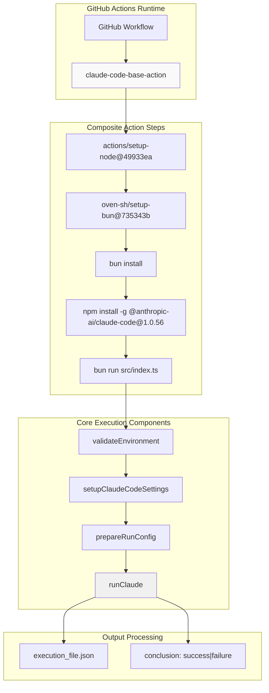
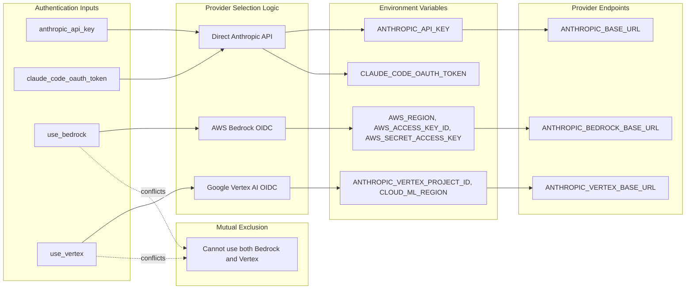
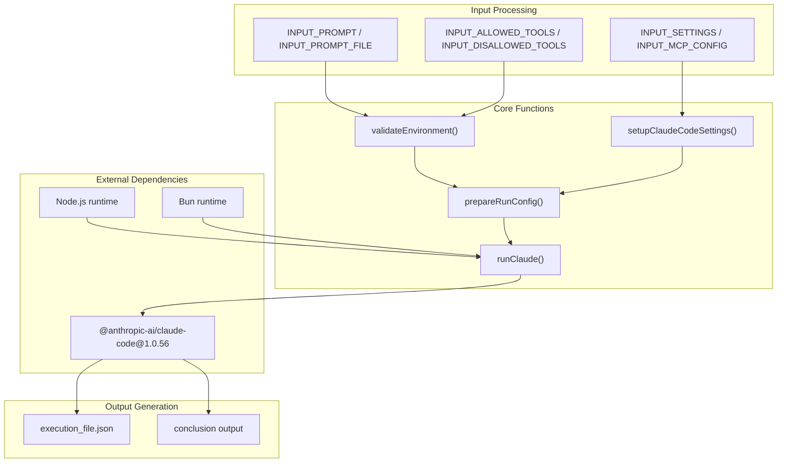

<!-- source: DeepWiki mcp.deepwiki.com · repo anthropics/claude-code-base-action · page 1 Overview · fetched 2026-10-26 -->

# Overview

Relevant source files

The following files were used as context for generating this wiki page:

- [MIRROR_DISCLAIMER.md](MIRROR_DISCLAIMER.md)
- [README.md](README.md)
- [action.yml](action.yml)

This document provides a high-level overview of the `claude-code-base-action` GitHub Action, which enables integration of Anthropic's Claude AI into GitHub Actions workflows. The action serves as a wrapper that orchestrates the execution of Claude Code within the GitHub Actions environment, handling authentication, configuration management, and output processing.

For detailed configuration options, see [Action Configuration](#3). For implementation specifics, see [Implementation Details](#4). For practical examples, see [Usage Examples](#5).

## Purpose and Architecture

The `claude-code-base-action` is a composite GitHub Action that provides a bridge between GitHub's workflow automation platform and Claude Code's AI capabilities. The action handles the complete lifecycle from environment setup to result processing, supporting multiple authentication providers and extensive configuration options.

### System Architecture

The action follows a multi-stage composite pattern that orchestrates several distinct phases:

**Sources:** [action.yml:96-167](), [README.md:12-16]()

### Authentication Provider Architecture

The action supports multiple authentication mechanisms with mutual exclusion validation:

**Sources:** [action.yml:65-81](), [action.yml:147-166](), [README.md:398-454]()

## Core Execution Flow

The action's main execution occurs through the `src/index.ts` entry point, which coordinates several key processes:

### Configuration Management

The action processes multiple configuration sources in a specific order:

| Configuration Type | Input Parameter | Environment Variable | Processing Function |
|-------------------|----------------|---------------------|-------------------|
| Claude Settings | `settings` | `INPUT_SETTINGS` | `setupClaudeCodeSettings` |
| MCP Configuration | `mcp_config` | `INPUT_MCP_CONFIG` | (processed in settings) |
| Environment Variables | `claude_env` | `INPUT_CLAUDE_ENV` | YAML parsing |
| System Prompts | `system_prompt`, `append_system_prompt` | `INPUT_SYSTEM_PROMPT`, `INPUT_APPEND_SYSTEM_PROMPT` | Direct assignment |

**Sources:** [action.yml:29-57](), [action.yml:130-145]()

### Key Components and Their Roles

The action architecture centers around several core functions that map to specific responsibilities:

**Sources:** [action.yml:116-129](), [action.yml:88-94]()

### Environment Variable Processing

The action implements a comprehensive environment variable system that bridges GitHub Actions inputs to Claude Code execution context:

| Category | Key Variables | Purpose |
|----------|--------------|---------|
| Model Configuration | `ANTHROPIC_MODEL`, `INPUT_FALLBACK_MODEL` | Claude model selection |
| Tool Control | `INPUT_ALLOWED_TOOLS`, `INPUT_DISALLOWED_TOOLS` | Tool permission management |
| Execution Control | `INPUT_MAX_TURNS`, `INPUT_TIMEOUT_MINUTES` | Runtime constraints |
| Provider Flags | `CLAUDE_CODE_USE_BEDROCK`, `CLAUDE_CODE_USE_VERTEX` | Authentication provider selection |

**Sources:** [action.yml:131-154]()

### Runtime Dependencies

The action orchestrates several runtime dependencies through its composite structure:

- **Node.js Runtime**: Managed via `actions/setup-node@49933ea5288caeca8642d1e84afbd3f7d6820020`
- **Bun Runtime**: Managed via `oven-sh/setup-bun@735343b667d3e6f658f44d0eca948eb6282f2b76`  
- **Claude Code CLI**: Installed as `@anthropic-ai/claude-code@1.0.56`
- **Action Dependencies**: Installed via `bun install` from the action's directory

**Sources:** [action.yml:99-118]()

This architecture enables the action to serve as a robust integration point between GitHub's automation platform and Claude's AI capabilities, while maintaining security, configurability, and extensibility across multiple cloud providers.

---

