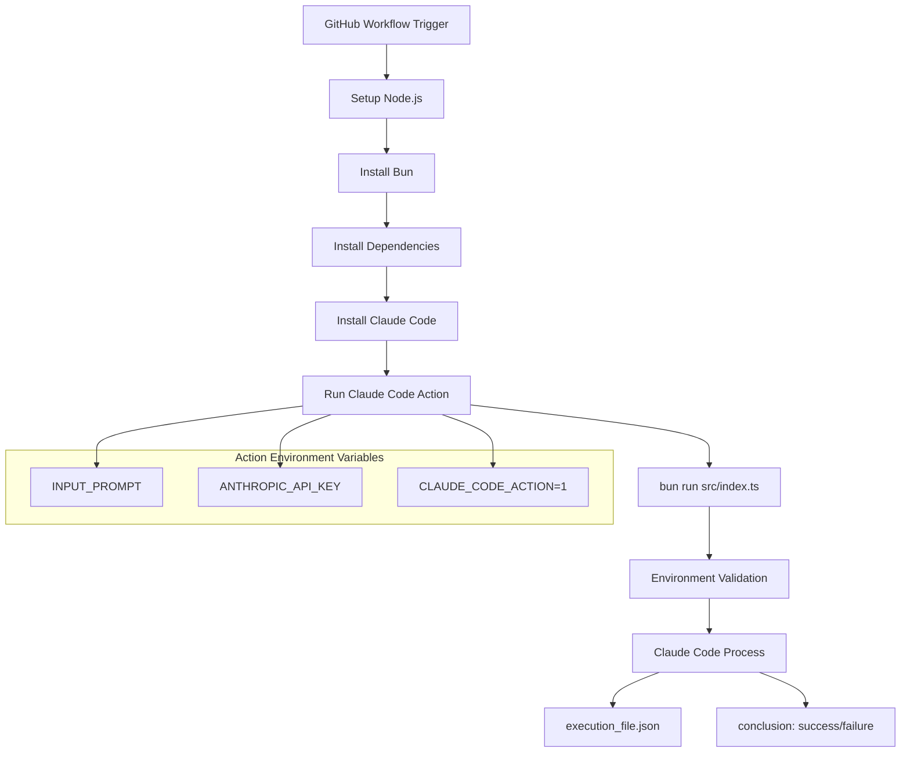
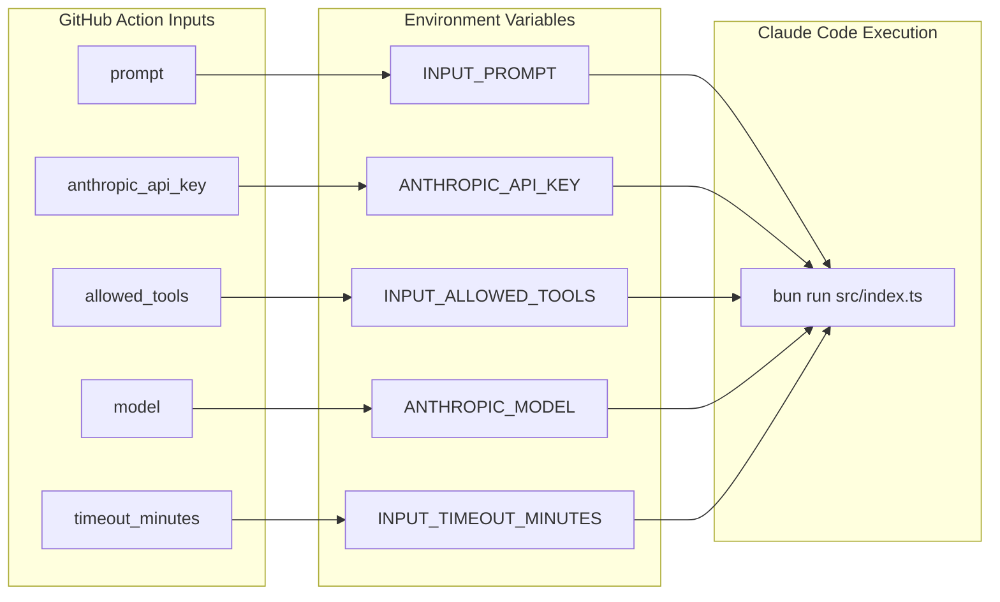

<!-- source: DeepWiki mcp.deepwiki.com · repo anthropics/claude-code-base-action · page 2 Getting Started · fetched 2026-10-26 -->

# Getting Started

<details>
<summary>Relevant source files</summary>

The following files were used as context for generating this wiki page:

- [MIRROR_DISCLAIMER.md](MIRROR_DISCLAIMER.md)
- [README.md](README.md)
- [action.yml](action.yml)

</details>


This document provides a quick start guide for integrating the claude-code-base-action into your GitHub workflows. It covers the basic setup process, essential configuration options, and minimal working examples to get you running Claude Code in your CI/CD pipeline.

For comprehensive configuration details, see [Action Configuration](#3). For real-world usage scenarios, see [Usage Examples](#5).

## Prerequisites

Before using this action, ensure you have:

- A GitHub repository with Actions enabled
- An Anthropic API key or Claude Code OAuth token stored as a repository secret
- Basic familiarity with GitHub Actions workflow syntax

## Quick Setup

The simplest way to run Claude Code in your workflow is with a direct prompt and API key authentication:

```yaml
- name: "Run Claude Code"
  uses: anthropics/claude-code-base-action@beta
  with:
    prompt: "Review the codebase and suggest improvements"
    anthropic_api_key: ${{ secrets.ANTHROPIC_API_KEY }}
```

This minimal configuration will execute Claude Code with default settings in your repository context.

**Sources:** [action.yml:22-29](), [README.md:22-29]()

## Action Execution Flow

The following diagram shows how the GitHub Action orchestrates Claude Code execution:

**GitHub Action Composite Steps Flow**



**Sources:** [action.yml:96-167](), [action.yml:120-129]()

## Input Configuration Mapping

This diagram shows how GitHub Action inputs map to internal environment variables:

**Input to Environment Variable Mapping**



**Sources:** [action.yml:130-167](), [action.yml:7-86]()

## Essential Inputs

The most commonly used action inputs are:

| Input | Purpose | Example Value |
|-------|---------|---------------|
| `prompt` | Direct text prompt for Claude | `"Review this pull request"` |
| `prompt_file` | Path to prompt file | `".github/prompts/review.txt"` |
| `anthropic_api_key` | Anthropic API authentication | `${{ secrets.ANTHROPIC_API_KEY }}` |
| `allowed_tools` | Restrict tool usage | `"Bash(git:*),View,GlobTool"` |
| `model` | Specify Claude model | `"claude-3-7-sonnet-20250219"` |
| `timeout_minutes` | Execution timeout | `"15"` |

**Sources:** [action.yml:7-86](), [README.md:98-121]()

## Authentication Options

The action supports multiple authentication methods:

```yaml
# Option 1: Anthropic API Key (most common)
- uses: anthropics/claude-code-base-action@beta
  with:
    prompt: "Your task here"
    anthropic_api_key: ${{ secrets.ANTHROPIC_API_KEY }}

# Option 2: OAuth Token
- uses: anthropics/claude-code-base-action@beta
  with:
    prompt: "Your task here"
    claude_code_oauth_token: ${{ secrets.CLAUDE_CODE_OAUTH_TOKEN }}

# Option 3: AWS Bedrock (requires OIDC setup)
- uses: anthropics/claude-code-base-action@beta
  with:
    prompt: "Your task here"
    use_bedrock: "true"
    model: "anthropic.claude-3-7-sonnet-20250219-v1:0"
```

**Sources:** [action.yml:65-81](), [README.md:400-454]()

## Working with Outputs

The action provides two key outputs for workflow integration:

```yaml
- name: "Run Claude Code"
  id: claude_step
  uses: anthropics/claude-code-base-action@beta
  with:
    prompt: "Analyze the codebase"
    anthropic_api_key: ${{ secrets.ANTHROPIC_API_KEY }}

- name: "Check Result"
  if: steps.claude_step.outputs.conclusion == 'success'
  run: |
    echo "Claude execution completed successfully"
    cat "${{ steps.claude_step.outputs.execution_file }}"
```

The `execution_file` output contains the complete JSON conversation log, while `conclusion` indicates success or failure status.

**Sources:** [action.yml:88-94](), [README.md:123-128]()

## Basic Workflow Example

Here's a complete minimal workflow file:

```yaml
name: "Claude Code Review"
on:
  pull_request:
    types: [opened, synchronize]

jobs:
  review:
    runs-on: ubuntu-latest
    steps:
      - name: "Checkout"
        uses: actions/checkout@v4
        
      - name: "Run Claude Review"
        uses: anthropics/claude-code-base-action@beta
        with:
          prompt: "Review the changes in this pull request for code quality issues"
          allowed_tools: "Bash(git:*),View,GlobTool,GrepTool"
          anthropic_api_key: ${{ secrets.ANTHROPIC_API_KEY }}
          timeout_minutes: "10"
```

**Sources:** [README.md:341-395]()

## Next Steps

Once you have the basic action running:

1. **Configure Advanced Options** - See [Action Configuration](#3) for detailed input/output reference and authentication methods
2. **Add Tool Restrictions** - Use `allowed_tools` and `disallowed_tools` to control Claude's capabilities
3. **Integrate with Workflows** - Use the `conclusion` and `execution_file` outputs in subsequent steps
4. **Explore Examples** - Check [Usage Examples](#5) for real-world implementation patterns

For local development and testing, see [Development Guide](#6).

**Sources:** [README.md:1-535](), [action.yml:1-167]()

---

