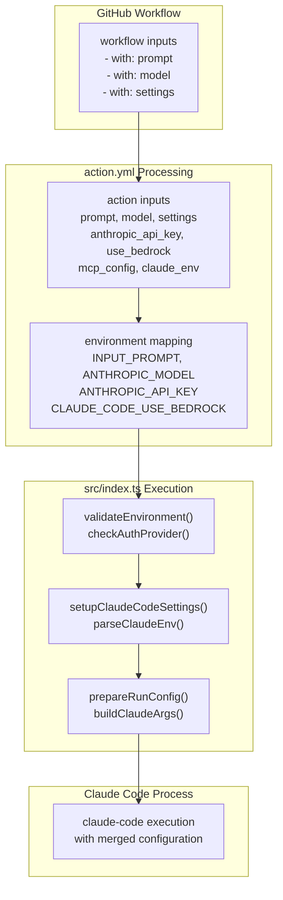
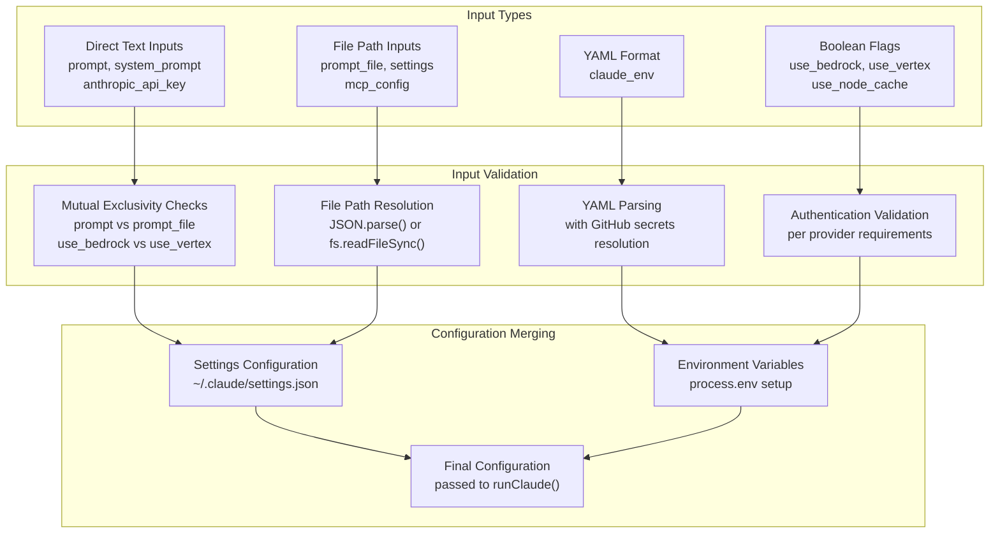
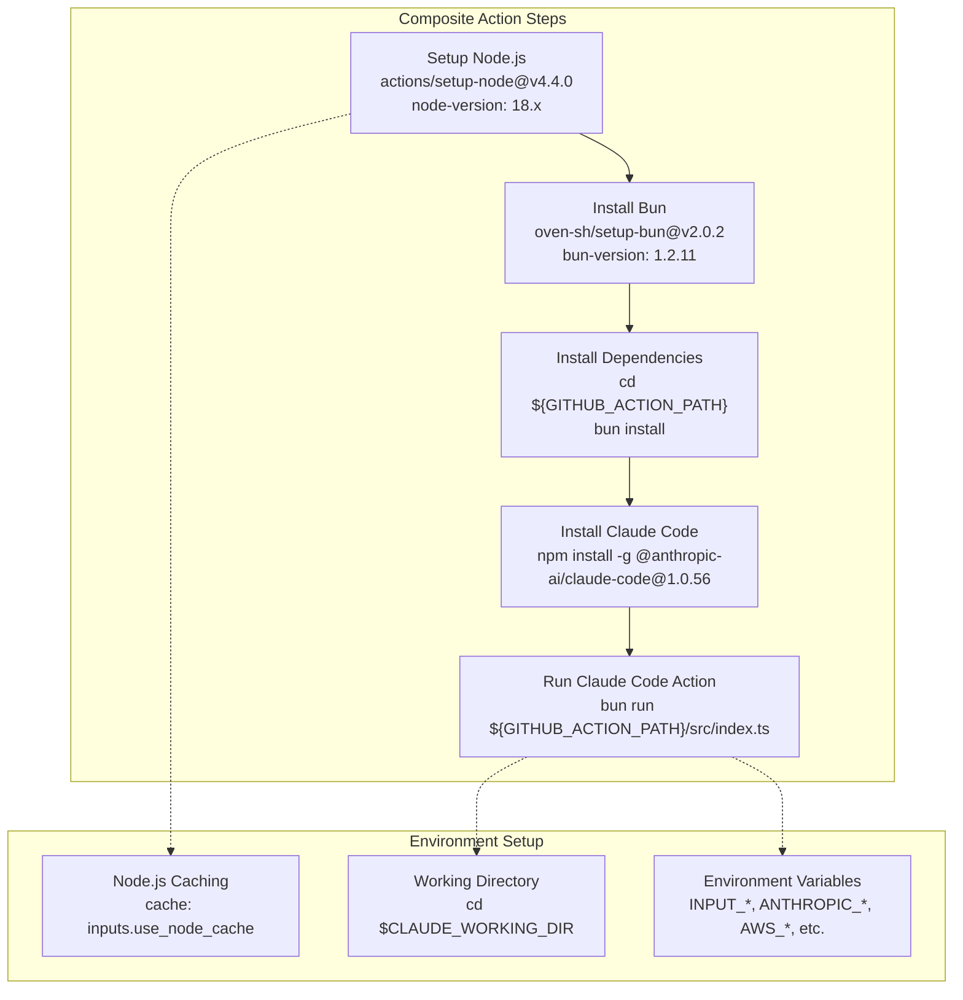

<!-- source: DeepWiki mcp.deepwiki.com · repo anthropics/claude-code-base-action · page 3 Action Configuration · fetched 2026-10-26 -->

# Action Configuration

Relevant source files

The following files were used as context for generating this wiki page:

- [action.yml](action.yml)

This document provides a comprehensive guide to configuring the `claude-code-base-action` GitHub Action. It covers all available inputs, outputs, and configuration options, showing how to customize the action's behavior for different use cases and authentication methods.

For specific details about individual inputs and outputs, see [Inputs and Outputs](#3.1). For authentication setup, see [Authentication Methods](#3.2). For advanced configuration including Claude Code settings and MCP servers, see [Settings and MCP Configuration](#3.3).

## Configuration Overview

The action accepts configuration through GitHub Action inputs defined in `action.yml`, which are then mapped to environment variables and passed to the underlying Claude Code execution system. The configuration system supports multiple authentication providers, flexible prompt handling, tool restrictions, and custom environment setup.

## Configuration Flow

The following diagram shows how configuration flows from GitHub workflow inputs through the action's internal systems:

**Sources:** [action.yml:7-167]()

## Configuration Categories

The action's configuration is organized into several categories, each serving different aspects of the execution:

| Category | Purpose | Key Inputs |
|----------|---------|------------|
| **Prompt Configuration** | Define the task for Claude | `prompt`, `prompt_file`, `system_prompt`, `append_system_prompt` |
| **Model Configuration** | Control which AI model to use | `model`, `fallback_model` |
| **Tool Configuration** | Control Claude's available capabilities | `allowed_tools`, `disallowed_tools` |
| **Authentication** | Configure API access | `anthropic_api_key`, `use_bedrock`, `use_vertex` |
| **Execution Control** | Control runtime behavior | `timeout_minutes`, `max_turns` |
| **Advanced Configuration** | Custom settings and environment | `settings`, `mcp_config`, `claude_env` |

**Sources:** [action.yml:8-86]()

## Input Processing Architecture

This diagram shows how the action processes and validates different types of configuration inputs:

**Sources:** [action.yml:8-86]()

## Action Outputs

The action provides two primary outputs that workflows can access:

| Output | Description | Value Source |
|--------|-------------|--------------|
| `conclusion` | Execution status | `${{ steps.run_claude.outputs.conclusion }}` - either `'success'` or `'failure'` |
| `execution_file` | Path to execution log | `${{ steps.run_claude.outputs.execution_file }}` - JSON file with detailed execution data |

These outputs are generated by the `run_claude` step and can be used by subsequent workflow steps for conditional logic or artifact collection.

**Sources:** [action.yml:88-94]()

## Composite Action Structure  

The action uses GitHub's composite action pattern with the following execution steps:

**Sources:** [action.yml:96-167]()

## Environment Variable Mapping

The action maps GitHub Action inputs to environment variables that the TypeScript execution code can access:

| Input Category | GitHub Input | Environment Variable |
|----------------|--------------|---------------------|
| **Prompt Configuration** | `prompt` | `INPUT_PROMPT` |
| **Model Configuration** | `model` | `ANTHROPIC_MODEL` |
| **Authentication** | `anthropic_api_key` | `ANTHROPIC_API_KEY` |
| **Provider Flags** | `use_bedrock` | `CLAUDE_CODE_USE_BEDROCK` |
| **Advanced Config** | `settings` | `INPUT_SETTINGS` |
| **Custom Environment** | `claude_env` | `INPUT_CLAUDE_ENV` |

The environment variable mapping follows a consistent pattern where action inputs are prefixed with `INPUT_` while provider-specific variables use their standard names (e.g., `ANTHROPIC_API_KEY`, `AWS_REGION`).

**Sources:** [action.yml:130-167]()

---

