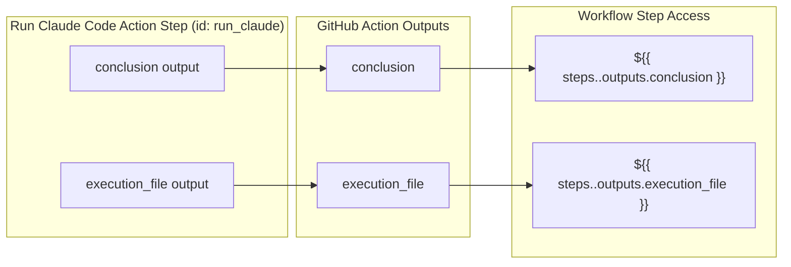

<!-- source: DeepWiki mcp.deepwiki.com · repo anthropics/claude-code-base-action · page 3.1 Inputs and Outputs · fetched 2026-10-26 -->

# Inputs and Outputs

<details>
<summary>Relevant source files</summary>

The following files were used as context for generating this wiki page:

- [MIRROR_DISCLAIMER.md](MIRROR_DISCLAIMER.md)
- [README.md](README.md)
- [action.yml](action.yml)

</details>


This document provides a detailed reference for all input parameters and output values supported by the claude-code-base-action GitHub Action. These parameters allow you to configure how Claude Code is executed within your GitHub workflows and retrieve the results of the execution.

For information about authentication methods, see [Authentication Methods](#3.2). For MCP configuration details, see [MCP Configuration](#3.3).

## Input Parameters

The claude-code-base-action accepts the following input parameters to configure its behavior:

```mermaid
flowchart TD
  subgraph InputParameters["Input Parameters"]
    direction TB
    subgraph PromptConfiguration["Prompt Configuration"]
      direction TB
      prompt[prompt]
      prompt_file[prompt_file]
    end
    subgraph ToolConfiguration["Tool Configuration"]
      direction TB
      allowed_tools[allowed_tools]
      disallowed_tools[disallowed_tools]
      mcp_config[mcp_config]
    end
    subgraph ModelConfiguration["Model Configuration"]
      direction TB
      anthropic_model[anthropic_model]
    end
    subgraph ExecutionConfiguration["Execution Configuration"]
      direction TB
      max_turns[max_turns]
      timeout_minutes[timeout_minutes]
      use_node_cache[use_node_cache]
    end
    subgraph AuthenticationConfiguration["Authentication Configuration"]
      direction TB
      anthropic_api_key[anthropic_api_key]
      use_bedrock[use_bedrock]
      use_vertex[use_vertex]
    end
  end

```



Sources: [action.yml:7-61](), [README.md:38-54]()

### Prompt Configuration

| Parameter | Description | Required | Default | Notes |
|-----------|-------------|----------|---------|-------|
| `prompt` | The prompt to send to Claude Code | No* | `""` | Mutually exclusive with `prompt_file` |
| `prompt_file` | Path to a file containing the prompt to send to Claude Code | No* | `""` | Mutually exclusive with `prompt` |

*Either `prompt` or `prompt_file` must be provided, but not both.

The prompt is the primary instruction given to Claude Code for analysis or task execution. You can provide it either inline in your workflow file using the `prompt` parameter or reference an external file using the `prompt_file` parameter.

Sources: [action.yml:9-16](), [README.md:42-43]()

### Tool Configuration

| Parameter | Description | Required | Default | Notes |
|-----------|-------------|----------|---------|-------|
| `allowed_tools` | Comma-separated list of allowed tools for Claude Code to use | No | `""` | Example: `"Bash(git:*),View,GlobTool"` |
| `disallowed_tools` | Comma-separated list of disallowed tools that Claude Code cannot use | No | `""` | Overrides `allowed_tools` when both are specified |
| `mcp_config` | MCP configuration as JSON string or path to MCP configuration JSON file | No | `""` | Used for custom MCP server configuration |

Tools determine what capabilities Claude Code can use to interact with your repository. Common tools include:
- `Bash`: Execute shell commands (can be scoped, e.g., `Bash(git:*)`)
- `View`: Read file contents
- `GlobTool`: Find files using glob patterns
- `GrepTool`: Search file contents
- `BatchTool`: Process files in batches
- `Write`: Write to files

Custom MCP tools follow the format `mcp__server-name__tool_name`.

Sources: [action.yml:17-32](), [README.md:44-47]()

### Model Configuration

| Parameter | Description | Required | Default | Notes |
|-----------|-------------|----------|---------|-------|
| `model` | Model to use | No | - | Provider-specific format required for Bedrock/Vertex |
| `anthropic_model` | DEPRECATED: Use 'model' instead | No | - | Maintained for backwards compatibility |
| `fallback_model` | Enable automatic fallback to specified model when default model is unavailable | No | `""` | Used for handling API errors/overload |

The model name format depends on the provider:
- Direct Anthropic API: `"claude-3-7-sonnet-20250219"` 
- AWS Bedrock: `"anthropic.claude-3-7-sonnet-20250219-v1:0"`
- Google Vertex AI: `"claude-3-7-sonnet@20250219"`

Sources: [action.yml:45-53](), [README.md:111-113]()

### Execution Configuration

| Parameter | Description | Required | Default | Notes |
|-----------|-------------|----------|---------|-------|
| `max_turns` | Maximum number of conversation turns | No | No limit | Limits the back-and-forth between the action and Claude |
| `timeout_minutes` | Timeout in minutes for Claude Code execution | No | `"10"` | Terminates execution if it exceeds this duration |
| `use_node_cache` | Whether to use Node.js dependency caching | No | `"false"` | Set to `"true"` only for Node.js projects with lock files |

Sources: [action.yml:25-29](), [action.yml:39-42](), [action.yml:58-61](), [README.md:46-49](), [README.md:53]()

### Authentication Configuration

| Parameter | Description | Required | Default | Notes |
|-----------|-------------|----------|---------|-------|
| `anthropic_api_key` | Anthropic API key | No* | `""` | Required for direct Anthropic API |
| `use_bedrock` | Use Amazon Bedrock with OIDC authentication | No | `"false"` | Mutually exclusive with direct API and Vertex |
| `use_vertex` | Use Google Vertex AI with OIDC authentication | No | `"false"` | Mutually exclusive with direct API and Bedrock |

*Required only if using direct Anthropic API (not using Bedrock or Vertex).

For OIDC authentication with AWS Bedrock or Google Vertex AI, additional setup steps are required before using this action. See [Authentication Methods](#3.2) for details.

Sources: [action.yml:45-56](), [README.md:50-52]()

## Input Parameter Mapping

The following diagram shows how input parameters are mapped to environment variables used by the action:

```mermaid
flowchart TD
    subgraph GitHub_Workflow["GitHub Workflow"]
        subgraph Action_Inputs["Action Inputs"]
            i_prompt["prompt"]
            i_prompt_file["prompt_file"]
            i_allowed_tools["allowed_tools"]
            i_disallowed_tools["disallowed_tools"]
            i_max_turns["max_turns"]
            i_mcp_config["mcp_config"]
            i_anthropic_model["anthropic_model"]
            i_timeout_minutes["timeout_minutes"]
            i_anthropic_api_key["anthropic_api_key"]
            i_use_bedrock["use_bedrock"]
            i_use_vertex["use_vertex"]
        end
    end

    subgraph Environment_Variables["Environment Variables"]
        e_prompt["INPUT_PROMPT"]
        e_prompt_file["INPUT_PROMPT_FILE"]
        e_allowed_tools["INPUT_ALLOWED_TOOLS"]
        e_disallowed_tools["INPUT_DISALLOWED_TOOLS"]
        e_max_turns["INPUT_MAX_TURNS"]
        e_mcp_config["INPUT_MCP_CONFIG"]
        e_anthropic_model["ANTHROPIC_MODEL"]
        e_timeout_minutes["INPUT_TIMEOUT_MINUTES"]
        e_anthropic_api_key["ANTHROPIC_API_KEY"]
        e_use_bedrock["CLAUDE_CODE_USE_BEDROCK"]
        e_use_vertex["CLAUDE_CODE_USE_VERTEX"]
    end

    i_prompt --> e_prompt
    i_prompt_file --> e_prompt_file
    i_allowed_tools --> e_allowed_tools
    i_disallowed_tools --> e_disallowed_tools
    i_max_turns --> e_max_turns
    i_mcp_config --> e_mcp_config
    i_anthropic_model --> e_anthropic_model
    i_timeout_minutes --> e_timeout_minutes
    i_anthropic_api_key --> e_anthropic_api_key
    i_use_bedrock --> e_use_bedrock
    i_use_vertex --> e_use_vertex

```



Sources: [action.yml:96-129]()

### Configuration and Environment

| Parameter | Description | Required | Default | Notes |
|-----------|-------------|----------|---------|-------|
| `settings` | Claude Code settings as JSON string or path to settings JSON file | No | `""` | Configures Claude Code behavior |
| `system_prompt` | Override system prompt | No | `""` | Replaces the default system prompt |
| `append_system_prompt` | Append to system prompt | No | `""` | Adds to the default system prompt |
| `claude_env` | Custom environment variables to pass to Claude Code execution (YAML multiline format) | No | `""` | YAML key-value pairs |

### Execution Configuration

| Parameter | Description | Required | Default | Notes |
|-----------|-------------|----------|---------|-------|
| `max_turns` | Maximum number of conversation turns | No | No limit | Limits the back-and-forth between the action and Claude |
| `timeout_minutes` | Timeout in minutes for Claude Code execution | No | `"10"` | Terminates execution if it exceeds this duration |
| `use_node_cache` | Whether to use Node.js dependency caching | No | `"false"` | Set to `"true"` only for Node.js projects with lock files |

Sources: [action.yml:25-28](), [action.yml:33-57](), [action.yml:60-63](), [action.yml:83-86](), [README.md:107-114]()

## Input Parameter Mapping to Environment Variables

The following diagram shows how action inputs are mapped to environment variables in the composite action execution environment:

```mermaid
flowchart TD
    subgraph Action_Inputs["GitHub Action Inputs"]
        i_prompt["prompt"]
        i_prompt_file["prompt_file"]
        i_allowed_tools["allowed_tools"]
        i_disallowed_tools["disallowed_tools"]
        i_max_turns["max_turns"]
        i_mcp_config["mcp_config"]
        i_settings["settings"]
        i_system_prompt["system_prompt"]
        i_append_system_prompt["append_system_prompt"]
        i_model["model"]
        i_anthropic_model["anthropic_model"]
        i_fallback_model["fallback_model"]
        i_claude_env["claude_env"]
        i_timeout_minutes["timeout_minutes"]
        i_anthropic_api_key["anthropic_api_key"]
        i_claude_code_oauth_token["claude_code_oauth_token"]
        i_use_bedrock["use_bedrock"]
        i_use_vertex["use_vertex"]
    end

    subgraph Composite_Action_Environment["Composite Action Environment Variables"]
        e_prompt["INPUT_PROMPT"]
        e_prompt_file["INPUT_PROMPT_FILE"]
        e_allowed_tools["INPUT_ALLOWED_TOOLS"]
        e_disallowed_tools["INPUT_DISALLOWED_TOOLS"]
        e_max_turns["INPUT_MAX_TURNS"]
        e_mcp_config["INPUT_MCP_CONFIG"]
        e_settings["INPUT_SETTINGS"]
        e_system_prompt["INPUT_SYSTEM_PROMPT"]
        e_append_system_prompt["INPUT_APPEND_SYSTEM_PROMPT"]
        e_anthropic_model["ANTHROPIC_MODEL"]
        e_fallback_model["INPUT_FALLBACK_MODEL"]
        e_claude_env["INPUT_CLAUDE_ENV"]
        e_timeout_minutes["INPUT_TIMEOUT_MINUTES"]
        e_anthropic_api_key["ANTHROPIC_API_KEY"]
        e_claude_code_oauth_token["CLAUDE_CODE_OAUTH_TOKEN"]
        e_use_bedrock["CLAUDE_CODE_USE_BEDROCK"]
        e_use_vertex["CLAUDE_CODE_USE_VERTEX"]
    end

    i_prompt --> e_prompt
    i_prompt_file --> e_prompt_file
    i_allowed_tools --> e_allowed_tools
    i_disallowed_tools --> e_disallowed_tools
    i_max_turns --> e_max_turns
    i_mcp_config --> e_mcp_config
    i_settings --> e_settings
    i_system_prompt --> e_system_prompt
    i_append_system_prompt --> e_append_system_prompt
    i_model --> e_anthropic_model
    i_anthropic_model --> e_anthropic_model
    i_fallback_model --> e_fallback_model
    i_claude_env --> e_claude_env
    i_timeout_minutes --> e_timeout_minutes
    i_anthropic_api_key --> e_anthropic_api_key
    i_claude_code_oauth_token --> e_claude_code_oauth_token
    i_use_bedrock --> e_use_bedrock
    i_use_vertex --> e_use_vertex
```



Note that both `model` and `anthropic_model` inputs map to the same `ANTHROPIC_MODEL` environment variable, with `model` taking precedence when both are provided.

Sources: [action.yml:130-167]()
</old_str>

<old_str>
## Output Parameters

The claude-code-base-action produces the following outputs after execution:

| Parameter | Description | Access Pattern |
|-----------|-------------|----------------|
| `conclusion` | Execution status of Claude Code ('success' or 'failure') | `${{ steps.<step-id>.outputs.conclusion }}` |
| `execution_file` | Path to the JSON file containing Claude Code execution log | `${{ steps.<step-id>.outputs.execution_file }}` |

The `execution_file` output contains a JSON representation of the entire conversation between your workflow and Claude, including all messages and tool executions. This file can be read and processed in subsequent steps of your workflow.

Sources: [action.yml:63-69](), [README.md:57-62]()
</old_str>
<new_str>
## Output Parameters

The claude-code-base-action produces the following outputs after execution:

### Action Outputs Reference

| Parameter | Description | Access Pattern | Source Step |
|-----------|-------------|----------------|-------------|
| `conclusion` | Execution status of Claude Code ('success' or 'failure') | `${{ steps.<step-id>.outputs.conclusion }}` | `steps.run_claude.outputs.conclusion` |
| `execution_file` | Path to the JSON file containing Claude Code execution log | `${{ steps.<step-id>.outputs.execution_file }}` | `steps.run_claude.outputs.execution_file` |

### Output Value Mapping

The outputs are generated by the `run_claude` composite action step and mapped as follows:



The `execution_file` output contains a JSON representation of the entire conversation between your workflow and Claude, including all messages and tool executions. This file can be read and processed in subsequent steps of your workflow.

Sources: [action.yml:88-94](), [action.yml:120-122](), [README.md:125-128]()

## Usage Examples

### Basic Usage with Direct Prompt

```yaml
- name: Run Claude Code with direct prompt
  id: claude-analysis
  uses: anthropics/claude-code-base-action@beta
  with:
    prompt: "Analyze the codebase for security vulnerabilities"
    allowed_tools: "Bash(git:*),View,GlobTool,GrepTool"
    anthropic_api_key: ${{ secrets.ANTHROPIC_API_KEY }}
```

### Using a Prompt File

```yaml
- name: Run Claude Code with prompt file
  id: claude-analysis
  uses: anthropics/claude-code-base-action@beta
  with:
    prompt_file: ".github/prompts/security-analysis.txt"
    allowed_tools: "Bash(git:*),View,GlobTool,GrepTool"
    anthropic_api_key: ${{ secrets.ANTHROPIC_API_KEY }}
```

### Limiting Conversation Turns

```yaml
- name: Run Claude Code with limited turns
  id: claude-analysis
  uses: anthropics/claude-code-base-action@beta
  with:
    prompt: "Analyze the codebase for security vulnerabilities"
    allowed_tools: "Bash(git:*),View,GlobTool,GrepTool"
    max_turns: "5"
    anthropic_api_key: ${{ secrets.ANTHROPIC_API_KEY }}
```

### Accessing and Using Outputs

```yaml
- name: Run Claude Code
  id: claude-analysis
  uses: anthropics/claude-code-base-action@beta
  with:
    prompt: "Analyze the codebase for security vulnerabilities"
    allowed_tools: "Bash(git:*),View,GlobTool,GrepTool,Write"
    anthropic_api_key: ${{ secrets.ANTHROPIC_API_KEY }}

- name: Process Claude Analysis Results
  if: steps.claude-analysis.outputs.conclusion == 'success'
  uses: actions/github-script@v7
  with:
    github-token: ${{ secrets.GITHUB_TOKEN }}
    script: |
      const fs = require('fs');
      const executionFile = '${{ steps.claude-analysis.outputs.execution_file }}';
      const executionLog = JSON.parse(fs.readFileSync(executionFile, 'utf8'));
      
      // Process the execution log
      let analysis = '';
      for (let i = executionLog.length - 1; i >= 0; i--) {
        if (executionLog[i].role === 'assistant') {
          analysis = executionLog[i].content;
          break;
        }
      }
      
      // Create an issue with the analysis
      if (analysis) {
        github.rest.issues.create({
          owner: context.repo.owner,
          repo: context.repo.repo,
          title: 'Security Analysis Report',
          body: analysis
        });
      }
```

Sources: [README.md:7-36](), [README.md:109-164]()

## Best Practices

1. **Prompt Selection**: Choose between `prompt` and `prompt_file` based on complexity. Use `prompt_file` for longer or more complex prompts.

2. **Tool Configuration**: Only provide the minimum tools required for the task to limit Claude's capabilities.

3. **Timeout Management**: Set `timeout_minutes` appropriately for your use case. Complex analyses might need longer timeouts.

4. **Error Handling**: Always check the `conclusion` output before processing the execution log.

5. **Security**: Never hardcode API keys or credentials in your workflow files. Always use GitHub Secrets.

```yaml
# ✅ CORRECT - Uses GitHub secrets
anthropic_api_key: ${{ secrets.ANTHROPIC_API_KEY }}

# ❌ WRONG - Exposes your API key
anthropic_api_key: "sk-ant-..."
```

6. **Authentication Method Selection**: Choose the appropriate authentication method based on your requirements and existing infrastructure.

7. **Model Selection**: Use the correct model name format based on your chosen provider.

Sources: [README.md:264-298]()

---

